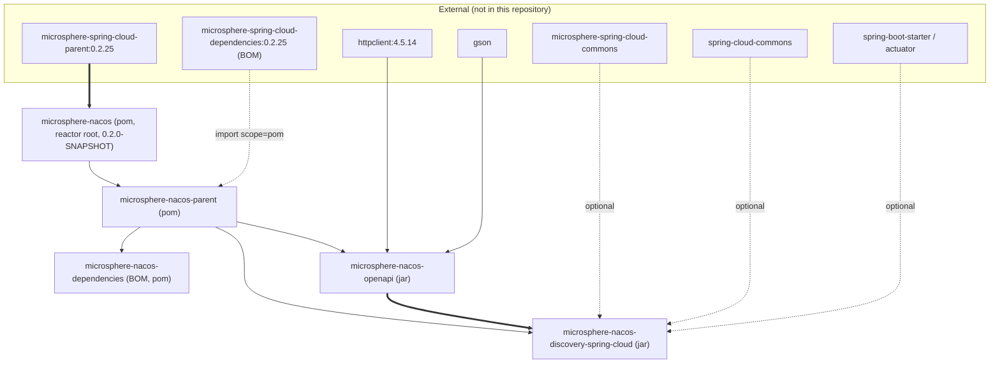

# Microsphere Nacos 1.x — Developer Guide

This is the developer guide for the **`1.x`** version line of `microsphere-nacos`. It documents the internal design
of the code you are about to modify: package layering, class responsibilities, the patterns the code actually uses,
extension points, and the build-and-test workflow that this snapshot ships with.

Everything below was read from a single source of truth.

## Source of truth and provenance

| Item | Value | Evidence |
| --- | --- | --- |
| Analyzed tree | `release-1.x` branch snapshot | `.docs-work/release-1x` Git worktree |
| Commit at the tip | `e6769812884e5753032e912c00845e85e7f05f4e` — "Migrate project build from Gradle to Maven" | `git log -1` |
| Reactor root | `io.github.microsphere-projects:microsphere-nacos:${revision}` (`pom`) | `pom.xml` |
| `${revision}` | `0.2.0-SNAPSHOT` | `pom.xml`, `<properties>` |
| `java.version` | `17` | `pom.xml`, `<properties>` |
| External parent | `microsphere-spring-cloud-parent:0.2.25` | `pom.xml`, `<parent>` |
| Imported BOM | `microsphere-spring-cloud-dependencies:0.2.25` | `microsphere-nacos-parent/pom.xml` |

**Provenance rule used throughout this guide.** Versions that live inside this repository (`${revision}`,
`httpclient 4.5.14`, `0.2.25`, the Maven wrapper versions) are stated as facts. Versions that live in the *external*
parent or the *external* imported BOM — Spring Boot, Spring Cloud, JUnit, Gson, Logback, and the Maven plugin and
profile definitions — are **not verifiable from this snapshot** and are always attributed to
`microsphere-spring-cloud-parent:0.2.25` / `microsphere-spring-cloud-dependencies:0.2.25` rather than being quoted as
numbers. Never invent them.

### Differences from the default (`release`) line

The reactor, the module list, the package layout and all Java sources in this line are the same as the `release`
snapshot. The differences are build-side only:

| Aspect | `1.x` (this line) | default line |
| --- | --- | --- |
| External parent | `microsphere-spring-cloud-parent:0.2.25` | `0.2.26` |
| Imported BOM | `microsphere-spring-cloud-dependencies:0.2.25` | `0.2.26` |
| `httpclient` pin | `4.5.14`, pinned in `microsphere-nacos-parent` | pinned in the same place |
| Branch tip | the Gradle-to-Maven build-migration commit | later history |

Because the Spring Cloud baseline is one patch behind, any dependency version you resolve while working on `1.x` may
differ from the value you get on the default line. Re-read `microsphere-nacos-parent/pom.xml` rather than assuming.

## Reactor at a glance

`pom.xml` declares four active modules and two disabled ones:

| Module | Artifact ID | Packaging | Source files (main) | Tests (main-line) |
| --- | --- | --- | --- | --- |
| Parent | `microsphere-nacos-parent` | `pom` | n/a | n/a |
| Dependencies (BOM) | `microsphere-nacos-dependencies` | `pom` | n/a | n/a |
| OpenAPI | `microsphere-nacos-openapi` | `jar` | 118 `.java` | 21 `.java` |
| Discovery Spring Cloud | `microsphere-nacos-discovery-spring-cloud` | `jar` | 10 `.java` | none |

```xml
<modules>
    <module>microsphere-nacos-parent</module>
    <module>microsphere-nacos-dependencies</module>
    <module>microsphere-nacos-openapi</module>
    <!-- <module>microsphere-nacos-spring</module> -->
    <!-- <module>microsphere-nacos-spring-boot</module> -->
    <module>microsphere-nacos-discovery-spring-cloud</module>
</modules>
```

`microsphere-nacos-spring` and `microsphere-nacos-spring-boot` are commented out. **No directories for them exist in
this snapshot**, so they are not buildable and not documented here. Do not add code that assumes they will come back.

## Module and inheritance structure

Two distinct relationships are in play, and confusing them is the most common mistake when editing the POMs:

- **inheritance** (`<parent>`), which supplies plugin management, properties and `dependencyManagement`;
- **dependency** (a `<dependency>` on `microsphere-nacos-openapi`), which supplies classes.



Read this as: the reactor root's own `<parent>` is the *external* `microsphere-spring-cloud-parent`, and
`microsphere-nacos-parent` is a `pom`-packaged child of the root that the two jar modules inherit. So the effective
inheritance chain for a jar module is
`module -> microsphere-nacos-parent -> microsphere-nacos -> microsphere-spring-cloud-parent:0.2.25`.

Note also that `microsphere-nacos-discovery-spring-cloud` declares its one compile dependency with an explicit
`<version>${revision}</version>` instead of relying on the BOM it inherits, so importing
`microsphere-nacos-dependencies` in your own build is *not* required to build this repository.

## Build and test workflow (as the files define it)

### Local build

The repository is Maven-only at this commit. Wrapper files are committed:

| File | Value |
| --- | --- |
| `.mvn/wrapper/maven-wrapper.properties` | `distributionUrl` = Apache Maven `3.9.0`; `wrapperUrl` = maven-wrapper `3.1.1` |
| `mvnw`, `mvnw.cmd` | POSIX and Windows wrapper scripts |

```bash
./mvnw package
```

```powershell
mvnw.cmd package
```

The version is a CI parameter, never hard-coded outside `<revision>`: `-Drevision=<value>`. Omitting it yields
`0.2.0-SNAPSHOT` from `pom.xml`.

### CI matrix

`.github/workflows/maven-build.yml` defines the matrix verbatim:

```yaml
matrix:
  java: [ '17' , '21' , '25' ]
  maven-profile-spring-cloud: [ 'spring-cloud-2022' , 'spring-cloud-2023' , 'spring-cloud-2024' ,
                                'spring-cloud-2025' ]
```

and the build step is:

```text
mvn --batch-mode --update-snapshots --file pom.xml -Drevision=0.0.1-SNAPSHOT test
    --activate-profiles test,coverage,spring-cloud-<year>
```

Two things to keep in mind when you touch the build:

- The four `spring-cloud-*` profiles, plus `test`, `coverage`, `publish` and `ci`, are **defined in the external
  `microsphere-spring-cloud-parent:0.2.25`**, not in this repository. You cannot see or edit them from here; a profile
  that does not resolve in CI is a parent-version problem, not a module problem.
- CI pins `-Drevision=0.0.1-SNAPSHOT` for the test run. That value exists only to keep test builds from colliding with
  published coordinates; it is not the version line.

### Tests need a running Nacos server

The integration tests are *not* self-contained. `OpenApiTest` (at
`microsphere-nacos-openapi/src/test/java/io/microsphere/nacos/client/OpenApiTest.java`) fails fast without a server
address:

```java
protected static final String SERVER_ADDRESS_PROPERTY_NAME = "SERVER_ADDRESS";

static String getServerAddress() {
    String key = SERVER_ADDRESS_PROPERTY_NAME;
    return System.getProperty(key, System.getenv(key));
}

@BeforeEach
public void init() {
    String serverAddress = getServerAddress();
    if (serverAddress == null) {
        String errorMessage = format("The Java System Property[ name : '%s' ] for Nacos Server must be set!", SERVER_ADDRESS_PROPERTY_NAME);
        throw new IllegalArgumentException(errorMessage);
    }
    NacosClientConfig config = new NacosClientConfig();
    config.setServerAddress(serverAddress);
    customize(config);
    this.openApiClient = new OpenApiHttpClient(config);
    this.nacosClientConfig = config;

    setup();
}
```

Consequences for your workflow:

1. `-DSERVER_ADDRESS=127.0.0.1:8848` (or the `SERVER_ADDRESS` environment variable) is mandatory for the 21 tests in
   `microsphere-nacos-openapi`.
2. Tests authenticate as `nacos`/`nacos` (`USER_NAME` / `PASSWORD` constants in `OpenApiTest`), and use the namespace
   `test` and group `test-group`.
3. `@AfterEach destroy()` closes the `OpenApiClient`, so each test method builds a real connection pool.
4. `microsphere-nacos-discovery-spring-cloud` has **zero test sources** in this snapshot (`src/test` does not exist).
   Changes there are not covered by automated tests; check them manually against a live server.
5. `logback-test.xml` in `microsphere-nacos-openapi/src/test/resources` configures test logging; Logback is
   `test`-scoped only.

### Compose-provided Nacos in CI

CI starts the server before Maven and stops it afterwards, `if: always()`:

```yaml
- name: Run Docker Compose
  run: docker compose -f "docker/test-services.yml" up -d
```

**Provenance note:** the referenced file `docker/test-services.yml` and its containing `docker/` directory are **not
present in this `release-1.x` snapshot** (`ls docker` reports no such directory). The workflow therefore names a
compose file this branch does not carry, so its image, tag and port settings are unverifiable from here. Do not quote a
Nacos version on the strength of this workflow file. Treat the compose file as belonging to the CI environment rather
than to this branch.

### Publish workflow and branch maintenance

- `.github/workflows/maven-publish.yml` declares `on: push: branches: [ 'release' ]` **and** a `workflow_dispatch` with a
  required `revision` input, but the `build` job is gated by `if: ${{ inputs.revision }}`. That input is empty on a push
  event, and the `release` job has `needs: build`, so in practice a release happens only through the manual dispatch.
  Dispatch validates the value against `^[0-9]+\.[0-9]+\.[0-9]+$`, then runs
  `./mvnw --batch-mode --update-snapshots --file pom.xml -Drevision=<input> -Dgpg.skip=true deploy --activate-profiles publish,ci`
  against a compose-provided Nacos, tags the released `major.minor.patch`, generates release notes through GitHub Models,
  rewrites the `<revision>` element in `pom.xml` with `sed -i` to `major.minor.(patch+1)-SNAPSHOT`, pushes that commit, and
  merges `release` into `main` with `--no-ff`.
- Because publishing passes `-Drevision=` on the command line rather than editing the POM first, the version in every
  published artefact comes from the dispatch input. See the `${revision}` caveat in
  [microsphere-nacos-dependencies](microsphere-nacos-dependencies.md) for what that means for the BOM consumers read.
- `.github/workflows/merge-main-to-branches.yml` merges `main` into `dev` and `release` only. **`release-1.x` is not in
  that matrix**, so this line does not receive automatic `main` merges; it is propagated by the sync workflow below or
  by hand.
- `.github/workflows/sync-branches-from-upstream.yml` runs every five minutes for forks and lists `main`, `dev` and
  `dev-1.x` under `on.push.branches`.
- `.github/dependabot.yml` enables daily `maven` updates from directory `/`, capped at 10 open pull requests. Because
  the BOM import and the `httpclient` pin live in `microsphere-nacos-parent/pom.xml`, a Dependabot pull request against
  this repository can legitimately edit that file — expect it to.

## Documentation map

Developer guides (this directory):

| Document | Covers |
| --- | --- |
| [README.md](README.md) | This index: provenance, reactor, build and test workflow |
| [microsphere-nacos-openapi.md](microsphere-nacos-openapi.md) | Client architecture, transport, auth, deserialization, error model, patterns, extension points |
| [microsphere-nacos-discovery-spring-cloud.md](microsphere-nacos-discovery-spring-cloud.md) | Spring Cloud adapter, auto-configuration bootstrap, call chains |
| [microsphere-nacos-parent.md](microsphere-nacos-parent.md) | Shared parent POM: pins and BOM import |
| [microsphere-nacos-dependencies.md](microsphere-nacos-dependencies.md) | Project BOM |

User guides (the consumer's view of the same code):

- [User guide: microsphere-nacos-openapi](../../user-guide/1.x/microsphere-nacos-openapi.md)
- [User guide: microsphere-nacos-discovery-spring-cloud](../../user-guide/1.x/microsphere-nacos-discovery-spring-cloud.md)
- [User guide: microsphere-nacos-parent](../../user-guide/1.x/microsphere-nacos-parent.md)
- [User guide: microsphere-nacos-dependencies](../../user-guide/1.x/microsphere-nacos-dependencies.md)
- [User guide index](../../user-guide/1.x/README.md)

Cross-cutting:

- [Docs home](../../README.md)
- [Repository README](../../../README.md)
- Current version line: [developer guide for `current`](README.md)

## Conventions expected of contributions

Observed in the sources, and required if you add to them:

- Root package is `io.microsphere.nacos.client`, not `io.microsphere.nacos`. Transport lives in
  `io.microsphere.nacos.client.transport`, versioned facades in `.v1` and `.v2`, shared contracts in `.common.*`,
  JSON plumbing in `.io`, helpers in `.util`.
- Every public type carries the Apache header block and a Javadoc with `@author <a href="mailto:mercyblitz@gmail.com">Mercy<a/>`
  and `@since 1.0.0`. Match the existing `@since` value; this line has not introduced a different one.
- Constructor injection of `NacosClientConfig` everywhere; `AbstractClient` and `AbstractOpenApiClient` both reject a
  null config with a `Objects.requireNonNull` message in the form `"The 'x' argument must not be null"`.
- Accessors that must not be overridden are declared `final` (`AbstractClient.getNacosClientConfig()`,
  `AbstractOpenApiClient.execute(OpenApiRequest)`, `OpenApiTemplateClient.getOpenApiClient()`).
- Static imports of own-module constants are the house style — see the `import static io.microsphere.nacos.client.transport.OpenApiRequestParam.*`
  blocks in the domain clients.
- Models hand-write `equals`, `hashCode` and `toString` rather than using Lombok or `Objects.equals`-only shortcuts.

## 中文

[中文](../zh/1.x/README.md)
