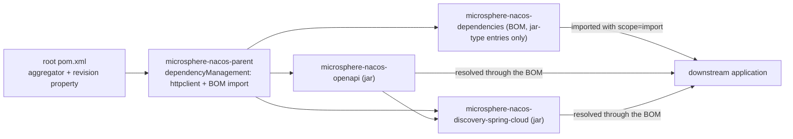

# microsphere-nacos-dependencies — Internals

`microsphere-nacos-dependencies` is the published BOM (bill of materials) for this repository. It manages the versions of
exactly two artifacts — the two jars this repository produces — and nothing else. It is 38 lines long, has no sources, no
build section, and is consumed by **no module in this reactor**.

| Attribute | Value | Evidence |
| --- | --- | --- |
| Coordinates | `io.github.microsphere-projects:microsphere-nacos-dependencies:${revision}` | `microsphere-nacos-dependencies/pom.xml:13-15` |
| Packaging | `pom` | `microsphere-nacos-dependencies/pom.xml:16` |
| Parent | `microsphere-nacos-parent:${revision}`, `relativePath` = `../microsphere-nacos-parent/pom.xml` | `microsphere-nacos-dependencies/pom.xml:5-10` |
| Length | 38 lines, whole file | `wc -l microsphere-nacos-dependencies/pom.xml` |
| Managed artifacts | 2, both from this repository | `microsphere-nacos-dependencies/pom.xml:21-37` |
| `<dependencies>` / `<build>` / `<profiles>` / `<modules>` | none | `microsphere-nacos-dependencies/pom.xml` |
| Imported by another POM in this repository | **no** | grep for `microsphere-nacos-dependencies` across all POMs matches only its own `<artifactId>` (line 14) and the root `<module>` entry (`pom.xml:61`) |

## The whole dependency section

```xml
<dependencyManagement>
    <dependencies>

        <dependency>
            <groupId>io.github.microsphere-projects</groupId>
            <artifactId>microsphere-nacos-openapi</artifactId>
            <version>${revision}</version>
        </dependency>

        <dependency>
            <groupId>io.github.microsphere-projects</groupId>
            <artifactId>microsphere-nacos-discovery-spring-cloud</artifactId>
            <version>${revision}</version>
        </dependency>

    </dependencies>
</dependencyManagement>
```

Both entries are `<version>${revision}</version>` with no `<type>` and no `<scope>`. That single shape carries three
design decisions:

1. **This is a project BOM, not a platform BOM.** It never states a third-party version. `gson`, Spring Boot, Spring
   Cloud, JUnit, logback and Apache HttpClient are outside it. Consumers get consistency across this repository's own
   artifacts, which is the only consistency this repository can promise.
2. **`${revision}` keeps the BOM in lock-step with the reactor.** `revision` is declared once, in the root
   `pom.xml:55` (`0.2.0-SNAPSHOT` on this branch). Releasing means changing that one property; the BOM needs no edit.
3. **No `<scope>` or `<type>`** — the entries describe jar artifacts, so the default `jar`/`compile` treatment is what a
   consumer needs. Compare the sibling POM `microsphere-nacos-parent/pom.xml:38-44`, where the imported BOM *does* need
   `<type>pom</type><scope>import</scope>`. That contrast is the whole difference between "managing an artifact" and
   "importing a BOM".

## What the BOM inherits, and what that means for a consumer

The parent of this POM is `microsphere-nacos-parent`, not the aggregator. `microsphere-nacos-parent` declares
`httpclient:4.5.14` and imports `microsphere-spring-cloud-dependencies:0.2.25` inside its own `dependencyManagement`
(see [microsphere-nacos-parent](microsphere-nacos-parent.md)). Maven merges a parent's `dependencyManagement` into the
child's effective model before imports are resolved, so the effective managed set of the published BOM is:

| Source of the entry | What it contributes |
| --- | --- |
| `microsphere-nacos-dependencies/pom.xml:24-34` | `microsphere-nacos-openapi`, `microsphere-nacos-discovery-spring-cloud` at `${revision}` |
| inherited from `microsphere-nacos-parent/pom.xml:31-35` | `org.apache.httpcomponents:httpclient:4.5.14` |
| inherited via the import at `microsphere-nacos-parent/pom.xml:38-44` | everything defined in `microsphere-spring-cloud-dependencies:0.2.25` — Spring Boot, Spring Cloud, `gson`, JUnit, logback and the `microsphere-*` libraries |

Stated that way, importing this BOM into an application is nearly a one-stop version set: it pins this project's two
artifacts *and* the HttpClient and microsphere lines they were built against.

Provenance: this is Maven's documented model-inheritance behaviour, applied to files read from the snapshot. It was not
confirmed by running `mvn help:effective-pom`, because Maven could not be executed offline in this environment, and
because the contents of `microsphere-spring-cloud-dependencies:0.2.25` live in an external artifact that is not part of
this snapshot. Do not quote a concrete `gson` or Spring version from this document — look it up in the released BOM.

### The `${revision}` caveat for consumers

`<version>${revision}</version>` inside a *published* POM is only meaningful if the reading project defines a `revision`
property — which it normally does not. The standard remedy is a POM-flattening step at `install`/`deploy` that substitutes
the resolved version. **No such plugin is configured in this snapshot**: grepping every POM and workflow for `flatten`
returns nothing, and neither `microsphere-nacos-parent` nor this POM has a `<build>` section. The flattening step, if it
exists, must be contributed by the external parent `microsphere-spring-cloud-parent:0.2.25`, whose build configuration is
not readable here.

Practical consequence for anyone verifying release artefacts: inspect the *published*
`microsphere-nacos-dependencies-<version>.pom` from the repository, not the file in the branch. If the published POM still
contains a literal `${revision}`, the BOM will not resolve for consumers, and that is a build-pipeline defect rather than
something to fix in this file.

## Why no module uses it

Every jar module in this reactor inherits `microsphere-nacos-parent`, which already manages the third-party versions, and
expresses intra-repository dependencies with an explicit `${revision}`:

```xml
<!-- Microsphere Nacos OpenAPI -->
<dependency>
    <groupId>io.github.microsphere-projects</groupId>
    <artifactId>microsphere-nacos-openapi</artifactId>
    <version>${revision}</version>
</dependency>
```

That block is from `microsphere-nacos-discovery-spring-cloud/pom.xml`. It is written as a literal `${revision}` rather
than a versionless entry because the BOM is not imported into the reactor — deliberately, so that building this
repository never depends on a previously published copy of its own BOM. Do not "simplify" this by adding an import of
`microsphere-nacos-dependencies` to the parent: it would create a cycle (the BOM's parent is that same POM chain).

## Position in the release flow



The published artefacts are produced by `.github/workflows/maven-publish.yml`, and `microsphere-nacos-dependencies` is
deployed along with the jars because it is a `<module>`. The workflow file, not this POM, decides the repository it lands
in; see [the build and release workflow](README.md) for what the workflow does and does not
disclose.

## Adding a module to the BOM

When a new jar module is added to this repository:

1. Add `<module>` to the root `pom.xml` (lines 59-66) and give the new module
   `microsphere-nacos-parent` as its `<parent>` with the usual `relativePath`.
2. Add a third `<dependency>` block here, in the same shape as the existing two: `groupId`
   `io.github.microsphere-projects`, the new `artifactId`, `<version>${revision}</version>`, no scope, no type.
3. Keep third-party versions out. If the new module needs a version this BOM does not supply, that pin belongs in
   `microsphere-nacos-parent` (if the source code is sensitive to it) or in the external
   `microsphere-spring-cloud-dependencies` (if it is shared across the organisation).
4. Keep the entries ordered by dependency depth — `microsphere-nacos-openapi` before
   `microsphere-nacos-discovery-spring-cloud` — which is the current convention and makes the file readable as a
   dependency graph.

## Related documents

- [Developer guide index](README.md)
- [microsphere-nacos-parent](microsphere-nacos-parent.md)
- [microsphere-nacos-openapi internals](microsphere-nacos-openapi.md)
- [microsphere-nacos-discovery-spring-cloud internals](microsphere-nacos-discovery-spring-cloud.md)
- [User guide: microsphere-nacos-dependencies](../../user-guide/1.x/microsphere-nacos-dependencies.md)
- [Repository README](../../../README.md)

## 中文

[中文](../zh/1.x/README.md)
