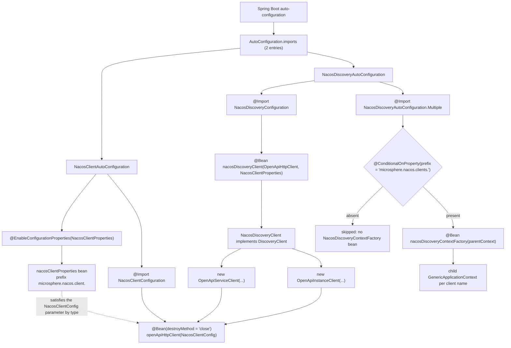
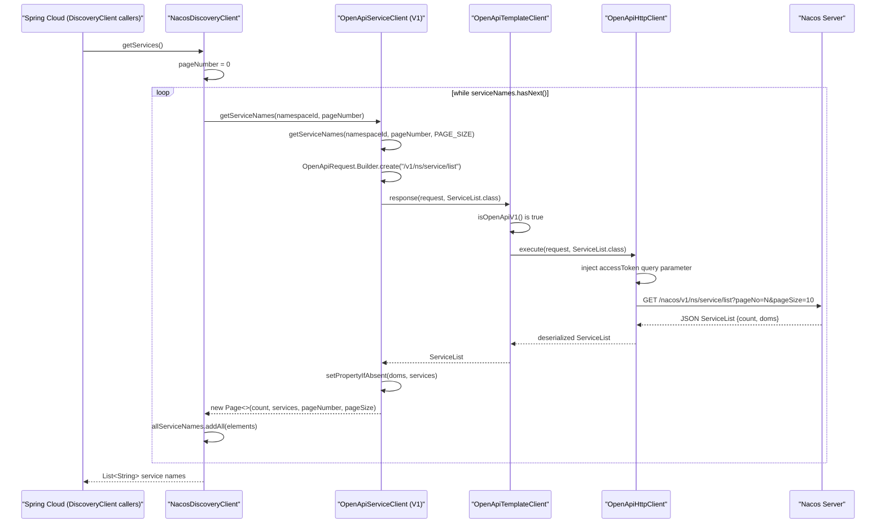

# microsphere-nacos-discovery-spring-cloud — Internals

`microsphere-nacos-discovery-spring-cloud` is the Spring Cloud adapter. It contains no protocol logic: it binds external
configuration onto `NacosClientConfig`, builds a single `OpenApiHttpClient` transport, and exposes Nacos data through
`org.springframework.cloud.client.discovery.DiscoveryClient`.

| Attribute | Value | Evidence |
| --- | --- | --- |
| Coordinates | `io.github.microsphere-projects:microsphere-nacos-discovery-spring-cloud:${revision}` | `microsphere-nacos-discovery-spring-cloud/pom.xml` |
| Packaging | `jar` | `microsphere-nacos-discovery-spring-cloud/pom.xml` |
| Parent | `microsphere-nacos-parent` (`relativePath` = `../microsphere-nacos-parent/pom.xml`) | `microsphere-nacos-discovery-spring-cloud/pom.xml` |
| Main sources | 10 `.java` files, 590 lines total | `find src/main/java -name '*.java' \| xargs wc -l` |
| Test sources | **none** — the module has no `src/test` directory | directory listing |
| Resources | 1 file: `META-INF/spring/org.springframework.boot.autoconfigure.AutoConfiguration.imports` | directory listing |
| Non-optional compile dependency | `microsphere-nacos-openapi:${revision}` | `microsphere-nacos-discovery-spring-cloud/pom.xml` |

The zero-test fact matters for the build workflow: [the CI matrix](README.md) runs
`mvn … test`, and this module contributes no test to it. Any behavioural claim about it in this guide is derived from
reading the source, not from executed assertions.

## Dependency graph: almost everything is `optional`

Of the 13 declared dependencies, exactly one reaches consumers.

| Declaration | `optional` | `scope` | Effect |
| --- | --- | --- | --- |
| `microsphere-annotation-processor` | yes | compile | build-time metadata only |
| `microsphere-java-core` | yes | compile | used by `NacosClientUtils` |
| `microsphere-nacos-openapi:${revision}` | **no** | compile | the only transitive dependency |
| `microsphere-spring-cloud-commons` | yes | compile | declared; **no type from it is referenced by any source file in this snapshot** |
| `spring-cloud-commons` | yes | compile | `DiscoveryClient`, `ServiceInstance`, `DefaultServiceInstance`, `NamedContextFactory` |
| `spring-boot-starter` | yes | compile | Spring context |
| `spring-boot-starter-actuator` | yes | compile | declared; not referenced by any source file |
| `spring-boot-configuration-processor` | yes | compile | generates `spring-configuration-metadata.json` |
| `spring-boot-autoconfigure-processor` | yes | compile | generates `spring-autoconfigure-metadata.properties` |
| `junit-jupiter` | no | test | no tests exist |
| `spring-boot-starter-test` | no | test | no tests exist |
| `microsphere-spring-boot-test` | no | test | no tests exist |
| `logback-classic` | no | test | no tests exist |

Because every Spring artifact is `optional`, Maven does **not** publish them transitively. A consumer that adds only
`microsphere-nacos-discovery-spring-cloud` to its POM gets the openapi client and nothing else — no `DiscoveryClient`
interface, no Boot auto-configuration machinery. The adapter therefore assumes the host application already manages its
Spring Cloud and Spring Boot versions. That is a deliberate design: this repository must compile against the four
`spring-cloud-2022` … `spring-cloud-2025` profiles without pinning any of them.

The practical rule when you extend this module: **do not remove `optional`** from a Spring dependency to "fix" a
consumer's `ClassNotFoundException`. Fix it in the consumer's BOM, the same way the reference applications do.

## Source layout

All sources live under
`microsphere-nacos-discovery-spring-cloud/src/main/java/io/microsphere/nacos/client/`. Two package roots coexist:
`…client.spring.*` (client bootstrap) and `…client.discovery.spring.cloud.*` (discovery adapter).

| File | Lines | Role |
| --- | --- | --- |
| `spring/boot/autoconfigure/NacosClientAutoConfiguration.java` | 41 | Entry point 1: enables `NacosClientProperties`, imports `NacosClientConfiguration` |
| `spring/boot/NacosClientProperties.java` | 58 | `@ConfigurationProperties("microsphere.nacos.client.")` extending `NacosClientConfig` |
| `spring/NacosClientConfiguration.java` | 37 | `@Bean(destroyMethod = "close") OpenApiHttpClient` |
| `spring/util/NacosClientUtils.java` | 51 | Multi-client property extraction: `microsphere.nacos.clients.<name>.*` |
| `discovery/spring/cloud/autoconfigure/NacosDiscoveryAutoConfiguration.java` | 51 | Entry point 2: imports discovery config + conditional multi-client factory |
| `discovery/spring/cloud/NacosDiscoveryConfiguration.java` | 43 | `@Bean NacosDiscoveryClient` |
| `discovery/spring/cloud/NacosDiscoveryClient.java` | 90 | `DiscoveryClient` implementation |
| `discovery/spring/cloud/NacosServiceInstance.java` | 83 | `ServiceInstance` adapter over the openapi `Instance` model |
| `discovery/spring/cloud/NacosDiscoveryContextFactory.java` | 54 | `NamedContextFactory` for one child context per Nacos client |
| `discovery/spring/cloud/NacosDiscoverySpecification.java` | 82 | `NamedContextFactory.Specification` value object |

## Auto-configuration bootstrap

Spring Boot 2.7+ discovers these classes through
`src/main/resources/META-INF/spring/org.springframework.boot.autoconfigure.AutoConfiguration.imports`. The file has
exactly two lines, in this order:

```text
io.microsphere.nacos.client.spring.boot.autoconfigure.NacosClientAutoConfiguration
io.microsphere.nacos.client.discovery.spring.cloud.autoconfigure.NacosDiscoveryAutoConfiguration
```

There is no legacy `META-INF/spring.factories` in this module. The application must therefore run on a Spring Boot
version that reads `AutoConfiguration.imports`; the CI matrix starts at the `spring-cloud-2022` profile, which
corresponds to Boot 3.x.



Two structural points follow from that graph.

First, the transport bean and the discovery client live in **different** auto-configuration classes, but both
`@Import` chains converge on the same `OpenApiHttpClient` instance because `NacosDiscoveryConfiguration` also declares
`@Import(NacosClientConfiguration.class)`. Even if `NacosClientAutoConfiguration` were removed from the imports file,
the discovery path would still produce its own transport — the two entry points are independent, not ordered.

Second, `NacosClientAutoConfiguration` has **no guard of its own**:

```java
@ConditionalOnPropertyPrefix(PREFIX)
@Configuration(proxyBeanMethods = false)
@EnableConfigurationProperties(NacosClientProperties.class)
@Import(value = {
        NacosClientConfiguration.class
})
public class NacosClientAutoConfiguration {
}
```

The `@ConditionalOnPropertyPrefix(PREFIX)` annotation appears at the top of that block, but the `PREFIX` constant is
`"microsphere.nacos.client."` — a prefix, not a property name — and `ConditionalOnPropertyPrefix` comes from
`io.microsphere.spring.boot.condition`, i.e. from the optional `microsphere-spring-cloud-commons`/microsphere-spring
dependency rather than from Spring Boot. `NacosClientAutoConfiguration.java:21` imports that annotation, and the
module declares `microsphere-spring-cloud-commons` as `optional`, so whether this configuration is actually conditional
depends on the microsphere condition being on the consumer's classpath. If it is not, the class is unconditionally
active, and `new OpenApiHttpClient(nacosClientCOnfig)` runs with a `NacosClientProperties` whose `serverAddress` is
`null`.

`NacosDiscoveryAutoConfiguration` is guarded in a narrower, unambiguous way:

```java
@Configuration(proxyBeanMethods = false)
@Import(value = {
        NacosDiscoveryConfiguration.class,
        NacosDiscoveryAutoConfiguration.Multiple.class
})
public class NacosDiscoveryAutoConfiguration {

    @ConditionalOnProperty(prefix = NACOS_CLIENTS_PROPERTY_NAME_PREFIX)
    public static class Multiple {

        @Bean
        public NacosDiscoveryContextFactory nacosDiscoveryContextFactory(ConfigurableApplicationContext parentContext) {
            return new NacosDiscoveryContextFactory(parentContext);
        }
    }
}
```

`@ConditionalOnProperty(prefix = "microsphere.nacos.clients.")` with no `name` attribute is Spring Boot's
prefix-only form: the nested `Multiple` configuration — and therefore the `NacosDiscoveryContextFactory` bean — exists
only when at least one property under `microsphere.nacos.clients.` is present. `NacosDiscoveryConfiguration` itself is
imported unconditionally, so a single-client application gets `NacosDiscoveryClient` without configuring anything.

## Configuration binding

`NacosClientProperties` is not a new configuration model; it *is* the openapi configuration model:

```java
@ConfigurationProperties(prefix = PREFIX)
public class NacosClientProperties extends NacosClientConfig {

    public static final String PREFIX = PROPERTY_NAME_PREFIX;

    private Discovery discovery = new Discovery();
    ...
    public static class Discovery {

        private String namespaceId;
        ...
    }
}
```

`PREFIX` is a static import of `Constants.PROPERTY_NAME_PREFIX` from the openapi module, whose value is the literal
`"microsphere.nacos.client."` (note the trailing dot). Extending `NacosClientConfig` means every setter defined in the
openapi module — `serverAddress`, `scheme`, `contextPath`, `userName`, `password`, `accessKey`, `secretKey`,
`maxConnections`, `maxPerRoute`, `connectionTimeout`, `readTimeout`, `longPollingTimeout`, `eventProcessingTimeout`,
`applicationName`, `encoding`, the three thread names, `name` — is bindable under that prefix with no extra code. The
only *new* key introduced by this module is `discovery.namespaceId`, which the openapi module knows nothing about.

| Property | Target | Notes |
| --- | --- | --- |
| `microsphere.nacos.client.server-address` | inherited `NacosClientConfig.setServerAddress` | no default; `null` unless set |
| `microsphere.nacos.client.scheme` | inherited | default `http` |
| `microsphere.nacos.client.context-path` | inherited | default `/nacos` |
| `microsphere.nacos.client.user-name`, `.password` | inherited | used by the authorization flow |
| `microsphere.nacos.client.access-key`, `.secret-key` | inherited | declared in `NacosClientConfig`; **no consumer anywhere in this snapshot's main sources** |
| `microsphere.nacos.client.name` | inherited | also used as the *child-context* property name — see `NacosDiscoveryContextFactory` |
| `microsphere.nacos.client.discovery.namespace-id` | `NacosClientProperties.Discovery` | read only by `NacosDiscoveryClient`, in its constructor (`NacosDiscoveryClient.java:57`) |

A second prefix governs multi-client setups only: `microsphere.nacos.clients.<name>.*`, defined as
`NacosClientUtils.NACOS_CLIENTS_PROPERTY_NAME_PREFIX`. The two prefixes are unrelated — `microsphere.nacos.client.x`
never feeds `microsphere.nacos.clients.a.x`.

`NacosClientUtils` is the bridge from that namespace to a Spring `PropertySource`:

```java
public static final String NACOS_CLIENTS_PROPERTY_NAME_PREFIX = "microsphere.nacos.clients.";

public static String buildNacosClientPropertyNamePrefix(String nacosClientName) {
    return NACOS_CLIENTS_PROPERTY_NAME_PREFIX + nacosClientName + ".";
}

public static Map<String, Object> getNacosClientProperties(ConfigurableEnvironment environment, String nacosClientName) {
    String prefix = buildNacosClientPropertyNamePrefix(nacosClientName);
    return getSubProperties(environment, prefix);
}

public static PropertySource getNacosCilentPropertySource(ConfigurableEnvironment environment, String nacosClientName) {
    Map properties = getNacosClientProperties(environment, nacosClientName);
    return new MapPropertySource(nacosClientName, properties);
}
```

`getSubProperties` is a static import from `io.microsphere.spring.util.PropertySourcesUtils`, i.e. from the external
microsphere-spring artifact. Whether the returned map keys keep or drop the `microsphere.nacos.clients.<name>.` prefix
is decided there, and that code is not part of this snapshot — this guide does not assert either way. Two local
observations are certain: the method name is misspelled `getNacosCilentPropertySource` (line 46) and `Map` is used raw
(line 47). If you rename the method, update the static import in `NacosDiscoveryContextFactory.java:26`.

## `NacosDiscoveryClient`

The class is small and holds no cache:

```java
public class NacosDiscoveryClient implements DiscoveryClient {

    private final ServiceClient serviceClient;

    private final InstanceClient instanceClient;

    private final NacosClientProperties nacosClientProperties;

    private final String namespaceId;

    public NacosDiscoveryClient(OpenApiHttpClient openApiHttpClient, NacosClientProperties nacosClientProperties) {
        this.serviceClient = new OpenApiServiceClient(openApiHttpClient, nacosClientProperties);
        this.instanceClient = new OpenApiInstanceClient(openApiHttpClient, nacosClientProperties);
        this.nacosClientProperties = nacosClientProperties;
        this.namespaceId = nacosClientProperties.getDiscovery().getNamespaceId();
    }
```

Three consequences of the constructor, each verifiable from the cited source:

1. **The client is hard-wired to Open API V1.** It instantiates `io.microsphere.nacos.client.v1.discovery.OpenApiServiceClient`
   and `…v1.discovery.OpenApiInstanceClient` directly. `OpenApiTemplateClient.getOpenApiVersion()` returns `V1` unless a
   subclass overrides it, and neither of these two overrides it. Using the V2 API from Spring Cloud requires either
   subclassing `NacosDiscoveryClient` or wiring the V2 clients yourself.
2. **The domain clients are collaborators, not beans.** They are plain `new` objects, so they are not injectable and not
   proxied. Only the transport they share (`OpenApiHttpClient`) is a bean — which is what makes the connection pool and
   the token cache global while the per-client domain logic is not.
3. **`namespaceId` is captured once, at construction.** Later changes to `microsphere.nacos.client.discovery.namespace-id`
   have no effect on an already-created client.

### `getServices()` call chain

`getServices()` is the most interesting method in the module because it is the only one that paginates.

```java
@Override
public List<String> getServices() {
    List<String> allServiceNames = new LinkedList<>();

    int pageNumber = 0;
    Page<String> serviceNames = serviceClient.getServiceNames(namespaceId, pageNumber);

    allServiceNames.addAll(serviceNames.getElements());

    while (serviceNames.hasNext()) {
        pageNumber = serviceNames.getPageSize();
        serviceNames = serviceClient.getServiceNames(namespaceId, pageNumber);
        allServiceNames.addAll(serviceNames.getElements());
    }

    return allServiceNames;
}
```



The wire-level detail comes from `v1/discovery/OpenApiServiceClient.java:95-105`:

```java
public Page<String> getServiceNames(String namespaceId, String groupName, int pageNumber, int pageSize) {
    OpenApiRequest request = OpenApiRequest.Builder.create(getServicesListEndpoint())
            .queryParameter(NAMESPACE_ID, namespaceId)
            .queryParameter(SERVICE_GROUP_NAME, groupName)
            .queryParameter(PAGE_NUMBER, pageNumber)
            .queryParameter(PAGE_SIZE, pageSize)
            .build();
    ServiceList serviceList = response(request, ServiceList.class);
    ...
    return new Page<>(serviceList.getCount(), serviceList.getServices(), pageNumber, pageSize);
}
```

`OpenApiRequestParam.PAGE_NUMBER` serialises to `pageNo` and `PAGE_SIZE` to `pageSize`. `getServicesListEndpoint()` is
`getEndpointPath() + SERVICE_ENDPOINT + "/list"`, i.e. `/v1` + `/ns/service` + `/list`; the context path (`/nacos` by
default) and the scheme/host come from `NacosClientConfig` inside the transport.

The two-argument overload used by `NacosDiscoveryClient` is a `default` method on `ServiceClient`:

```java
default Page<String> getServiceNames(String namespaceId, int pageNumber) {
    return getServiceNames(namespaceId, pageNumber, PAGE_SIZE);
}
```

`PAGE_SIZE` is `Constants.PAGE_SIZE`, which is `getInteger("microsphere.nacos.client.page-size", 10)` — a
**system property**, not a `NacosClientConfig` field. Binding `microsphere.nacos.client.page-size` through
`application.yml` therefore changes nothing; only `-Dmicrosphere.nacos.client.page-size=…` reaches this call path.

### Pagination caveat

`Page.hasNext()` is defined as:

```java
public boolean hasNext() {
    return pageNumber < totalPages - 1;
}
```

and `totalPages` is computed by the constructor used above (`Page.java:46-50`) as
`size(elements) == 0 ? 1 : (int) Math.ceil((double) totalElements / (double) pageSize)`.

Combining that with the loop body produces behaviour worth knowing before you rely on `getServices()`:

- The loop advances with `pageNumber = serviceNames.getPageSize()`. `getPageSize()` returns the **page size** (10 by
  default), not `pageNumber + 1`. With more than one page of services, the second request asks the server for
  `pageNo=10`.
- The loop's first request uses `pageNo=0` while `Constants.DEFAULT_PAGE_NUMBER` is `1`, and the `default` overload
  `getServiceNames(String namespaceId)` starts at `PAGE_NUMBER` (1). The two entry points disagree on the page-number
  base.
- `hasNext()` is evaluated against the *page just fetched*, so the combination `pageNumber=0`, `totalPages=ceil(count/10)`
  decides whether a second HTTP call happens at all.

This is recorded as read: the module has no tests, so no assertion pins the intended paging semantics, and no Nacos
server was reachable to observe the real response. If you change the loop to `pageNumber + 1`, keep
`getServiceNames(namespaceId, pageNumber)`'s `hasNext()` contract in mind — `Page` is shared with the config history
API.

### `getInstances(serviceId)` call chain

```java
@Override
public List<ServiceInstance> getInstances(String serviceId) {
    String serviceName = serviceId;
    InstancesList instancesList = instanceClient.getInstancesList(namespaceId, serviceName);
    List<Instance> instances = instancesList.getHosts();
    return instances.stream().map(NacosServiceInstance::new).collect(Collectors.toList());
}
```

`getInstancesList(namespaceId, serviceName)` is a `default` on `InstanceClient` (line 441) that widens to the eight-argument
abstract method through `DEFAULT_GROUP_NAME` and `DEFAULT_CLUSTER_NAME`, and the concrete implementation is
`OpenApiInstanceClient.getInstancesList(...)` at `v1/discovery/OpenApiInstanceClient.java:121`. That method contains the
one place where the V1/V2 switch is visible in the discovery flow:

```java
OpenApiRequestParam clusterParam = isOpenApiV1() ? CLUSTERS : CLUSTER_NAME;
```

For V1 the query parameter is `clusters`; for V2 it is `clusterName`. Because `NacosDiscoveryClient` always builds V1
domain clients, `isOpenApiV1()` is `true` here and the parameter is `clusters`. `GET /nacos/v1/ns/instance/list` answers
with an `InstancesList`, whose instance array is named `hosts` — that is why the adapter reads `getHosts()` rather than
a method called `getInstances()`.

No exception handling wraps either method: an unreachable or unauthorized Nacos surfaces to Spring Cloud as whatever
`AbstractOpenApiClient` throws (`OpenApiClientException`, or a mapped `ErrorCode` failure). A `LoadBalancer` instance
list refresh therefore propagates rather than degrading to an empty list.

## `NacosServiceInstance`: the adapter

`NacosServiceInstance` holds one openapi `Instance` and delegates every accessor, with two hard-coded answers.

| `ServiceInstance` method | Implementation | Source |
| --- | --- | --- |
| `getInstanceId()` | `instance.getInstanceId()` | `NacosServiceInstance.java:41-43` |
| `getServiceId()` | `instance.getService()` | `NacosServiceInstance.java:46-48` |
| `getHost()` | `instance.getIp()` | `NacosServiceInstance.java:51-53` |
| `getPort()` | `instance.getPort()` | `NacosServiceInstance.java:56-58` |
| `isSecure()` | `false`, literal | `NacosServiceInstance.java:61-63` |
| `getUri()` | `DefaultServiceInstance.getUri(this)` | `NacosServiceInstance.java:66-68` |
| `getMetadata()` | `instance.getMetadata()` | `NacosServiceInstance.java:71-73` |
| `getScheme()` | `"http"`, literal | `NacosServiceInstance.java:76-78` |
| `getInstance()` | the wrapped openapi model | `NacosServiceInstance.java:80-82` |

`getUri()` deliberately delegates to Spring Cloud's static helper rather than building a `URI` itself, so the URI is
composed from `getScheme()`, `getHost()`, `getPort()` and `getContextPath()` exactly as the framework defines it. Because
`getScheme()` returns the literal `"http"` and `isSecure()` returns `false`, TLS endpoints cannot be expressed through
this adapter even though `NacosClientConfig` carries a `scheme` field: those two methods never consult the wrapped
instance or the client configuration. `getInstance()` is the escape hatch — cast or unwrap when you need
`weight`, `healthy`, `clusterName`, `ephemeral` or the Nacos-specific instance fields.

The `Instance` model sits at the end of a four-level hierarchy in the openapi module
(`Instance` → `NewInstance` → `GenericInstance` → `BaseInstance` → `DiscoverableModel`). Each value the adapter reads
comes from a different level: `getInstanceId()` (`Instance.java:48`) and `getService()` (`Instance.java:56`) are the two
accessors `Instance` declares itself; `getIp()` and `getPort()` come from `BaseInstance`; `getMetadata()` and `getWeight()`
from `GenericInstance`; `getHealthy()` from `NewInstance`; and `getClusterName()`, `getServiceName()`, `getNamespaceId()`
and `getGroupName()` are accessors over the `protected` fields of `DiscoverableModel`.

## Multi-client support: `NamedContextFactory`

`NacosDiscoveryContextFactory` gives each Nacos client its own child `ApplicationContext`, following the same pattern
Spring Cloud uses for per-load-balancer contexts.

```java
public class NacosDiscoveryContextFactory extends NamedContextFactory<NacosDiscoverySpecification> {

    private final ConfigurableApplicationContext parentContext;

    private static final String NACOS_DISCOVERY_PROPERTY_NAME = "nacos-discovery";

    public NacosDiscoveryContextFactory(ConfigurableApplicationContext parentContext) {
        super(NacosDiscoveryConfiguration.class, NACOS_DISCOVERY_PROPERTY_NAME, PREFIX + "name");
        setApplicationContext(parentContext);
        this.parentContext = parentContext;
    }

    @Override
    public GenericApplicationContext buildContext(String name) {
        GenericApplicationContext context = super.buildContext(name);
        PropertySource nacosClientPropertySource = getNacosCilentPropertySource(this.parentContext.getEnvironment(), name);
        ConfigurableEnvironment environment = context.getEnvironment();
        environment.getPropertySources().addAfter(NACOS_DISCOVERY_PROPERTY_NAME, nacosClientPropertySource);
        return context;
    }
}
```

Reading the `super(…)` arguments against the Spring Cloud signature
`NamedContextFactory(Class<?> defaultType, String propertySourceName, String propertyName)` — that constructor belongs to
the external `org.springframework.cloud.context.named.NamedContextFactory` and its source is not in this snapshot, so the
parameter names below are inferred from the call site and from the artifact's published contract:

- `defaultType` = `NacosDiscoveryConfiguration.class` — the configuration registered in every child context by default.
- `propertySourceName` = `"nacos-discovery"` — reused here both as the default property-source name and, in
  `buildContext`, as the name of the per-client source inserted with `addAfter(...)`.
- `propertyName` = `PREFIX + "name"` = `"microsphere.nacos.client.name"` — the key Spring Cloud's
  `getDefaultProperties(name)` seeds into the child environment, so a child context created for client `order` binds
  `microsphere.nacos.client.name=order`.

`buildContext` then layers the real per-client block on top: for client name `order`, `getNacosCilentPropertySource`
harvests everything under `microsphere.nacos.clients.order.` and adds it as a `MapPropertySource` named `order`,
positioned after `nacos-discovery`. The intended YAML shape is:

```yaml
microsphere:
  nacos:
    clients:
      order:
        server-address: 127.0.0.1:8848
        user-name: nacos
        password: nacos
        discovery:
          namespace-id: order-ns
```

`setApplicationContext(parentContext)` is the `ApplicationContextAware` callback, and here it is invoked *manually* by the
constructor rather than by the container, because the `@Bean` method receives the parent context as a parameter. The
factory itself is not registered as a bean inside any child context, so `parentContext` must be non-null before
`getContext(name)` is first called — `buildContext` dereferences `this.parentContext.getEnvironment()` without a null
check.

Child-context teardown is not described in this snapshot: `NacosDiscoveryContextFactory` overrides no destroy method, and
whatever `NamedContextFactory` does on shutdown lives in the external Spring Cloud artifact. Treat that behaviour as
unverified rather than as inherited-by-default.

`NacosDiscoverySpecification` is the pair the factory's generic parameter expects — a `name` plus `Class<?>[]
configuration`, with a package-private no-arg constructor, equals/hashCode over `Objects.equals(name)` and
`Arrays.equals(configuration)`, and an `equals` that returns `false` for `null` and mismatched classes. It carries no
Nacos-specific logic and is instantiated nowhere in this snapshot; `super(NacosDiscoveryConfiguration.class, …)` makes
the default configuration path sufficient.

## Design patterns, asserted from source only

| Pattern | Where | Evidence |
| --- | --- | --- |
| Adapter | `NacosServiceInstance` | Implements Spring's `ServiceInstance` over the openapi `Instance` without changing either type |
| Facade | `NacosDiscoveryClient` | Exposes two methods (`getServices`, `getInstances`) while hiding paging, request building and deserialization |
| Delegation / composition | `NacosDiscoveryClient` constructor | Builds `OpenApiServiceClient` and `OpenApiInstanceClient` over an injected shared `OpenApiHttpClient` |
| Template Method | `OpenApiTemplateClient.getOpenApiVersion()` → `isOpenApiV1()` → `response(...)`; `NacosDiscoveryContextFactory.buildContext` calls `super.buildContext` then adds a property source | The hook selects both the endpoint prefix and the payload envelope |
| Strategy (property source) | `NacosDiscoveryContextFactory.buildContext` with `addAfter` | Source ordering *is* the resolution strategy for the multi-client case |
| Registry / factory-of-contexts | `NamedContextFactory` subclass keyed by client name | `NacosDiscoveryContextFactory` |
| Overload ladder | `ServiceClient.getServiceNames` `default` chain (six overloads) converging on the four-argument abstract method | `common/discovery/ServiceClient.java:150-208` |

Observer, Builder and the serialization SPI appear in the openapi module, not here — see
[the openapi internals](microsphere-nacos-openapi.md).

## Extension points

**Add a reactive or registration-aware variant.** Nothing in this module implements `ReactiveDiscoveryClient`,
`AutoServiceRegistration` or a `HeartbeatMonitor`. To add one, create the class in
`io.microsphere.nacos.client.discovery.spring.cloud`, add a `@Bean` for it inside `NacosDiscoveryConfiguration` (or a
sibling configuration), and add the new auto-configuration class to
`META-INF/spring/org.springframework.boot.autoconfigure.AutoConfiguration.imports`. That file is the only registration
mechanism present; there is no `spring.factories` and no `@AutoConfigureAfter`/`@AutoConfigureBefore` in this module, so
do not assume ordering between the two entry points.

**Switch a client to Open API V2.** The cleanest route is a V2 configuration: build the `v2` domain clients
(`io.microsphere.nacos.client.v2.discovery.*`) over the same `OpenApiHttpClient` bean and have your own
`DiscoveryClient` implementation take them, rather than trying to subclass `NacosDiscoveryClient` — its fields are
`private final` and the constructor names the V1 types literally.

**Make the page loop correct.** Keep the fix inside `NacosDiscoveryClient`: `Page` and the `ServiceClient` defaults are
shared with other callers, and `PAGE_SIZE` is read from a system property by `Constants`.

**Expose TLS.** Two options, both local: override `getScheme()`/`isSecure()` in a `NacosServiceInstance` subclass fed by
`NacosClientConfig.getScheme()` (the constructor is `public`, the wrapped field is reachable through `getInstance()`), or
map `instance.getSecurePort()` in a custom adapter. Do not set `microsphere.nacos.client.scheme=https` and expect this
class to follow it.

## Conventions specific to this module

- Every source file carries the Apache-2.0 license header, and `@author <a href="mailto:mercyblitz@gmail.com">Mercy</a>`
  plus an `@since` tag. The `@since` values here are type names (`@since Configuration`, `@since ServiceInstance`,
  `@since NamedContextFactory.Specification`, `@since NacosClientConfig`) rather than versions — they are produced by the
  optional `microsphere-annotation-processor` convention, not hand-written, so leave them alone in reviews.
- `@Configuration(proxyBeanMethods = false)` on every configuration class, including `NacosDiscoveryConfiguration` and
  both auto-configuration classes. Do not introduce inter-bean method calls.
- `@Import` is used instead of `@ComponentScan` throughout; no class in this module is annotated `@Component`.
- Constants are referenced by static import from the class that owns them (`PREFIX`,
  `NACOS_CLIENTS_PROPERTY_NAME_PREFIX`, `getNacosCilentPropertySource`), matching the openapi module's style.
- Package placement follows the openapi module's `io.microsphere.nacos.client.*` root rather than the artifact name, so
  `spring` and `discovery.spring.cloud` are siblings under one root.

## Observed limitations in this snapshot

Each row is checkable at the cited path.

| Observation | Location | Effect |
| --- | --- | --- |
| No test sources at all | `microsphere-nacos-discovery-spring-cloud/src` (no `src/test`) | The four test dependencies resolve but run nothing; the CI matrix gains no signal from this module |
| `@ConditionalOnPropertyPrefix` imported and applied with a *prefix* constant | `spring/boot/autoconfigure/NacosClientAutoConfiguration.java:21,34` | Guard behaviour depends on an optional microsphere artifact being present; without it the transport bean is created with `serverAddress` unset |
| `getPageSize()` used as the next page number | `NacosDiscoveryClient.java:83` | Second request asks for `pageNo=10` (default page size) instead of page 2 |
| First page requested as `pageNumber = 0` | `NacosDiscoveryClient.java:77` | Disagrees with `Constants.DEFAULT_PAGE_NUMBER = 1` and with the `default getServiceNames(namespaceId)` overload |
| `PAGE_SIZE` comes from a system property, not `NacosClientConfig` | `common/discovery/ServiceClient.java:161-162`, `constants/Constants.java:227` | `microsphere.nacos.client.page-size` in `application.yml` is ignored on this path |
| `accessKey`/`secretKey` are bound but never read in this snapshot | `NacosClientConfig.java:82,87` | AK/SK authentication appears configurable but is not wired into the transport |
| `isSecure()` and `getScheme()` are hard-coded | `NacosServiceInstance.java:61-63,76-78` | HTTPS and per-instance scheme are unrepresentable |
| `namespaceId` captured in the constructor | `NacosDiscoveryClient.java:57,51` | Namespace changes require a new client bean |
| `getNacosCilentPropertySource` misspelled; `Map` used raw | `NacosClientUtils.java:46-47` | Cosmetic; renaming touches the static import in `NacosDiscoveryContextFactory.java:26` |
| `NacosDiscoverySpecification` is never instantiated | whole module | The `Specification` slot of the generic parameter is currently unused |
| `spring-boot-starter-actuator` and `microsphere-spring-cloud-commons` are declared but unreferenced by main sources | `pom.xml` | Either dead declarations or placeholders for an endpoint/health contributor that does not exist in this branch |
| No exception handling around `getInstances`/`getServices` | `NacosDiscoveryClient.java:66-89` | Server errors propagate into Spring Cloud's discovery abstraction |

## Related documents

- [Developer guide index](README.md)
- [microsphere-nacos-openapi internals](microsphere-nacos-openapi.md)
- [microsphere-nacos-parent](microsphere-nacos-parent.md)
- [microsphere-nacos-dependencies](microsphere-nacos-dependencies.md)
- [User guide: microsphere-nacos-discovery-spring-cloud](../../user-guide/1.x/microsphere-nacos-discovery-spring-cloud.md)
- [Repository README](../../../README.md)

## 中文

[中文](../zh/1.x/README.md)
