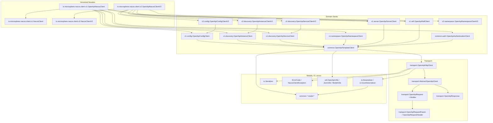
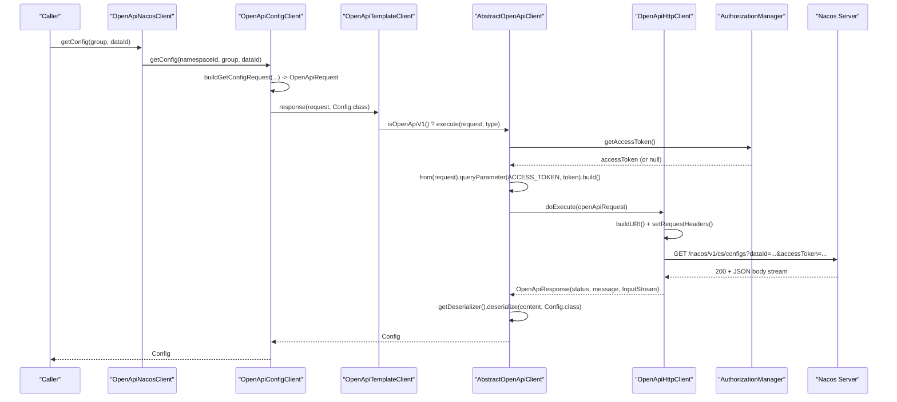
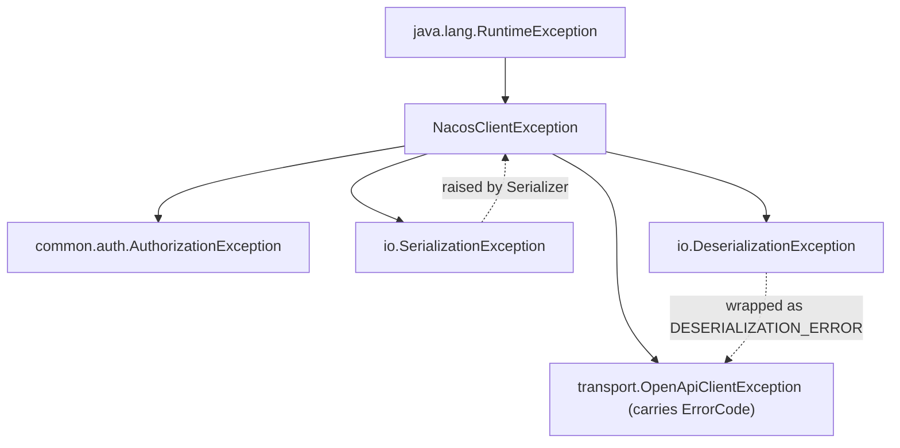
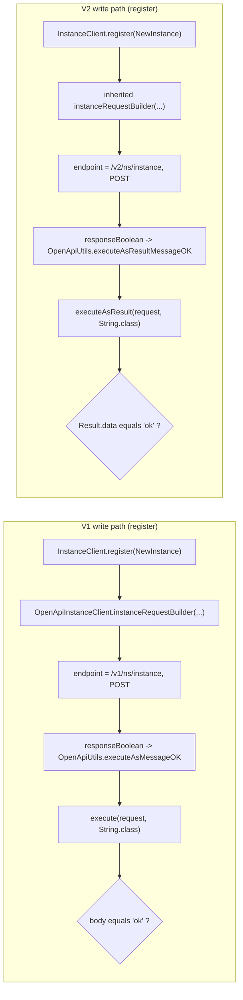
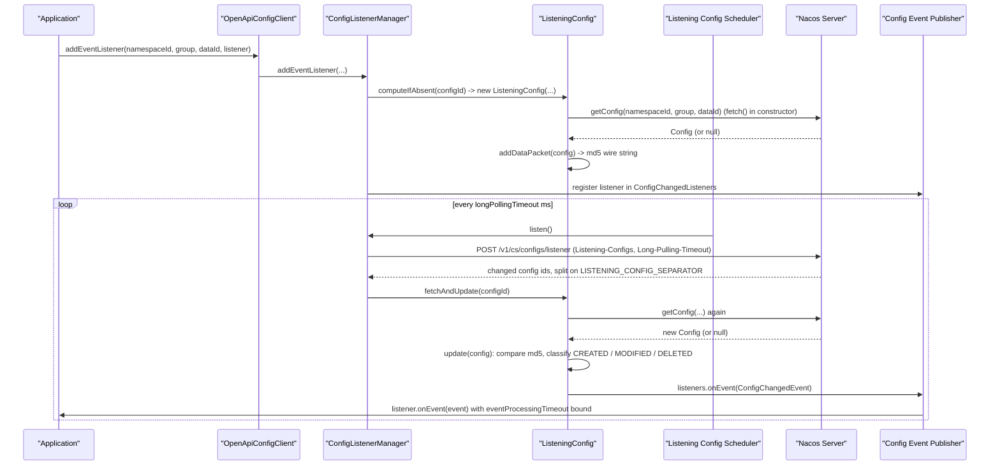

# microsphere-nacos-openapi — Internals

`microsphere-nacos-openapi` is a hand-written Java client for the Nacos Open API. It is the only module in this
repository that contains protocol logic; everything else either configures the build or adapts this module to Spring
Cloud.

| Attribute | Value | Evidence |
| --- | --- | --- |
| Coordinates | `io.github.microsphere-projects:microsphere-nacos-openapi:${revision}` | `microsphere-nacos-openapi/pom.xml` |
| Packaging | `jar` | `microsphere-nacos-openapi/pom.xml` |
| Inherited from | `microsphere-nacos-parent` (`relativePath` = `../microsphere-nacos-parent/pom.xml`) | `microsphere-nacos-openapi/pom.xml` |
| Compile dependencies | `httpclient` (version `4.5.14`, pinned in `microsphere-nacos-parent`), `gson` (version from `microsphere-spring-cloud-dependencies:0.2.25`) | POM files |
| Optional compile deps | `microsphere-annotation-processor`, `microsphere-java-core` | POM file |
| Test dependencies | `junit-jupiter`, `microsphere-java-test`, `microsphere-logging-test`, `logback-classic` | POM file |
| Main sources | 118 `.java` files under `microsphere-nacos-openapi/src/main/java` | directory listing |
| Test sources | 21 `.java` files under `microsphere-nacos-openapi/src/test/java` | directory listing |
| Resources | 3 files under `src/main/resources` | directory listing |

`httpclient` and `gson` are the only two **non-optional** compile dependencies. That is deliberate: this module has no
Spring, no Nacos SDK and no servlet API on its compile classpath. Keep it that way when you add code — the module is the
foundation for adapters, and pulling a framework into it inverts the dependency graph.

## Layered architecture

Four layers, each of which knows only about the layer(s) below it:



| Layer | Responsibility | Must not know |
| --- | --- | --- |
| Versioned facade | Aggregate the domain interfaces into one type; delegate every call to a domain client | HTTP, JSON, endpoints |
| Domain client | Build an `OpenApiRequest` for one Open API area and map the payload to a model | Socket lifecycle, connection pooling |
| Transport | Execute a request: inject the access token, assemble the URI, call Apache HttpClient, read the status line and body stream | What a `Config` or an `Instance` is |
| Models / io / util | POJOs, JSON (de)serialization, endpoint-name and value formatting | The network |

## Package inventory

Paths are relative to `microsphere-nacos-openapi/src/main/java/io/microsphere/nacos/client/`.

| Package | Files | Key types |
| --- | --- | --- |
| `.` (root) | 6 | `Client`, `AbstractClient`, `NacosClientConfig`, `OpenApiVersion`, `ErrorCode`, `NacosClientException` |
| `transport` | 8 | `OpenApiClient`, `AbstractOpenApiClient`, `OpenApiHttpClient`, `OpenApiRequest`, `OpenApiResponse`, `OpenApiRequestHeader`, `OpenApiRequestParam`, `OpenApiClientException` |
| `io` | 7 | `Serializer`, `Deserializer`, `GsonDeserializer`, `DefaultSerializer`, `DefaultDeserializer`, `SerializationException`, `DeserializationException` |
| `util` | 8 | `OpenApiUtils`, `JsonUtils`, `ModelUtils`, `ErrorCodeControl`, `IOUtils`, `StringUtils`, `TypeUtils`, `CollectionUtils` |
| `constants` | 1 | `Constants` |
| `http` | 1 | `HttpMethod` |
| `common` | 1 | `OpenApiTemplateClient` |
| `common/model` | 3 | `Model`, `Page`, `Result` |
| `common/auth` | 4 + 1 model | `AuthenticationClient`, `OpenApiAuthenticationClient`, `AuthorizationManager`, `AuthorizationException`, `model.Authentication` |
| `common/config` | 3 + 5 model + 4 io + 2 event | `ConfigClient`, `ConfigType`, `ConfigOperationType`, `model.{BaseConfig,NewConfig,Config,HistoryConfig,HistoryConfigPage}`, `io.*`, `event.*` |
| `common/discovery` | 3 + 17 model | `InstanceClient`, `ServiceClient`, `ConsistencyType`, `model.{BaseInstance,GenericInstance,NewInstance,Instance,...}` |
| `common/namespace` | 1 + 2 model + 1 io | `NamespaceClient`, `model.{Namespace,NamespacesList}`, `io.NamespaceDeserializer` |
| `v1` | 2 | `NacosClient`, `OpenApiNacosClient` |
| `v1/config` | 2 + 1 util | `OpenApiConfigClient`, `ConfigListenerManager` (package-private), `util.ConfigUtil` |
| `v1/discovery` | 2 | `OpenApiInstanceClient`, `OpenApiServiceClient` |
| `v1/namespace` | 1 | `OpenApiNamespaceClient` |
| `v1/server` | 6 + 5 model + 3 io | `ServerClient`, `OpenApiServerClient`, `ServerSwitchClient`, `ServerMetricsClient`, `ServersListClient`, `ServerStatus`, models and deserializers |
| `v1/raft` | 2 + 2 model + 1 io | `RaftClient` (`@Deprecated`), `OpenApiRaftClient`, `model.{RaftModel,RaftPeer}`, `io.RaftModelDeserializer` |
| `v2` | 2 | `NacosClientV2`, `OpenApiNacosClientV2` |
| `v2/config` | 1 | `OpenApiConfigClientV2` |
| `v2/discovery` | 2 | `OpenApiInstanceClientV2`, `OpenApiServiceClientV2` |
| `v2/namespace` | 1 | `OpenApiNamespaceClientV2` |
| `v2/client` | 0 + 4 model + 3 io | `model.{ClientInfo,ClientDetail,ClientInstance,ClientSubscriber}`, `io.*` deserializers — **no client class**; the `/v2/ns/client` calls are implemented inside the facade |

## How the Open API version and the config select an implementation

This is the part most often misunderstood, so state it precisely:

1. **`NacosClientConfig` carries no version.** Read its fields (`microsphere-nacos-openapi/src/main/java/io/microsphere/nacos/client/NacosClientConfig.java`):
   `name`, `applicationName`, `serverAddress`, `scheme`, `contextPath`, `userName`, `password`, `accessKey`, `secretKey`,
   `maxConnections`, `maxPerRoute`, `connectionTimeout`, `readTimeout`, `longPollingTimeout`, `eventProcessingTimeout`,
   `fetchingConfigThreadName`, `listenerConfigThreadName`, `publishingConfigEventThreadName`, `encoding`. There is no
   `openApiVersion` property. **The version is chosen by which facade you instantiate**, not by configuration:
   `new OpenApiNacosClient(config)` gives V1, `new OpenApiNacosClientV2(config)` gives V2.
2. **`OpenApiVersion` is an endpoint-prefix enum**, and it drives path composition, not class selection:

   ```java
   public enum OpenApiVersion {

       V1("/v1"),

       V2("/v2");

       private final String endpointPath;

       // ...

       public static OpenApiVersion getVersion(String endpoint) {
           for (OpenApiVersion version : values()) {
               if (endpoint.startsWith(version.endpointPath)) {
                   return version;
               }
           }
           return null;
       }
   }
   ```
   (`OpenApiVersion.java`). `getVersion(String)` is present but is not called anywhere in the main sources of this
   snapshot — endpoint strings are built by concatenation instead. Do not assume the enum reverse-parses a response.

3. **`OpenApiTemplateClient` is where the version becomes behaviour.** Every domain client extends it, and it exposes
   three version-dependent hooks:

   ```java
   public OpenApiVersion getOpenApiVersion() {
       return V1;
   }

   protected String getEndpointPath() {
       return getOpenApiVersion().getEndpointPath();
   }

   protected boolean isOpenApiV1() {
       return V1.equals(getOpenApiVersion());
   }

   protected boolean isOpenApiV2() {
       return V2.equals(getOpenApiVersion());
   }

   protected <T> T response(OpenApiRequest request, Type payloadType) {
       if (isOpenApiV1()) {
           return this.openApiClient.execute(request, payloadType);
       }
       return this.openApiClient.executeAsResult(request, payloadType);
   }
   ```
   (`common/OpenApiTemplateClient.java`)

   `response()` is the single most important line in the module: **V1 payloads are read raw, V2 payloads are unwrapped
   from the `Result<T>` envelope** (`common/model/Result.java`, whose `isSuccess()` accepts code `0` or `200`).
4. **Only four classes override `getOpenApiVersion()`** — verified by grep across the module:
   `v2/OpenApiNacosClientV2`, `v2/config/OpenApiConfigClientV2`, `v2/discovery/OpenApiInstanceClientV2`,
   `v2/discovery/OpenApiServiceClientV2`. `v2/namespace/OpenApiNamespaceClientV2` does **not** override it: it keeps
   `V1` while hard-coding `/v2/console/namespace` paths and calling `openApiClient.executeAsResult(...)` directly
   instead of `response(...)`. That asymmetry is real and load-bearing — see
   [Observed limitations](#observed-limitations-in-this-snapshot).
5. **V2 reuses V1 wholesale.** `OpenApiConfigClientV2 extends OpenApiConfigClient`,
   `OpenApiInstanceClientV2 extends OpenApiInstanceClient`, `OpenApiServiceClientV2 extends OpenApiServiceClient`, and
   `OpenApiNacosClientV2`'s constructor wires `OpenApiServerClient` and `OpenApiRaftClient` — the V1-only server and RAFT
   domains — unchanged. Server, RAFT and authentication therefore have no V2 endpoints in this module.

## Transport layer

`OpenApiClient` is the SPI-shaped contract the rest of the code depends on:

```java
public interface OpenApiClient extends AutoCloseable {

    OpenApiResponse execute(OpenApiRequest request) throws OpenApiClientException;

    <T> T execute(OpenApiRequest request, Type payloadType) throws OpenApiClientException;

    default <T> T executeAsResult(OpenApiRequest request, Type dataType) throws OpenApiClientException {
        ParameterizedType payloadType = ofParameterizedType(Result.class, dataType);
        return execute(request, payloadType);
    }

    Serializer getSerializer();

    Deserializer getDeserializer();

    String getEncoding();
}
```
(`transport/OpenApiClient.java`)

`executeAsResult` uses `TypeUtils.ofParameterizedType(Result.class, dataType)` to synthesise a `Result<T>` type token,
which is how generic unwrapping works without a `Class<Result<T>>` (impossible in Java). `TypeUtils.ParameterizedTypeImpl`
is the hand-rolled `java.lang.reflect.ParameterizedType` that makes this legal.

`AbstractOpenApiClient` fixes the algorithm and leaves two holes:

```java
@Override
public final OpenApiResponse execute(OpenApiRequest request) throws OpenApiClientException {
    String accessToken = getAccessToken();
    OpenApiRequest openApiRequest = accessToken == null ? request :
            from(request).queryParameter(ACCESS_TOKEN, accessToken).build();
    return doExecute(openApiRequest);
}

protected abstract OpenApiResponse doExecute(OpenApiRequest request) throws OpenApiClientException;

protected abstract String getAccessToken();
```
(`transport/AbstractOpenApiClient.java`)

The two-argument `execute(request, payloadType)` is where response handling, deserialization and error translation
converge. Its order of operations matters when you debug:

1. Call `execute(request)` (token-injected) and read `statusCode`.
2. On `200`: if `payloadType` is a `ParameterizedType` whose raw type is `Result`, deserialize into `Result`, and if
   `result.isSuccess()` take `result.getData()`. Otherwise (or if the unwrapped payload is still `null`) deserialize the
   stream straight to `payloadType`.
3. On non-`200`: capture the status code, and use the response body as the message when the reason phrase is blank.
4. `DeserializationException` → `OpenApiClientException(DESERIALIZATION_ERROR, "The payload[%s] can't be deserialized", e)`.
   Any other `Throwable` → `OpenApiClientException(CLIENT_ERROR, ...)`.
5. Fall through to `ErrorCode.valueOf(code)` and throw `OpenApiClientException(errorCode, ...)`.

`OpenApiHttpClient` supplies the Apache HttpClient 4.x body of that template. Its constructor is the assembly point for
the whole module:

```java
public OpenApiHttpClient(NacosClientConfig nacosClientConfig) {
    super(nacosClientConfig);
    int maxConnections = nacosClientConfig.getMaxConnections();
    int maxPerRoute = nacosClientConfig.getMaxPerRoute();
    int connectionTimeout = nacosClientConfig.getConnectionTimeout();
    int readTimeout = nacosClientConfig.getReadTimeout();

    PoolingHttpClientConnectionManager connectionManager = new PoolingHttpClientConnectionManager();
    connectionManager.setMaxTotal(maxConnections);
    connectionManager.setDefaultMaxPerRoute(maxPerRoute);

    RequestConfig requestConfig = RequestConfig.custom()
            .setConnectTimeout(connectionTimeout)
            .setConnectionRequestTimeout(connectionTimeout)
            .setSocketTimeout(readTimeout)
            .build();

    HttpClientBuilder httpClientBuilder = HttpClientBuilder.create()
            .setConnectionManager(connectionManager)
            .setDefaultRequestConfig(requestConfig)
            .useSystemProperties();

    this.httpClient = httpClientBuilder.build();
    this.nacosClientConfig = nacosClientConfig;
    this.serializer = loadSerializer(nacosClientConfig);
    this.deserializer = loadDeserializer(nacosClientConfig);
    this.authorizationManager = new AuthorizationManager(this, nacosClientConfig);
}
```
(`transport/OpenApiHttpClient.java`)

Three details to preserve:

- The last line passes `this` into `AuthorizationManager`, so the auth client performs its login **through the same
  transport it is being constructed inside**. `getAccessToken()` null-checks `authorizationManager` for exactly this
  reason — during construction it is still unset.
- `buildURI()` percent-encodes query values with `config.getEncoding()` but never encodes names, and appends `&` after
  the final parameter. Endpoint paths are concatenated verbatim onto `scheme://serverAddress + contextPath`; if
  `serverAddress` already starts with `scheme://` the prefix is not repeated (`buildRootPath`).
- `doExecute()` maps `IOException` to `OpenApiClientException(IO_ERROR, ...)` and nothing else; `close()` closes the
  `AuthorizationManager` before the `httpClient`.

`OpenApiRequest` is immutable (endpoint, `HttpMethod`, query map, header map) with a nested mutable `Builder`. `Builder.from(request)`
is what `AbstractOpenApiClient` uses to clone-and-augment, which is why adding the token does not mutate the caller's
request. `OpenApiResponse` holds `statusCode`, `statusMessage` and a raw `InputStream` — the stream is read lazily by the
`Deserializer`, so a response body must be consumed before the connection is recycled.

`OpenApiRequestParam` is a 394-line enum of every query parameter name in the Open API. Its interesting property is that
constants can carry their own value conversion by overriding `toValue(Object)`:

```java
CONSISTENCY_TYPE("consistencyType", ConsistencyType.class) {
    @Override
    public String toValue(Object rawValue) {
        return ((ConsistencyType) rawValue).getValue();
    }
},
```
```java
INSTANCES("instances", List.class) {
    @Override
    public String toValue(Object rawValue) {
        List<Map<String, String>> instances = (List<Map<String, String>>) rawValue;
        return toJSON(instances);
    }
},
```
(`transport/OpenApiRequestParam.java`)

So per-parameter marshalling is a per-constant strategy, not a central switch. `OpenApiRequestHeader` is the analogous
enum for headers (`Long-Pulling-Timeout`, `Client-Version`, `User-Agent`, `Request-Source`, `Content-Type`, `Accept-Charset`,
`Requester`, `RequestId`, `Request-Module`, `app`, `clientIp`, …) and defaults `toValue` to `toString`.

## Authentication and the access-token lifecycle

`AuthorizationManager` (`common/auth/AuthorizationManager.java`) owns the token. It is created once per transport
instance, is `AutoCloseable`, and holds the current state in a `volatile Authentication` field.

```java
private void refreshAuthentication() throws AuthorizationException {
    if (isAuthorizationEnabled()) {
        try {
            this.authentication = this.authenticationClient.authenticate();
        } catch (Throwable e) {
            String errorMessage = "Failed to refresh Nacos Client Authentication";
            throw new AuthorizationException(errorMessage, e);
        } finally {
            scheduleRefresh();
        }
    }
}

private void scheduleRefresh() {
    this.authenticationRefresher.schedule(this::refreshAuthentication, getRefreshIntervalInSeconds(getAuthentication()), SECONDS);
}

private long getRefreshIntervalInSeconds(Authentication authentication) {
    long tokenTtlInSeconds = authentication == null ? 60 : authentication.getTokenTtl();
    return tokenTtlInSeconds / 2;
}
```

The behaviour this defines, which you should not change accidentally:

| Condition | Behaviour |
| --- | --- |
| `userName` or `password` is null | `isAuthorizationEnabled()` is false; `initAuthenticationRefresher()` returns `null`; **no scheduler is created** and `getAccessToken()` returns `null` |
| Authorization enabled | Login happens **eagerly in the constructor**, then is re-scheduled at half the server-reported `tokenTtl` |
| Login throws | `AuthorizationException` is raised, but the `finally` still schedules a retry; `authentication` stays `null`, so the fallback interval is `60 / 2 = 30` seconds |
| Token read | `getAccessToken()` → `authentication.getAccessToken()`, `null` when there is no `Authentication` |

`Authentication` (`common/auth/model/Authentication.java`) is the deserialized login body: `accessToken`, `tokenTtl`,
`globalAdmin`.

The login call itself is a normal V1 request built by `OpenApiAuthenticationClient`:

```java
@Override
public Authentication authenticate(String userName, String password) {
    OpenApiRequest request = OpenApiRequest.Builder.create("/v1/auth/login")
            .method(POST)
            .queryParameter(USER_NAME, userName)
            .queryParameter(PASSWORD, password)
            .build();
    return openApiClient.execute(request, Authentication.class);
}
```
(`common/auth/OpenApiAuthenticationClient.java`)

Note it calls `execute(..., Authentication.class)` — the raw, non-`Result` path — because `/v1/auth/login` returns the
model directly. Also note the credentials travel as **query parameters on a POST**, matching the Nacos Open API, so the
access key and secret are not percent-safe on their own; `buildURI()` does the encoding.

The recursion — `doExecute` → `authenticate` → `execute` → `doExecute` — is broken because
`AbstractOpenApiClient.execute()` only injects the token when `getAccessToken()` returns non-null, and the manager's
`authentication` field is still `null` on the very first (login) call.



## Deserialization pipeline

Two interfaces, one default Gson implementation, one SPI.

`Deserializer` reads a stream into a type token; the streaming overload is a default method built on `IOUtils.readAsString`:

```java
public interface Deserializer {

    default <T> T deserialize(InputStream inputStream, Type deserializedType) throws DeserializationException {
        String content = null;
        try {
            content = readAsString(inputStream, getEncoding());
        } catch (IOException e) {
            throw new DeserializationException(e.getMessage(), e);
        }
        return deserialize(content, deserializedType);
    }

    <T> T deserialize(String content, Type deserializedType) throws DeserializationException;

    default String getEncoding() {
        return ENCODING;
    }
}
```
(`io/Deserializer.java`)

`DefaultDeserializer` creates a `Gson` and registers per-type adapters discovered through `ServiceLoader`. The registry is
built by reading the **first generic type argument of each implementation's direct superclass**:

```java
private Map<Type, GsonDeserializer> loadGsonDeserializers() {
    Map<Type, GsonDeserializer> gsonDeserializersMap = new HashMap<>();
    for (GsonDeserializer gsonDeserializer : ServiceLoader.load(GsonDeserializer.class)) {
        Class<?> gsonDeserializerClass = gsonDeserializer.getClass();
        Type genericSuperclass = gsonDeserializerClass.getGenericSuperclass();
        if (genericSuperclass instanceof ParameterizedType) {
            ParameterizedType parameterizedType = (ParameterizedType) genericSuperclass;
            Type[] typeArguments = parameterizedType.getActualTypeArguments();
            Type desirializedType = typeArguments[0];
            gsonDeserializersMap.put(desirializedType, gsonDeserializer);
        }
    }
    return gsonDeserializersMap;
}
```
(`io/DefaultDeserializer.java`)

Two consequences you must respect when adding a deserializer:

- **`extends GsonDeserializer<YourModel>` must be the direct superclass and must be parameterized.** A class that
  implements `JsonDeserializer` directly, or extends an unparameterized intermediate type, is silently skipped — it is
  loaded by `ServiceLoader` but contributes no registration.
- Each adapter receives a back-reference (`gsonDeserializer.setDeserializer(this)` inside `buildGson()`), so it can call
  the parent `Deserializer` recursively. `GsonDeserializer.setDeserializer` is **package-private**, so only classes in
  `io.microsphere.nacos.client.io` can wire it; your own adapter gets it for free via the SPI.

`GsonDeserializer<T>` is itself a Template Method with a safe fallback:

```java
@Override
public T deserialize(JsonElement json, Type typeOfT, JsonDeserializationContext context) throws JsonParseException {
    T result = deserialize(json, typeOfT);
    return result == null ? context.deserialize(json, typeOfT) : result;
}

protected T deserialize(JsonElement json, Type typeOfT) throws JsonParseException {
    return null;
}
```
(`io/GsonDeserializer.java`)

Returning `null` from the protected overload means "defer to Gson's reflective binding" — which is why only the models
whose JSON shape differs from their Java shape have a deserializer at all. The class also supplies null-tolerant field
readers (`getString`, `getInteger`, `getLong`, `getFloat`, `getBoolean`) that accept **alternative member names** and
treat `JsonNull` as absent:

```java
protected <T> T getFieldValue(JsonObject jsonObject, String memberName, String[] otherMemberNames, Function<JsonElement, T> asTypeFunction) {
    JsonElement fieldElement = get(jsonObject, memberName);
    if (fieldElement == null) {
        for (String otherMemberName : otherMemberNames) {
            fieldElement = get(jsonObject, otherMemberName);
            if (fieldElement != null) {
                break;
            }
        }
    }
    if (fieldElement == null) {
        return null;
    }
    return asTypeFunction.apply(fieldElement);
}
```

That varargs alternative-name facility is the mechanism used for V1/V2 field-name drift, and it is the right tool when
an endpoint renames a field rather than adding a new model.

### Registered deserializers

`microsphere-nacos-openapi/src/main/resources/META-INF/services/io.microsphere.nacos.client.io.GsonDeserializer` lists
eleven implementations:

| Registration | Target model | Why a custom deserializer exists |
| --- | --- | --- |
| `common.config.io.ConfigDeserializer` | `Config` | field renames (`desc`, `configTags`, `createUser`, `createIp`, `modifyTime`) and `type` → `ConfigType` |
| `common.config.io.HistoryConfigDeserializer` | `HistoryConfig` | revision/operation-type mapping |
| `common.config.io.HistoryConfigPageDeserializer` | `HistoryConfigPage` | `totalCount`/`pageNumber`/`pagesAvailable`/`pageItems` → `Page` shape |
| `common.namespace.io.NamespaceDeserializer` | `Namespace` | console namespace field naming |
| `v1.server.io.ServerStateDeserializer` | `ServerState` | flattened state document |
| `v1.server.io.ServerMetricsDeserializer` | `ServerMetrics` | nested metrics map |
| `v1.server.io.ServerDeserializer` | `Server` | nested server entry |
| `v1.raft.io.RaftModelDeserializer` | `RaftModel` | `leader` arrives as a **JSON string**, needing a second `deserialize` pass |
| `v2.client.io.ClientInfoDeserializer` | `ClientInfo` | V2 client shape |
| `v2.client.io.ClientInstanceDeserializer` | `ClientInstance` | V2 published-instance shape |
| `v2.client.io.ClientSubscriberDeserializer` | `ClientSubscriber` | V2 subscriber shape |

`RaftModelDeserializer` is the reference example of the back-reference technique:

```java
@Override
protected RaftModel deserialize(JsonElement json, Type typeOfT) throws JsonParseException {
    JsonObject jsonObject = json.getAsJsonObject();
    String leaderJson = getString(jsonObject, LEADER_MEMBER_NAME);
    Deserializer deserializer = getDeserializer();
    RaftPeer leader = deserializer.deserialize(leaderJson, RaftPeer.class);
    RaftModel raftModel = new RaftModel();
    raftModel.setLeader(leader);
    return raftModel;
}
```
(`v1/raft/io/RaftModelDeserializer.java`)

`common/config/io/BaseConfigDeserializer<C extends BaseConfig>` factors the shared config mapping and is itself a
Template Method — the concrete parts are the four abstract hooks:

```java
protected abstract void deserialize(JsonObject jsonObject, C config, Type typeOfT) throws JsonParseException;

protected abstract C newConfig();

protected abstract String getOperatorMemberName();

protected abstract String getOperatorIpMemberName();
```

`Serializer` is the mirror image but much thinner: `DefaultSerializer` wraps a plain `new Gson()` and its `buildGson()`
carries `// TODO support the more customized implementations`. Body serialization is not exercised by the transport (all
requests are query-parameter based), so `Serializer` is currently only reachable through
`OpenApiClient.getSerializer()`. `OpenApiHttpClient` still honours SPI: `loadSerializer`/`loadDeserializer` each take the
**first** `ServiceLoader` element, falling back to `DefaultSerializer`/`DefaultDeserializer` when none is registered.
Only `GsonDeserializer` has a services file in this module, so `Deserializer` and `Serializer` SPI slots are open for a
downstream project to override globally.

## Error model

Single unchecked hierarchy rooted at `NacosClientException`, which disables stack-trace filling and suppression:

```java
public NacosClientException(String message, Throwable cause) {
    super(message, cause, true, false);
}
```
(`NacosClientException.java`)



`ErrorCode` is a 40-constant enum whose numeric values are the union of HTTP statuses, Nacos 2.x business codes and
client-side codes; the ranges are documented in the source itself:

| Range | Meaning | Examples |
| --- | --- | --- |
| 400–500 | Nacos 1.x / HTTP statuses | `BAD_REQUEST(400)`, `FORBIDDEN(403)`, `NOT_FOUND(404)`, `INTERNAL_SERVER_ERROR(500)` |
| 10000–10002 | Nacos 2.x generic | `PARAMETER_MISSING`, `ACCESS_DENIED`, `DATA_ACCESS_ERROR` |
| 20000–20099 | Configuration | `CONFIG_LISTENER_IS_NULL(20006)`, `INVALID_DATA_ID(20008)` |
| 21000–21099 | Naming/service/instance | `SERVICE_NOT_EXIST(21008)`, `INSTANCE_NOT_FOUND(21003)` |
| 22000–22099 | Namespace | `NAMESPACE_NOT_EXIST(22001)` |
| 23000–23099 | Node/state | `ILLEGAL_STATE(23000)`, `NODE_DOWN_FAILURE(23002)` |
| 30000 | Server | `SERVER_ERROR` |
| 40000–49999 | This client, not the server | `CLIENT_ERROR(40000)`, `IO_ERROR(40001)`, `SERIALIZATION_ERROR(40002)`, `DESERIALIZATION_ERROR(40003)` |

`ErrorCode.valueOf(int)` throws `IllegalArgumentException` for an unknown value — so a server error code outside the enum
surfaces as `IllegalArgumentException`, **not** as `OpenApiClientException`. If you add an endpoint that can return a code
the enum does not model, add the constant first.

Messages are localized through `ResourceBundle`, keyed by the numeric value, from two properties files:

- `microsphere-nacos-openapi/src/main/resources/META-INF/error-code/messages.properties`
- `microsphere-nacos-openapi/src/main/resources/META-INF/error-code/messages_zh_CN.properties`

`util/ErrorCodeControl` exists because the default `ResourceBundle` control would read `.properties` as ISO-8859-1; it
pins `FORMAT_PROPERTIES` and reads the stream through `new InputStreamReader(stream, DEFAULT_ENCODING)` (`UTF-8` from
`Constants`). `ErrorCodeControl.INSTANCE` is the singleton used by `ErrorCode.getMessage(Locale)`.
`ErrorCodeTest.testGetMessage()` asserts that every constant resolves in both English and Simplified Chinese and that the
two differ, so **a new constant must be added to both files or the test suite fails.**

## Domain clients and endpoints

Constants below are the literal strings in the sources; `getEndpointPath()` is `"/v1"` or `"/v2"` per
`getOpenApiVersion()`.

### V1

| Client | Endpoints |
| --- | --- |
| `OpenApiConfigClient` | `getEndpointPath() + "/cs/configs"`, `"/cs/history"`, `"/cs/history/previous"`; listener `/v1/cs/configs/listener` (in `ConfigListenerManager`) |
| `OpenApiServiceClient` | `getEndpointPath() + "/ns/service"`, `"/ns/service/list"` |
| `OpenApiInstanceClient` | `getEndpointPath() + "/ns/instance"`, `"/ns/instance/list"`, `"/ns/instance/beat"`, `"/ns/instance/metadata/batch"`, `getEndpointPath() + "/ns/health/instance"` |
| `OpenApiNamespaceClient` | `/v1/console/namespaces` (hard-coded, no `getEndpointPath()`) |
| `OpenApiServerClient` | `/v1/console/server/state`, `/v1/ns/operator/switches`, `/v1/ns/operator/metrics`, `/v1/ns/operator/servers` |
| `OpenApiRaftClient` | `/v1/ns/raft/leader` |
| `OpenApiAuthenticationClient` | `/v1/auth/login` |

### V2

| Client | Endpoints |
| --- | --- |
| `OpenApiConfigClientV2` | `getEndpointPath() + "/cs/config"` and `"/cs/history/list"`; **`getConfig` deliberately falls back to `V1.getEndpointPath() + "/cs/configs"`** with the comment "No getConfig endpoint is not found in Open API V2" |
| `OpenApiInstanceClientV2` | inherited paths under `/v2/ns/...`; overrides `sendHeartbeat` to add `serviceName` built as `groupName@@serviceName` |
| `OpenApiServiceClientV2` | inherited paths under `/v2/ns/...`; overrides `response()` to always unwrap `Result` |
| `OpenApiNamespaceClientV2` | `/v2/console/namespace`, `/v2/console/namespace/list` (hard-coded) |
| `OpenApiNacosClientV2` (inline) | `/v2/ns/client`, `/v2/ns/client/list`, `/publish/list`, `/subscribe/list`, `/service/publisher/list`, `/service/subscriber/list` |

The V1 vs V2 write-path difference is summarized by the two `responseBoolean` implementations, which are the reason the
"ok" string comparison is versioned separately from `response()`:



Both flows issue `POST` with the instance's fields as **query parameters only** — there is no request body anywhere in
the module. `NewInstance`/`GenericInstance`/`BaseInstance`/`QueryInstance`/`UpdateInstance`/`DeleteInstance`/
`UpdateHealthInstance` are the parameter-source objects, distinguished by which extra parameters they contribute
(`INSTANCE_HEALTHY`, `INSTANCE_WEIGHT`, `INSTANCE_ENABLED`, `INSTANCE_EPHEMERAL`, `METADATA`).

`ModelUtils.completeInstance(...)` / `completeInstances(...)` and `ModelUtils.setPropertyIfAbsent(newValue, getter, setter)`
normalize responses after deserialization: the `@@`-separated `serviceName` is split back into `groupName` + `serviceName`,
and request-side coordinates are written into the response model when the server left them out. `OpenApiInstanceClient.getInstancesList`
additionally patches `clusters` (empty in V1, `DEFAULT` in V2) and `dom` (the service name in V1, `null` in V2) — the two
documented compatibility gaps, visible in the source comments:

```java
// the "clusters" is "" in the V1 Endpoint, but is "DEFAULT" in the V2 Endpoint
if (isBlank(instancesList.getClusters())) {
    instancesList.setClusters(clusterName);
}

// the "dom" is serviceName in the V1 Endpoint, but is null in the V2 Endpoint
if (isBlank(instancesList.getDom())) {
    instancesList.setDom(serviceName);
}
```

## Configuration listeners: the observer machinery

`OpenApiConfigClient` composes a **package-private** `ConfigListenerManager`
(`v1/config/ConfigListenerManager.java`, `class ConfigListenerManager` — not `public`). Both facades expose
`addEventListener`/`removeEventListener` and forward straight to it.

State held per config client:

| Field | Type | Role |
| --- | --- | --- |
| `listeningConfigsCache` | `ConcurrentMap<String, ListeningConfig>` | one entry per `configId`, populated by `computeIfAbsent` |
| `fetchingConfigIds` | `CopyOnWriteArraySet<String>` | work queue for configs not yet fetched; also the monitor object for `wait()`/`notifyAll()` |
| `listeningConfigDataPackets` | `CopyOnWriteArraySet<String>` | the `dataId^2group^2md5^2tenant` wire strings POSTed to the listener endpoint |
| `fetchingConfigsExecutor` | single-thread `ExecutorService`, daemon, named from `getFetchingConfigThreadName()` | runs `fetchConfigs()` forever |
| `listeningConfigsScheduler` | single-thread `ScheduledExecutorService`, daemon, named from `getListenerConfigThreadName()` | `scheduleAtFixedRate(this::listen, longPollingTimeout, longPollingTimeout, MILLISECONDS)` |
| `publishingEventExecutor` | single-thread `ExecutorService`, daemon, named from `getPublishingConfigEventThreadName()` | dispatches events to user listeners |

Three threads, all daemon, all named from `NacosClientConfig` — that is why those three thread-name properties exist.
The manager also registers `getRuntime().addShutdownHook(new Thread(this::destroy))`, which shuts all three executors
down and clears all three collections.

`configId` and the data packet are built by `v1/config/util/ConfigUtil` using two control characters from `Constants`
(`LISTENING_CONFIG_SEPARATOR_CHAR = (char) 1`, `LISTENING_CONFIG_FIELD_SEPARATOR_CHAR = (char) 2`) and then
`IOUtils.encode(...)`. Namespace-less configs get a two-field id, namespaced ones three — the omission, not an empty
string, is what distinguishes them.

Change detection lives in `ListeningConfig.update(Config)`, and is md5-driven:

```java
boolean update(Config config) {
    Config previousConfig = this.config;
    if (previousConfig == null) {
        if (config != null) {
            // The Config was created in first time
            listeners.onEvent(ofCreated(config));
        } else {
            // otherwise does nothing
            return false;
        }
    } else {
        if (config == null) {
            // The Config was deleted
            listeners.onEvent(ofDeleted(previousConfig));
        } else {
            if (Objects.equals(previousConfig.getMd5(), config.getMd5())) {
                return false;
            }
            // The Config was modified
            listeners.onEvent(ofModified(previousConfig, config));
        }
        // Remove the previous Data Package
        removeDataPacket(previousConfig);
    }

    if (config != null) {
        // Add new Data Package
        addDataPacket(config);
    }

    this.config = config;
    return true;
}
```

`ConfigChangedEvent` (`common/config/event/`) is a `java.util.EventObject` with static factories `ofCreated`, `ofModified`,
`ofDeleted` and a `Kind` enum; `getConfig()` resolves to `current == null ? previous : current`, which is what makes
`getNamespaceId()`/`getGroup()`/`getDataId()`/`getContent()` non-null on a delete event.
`ConfigChangedListener` is a `java.util.EventListener` with one method, `onEvent(ConfigChangedEvent)` — a functional
interface, so tests and callers pass lambdas.

Delivery is bounded, in `ConfigChangedListeners.onEvent`:

```java
@Override
public void onEvent(ConfigChangedEvent event) {
    Future future = publishingEventExecutor.submit(() -> {
        listeners.forEach(listener -> listener.onEvent(event));
    });
    int eventProcessingTimeout = nacosClientConfig.getEventProcessingTimeout();
    try {
        future.get(eventProcessingTimeout, TimeUnit.MILLISECONDS);
    } catch (InterruptedException e) {
        Thread.currentThread().interrupt();
    } catch (ExecutionException e) {
        throw new RuntimeException(e);
    } catch (TimeoutException e) {
        future.cancel(true);
    }
}
```

An `ExecutionException` from user code is rewrapped as a bare `RuntimeException`; a timeout cancels the task. Neither is
logged — the surrounding `listen()` and `fetchConfigs()` methods swallow `Throwable` with a `// TODO Log` comment.



`fetchConfigs()` handles the case where the config did not exist when the listener was registered: `handleEventListener`
puts the `configId` into `fetchingConfigIds` and `notifyAll()`s the monitor, the loop fetches until a non-null `Config`
appears, then `update()` classifies it as `CREATED`. `OpenApiConfigClientTest` exercises exactly this sequence —
delete, publish (expect `CREATED`), publish new content (expect `MODIFIED`), delete (expect `DELETED`) — with
`LONG_POLLING_TIMEOUT = 5000` set via the `customize(NacosClientConfig)` hook.

## Design patterns in this module

Asserted only where the code shows them.

| Pattern | Where | Evidence in the source |
| --- | --- | --- |
| **Template Method** | `AbstractOpenApiClient.execute` (declared `final`) over abstract `doExecute` + `getAccessToken`; `OpenApiTemplateClient.response()` over `getOpenApiVersion()`; `BaseConfigDeserializer.deserialize` (`final`) over `newConfig`/`getOperatorMemberName`/`getOperatorIpMemberName`; `GsonDeserializer.deserialize(json,typeOfT)` defaulting to `null` | `transport/AbstractOpenApiClient.java:52-57,111-118`; `common/OpenApiTemplateClient.java:62-106`; `common/config/io/BaseConfigDeserializer.java:50-82`; `io/GsonDeserializer.java:42-58` |
| **Facade** | `v1.NacosClient` / `v1.OpenApiNacosClient` and `v2.NacosClientV2` / `v2.OpenApiNacosClientV2`; each facade interface is the intersection of every domain interface | `public interface NacosClient extends AuthenticationClient, ConfigClient, ServiceClient, InstanceClient, NamespaceClient, ServerClient, RaftClient, Client` |
| **Delegation** | every facade method body is a one-line forward to a field; `OpenApiNacosClient` builds seven domain clients in its constructor around one shared `OpenApiClient` | `v1/OpenApiNacosClient.java:76-85, 116-134` |
| **Strategy (version)** | `getOpenApiVersion()` selects raw-vs-`Result` unwrapping in `response()` and `CLUSTERS` vs `CLUSTER_NAME` in `getInstancesList` | `common/OpenApiTemplateClient.java:101-106`; `v1/discovery/OpenApiInstanceClient.java` (`OpenApiRequestParam clusterParam = isOpenApiV1() ? CLUSTERS : CLUSTER_NAME;`) |
| **Strategy (serialization)** | `Serializer` / `Deserializer` interfaces chosen at runtime via `ServiceLoader`, defaulting to the Gson implementations | `transport/OpenApiHttpClient.java:163-182` |
| **Strategy (per-parameter marshalling)** | `OpenApiRequestParam.toValue(Object)` overridden per constant | `transport/OpenApiRequestParam.java` (`CONSISTENCY_TYPE`, `INSTANCES`) |
| **Registry via SPI** | `ServiceLoader.load(GsonDeserializer.class)` + generic-superclass reflection → `Map<Type, GsonDeserializer>` registered on the `GsonBuilder` | `io/DefaultDeserializer.java:65-92`; `META-INF/services/io.microsphere.nacos.client.io.GsonDeserializer` |
| **Observer** | `ConfigChangedListener extends EventListener`, `ConfigChangedEvent extends EventObject`, per-config `CopyOnWriteArrayList` of listeners, md5-diff-driven firing | `common/config/event/*.java`; `v1/config/ConfigListenerManager.java:285-347,350-382` |
| **Builder** | `OpenApiRequest.Builder` (`create`, `from`, fluent `method`/`queryParameter`/`header`/`removeParameters`, `build`) | `transport/OpenApiRequest.java:106-223` |
| **Role-interface segregation** | `ServerClient extends ServerSwitchClient, ServerMetricsClient, ServersListClient, Client` | `v1/server/ServerClient.java:16` |
| **Overload ladder** | `ConfigClient`, `InstanceClient` and `ServiceClient` expose 1-arg through full-arity `default` methods that fill `DEFAULT_NAMESPACE_ID` / `DEFAULT_GROUP_NAME` / `Constants.PAGE_NUMBER` / `PAGE_SIZE` | `common/config/ConfigClient.java:61-104`; `common/discovery/ServiceClient.java:150-208` |
| **Adapter** | `NamespacesList extends Result<List<Namespace>>` models a V1 list response as a `Result` subtype | `common/namespace/model/NamespacesList.java:33` |
| **Value-object copy constructors** | `Instance.from(...)`, `NewInstance.from(...)`, `DeleteInstance.build(...)` | `common/discovery/model/Instance.java:112`, `NewInstance.java` |

Not a pattern to invent here: there is no proxy, no reactive transport, no `@Retryable`-style retry, and no caching layer.
The only pooling is Apache HttpClient's connection pool.

## Extension points

### Adding a new domain client

1. **Declare the contract in `common/<domain>`** as an interface extending `Client`, with `default` overloads that fill
   `Constants.DEFAULT_NAMESPACE_ID` / `DEFAULT_GROUP_NAME` so callers get the ladder the other clients have.
2. **Add models in `common/<domain>/model`**, implementing `Model` (which is `Serializable`). Follow the existing split of
   request-side (`NewXxx`) vs response-side (`Xxx`) models — note the local convention that the response type extends the
   request type (`Config extends NewConfig`, `Instance extends NewInstance`).
3. **Implement the V1 client** in `v1/<domain>/OpenApiXxxClient extends OpenApiTemplateClient implements XxxClient`.
   Derive paths from `getEndpointPath() + CONSTANT_SUFFIX` so a V2 subclass can reuse them, and read payloads with
   `response(request, Type)` rather than `openApiClient.execute(...)` so version handling stays centralized.
4. **Implement the V2 client** in `v2/<domain>/OpenApiXxxClientV2 extends OpenApiXxxClient`, overriding
   `getOpenApiVersion()` to return `V2` and only the endpoint hooks that genuinely differ.
5. **Register a `GsonDeserializer`** in `<domain>/io` if the JSON shape does not match the model, add it to
   `src/main/resources/META-INF/services/io.microsphere.nacos.client.io.GsonDeserializer`, and make sure the class
   `extends GsonDeserializer<YourModel>` **directly**.
6. **Wire both facades**: add the field + constructor line + getter in `OpenApiNacosClient` and
   `OpenApiNacosClientV2`, add the interface to the `extends` clause of `NacosClient` / `NacosClientV2`, and add one-line
   delegating methods. `OpenApiNacosClientV2` also has to be updated in the same way as V1 for shared domains.
7. **Add an integration test extending `OpenApiTest`** in `src/test/java/.../v1/<domain>/`, using the `customize()` and
   `setup()` hooks rather than re-implementing transport construction.

Steps 1–6 are all mechanical; the reason they are listed in this order is that the `ServiceLoader` file and the facade
`extends` clauses are the two places a missing edit produces a runtime failure instead of a compile error.

### Other extension points

| Point | Mechanism | Scope |
| --- | --- | --- |
| Replace deserialization globally | register a `META-INF/services/io.microsphere.nacos.client.io.Deserializer` in **your** project | `OpenApiHttpClient.loadDeserializer` takes the first SPI it finds; the default is only used when none exists |
| Replace serialization globally | register `META-INF/services/io.microsphere.nacos.client.io.Serializer` | same |
| Support a renamed JSON field | override `GsonDeserializer.deserialize(JsonElement, Type)` and pass alternative member names to `getString(jsonObject, "newName", "oldName")` | no wiring change needed if the deserializer is already registered |
| Swap the transport | implement `OpenApiClient` (or extend `AbstractOpenApiClient`) and pass it to `new OpenApiNacosClient(openApiClient, nacosClientConfig)` | both facades expose a two-argument constructor for exactly this |
| Localize a new error code | add the numeric key to both `messages.properties` files | enforced by `ErrorCodeTest.testGetMessage()` |
| Tune timeouts/pooling/threads | setters on `NacosClientConfig` (all 19 properties), or the `microsphere.nacos.client.*` system-property defaults in `Constants` | `Constants` reads each default through `getInteger(PROPERTY, FALLBACK)` |

`Constants` exposes `PROPERTY_NAME_PREFIX = "microsphere.nacos.client."` and per-property names such as
`microsphere.nacos.client.max-connections`, `...connection-timeout`, `...read-timeout`, `...long-polling-timeout`,
`...event-processing-timeout`, `...encoding`, `...page-number`, `...page-size`, `...app-name`. These are JVM-level
defaults resolved **once** at interface initialization, so they are a fallback for `NacosClientConfig`, not a live override.

## Observed limitations in this snapshot

Recorded as read, because they will bite anyone extending this module. Each is verifiable at the cited line.

| Observation | Location | Effect |
| --- | --- | --- |
| `HttpMethod.DELETE("GET")` — the enum's `value` string is `"GET"` | `http/HttpMethod.java:42` | Harmless today: `buildHttpUriRequest` switches on the enum constant, never on `getValue()`. Fixing the string is safe, but do not "correct" it by routing on `getValue()` |
| `Constants.DEFAULT_EVENT_PROCESSING_TIMEOUT_PROPERTY_NAME = (int) SECONDS.toMicros(30)` | `constants/Constants.java` | 30 seconds expressed in **micro**seconds (30,000,000) used as a millisecond timeout, i.e. an effectively unbounded event deadline |
| `OpenApiConfigClientV2.publishConfig` calls `type.toLowerCase()` after `type` may be `null` | `v2/config/OpenApiConfigClientV2.java` | `NullPointerException` when publishing a `NewConfig` whose `type` is unset (V1 tolerates it via `queryParameter(CONFIG_TYPE, type)`) |
| `getHistoryConfigs` rejects `pageSize > MAX_PAGE_SIZE` with the message `"The argument 'pageSize' must less than or equal 1"` | `v1/config/OpenApiConfigClient.java:~120` | Misleading validation text; `MAX_PAGE_SIZE` is `500` (`ConfigClient`) |
| `ConfigDeserializer` names its constants inversely (`OPERATOR_IP_MEMBER_NAME = "createUser"`, `OPERATOR_MEMBER_NAME = "createIp"`) and swaps them in the hook methods | `common/config/io/ConfigDeserializer.java:40-42, 78-86` | The final mapping is correct (`operator` ← `createUser`, `operatorIp` ← `createIp`); only the constant names read backwards |
| `OpenApiNamespaceClientV2` does not override `getOpenApiVersion()` | `v2/namespace/OpenApiNamespaceClientV2.java` | `isOpenApiV1()` is `true` for a V2 client; correctness survives only because it calls `execute`/`executeAsResult` directly. `getAllNamespaces()` reads the raw (non-`Result`) payload while the other four methods unwrap it |
| `ConfigListenerManager.listen()` and `fetchConfigs()` swallow every `Throwable` with `// TODO Log` | `v1/config/ConfigListenerManager.java:202-205, 225-228` | A listener that never fires is silent; also `OpenApiNamespaceClientV2.getNamespace` catches `OpenApiClientException` and returns `null` with the same `// TODO log` |
| `ErrorCode` Javadoc has `@see ErrorCodeResourceBundleControlProvider`, but no such type exists in the module | `ErrorCode.java:151,163` | Dangling Javadoc reference; `util/ErrorCodeControl` is the real implementation |
| `OpenApiNacosClient` and `OpenApiNacosClientV2` are not `AutoCloseable` | `v1/OpenApiNacosClient.java`, `v2/OpenApiNacosClientV2.java` | Only the underlying `OpenApiClient` closes. Closing a facade requires `getConfigClient()`/`getOpenApiClient()` and an explicit `close()` |
| `OpenApiUtils.executeAsMessageOK` reads the whole body into a `String` and compares to `"ok"` | `util/OpenApiUtils.java:71-74` | Write operations have no structured error surface; non-200 responses still throw via `AbstractOpenApiClient` |

## Related documents

- [Developer guide index](README.md)
- [microsphere-nacos-discovery-spring-cloud](microsphere-nacos-discovery-spring-cloud.md)
- [microsphere-nacos-parent](microsphere-nacos-parent.md)
- [microsphere-nacos-dependencies](microsphere-nacos-dependencies.md)
- [User guide: microsphere-nacos-openapi](../../user-guide/1.x/microsphere-nacos-openapi.md)
- [Repository README](../../../README.md)

## 中文

[中文](../zh/1.x/README.md)
