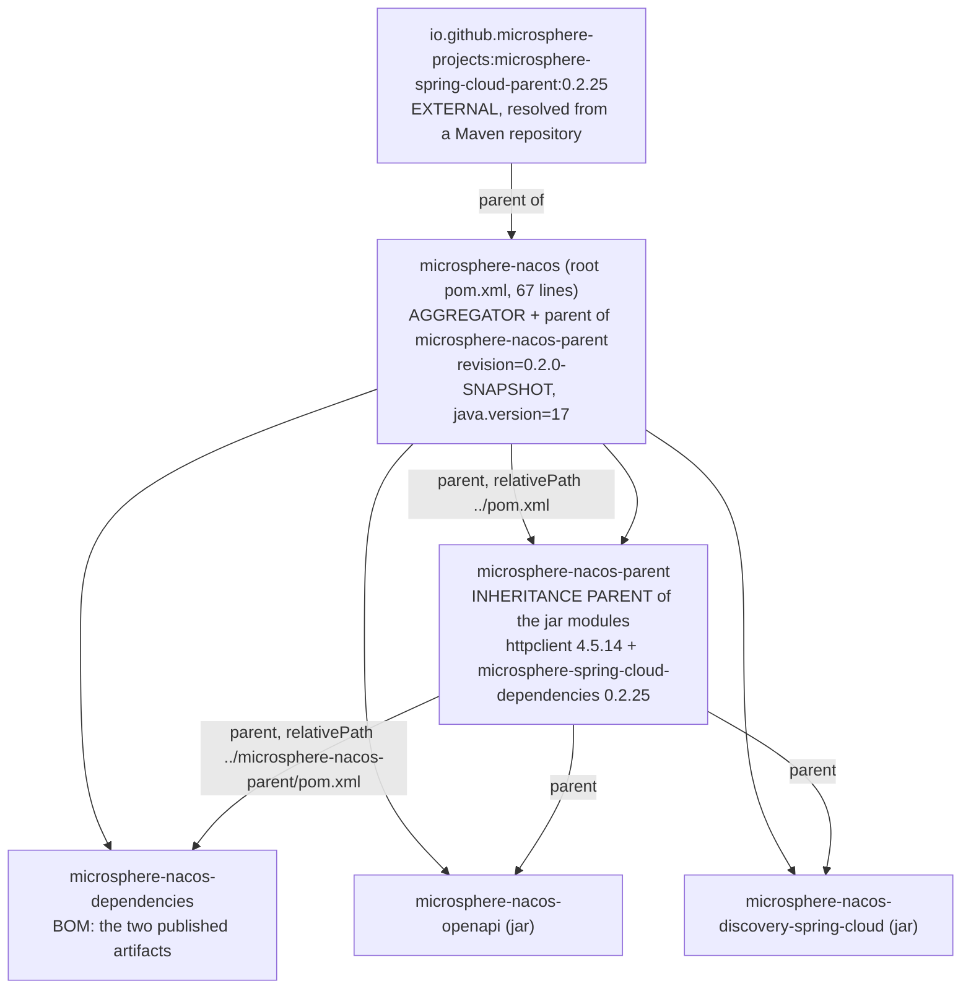

# microsphere-nacos-parent — Internals

`microsphere-nacos-parent` is a 48-line POM whose only job is to hold the third-party version pins that this repository
owns directly. It is not an aggregator, it has no sources, and it has no build configuration. If you are looking for
compiler settings, plugin management or release profiles, they are inherited from an artifact outside this repository —
this document says exactly where each boundary lies.

| Attribute | Value | Evidence |
| --- | --- | --- |
| Coordinates | `io.github.microsphere-projects:microsphere-nacos-parent:${revision}` | `microsphere-nacos-parent/pom.xml:13-15` |
| Packaging | `pom` | `microsphere-nacos-parent/pom.xml:16` |
| Parent | `microsphere-nacos:${revision}`, `relativePath` = `../pom.xml` | `microsphere-nacos-parent/pom.xml:5-10` |
| Length | 48 lines, whole file | `wc -l microsphere-nacos-parent/pom.xml` |
| `<dependencies>` section | none | `microsphere-nacos-parent/pom.xml` |
| `<build>` section | none | `microsphere-nacos-parent/pom.xml` |
| `<profiles>` section | none | `microsphere-nacos-parent/pom.xml` |
| Modules | none — it does not aggregate | `microsphere-nacos-parent/pom.xml` |
| Managed dependencies | 2 entries (1 versioned directly, 1 by BOM import) | `microsphere-nacos-parent/pom.xml:27-47` |

## Parent versus aggregator

The distinction is the first thing to get straight, because both live in this repository and both use the word
"parent".



Three separate Maven mechanics are in play:

1. **Aggregation** — only `<modules>` in the root `pom.xml` (lines 59-66) creates a multi-module build. Reactor order
   follows the declared list: `microsphere-nacos-parent`, `microsphere-nacos-dependencies`, `microsphere-nacos-openapi`,
   `microsphere-nacos-discovery-spring-cloud`.
2. **Inheritance** — a module's `<parent>` element. The two jar modules and the BOM point at
   `microsphere-nacos-parent`; that POM in turn points at the root POM; the root POM points at
   `microsphere-spring-cloud-parent:0.2.25`. Inheritance is therefore four levels deep for a jar module.
3. **Dependency management import** — `<scope>import</scope>` inside `dependencyManagement`, used once, in this POM.

`microsphere-nacos-parent` is simultaneously aggregated (it is a `<module>`) and inherited from (it is a `<parent>`).
That is legal and is what makes the versions resolvable: the parent must be in the reactor for `relativePath` to work
during a clean checkout.

## What the POM actually contains

Properties (lines 21-25):

```xml
<properties>
    <httpclient.version>4.5.14</httpclient.version>
    <!-- BOM versions -->
    <microsphere-spring-cloud.version>0.2.25</microsphere-spring-cloud.version>
</properties>
```

Dependency management (lines 27-47):

```xml
<dependencyManagement>
    <dependencies>

        <!-- Apache HttpClient -->
        <dependency>
            <groupId>org.apache.httpcomponents</groupId>
            <artifactId>httpclient</artifactId>
            <version>${httpclient.version}</version>
        </dependency>

        <!-- Microsphere Spring Cloud Dependencies -->
        <dependency>
            <groupId>io.github.microsphere-projects</groupId>
            <artifactId>microsphere-spring-cloud-dependencies</artifactId>
            <version>${microsphere-spring-cloud.version}</version>
            <type>pom</type>
            <scope>import</scope>
        </dependency>

    </dependencies>
</dependencyManagement>
```

Two entries, two different mechanisms. `httpclient` is pinned by value. `gson`, every Spring artifact, JUnit and the
microsphere libraries are pinned by *importing* another BOM — meaning their versions are not in this repository at all.

### Provenance of the versions you can and cannot verify here

| Artifact | Version | Where it is defined | Verifiable in this snapshot? |
| --- | --- | --- | --- |
| `org.apache.httpcomponents:httpclient` | `4.5.14` | `microsphere-nacos-parent/pom.xml:22,34` | **Yes** |
| everything in `microsphere-spring-cloud-dependencies` (e.g. `gson`, `spring-boot-*`, `spring-cloud-*`, `junit-jupiter`, `logback-classic`, `microsphere-*`) | defined in that external BOM | external artifact `io.github.microsphere-projects:microsphere-spring-cloud-dependencies:0.2.25` | **No** |
| `microsphere-spring-cloud-parent` | `0.2.25` | `pom.xml:9` (root, literal version) | **Yes**, as a coordinate only |
| `${revision}` for this repository's own artifacts | `0.2.0-SNAPSHOT` | `pom.xml:55` | **Yes** |
| Java release | `17` (`<java.version>`) | `pom.xml:56` | **Yes** as a property; the plugin that consumes it is external |
| Maven itself | `3.9.0` | `.mvn/wrapper/maven-wrapper.properties` | **Yes** |

When documenting or bumping a version that lives in the imported BOM, say where it comes from. The jar modules
deliberately write `<artifactId>` with no `<version>` (for example `gson` in
`microsphere-nacos-openapi/pom.xml`), so a search of this repository will not find those numbers. Do not infer them.

## Why `httpclient` is pinned here and `gson` is not

`microsphere-nacos-openapi/pom.xml` declares both with no version. Both resolve through this POM, but by different
routes: `httpclient` by the direct entry above, `gson` through the imported BOM. Pinning `httpclient` locally is the
statement that this repository's transport layer is tied to Apache HttpClient 4.x specifically — the code imports
`org.apache.http.client.*` (4.x package layout), not the `org.apache.hc.client5.*` packages of HttpClient 5. A BOM that
later moves `httpclient` to a 5.x line would break compilation, so the override is a guard rail.

The rule for contributors: a version override belongs in `microsphere-nacos-parent` only when the repository's *source
code* is sensitive to that number. Everything else stays in the imported BOM so the whole microsphere organisation can
upgrade in one place.

## What the POM deliberately does not do

- **No `<dependencies>`.** `dependencyManagement` alone adds nothing to any classpath. A module that declares
  `httpclient` without a version picks up `4.5.14`; a module that does not declare it gets nothing.
- **No `<build>`, no `<pluginManagement>`, no `<distributionManagement>`.** Compiler level, source/target encoding, the
  `maven-source-plugin`/`maven-javadoc-plugin` attachments, `maven-gpg-plugin` signing, the `Sonatype`/`Central` server
  ids and the flatten step required by `${revision}` all come from `microsphere-spring-cloud-parent:0.2.25`. That POM is
  not in this repository, so its exact plugin versions cannot be stated here.
- **No `<profiles>`.** The profiles CI activates — `test` and `coverage`, plus the `spring-cloud-2022` …
  `spring-cloud-2025` selectors — are defined in that same external parent. See
  [the build workflow](README.md) for the commands and for what remains unverifiable offline.
- **It does not re-export `${revision}`.** `microsphere-nacos-parent/pom.xml:8` uses `${revision}` as its parent version
  and line 15 as its own; the property itself is defined in the root POM at line 55 and reaches here by inheritance.
  Bumping a release means editing exactly one line, `pom.xml:55`.

## Resolving the external parent: the offline constraint

The root POM declares its parent without a `<relativePath>`:

```xml
<parent>
    <groupId>io.github.microsphere-projects</groupId>
    <artifactId>microsphere-spring-cloud-parent</artifactId>
    <version>0.2.25</version>
</parent>
```

Maven then needs `microsphere-spring-cloud-parent-0.2.25.pom` (and, through it,
`microsphere-spring-cloud-dependencies-0.2.25.pom`) in the local repository or a remote one. Consequences worth
recording before you try to build this branch:

- A first-time build on a machine with no populated `~/.m2` and no network fails at POM resolution, before any module is
  compiled. This is exactly the state this documentation snapshot was produced in: Maven was not runnable here, so no
  statement in this guide comes from a completed build.
- `mvnw` pins Maven `3.9.0` but cannot substitute for a missing parent POM; `.mvn/` contains only
  `wrapper/maven-wrapper.properties` and `wrapper/maven-wrapper.jar` — there is no `maven.config`, no `jvm.config` and no
  `extensions.xml` that would alter resolution.
- The `-Drevision=0.0.1-SNAPSHOT` override used in CI exists precisely because the reactor's own coordinates are
  property-driven; it does not affect the external parent, whose version `0.2.25` is a literal.

## Changing this POM: checklist

1. Adding a version pin for code in this repository → add a property and a `dependencyManagement` entry here, in the
   style of the existing `httpclient` block.
2. Adding a pin for a *published* artifact of this repository → that belongs in
   [microsphere-nacos-dependencies](microsphere-nacos-dependencies.md), not here.
3. Bumping `microsphere-spring-cloud.version` → expect the versions of `gson`, Spring, JUnit and the microsphere
   libraries to move together; re-run the full CI matrix, since the four `spring-cloud-*` profiles interact with this
   number.
4. Upgrading Apache HttpClient to 5.x → this POM is not the blocker; `transport/OpenApiHttpClient.java` is, because of
   the 4.x package imports. Treat it as a source migration.
5. Editing `<modules>` → that is the root `pom.xml`, not this file.

## Related documents

- [Developer guide index](README.md)
- [microsphere-nacos-dependencies](microsphere-nacos-dependencies.md)
- [microsphere-nacos-openapi internals](microsphere-nacos-openapi.md)
- [microsphere-nacos-discovery-spring-cloud internals](microsphere-nacos-discovery-spring-cloud.md)
- [User guide: microsphere-nacos-parent](../../user-guide/1.x/microsphere-nacos-parent.md)
- [Repository README](../../../README.md)

## 中文

[中文](../zh/1.x/README.md)
