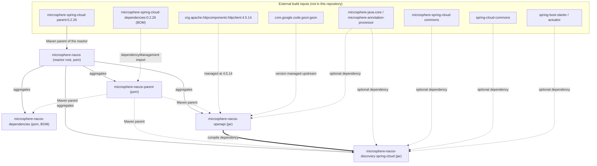
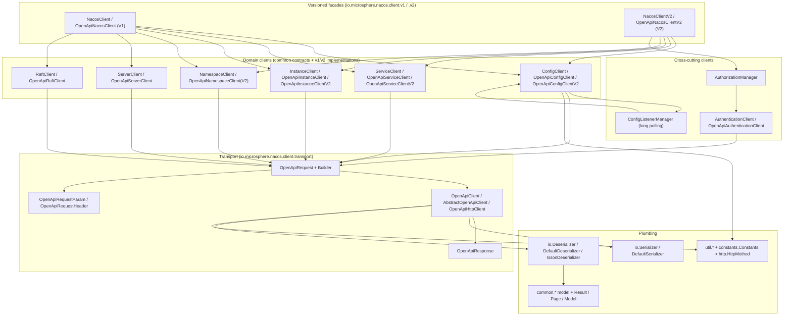
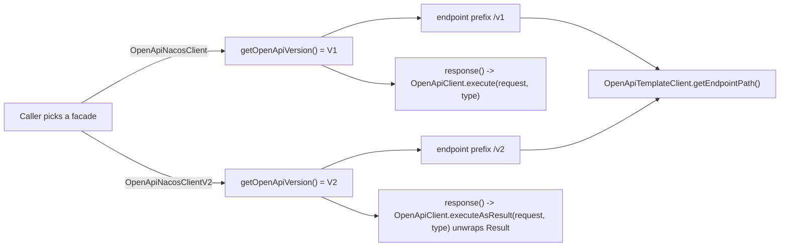
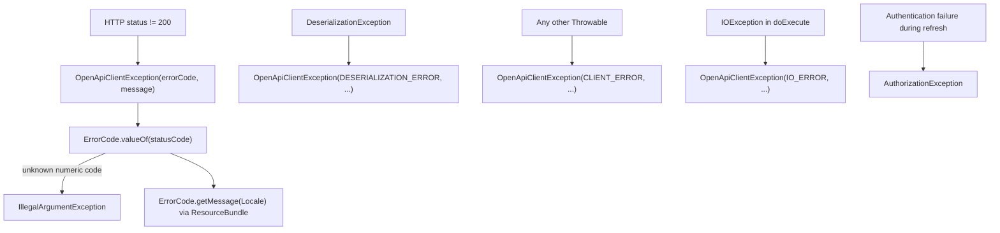

# Microsphere Nacos — Developer Guide (`current`)

This is the developer guide for the **`current`** version line of `microsphere-nacos`, a Nacos **Open-API** client
library plus a Spring Cloud `DiscoveryClient` adapter built on top of it. It documents internal design: module
structure, package layering, class responsibilities, the patterns the code actually uses, the flows you must understand
before changing them, extension points, and the build-and-test workflow.

Everything below was read from one source of truth.

## Source of truth and provenance

| Item | Value | Evidence |
| --- | --- | --- |
| Analyzed tree | `release` branch snapshot | `.docs-work/release` Git worktree (detached HEAD `876f588`) |
| Reactor root | `io.github.microsphere-projects:microsphere-nacos:${revision}` (`pom`) | `pom.xml` |
| `${revision}` | `0.2.0-SNAPSHOT` | `pom.xml`, `<properties>` |
| `java.version` | `17` | `pom.xml`, `<properties>` |
| External Maven parent | `microsphere-spring-cloud-parent:0.2.26` | `pom.xml`, `<parent>` |
| Imported BOM | `microsphere-spring-cloud-dependencies:0.2.26` | `microsphere-nacos-parent/pom.xml` |
| Pinned third-party version | `org.apache.httpcomponents:httpclient:4.5.14` | `microsphere-nacos-parent/pom.xml` |
| Maven wrapper | wrapper `3.3.4`, `distributionType=only-script`, Maven `3.9.16` | `.mvn/wrapper/maven-wrapper.properties` |

**Provenance rule applied throughout this guide.** Versions owned by this repository (`${revision}`, the
`httpclient 4.5.14` pin, the wrapper coordinates) are stated as facts. Versions owned by the *external* parent and the
*external* imported BOM — Spring Boot, Spring Cloud, Gson, JUnit, Logback, the Microsphere libraries, plus every Maven
plugin and every build profile (`test`, `coverage`, `publish`, `ci`, `spring-cloud-2022` … `spring-cloud-2025`) — are
**not verifiable from this snapshot**. They are referenced as "provided by `microsphere-spring-cloud-parent:0.2.26`"
and never quoted as numbers.

## Reactor at a glance

`pom.xml` declares four active modules and two disabled ones:

```xml
<modules>
    <module>microsphere-nacos-parent</module>
    <module>microsphere-nacos-dependencies</module>
    <module>microsphere-nacos-openapi</module>
    <!-- <module>microsphere-nacos-spring</module> -->
    <!-- <module>microsphere-nacos-spring-boot</module> -->
    <module>microsphere-nacos-discovery-spring-cloud</module>
</modules>
```

| Module | Artifact ID | Packaging | Main `.java` | Test `.java` | Guide |
| --- | --- | --- | --- | --- | --- |
| Parent | `microsphere-nacos-parent` | `pom` | n/a | n/a | [microsphere-nacos-parent.md](microsphere-nacos-parent.md) |
| Dependencies | `microsphere-nacos-dependencies` | `pom` (BOM) | n/a | n/a | [microsphere-nacos-dependencies.md](microsphere-nacos-dependencies.md) |
| OpenAPI client | `microsphere-nacos-openapi` | `jar` | 118 | 21 | [microsphere-nacos-openapi.md](microsphere-nacos-openapi.md) |
| Discovery adapter | `microsphere-nacos-discovery-spring-cloud` | `jar` | 10 | 0 | [microsphere-nacos-discovery-spring-cloud.md](microsphere-nacos-discovery-spring-cloud.md) |

`microsphere-nacos-spring` and `microsphere-nacos-spring-boot` are commented out **and have no directories in this
snapshot**. They are not buildable and are not documented here; do not write code that assumes they exist.

## Module dependency and inheritance flowchart

Two different relationships are in play, and mixing them up is the most common source of POM mistakes: the **Maven
parent** relationship (build inheritance) and the **artifact dependency** relationship (classpath).



Reading the diagram:

- The **only** compile-scope dependency that crosses module boundaries inside this repository is
  `microsphere-nacos-openapi` → used by `microsphere-nacos-discovery-spring-cloud`
  (`microsphere-nacos-discovery-spring-cloud/pom.xml`).
- `microsphere-nacos-parent` owns no sources; it exists to give the three buildable modules one shared
  `dependencyManagement` block.
- `microsphere-nacos-dependencies` (the BOM) manages **this project's own artifacts only**; it is for downstream
  consumers, and no module in the reactor depends on it.
- Spring Boot / Spring Cloud / Microsphere-Spring-Cloud are `optional` in the discovery module, so consumers must
  supply them. See [microsphere-nacos-discovery-spring-cloud.md](microsphere-nacos-discovery-spring-cloud.md).

## Layered architecture of the client

`microsphere-nacos-openapi` is a strict bottom-up stack. Each layer depends only on layers below it.



Key structural facts, all verifiable in the sources:

- `Client` (`.../nacos/client/Client.java`) is the one-method root contract: `NacosClientConfig getNacosClientConfig()`.
  Every domain client and every facade ultimately implements it.
- `AbstractClient` implements it once, `final`, and stores the config; `OpenApiTemplateClient extends AbstractClient`
  adds the `OpenApiClient` collaborator plus version-aware request/response helpers. That single class is the seam
  between "domain client" and "transport".
- Transport is chosen once: `OpenApiHttpClient` is the only `OpenApiClient` implementation in the snapshot
  (`io.microsphere.nacos.client.transport.OpenApiHttpClient`).
- Domain clients never build `URI` strings or Apache HTTP objects; they build `OpenApiRequest` and hand it to the
  injected `OpenApiClient`.

## How an implementation gets selected (V1 vs V2)

`NacosClientConfig` contains **no** version field (see
`.../nacos/client/NacosClientConfig.java` — address, scheme, context path, credentials, pool and timeout settings,
thread names, encoding, and nothing else). Version selection is structural: it happens when you choose the facade and
the domain client classes, and the choice then propagates through `OpenApiVersion`.



| Concern | V1 | V2 | Evidence |
| --- | --- | --- | --- |
| Path prefix | `/v1` | `/v2` | `OpenApiVersion.V1("/v1")`, `V2("/v2")` |
| Payload envelope | raw body | `Result<T>` wrapper, unwrapped when `isSuccess()` | `OpenApiTemplateClient.response(...)`, `AbstractOpenApiClient.execute(request, payloadType)` |
| Success sentinel | body equals `"ok"` | `Result` payload equals `"ok"` | `OpenApiUtils.executeAsMessageOK` vs `executeAsResultMessageOK` |
| Cluster query param | `clusters` | `clusterName` | `OpenApiInstanceClient.getInstancesList(...)`: `isOpenApiV1() ? CLUSTERS : CLUSTER_NAME` |
| Config get endpoint | `/v1/cs/configs` | no V2 equivalent; V2 client falls back to the V1 path | `OpenApiConfigClientV2.getConfig(...)` comment and code |
| Facade surface | config + service + instance + namespace + server + raft + auth | config + service + instance + namespace + auth + V2 *client* introspection | `v1.NacosClient`, `v2.NacosClientV2` |

The V2 facade still wires `OpenApiServerClient` and `OpenApiRaftClient` (V1-only implementations) and exposes them via
`getServerClient()` / `getRaftClient()`, but because `NacosClientV2` does not extend `ServerClient` or `RaftClient`, no
server/raft delegation methods exist on the V2 facade — confirmed by the absence of `getServerState`, `getServerMetrics`,
`getServersList` and `getRaftModel` in `v2/OpenApiNacosClientV2.java`.

## Authentication and token lifecycle in one page

- `NacosClientConfig.isAuthorizationEnabled()` is `userName != null && password != null`.
- `OpenApiHttpClient`'s constructor creates an `AuthorizationManager`, which immediately calls `authenticate()` against
  `POST /v1/auth/login` and starts a daemon scheduler.
- `AbstractOpenApiClient.execute(OpenApiRequest)` is `final` and is the **only** injection point for the token:

```java
@Override
public final OpenApiResponse execute(OpenApiRequest request) throws OpenApiClientException {
    String accessToken = getAccessToken();
    OpenApiRequest openApiRequest = accessToken == null ? request :
            from(request).queryParameter(ACCESS_TOKEN, accessToken).build();
    return doExecute(openApiRequest);
}
```

- The token is a **query parameter** named `accessToken` (`OpenApiRequestParam.ACCESS_TOKEN`), never a header.
- Refresh happens at half the server-reported TTL, on the thread `Nacos Client - Authorization Refresher`.
- Full sequence diagram and failure semantics:
  [microsphere-nacos-openapi.md](microsphere-nacos-openapi.md#6-authentication-commonauth).

## Error model in one page



All of them extend `NacosClientException extends RuntimeException`, constructed with
`super(message, cause, true, false)` — suppression enabled, **writable stack trace disabled**, so exceptions are cheap on
hot paths. Details, tables and the localized message bundles:
[microsphere-nacos-openapi.md](microsphere-nacos-openapi.md#19-error-handling-model).

## Design patterns actually present

Only patterns with a code pointer are listed. The "Where" column is the file you should open to confirm it.

| Pattern | Where it lives | File |
| --- | --- | --- |
| Template Method | `AbstractOpenApiClient.execute(...)` (final) calls abstract `doExecute(...)` and `getAccessToken()` | `.../client/transport/AbstractOpenApiClient.java` |
| Template Method | `AbstractClient` fixes `getNacosClientConfig()`; `OpenApiTemplateClient` fixes `response(...)` | `.../client/AbstractClient.java`, `.../client/common/OpenApiTemplateClient.java` |
| Facade | `OpenApiNacosClient` / `OpenApiNacosClientV2` implement `NacosClient` / `NacosClientV2` and forward every call | `.../client/v1/OpenApiNacosClient.java`, `.../client/v2/OpenApiNacosClientV2.java` |
| Delegation | facades hold seven domain-client fields built in the constructor and contain no HTTP logic | same two files |
| Strategy | `Serializer` / `Deserializer` interfaces with `DefaultSerializer` / `DefaultDeserializer` (Gson) | `.../client/io/` |
| Strategy | `OpenApiVersion` selects endpoint prefix and response envelope | `.../client/OpenApiVersion.java`, `.../client/common/OpenApiTemplateClient.java` |
| Builder | `OpenApiRequest.Builder` (`create`, `from`, `method`, `queryParameter`, `header`, `build`) | `.../client/transport/OpenApiRequest.java` |
| Observer | `ConfigChangedListener extends EventListener`, `ConfigChangedEvent extends EventObject`, `ConfigListenerManager` + `ConfigChangedListeners` | `.../client/common/config/event/`, `.../client/v1/config/ConfigListenerManager.java` |
| Adapter | `NacosServiceInstance` maps a Nacos `Instance` onto Spring Cloud `ServiceInstance` | `.../discovery/spring/cloud/NacosServiceInstance.java` |
| Registry / cache | `ConcurrentMap<String, ListeningConfig> listeningConfigsCache` keyed by `ConfigUtil.buildConfigId(...)` | `.../client/v1/config/ConfigListenerManager.java` |
| Service Loader (SPI) | `ServiceLoader.load(Serializer.class)`, `Deserializer.class`, `GsonDeserializer.class` | `.../client/transport/OpenApiHttpClient.java`, `.../client/io/DefaultDeserializer.java` |
| Named child contexts | `NacosDiscoveryContextFactory extends NamedContextFactory<NacosDiscoverySpecification>` | `.../discovery/spring/cloud/NacosDiscoveryContextFactory.java` |

## Reading order

Read in this order; each step assumes only what the previous ones established.

| # | Document | Why first |
| --- | --- | --- |
| 1 | This file | reactor, layering, pattern inventory |
| 2 | [microsphere-nacos-parent.md](microsphere-nacos-parent.md) | where every dependency version comes from, why `httpclient` is pinned to 4.5.14 |
| 3 | [microsphere-nacos-dependencies.md](microsphere-nacos-dependencies.md) | the `${revision}` / CI-friendly version scheme and what the BOM does and does not manage |
| 4 | [microsphere-nacos-openapi.md](microsphere-nacos-openapi.md) | the deep dive: transport, auth, serialization, long polling, error model, extension points |
| 5 | [microsphere-nacos-discovery-spring-cloud.md](microsphere-nacos-discovery-spring-cloud.md) | the only consumer of the client in this repo, and the Spring Boot bootstrap it adds |

If you are about to add one API method, jump straight to
[microsphere-nacos-openapi.md → Extension points](microsphere-nacos-openapi.md#20-extension-points-and-adding-a-new-api-surface).

## Build and test workflow (described from files, never executed here)

- Wrapper: `.mvn/wrapper/maven-wrapper.properties` pins Maven `3.9.16` with `distributionType=only-script`; `mvnw` and
  `mvnw.cmd` are both at the repository root. The root `README.md` documents `./mvnw package` (Linux/macOS) and
  `mvnw.cmd package` (Windows).
- CI build matrix (`.github/workflows/maven-build.yml`): JDK `17`, `21`, `25` × profiles `spring-cloud-2022`,
  `spring-cloud-2023`, `spring-cloud-2024`, `spring-cloud-2025`, running `mvn --batch-mode --update-snapshots
  --file pom.xml -Drevision=0.0.1-SNAPSHOT test --activate-profiles test,coverage,<profile>`.
- Test environment: CI starts `docker compose -f "docker/test-services.yml" up -d` before the Maven run and tears it
  down afterwards. **`docker/test-services.yml` is not present in this snapshot**, so the exact Nacos image, port and
  the value exported as `SERVER_ADDRESS` could not be verified.
- Test entry point: `microsphere-nacos-openapi/src/test/java/io/microsphere/nacos/client/OpenApiTest.java` fails fast
  when the Nacos address is missing:

```java
static String getServerAddress() {
    String key = SERVER_ADDRESS_PROPERTY_NAME;
    return System.getProperty(key, System.getenv(key));
}
```

  with `SERVER_ADDRESS_PROPERTY_NAME = "SERVER_ADDRESS"`, and `init()` throwing an `IllegalArgumentException` naming
  that property when it resolves to `null`. Every API test therefore needs a live Nacos server plus
  `-DSERVER_ADDRESS=...` (or the environment variable). Username/password defaults in that base class are `nacos`/`nacos`.
- Publishing (`.github/workflows/maven-publish.yml`): requires a `major.minor.patch` input, runs
  `./mvnw ... -Drevision=${{ inputs.revision }} -Dgpg.skip=true deploy --activate-profiles publish,ci`, then tags,
  generates release notes, rewrites `<revision>` in `pom.xml` to the next `-SNAPSHOT` patch with `sed`, and merges
  `release` into `main`. The reactor itself never pins a Maven version outside `${revision}`.
- `microsphere-nacos-discovery-spring-cloud` has **no test sources** in this snapshot (`src/` contains only `main/`),
  so a regression there is caught only by downstream applications.
- Profiles `test`, `coverage`, `ci`, `publish` and the `spring-cloud-*` profiles are **not declared in any POM in this
  snapshot**; they come from `microsphere-spring-cloud-parent:0.2.26` and are unverifiable here.

## Documentation map

Developer guides (this directory):

| Document | Covers |
| --- | --- |
| [README.md](README.md) | This index: provenance, reactor, layering, patterns, reading order, build workflow |
| [microsphere-nacos-openapi.md](microsphere-nacos-openapi.md) | Package-by-package source analysis, request lifecycle, long polling, error model, extension points |
| [microsphere-nacos-discovery-spring-cloud.md](microsphere-nacos-discovery-spring-cloud.md) | `DiscoveryClient` adapter, auto-configuration bootstrap, multi-client contexts |
| [microsphere-nacos-parent.md](microsphere-nacos-parent.md) | Shared parent POM: `dependencyManagement` strategy, `httpclient` pin |
| [microsphere-nacos-dependencies.md](microsphere-nacos-dependencies.md) | Project BOM, `${revision}` CI-friendly versioning |

User guides (the consumer's view of the same code):

- [User guide: microsphere-nacos-openapi](../../user-guide/current/microsphere-nacos-openapi.md)
- [User guide: microsphere-nacos-discovery-spring-cloud](../../user-guide/current/microsphere-nacos-discovery-spring-cloud.md)
- [User guide: microsphere-nacos-parent](../../user-guide/current/microsphere-nacos-parent.md)
- [User guide: microsphere-nacos-dependencies](../../user-guide/current/microsphere-nacos-dependencies.md)
- [User guide index](../../user-guide/current/README.md)

Cross-cutting:

- [Docs home](../../README.md)
- [Repository README](../../../README.md)
- The `1.x` version line: [developer guide for `1.x`](README.md)

## Conventions expected of contributions

Observed in these sources and required if you add to them:

- Root package is `io.microsphere.nacos.client`. Transport in `.transport`, JSON plumbing in `.io`, shared contracts and
  models in `.common.<domain>`, per-version implementations in `.v1` / `.v2`, helpers in `.util`, keys in
  `.constants`.
- Apache licence header on every file; Javadoc with
  `@author <a href="mailto:mercyblitz@gmail.com">Mercy<a/>` and `@since 1.0.0`. This line has not introduced a different
  `@since` value — match `1.0.0`.
- `NacosClientConfig` is passed to every constructor; `AbstractClient` and `AbstractClient`-derived classes reject a
  null collaborator with `Objects.requireNonNull(..., "The 'x' argument must not be null")`.
- Hook methods that must not be bypassed are `final`: `AbstractClient.getNacosClientConfig()`,
  `AbstractOpenApiClient.execute(OpenApiRequest)`, `OpenApiTemplateClient.getOpenApiClient()`.
- Endpoint paths are assembled as `getEndpointPath() + CONSTANT_SUFFIX` so the version prefix is never hard-coded in a
  domain client (see `OpenApiConfigClient.getConfigEndpoint()`). The exceptions are the console endpoints
  (`/v1/console/namespaces`, `/v1/console/server/state`, `/v1/ns/operator/*`, `/v1/ns/raft/leader`,
  `/v1/cs/configs/listener`), which embed `/v1` explicitly and therefore do not migrate to V2 by inheritance alone.
- Models implement `Model extends Serializable` and hand-write `equals`, `hashCode`, `toString`.
- Static imports of own-module constants (`OpenApiRequestParam.*`, `HttpMethod.*`) are the house style in domain clients.

## 中文

[中文](../zh/current/README.md)
