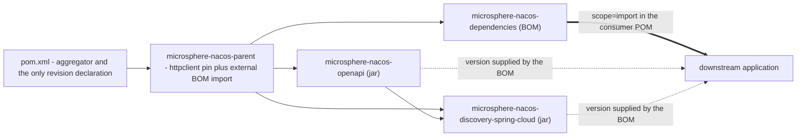

# `microsphere-nacos-dependencies` — Developer Guide (`current`)

The published BOM (bill of materials) for this repository. It manages the versions of exactly two artifacts — the two
jars this branch produces — and nothing else. 38 numbered lines, no sources, no build section, and it is consumed by **no
module in its own reactor**.

## 1. Facts

| Attribute | Value | Evidence |
| --- | --- | --- |
| Coordinates | `io.github.microsphere-projects:microsphere-nacos-dependencies:${revision}` | `microsphere-nacos-dependencies/pom.xml:13-15` |
| Packaging | `pom` | `microsphere-nacos-dependencies/pom.xml:16` |
| Maven parent | `microsphere-nacos-parent:${revision}`, `relativePath ../microsphere-nacos-parent/pom.xml` | `microsphere-nacos-dependencies/pom.xml:5-10` |
| Aggregated by the root | yes, second module entry | `pom.xml:61` |
| Length | 38 numbered lines; `wc -l` reports 37 (no final newline) | `microsphere-nacos-dependencies/pom.xml` |
| Managed artifacts | 2, both produced by this repository | `microsphere-nacos-dependencies/pom.xml:21-37` |
| `<dependencies>` / `<build>` / `<profiles>` / `<modules>` / `<properties>` | none | whole file |
| Imported by any POM in this reactor | **no** | `grep -rn "microsphere-nacos-dependencies" --include=pom.xml .` matches only its own `<artifactId>` (line 14) and the root `<module>` (`pom.xml:61`) |

## 2. The whole dependency section

```xml
<dependencyManagement>
    <dependencies>

        <dependency>
            <groupId>io.github.microsphere-projects</groupId>
            <artifactId>microsphere-nacos-openapi</artifactId>
            <version>${revision}</version>
        </dependency>

        <dependency>
            <groupId>io.github.microsphere-projects</groupId>
            <artifactId>microsphere-nacos-discovery-spring-cloud</artifactId>
            <version>${revision}</version>
        </dependency>

    </dependencies>
</dependencyManagement>
```

(`microsphere-nacos-dependencies/pom.xml:21-37`.) Both entries are `<version>${revision}</version>`, with no `<type>` and
no `<scope>`. That single shape encodes three decisions:

1. **This is a project BOM, not a platform BOM.** It never states a third-party version. `gson`, Apache HttpClient, Spring
   Boot, Spring Cloud, JUnit and logback are outside what this file *declares*. Consumers get consistency across this
   repository's own artifacts — the only consistency this repository can promise.
2. **`${revision}` keeps the BOM in lock-step with the reactor.** The property is declared once, in the root
   `pom.xml:55` (`0.2.0-SNAPSHOT` on this branch). Releasing changes that one line; the BOM needs no edit.
3. **No `<scope>` or `<type>`.** The entries describe jar artifacts, so the default `jar`/`compile` treatment is what a
   consumer needs. Compare the sibling `microsphere-nacos-parent/pom.xml:38-44`, where the *imported* BOM does need
   `<type>pom</type><scope>import</scope>`. That contrast is the entire difference between "managing an artifact" and
   "importing a BOM", and it is the one thing a reviewer must not "tidy".

Ordering is by dependency depth: `microsphere-nacos-openapi` (the library) before
`microsphere-nacos-discovery-spring-cloud` (the adapter that depends on it) — which makes the block readable as the
reactor's own graph (`microsphere-nacos-discovery-spring-cloud/pom.xml:40-44`).

## 3. What the BOM inherits, and what that means for a consumer

The parent of this POM is `microsphere-nacos-parent`, not the aggregator. That parent declares `httpclient:4.5.14` and
imports `microsphere-spring-cloud-dependencies:0.2.26` inside its own `dependencyManagement`
([microsphere-nacos-parent.md](microsphere-nacos-parent.md)). Maven merges a parent's `dependencyManagement` into the
child's effective model before imports are expanded, so the *effective* managed set of the published BOM is broader than
the 38 lines suggest:

| Source of the entry | What it contributes |
| --- | --- |
| `microsphere-nacos-dependencies/pom.xml:24-34` | `microsphere-nacos-openapi`, `microsphere-nacos-discovery-spring-cloud` at `${revision}` |
| inherited from `microsphere-nacos-parent/pom.xml:31-35` | `org.apache.httpcomponents:httpclient:4.5.14` |
| inherited through the import at `microsphere-nacos-parent/pom.xml:38-44` | everything in the external `microsphere-spring-cloud-dependencies:0.2.26` — Spring Boot, Spring Cloud, `gson`, JUnit, logback, the `microsphere-*` libraries |

Read that as: importing this BOM into an application is close to a one-stop version set — it pins this project's two
artifacts *and* the HttpClient and microsphere lines they were built against.

**Provenance of this section.** It is Maven's documented model-inheritance behaviour applied to files read from the
snapshot. It was **not** confirmed by `mvn help:effective-pom`, because Maven could not be executed in this environment,
and because the contents of `microsphere-spring-cloud-dependencies:0.2.26` live in an artifact outside this branch. Do not
quote a concrete Spring Boot, Spring Cloud or `gson` version from this document — look them up in the released BOM.

### 3.1 Precedence, when a consumer already imports other BOMs

`dependencyManagement` is first-declaration-wins, so the order of `<dependencyManagement><dependencies>` entries in the
consumer's own POM decides which BOM answers for an overlap. Two practical notes for anyone adding this BOM next to
`spring-boot-dependencies` or `spring-cloud-dependencies`:

- Declare this BOM **before** the platform BOMs if you want the versions this repository was built against to win; after
  them if you want your platform to win.
- Entries declared directly by the consumer always beat any imported BOM, in either direction.

This is Maven's rule, not a property of this file; nothing in the snapshot enforces or tests it.

## 4. `${revision}`: the CI-friendly version scheme, as observable in these POMs

`${revision}` is declared exactly once and used twelve times:

| Location | Role |
| --- | --- |
| `pom.xml:55` | **the only declaration**: `<revision>0.2.0-SNAPSHOT</revision>` |
| `pom.xml:14` | the aggregator's own `<version>` |
| `microsphere-nacos-parent/pom.xml:8,15` | parent coordinate + own coordinate |
| `microsphere-nacos-dependencies/pom.xml:8,15` | parent coordinate + own coordinate |
| `microsphere-nacos-dependencies/pom.xml:27,33` | the two managed artifact versions |
| `microsphere-nacos-openapi/pom.xml:9,15` | parent coordinate + own coordinate |
| `microsphere-nacos-discovery-spring-cloud/pom.xml:9,17,43` | parent coordinate + own coordinate + the intra-repository dependency on `microsphere-nacos-openapi` |

Two POMs deliberately do **not** use it: the external parent coordinate `microsphere-spring-cloud-parent:0.2.26`
(`pom.xml:6-10`) and the external BOM coordinate, which uses the dedicated
`microsphere-spring-cloud.version` property (`microsphere-nacos-parent/pom.xml:24,41`). Mixing those would make release
automation rewrite coordinates it must not touch.

How the scheme is exercised in this branch's own automation:

- **CI** overrides it per run: `-Drevision=0.0.1-SNAPSHOT` (`.github/workflows/maven-build.yml:52`), alongside the JDK
  matrix `17`/`21`/`25` and the `spring-cloud-2022` … `spring-cloud-2025` profile selectors (lines 25-27). CI therefore
  never publishes; it builds an arbitrary throwaway version to prove the code compiles and tests pass on each platform
  line.
- **Release** passes the real number in: `-Drevision=${{ inputs.revision }}`
  (`.github/workflows/maven-publish.yml:60`), where the `workflow_dispatch` input `revision` is declared at lines 16-19
  and validated against `^[0-9]+\.[0-9]+\.[0-9]+$` at lines 28-31; the deploy runs under the `publish,ci` profiles
  (line 63). Afterwards the "Increment patch version" step (lines 193-202) recomputes `major.minor.(patch+1)-SNAPSHOT`
  and rewrites the property with
  `sed "s|^\( *\)<revision>[^<]*</revision>|\1<revision>${NEXT_VERSION}</revision>|" pom.xml`
  (line 201) — note the target: **`pom.xml` only**, the single declaration site. The tag and the GitHub release use the
  input value (lines 94, 185).

The reactor itself never pins a Maven version in a POM; the wrapper does: `wrapperVersion=3.3.4`,
`distributionType=only-script`, `distributionUrl=…/apache-maven-3.9.16-bin.zip`
(`.mvn/wrapper/maven-wrapper.properties:1-3`) — i.e. a Maven **3.x** distribution.

### 4.1 Flattening: what is and is not observable

`${revision}` in a *published* POM is only meaningful to a reader that defines the property — which a downstream
application normally does not. The standard remedy for a Maven 3.x build is a POM-flattening step at `install`/`deploy`
(`flatten-maven-plugin`, typically with `flattenMode=resolveCiFriendliesOnly`) that substitutes the resolved version and
strips the `${revision}` placeholders.

In this snapshot: **no such configuration exists.** Grepping every POM and every workflow for `flatten` returns zero
matches; neither `microsphere-nacos-dependencies` nor `microsphere-nacos-parent` has a `<build>` section at all
([microsphere-nacos-parent.md](microsphere-nacos-parent.md)). Whatever performs the substitution, if anything does, is
contributed by the external `microsphere-spring-cloud-parent:0.2.26`, whose build configuration is not readable here.
Maven's version-3 caveat about `${revision}` inside `<parent><version>` (used at three places in this reactor, §4) falls
in the same unverifiable bucket.

Practical consequence for anyone auditing release artifacts: inspect the *published*
`microsphere-nacos-dependencies-<version>.pom`, not the file on this branch. If the published POM still contains a
literal `${revision}`, the BOM will not resolve for consumers — and that is a build-pipeline defect, not something to fix
by editing this file.

## 5. Why no module uses it

Every jar module inherits `microsphere-nacos-parent`, which already manages the third-party versions, and expresses the
intra-repository dependency with an explicit `${revision}`:

```xml
<!-- Microsphere Nacos OpenAPI -->
<dependency>
    <groupId>io.github.microsphere-projects</groupId>
    <artifactId>microsphere-nacos-openapi</artifactId>
    <version>${revision}</version>
</dependency>
```

(`microsphere-nacos-discovery-spring-cloud/pom.xml:39-44`.) A literal version rather than a versionless entry, because
the BOM is not imported into the reactor — deliberately, so that building this repository never depends on a previously
published copy of its own BOM. Do not "simplify" this by adding an import of `microsphere-nacos-dependencies` to
`microsphere-nacos-parent`: the BOM's `<parent>` **is** that POM, so the import would be circular
(`microsphere-nacos-dependencies/pom.xml:5-10`).

## 6. Import versus inherit

| You are… | Use | Why |
| --- | --- | --- |
| A downstream application that wants consistent versions of this project's jars | `<scope>import</scope>` + `<type>pom</type>` on `microsphere-nacos-dependencies:${version}` in your own `dependencyManagement` | An import merges managed *coordinates* without inheriting a build model |
| A downstream application that needs one artifact only | write `<version>` for that artifact | The BOM is worth its overhead only when two or more of these artifacts are used together; today it manages exactly two |
| A new module added **inside this reactor** | `<parent>` = `microsphere-nacos-parent` with `relativePath ../microsphere-nacos-parent/pom.xml` | Inheritance is what supplies the third-party versions; the BOM is not on the reactor's classpath of build inputs (§5) |
| A module that only wants this project's versions and nothing else | import the BOM, never inherit it | Inheriting would also drag in the whole external parent chain, including plugin and release configuration you did not ask for |

The rule of thumb: **inherit inside the reactor, import outside it.** `${revision}` makes that asymmetry safe inside
(section 4) and is the reason a consumer must read the flattened POM rather than the branch file.

## 7. Position in the release flow



All four modules deploy together, because the BOM is a `<module>` (`pom.xml:61`) and the publish job runs `deploy` over
the whole reactor (`.github/workflows/maven-publish.yml:55-63`). The workflow, not this POM, decides the destination
repository; see [README → Build and test workflow](README.md) for what the workflows do and do not disclose.

## 8. Adding a module to the BOM

1. Add `<module>` to the root `pom.xml` (lines 59-66) and give the new module `microsphere-nacos-parent` as its
   `<parent>` with the usual `relativePath`.
2. Add a third `<dependency>` block here, in the same shape as the existing two: groupId
   `io.github.microsphere-projects`, the new artifactId, `<version>${revision}</version>`, no scope, no type
   (§2, decision 3).
3. Keep third-party versions out. If the new module needs a pin this BOM does not supply, that number belongs in
   `microsphere-nacos-parent` when the source code is sensitive to it, or in the external
   `microsphere-spring-cloud-dependencies` when it is shared across the organisation — see
   [microsphere-nacos-parent.md](microsphere-nacos-parent.md).
4. Keep the entries ordered by dependency depth (leaf libraries first, adapters last).
5. If the new module is a `pom`-packaging BOM or starter rather than a jar, decide explicitly whether consumers should
   manage it: `<type>pom</type>` is required for such entries, and adding it here would make this file the first place in
   the repository that manages a non-jar coordinate.

## 9. Related documents

- [Developer guide index](README.md)
- [microsphere-nacos-parent.md](microsphere-nacos-parent.md) — the parent this BOM inherits, and where the third-party
  versions actually come from
- [microsphere-nacos-openapi.md](microsphere-nacos-openapi.md) — managed artifact 1
- [microsphere-nacos-discovery-spring-cloud.md](microsphere-nacos-discovery-spring-cloud.md) — managed artifact 2, and the
  only module in this reactor that depends on artifact 1
- [User guide: microsphere-nacos-dependencies](../../user-guide/current/microsphere-nacos-dependencies.md)
- [Docs home](../../README.md)
- [Repository README](../../../README.md)

## 中文

[中文](../zh/current/README.md)
