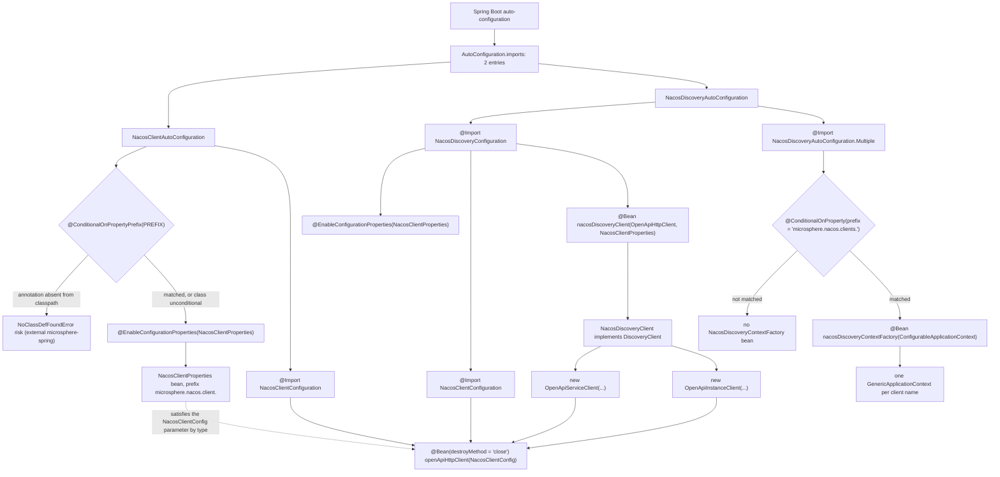
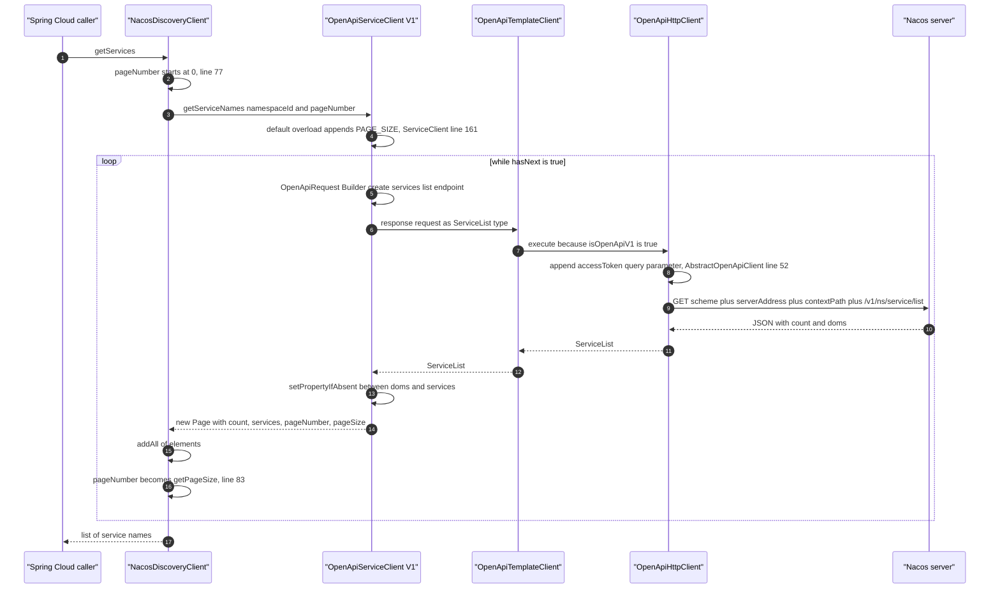
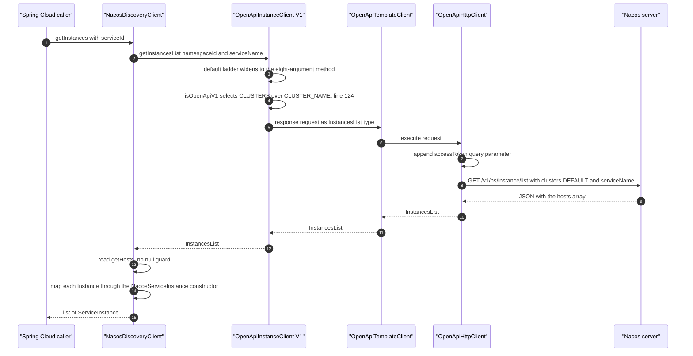

# `microsphere-nacos-discovery-spring-cloud` — Developer Guide (`current`)

The Spring Cloud adapter. It contains **no protocol logic**: it binds external configuration onto the openapi module's
`NacosClientConfig`, builds one `OpenApiHttpClient` transport bean, and exposes Nacos data through
`org.springframework.cloud.client.discovery.DiscoveryClient`. Ten classes, 590 lines of Java, one resource file, zero
tests.

Evidence base: the `release` branch snapshot at `.docs-work/release` (detached HEAD `876f588`). Nothing here was
compiled, executed, or started in a Spring context — see the [provenance rule](README.md).

## 1. Module facts

| Attribute | Value | Evidence |
| --- | --- | --- |
| Coordinates | `io.github.microsphere-projects:microsphere-nacos-discovery-spring-cloud:${revision}` | `microsphere-nacos-discovery-spring-cloud/pom.xml:15-17` |
| `${revision}` on this line | `0.2.0-SNAPSHOT` | `pom.xml:55` |
| Packaging | `jar` | `microsphere-nacos-discovery-spring-cloud/pom.xml:18` |
| Maven parent | `microsphere-nacos-parent`, `relativePath ../microsphere-nacos-parent/pom.xml` | `microsphere-nacos-discovery-spring-cloud/pom.xml:6-11` |
| Main sources | 10 `.java` files, 590 lines (`wc -l` total) | `src/main/java/io/microsphere/nacos/client` |
| Test sources | **none** — there is no `src/test` directory | directory listing |
| Resources | 1 file: `src/main/resources/META-INF/spring/org.springframework.boot.autoconfigure.AutoConfiguration.imports` | directory listing |
| Non-optional dependency | `microsphere-nacos-openapi:${revision}` | `pom.xml:40-44` |
| Everything else | `optional` (compile) or `test` | `pom.xml:23-111` |

Because this module has no tests, the CI `mvn … test` run
([README → Build and test workflow](README.md)) gains no signal from it. Every behavioural statement below is derived
from reading source, never from an executed assertion.

## 2. Dependency graph: almost everything is `optional`

Thirteen declared dependencies; exactly one reaches a consumer transitively.

| Declaration (`pom.xml`) | `optional` | scope | Reachable use in main sources |
| --- | --- | --- | --- |
| `microsphere-annotation-processor` (`:26-30`) | yes | compile | build-time metadata only; explains the odd `@since` values (see §11) |
| `microsphere-java-core` (`:33-37`) | yes | compile | not imported by any file in this module |
| `microsphere-nacos-openapi:${revision}` (`:40-44`) | **no** | compile | `InstanceClient`, `ServiceClient`, `Instance`, `InstancesList`, `Page`, `OpenApiHttpClient`, `OpenApiServiceClient`, `OpenApiInstanceClient`, `NacosClientConfig` |
| `microsphere-spring-cloud-commons` (`:47-51`) | yes | compile | `io.microsphere.spring.boot.condition.ConditionalOnPropertyPrefix`, `io.microsphere.spring.util.PropertySourcesUtils` — see the caveat below |
| `spring-cloud-commons` (`:54-58`) | yes | compile | `DiscoveryClient`, `ServiceInstance`, `DefaultServiceInstance`, `NamedContextFactory` |
| `spring-boot-starter` (`:61-65`) | yes | compile | `@Configuration`, `@Bean`, `@Import`, `@ConfigurationProperties`, `@EnableConfigurationProperties`, `@ConditionalOnProperty`, `Environment`, `PropertySource` |
| `spring-boot-starter-actuator` (`:67-71`) | yes | compile | **no import of any actuator type exists in this module** |
| `spring-boot-configuration-processor` (`:73-77`) | yes | compile | generates `spring-configuration-metadata.json` at build time |
| `spring-boot-autoconfigure-processor` (`:79-83`) | yes | compile | generates `spring-autoconfigure-metadata.properties` |
| `junit-jupiter`, `spring-boot-starter-test`, `microsphere-spring-boot-test`, `logback-classic` (`:86-111`) | no | test | resolve but run nothing — no `src/test` |

Two consequences worth internalising before you edit this POM:

1. `optional` is **not** transitive. A consumer that adds only this artifact gets the openapi client and nothing else:
   no `DiscoveryClient` interface, no Boot auto-configuration machinery, and no `microsphere-spring` classes. The host
   application must already manage Spring Boot / Spring Cloud versions — which is exactly what lets this repository
   compile under the four `spring-cloud-2022` … `spring-cloud-2025` CI profiles without pinning any of them
   (`.github/workflows/maven-build.yml:26-27`).
2. `ConditionalOnPropertyPrefix` and `PropertySourcesUtils` live in packages `io.microsphere.spring.*`, which no
   artifact produced by this repository provides. The only declaration that can supply them is
   `microsphere-spring-cloud-commons`, and its transitive layout is **external and unverifiable from this snapshot**.
   If those classes are absent at runtime, `NacosClientAutoConfiguration` and `NacosClientUtils` fail with
   `NoClassDefFoundError` — a packaging question, not a code question.

Do not "fix" a consumer's `ClassNotFoundException` by dropping `optional` here; fix the consumer's BOM.

## 3. Class inventory

All paths are relative to `microsphere-nacos-discovery-spring-cloud/src/main/java/`.

| File | Lines | Role |
| --- | --- | --- |
| `io/microsphere/nacos/client/spring/boot/autoconfigure/NacosClientAutoConfiguration.java` | 41 | Auto-configuration entry point 1: conditional, enables the properties bean, imports the transport configuration |
| `io/microsphere/nacos/client/spring/boot/NacosClientProperties.java` | 58 | `@ConfigurationProperties("microsphere.nacos.client.")`, **extends** the openapi `NacosClientConfig`, adds `discovery.namespace-id` |
| `io/microsphere/nacos/client/spring/NacosClientConfiguration.java` | 37 | `@Bean(destroyMethod = "close") OpenApiHttpClient` — the only bean that owns the connection pool and token cache |
| `io/microsphere/nacos/client/spring/util/NacosClientUtils.java` | 51 | Prefix constants and per-client property extraction for `microsphere.nacos.clients.<name>.*` |
| `io/microsphere/nacos/client/discovery/spring/cloud/autoconfigure/NacosDiscoveryAutoConfiguration.java` | 51 | Auto-configuration entry point 2: imports discovery config plus the conditional nested `Multiple` configuration |
| `io/microsphere/nacos/client/discovery/spring/cloud/NacosDiscoveryConfiguration.java` | 43 | `@Configuration(proxyBeanMethods = false)`, `@Import(NacosClientConfiguration.class)`, declares `nacosDiscoveryClient` |
| `io/microsphere/nacos/client/discovery/spring/cloud/NacosDiscoveryClient.java` | 90 | The `DiscoveryClient` implementation: `description()`, `getInstances()`, `getServices()` |
| `io/microsphere/nacos/client/discovery/spring/cloud/NacosServiceInstance.java` | 83 | Adapter: openapi `Instance` → Spring Cloud `ServiceInstance` |
| `io/microsphere/nacos/client/discovery/spring/cloud/NacosDiscoveryContextFactory.java` | 54 | `NamedContextFactory` for one child context per named Nacos client |
| `io/microsphere/nacos/client/discovery/spring/cloud/NacosDiscoverySpecification.java` | 82 | `NamedContextFactory.Specification` value object — the generic parameter of the factory above |

Two package roots coexist under one root package (`io.microsphere.nacos.client`), mirroring the openapi module rather
than the artifact name: `…client.spring.*` (client bootstrap, generic to Spring) and
`…client.discovery.spring.cloud.*` (the discovery adapter, Spring Cloud specific).

## 4. Auto-configuration bootstrap

`AutoConfiguration.imports` contains exactly two lines, in this order
(`src/main/resources/META-INF/spring/org.springframework.boot.autoconfigure.AutoConfiguration.imports`):

```text
io.microsphere.nacos.client.spring.boot.autoconfigure.NacosClientAutoConfiguration
io.microsphere.nacos.client.discovery.spring.cloud.autoconfigure.NacosDiscoveryAutoConfiguration
```

There is no `META-INF/spring.factories` in this module, so the host application must run on a Spring Boot version that
reads `AutoConfiguration.imports`. Both entries are annotated `@Configuration`, **not** `@AutoConfiguration`, and
neither declares `@AutoConfigureAfter`/`@AutoConfigureBefore`: ordering between the two entry points is Boot's default
alphabetical/registration ordering, not something this module controls.



Read three things out of that graph.

**(a) The two entry points are independent, not ordered.** `NacosDiscoveryConfiguration` itself declares
`@Import(NacosClientConfiguration.class)` (`NacosDiscoveryConfiguration.java:35`) and
`@EnableConfigurationProperties(NacosClientProperties.class)` (`:34`). So even if `NacosClientAutoConfiguration` were
removed from the imports file, the discovery path still produces a properties bean and a transport bean. The redundancy
is deliberate: the discovery module is usable without the client auto-configuration.

**(b) `NacosClientAutoConfiguration`'s guard is external.** The whole class is:

```java
@ConditionalOnPropertyPrefix(PREFIX)
@Configuration(proxyBeanMethods = false)
@EnableConfigurationProperties(NacosClientProperties.class)
@Import(value = {
        NacosClientConfiguration.class
})
public class NacosClientAutoConfiguration {
}
```

(`spring/boot/autoconfigure/NacosClientAutoConfiguration.java:34-41`; `PREFIX` is statically imported from
`NacosClientProperties` at line 26.) `ConditionalOnPropertyPrefix` is `io.microsphere.spring.boot.condition`
(line 21) — not a Spring Boot annotation — so its matching rule cannot be read from this snapshot. Note the shape of the
risk, which *is* local: `NacosClientConfiguration.openApiHttpClient(NacosClientConfig)` constructs
`new OpenApiHttpClient(nacosClientCOnfig)` unconditionally (`spring/NacosClientConfiguration.java:33-36`), so if the
guard does not apply and `server-address` was never set, the transport is built with `serverAddress == null`. Where that
fails first is a property of the openapi module (`transport/OpenApiHttpClient.java`, `buildRootPath`).

**(c) The nested `Multiple` configuration uses Spring Boot's annotation with a prefix and no name.**

```java
@Configuration(proxyBeanMethods = false)
@Import(value = {
        NacosDiscoveryConfiguration.class,
        NacosDiscoveryAutoConfiguration.Multiple.class
})
public class NacosDiscoveryAutoConfiguration {

    @ConditionalOnProperty(prefix = NACOS_CLIENTS_PROPERTY_NAME_PREFIX)
    public static class Multiple {

        @Bean
        public NacosDiscoveryContextFactory nacosDiscoveryContextFactory(ConfigurableApplicationContext parentContext) {
            return new NacosDiscoveryContextFactory(parentContext);
        }
    }
}
```

(`discovery/spring/cloud/autoconfigure/NacosDiscoveryAutoConfiguration.java:35-49`, with
`NACOS_CLIENTS_PROPERTY_NAME_PREFIX = "microsphere.nacos.clients."` statically imported at line 27 and defined at
`spring/util/NacosClientUtils.java:35`.) `org.springframework.boot.autoconfigure.condition.ConditionalOnProperty` is
imported at line 21 and applied with only `prefix` — no `name`, no `value`, no `havingValue`, no `matchIfMissing`.
Spring Boot's `OnPropertyCondition` decides what that means, and that class is external here, so **this guide does not
assert that it matches "at least one property under the prefix"**. If you depend on the multi-client context factory,
verify it once with `--debug` (the conditions evaluation report) rather than inferring it. The surrounding asymmetry is
local and certain: `NacosDiscoveryConfiguration` is imported unconditionally, so a single-client application gets a
`NacosDiscoveryClient` bean without configuring anything.

## 5. Configuration binding

`NacosClientProperties` is not a parallel configuration model — it *is* the openapi model:

```java
@ConfigurationProperties(prefix = PREFIX)
public class NacosClientProperties extends NacosClientConfig {

    public static final String PREFIX = PROPERTY_NAME_PREFIX;

    private Discovery discovery = new Discovery();
    ...
    public static class Discovery {
        private String namespaceId;
    }
}
```

(`spring/boot/NacosClientProperties.java:31-57`.) `PREFIX` resolves to `Constants.PROPERTY_NAME_PREFIX` from the openapi
module, whose literal is `"microsphere.nacos.client."` including the trailing dot
(`microsphere-nacos-openapi/src/main/java/io/microsphere/nacos/client/constants/Constants.java:38`). Inheriting
`NacosClientConfig` is what makes binding free: every setter in that class is bindable under this prefix with no
annotation of its own.

| Property (prefix `microsphere.nacos.client.`) | Declared in | Default / note |
| --- | --- | --- |
| `server-address` | openapi `NacosClientConfig:57` | no default, `null` unless set |
| `scheme` | openapi `NacosClientConfig:62` | `http` |
| `context-path` | openapi `NacosClientConfig:67` | `/nacos` |
| `user-name`, `password` | openapi `NacosClientConfig:72,77` | drive `isAuthorizationEnabled()` |
| `access-key`, `secret-key` | openapi `NacosClientConfig:82,87` | bound, **never read by any main source in this snapshot** |
| `name` | openapi `NacosClientConfig:47` | reused as the child-context property name, §8 |
| `application-name`, `encoding` | openapi `NacosClientConfig:52,137` | |
| `max-connections`, `max-per-route` | openapi `NacosClientConfig:92,97` | defaults from `Constants` (system properties) |
| `connection-timeout`, `read-timeout`, `long-polling-timeout`, `event-processing-timeout` | openapi `NacosClientConfig:102-117` | same |
| `fetching-config-thread-name`, `listener-config-thread-name`, `publishing-config-event-thread-name` | openapi `NacosClientConfig:122-137` | |
| `discovery.namespace-id` | **this module**, `NacosClientProperties.Discovery:48` | read once, in `NacosDiscoveryClient`'s constructor |

A second, unrelated prefix governs multi-client setups only: `microsphere.nacos.clients.<name>.*`
(`spring/util/NacosClientUtils.java:35`). `microsphere.nacos.client.x` never feeds `microsphere.nacos.clients.a.x`; the
only bridge between the two namespaces is `NacosClientUtils`, which turns a per-client block into a `PropertySource`
that child contexts can read as if it were the flat `microsphere.nacos.client.*` namespace (§8).

`NacosClientUtils` is small and has three members:

```java
public static final String NACOS_CLIENTS_PROPERTY_NAME_PREFIX = "microsphere.nacos.clients.";

public static String buildNacosClientPropertyNamePrefix(String nacosClientName) { ... + nacosClientName + "."; }

public static Map<String, Object> getNacosClientProperties(ConfigurableEnvironment environment, String nacosClientName) {
    String prefix = buildNacosClientPropertyNamePrefix(nacosClientName);
    return getSubProperties(environment, prefix);
}

public static PropertySource getNacosCilentPropertySource(ConfigurableEnvironment environment, String nacosClientName) {
    Map properties = getNacosClientProperties(environment, nacosClientName);
    return new MapPropertySource(nacosClientName, properties);
}
```

(`spring/util/NacosClientUtils.java:35-49`; the class is `abstract` with only static members — a utility, not a bean.)
`getSubProperties` is a static import from `io.microsphere.spring.util.PropertySourcesUtils` (line 25). **Whether the
returned keys keep or drop the `microsphere.nacos.clients.<name>.` prefix is decided inside that external class and is
not verifiable from this snapshot** — and no test exercises it. Two local observations are certain: the method name is
misspelled `getNacosCilentPropertySource` (line 46) and `Map` is used raw (line 47). Renaming the method requires
updating the static import in `NacosDiscoveryContextFactory.java:26`.

## 6. `NacosDiscoveryClient`

```java
public class NacosDiscoveryClient implements DiscoveryClient {

    private final ServiceClient serviceClient;

    private final InstanceClient instanceClient;

    private final NacosClientProperties nacosClientProperties;

    private final String namespaceId;

    public NacosDiscoveryClient(OpenApiHttpClient openApiHttpClient, NacosClientProperties nacosClientProperties) {
        this.serviceClient = new OpenApiServiceClient(openApiHttpClient, nacosClientProperties);
        this.instanceClient = new OpenApiInstanceClient(openApiHttpClient, nacosClientProperties);
        this.nacosClientProperties = nacosClientProperties;
        this.namespaceId = nacosClientProperties.getDiscovery().getNamespaceId();
    }
```

(`discovery/spring/cloud/NacosDiscoveryClient.java:43-58`.) Four consequences, all readable from those lines:

1. **Hard-wired to Open API V1.** It constructs `io.microsphere.nacos.client.v1.discovery.OpenApiServiceClient` and
   `…v1.discovery.OpenApiInstanceClient` (imports at lines 26-27). `OpenApiTemplateClient.getOpenApiVersion()` returns
   `V1` unless a subclass overrides it, and neither V1 client overrides it. Reaching V2 from Spring Cloud means a
   different `DiscoveryClient`, not a flag.
2. **The domain clients are collaborators, not beans.** They are plain `new` objects (lines 54-55), so they are not
   injectable or proxied. Only the shared transport is a bean — which is why the connection pool and the access-token
   cache are global while per-client domain logic is not.
3. **`namespaceId` is captured at construction** (line 57). Changing `microsphere.nacos.client.discovery.namespace-id`
   later has no effect on an existing client; `nacosClientProperties` is stored (line 56) but never re-read.
4. **The parameter type is the concrete `OpenApiHttpClient`**, not the `OpenApiClient` interface (line 53), even though
   both V1 client constructors accept `OpenApiClient`
   (`v1/discovery/OpenApiServiceClient.java:61`, `v1/discovery/OpenApiInstanceClient.java:90`). Swapping the transport
   for a test double therefore requires subclassing this class.

`description()` returns the literal `"DiscoveryClient - Nacos"` (lines 60-63).

### 6.1 `getServices()` — the only paginating path

```java
@Override
public List<String> getServices() {
    List<String> allServiceNames = new LinkedList<>();

    int pageNumber = 0;
    Page<String> serviceNames = serviceClient.getServiceNames(namespaceId, pageNumber);

    allServiceNames.addAll(serviceNames.getElements());

    while (serviceNames.hasNext()) {
        pageNumber = serviceNames.getPageSize();
        serviceNames = serviceClient.getServiceNames(namespaceId, pageNumber);
        allServiceNames.addAll(serviceNames.getElements());
    }

    return allServiceNames;
}
```

(`NacosDiscoveryClient.java:73-89`.)



Wire details, from the openapi module:

| Step | Code | Result |
| --- | --- | --- |
| Endpoint | `getServicesListEndpoint()` = `getEndpointPath() + SERVICES_LIST_ENDPOINT` (`v1/discovery/OpenApiServiceClient.java:59,136`) | `/v1` + `/ns/service/list` |
| Query parameters | `NAMESPACE_ID`, `SERVICE_GROUP_NAME`, `PAGE_NUMBER`, `PAGE_SIZE` (`OpenApiServiceClient.java:96-101`) | `namespaceId`, `groupName`, `pageNo`, `pageSize` (`transport/OpenApiRequestParam.java:60,65,124,245`) |
| Page size | `ServiceClient.getServiceNames(namespaceId, pageNumber)` → `PAGE_SIZE` (`common/discovery/ServiceClient.java:161-162`) | `Constants.PAGE_SIZE = getInteger("microsphere.nacos.client.page-size", 10)` (`constants/Constants.java:227`) — a **system property**, not a `NacosClientConfig` field, so `application.yml` cannot change it on this path |
| Full URL | `buildURI` / `buildRootPath` (`transport/OpenApiHttpClient.java:184-233`) | `scheme://serverAddress + contextPath + endpoint + ?query` |
| Return type | `new Page<>(serviceList.getCount(), serviceList.getServices(), pageNumber, pageSize)` (`OpenApiServiceClient.java:105`) | `Page.getElements()` is null-safe (`common/model/Page.java:55`) |

### 6.2 Pagination caveat, derived from `Page`

`Page`'s own definitions (`common/model/Page.java`):

```java
public boolean hasNext() {
    return pageNumber < totalPages - 1;
}
...
public Page(int totalElements, List<E> elements, int pageNumber, int pageSize) {
    this((size(elements) == 0 ? 1 : (int) Math.ceil((double) totalElements / (double) pageSize)), totalElements, elements);
```

with `totalPages` computed from the *fetched* page's element count, and `isFirst()` testing `pageNumber == 1` (line 126)
while `isLast()`/`hasNext()` use 0-based comparisons (lines 135, 153) — `Page` mixes both conventions internally.

Combining those with the loop body gives behaviour you must know before relying on `getServices()`:

- The loop advances with `pageNumber = serviceNames.getPageSize()` (line 83). `getPageSize()` is the **page size** (10
  by default), not `pageNumber + 1`. The second request therefore asks for `pageNo=10`, not page 2.
- The first request uses `pageNumber = 0` (line 77) while `Constants.DEFAULT_PAGE_NUMBER` is `1` (`Constants.java:153`)
  and the no-page-number overload starts at `PAGE_NUMBER` (`ServiceClient.java:151`). The entry points disagree on the
  page-number base.
- Arithmetically, with `pageSize = 10`: `count <= 10` → one request; `11 <= count <= 110` → a second `pageNo=10`
  request whose result is very likely empty, `totalPages` becomes `1`, `hasNext()` is `10 < 0` = false, so the loop stops
  **after having skipped pages 1..9**; `count >= 111` → `totalPages >= 12`, `hasNext()` stays true and `pageNumber` is
  reset to the same `10` forever, so the loop re-requests the same page and appends it to a `LinkedList` without
  terminating.

The only part of that which is not local is what a real Nacos server answers for `pageNo=10`; no server was reachable
while writing this, and no test pins it. If you fix the loop, keep the fix inside `NacosDiscoveryClient`: `Page` and the
`ServiceClient` default overloads are shared with the config-history and other call paths.

### 6.3 `getInstances(serviceId)`

```java
@Override
public List<ServiceInstance> getInstances(String serviceId) {
    String serviceName = serviceId;
    InstancesList instancesList = instanceClient.getInstancesList(namespaceId, serviceName);
    List<Instance> instances = instancesList.getHosts();
    return instances.stream().map(NacosServiceInstance::new).collect(Collectors.toList());
}
```

(`NacosDiscoveryClient.java:65-71`.)



The widening ladder is a chain of `default` methods on `InstanceClient`: the two-argument call at line 68 of the adapter
resolves to `InstanceClient.java:441` → `getInstancesList(namespaceId, serviceName, null, (Integer) null)` (line 455) →
`getInstancesList(namespaceId, DEFAULT_GROUP_NAME, serviceName, ip, port)` (line 483) →
`getInstancesList(namespaceId, groupName, DEFAULT_CLUSTER_NAME, serviceName, ip, port)` (line 515) → … → the single
abstract eight-argument method (`InstanceClient.java:591-592`). `DEFAULT_GROUP_NAME` is `"DEFAULT_GROUP"`,
`DEFAULT_CLUSTER_NAME` `"DEFAULT"`, `DEFAULT_HEALTHY_ONLY` `false` (`constants/Constants.java:237,242,163`). The
concrete implementation is `OpenApiInstanceClient.getInstancesList(...)` at `v1/discovery/OpenApiInstanceClient.java:121`
against endpoint `/v1/ns/instance/list` (`:82,223`), and it is the one place the discovery flow can see the version
switch: `OpenApiRequestParam clusterParam = isOpenApiV1() ? CLUSTERS : CLUSTER_NAME;` (`:124`). For this module the
answer is always `clusters`.

The instance array in the V1 response is named `hosts` — which is why the adapter reads `getHosts()`
(`common/discovery/model/InstancesList.java:63,177`) rather than a `getInstances()`. Unlike `Page.getElements()`, that
getter has no null fallback: a response without a `hosts` key leaves the field `null`, and `instances.stream()` (line 70)
throws `NullPointerException` inside Spring Cloud's discovery call.

No `try`/`catch` wraps either method. A unreachable or unauthorized server surfaces as whatever the openapi module
throws (`OpenApiClientException` and friends — see
[microsphere-nacos-openapi.md](microsphere-nacos-openapi.md)), so a load-balancer refresh propagates instead of
degrading to an empty list.

## 7. `NacosServiceInstance`: the adapter

One wrapped openapi model, every accessor delegated, two hard-coded answers.

| `ServiceInstance` method | Implementation | Source |
| --- | --- | --- |
| `getInstanceId()` | `instance.getInstanceId()` | `NacosServiceInstance.java:41-43` |
| `getServiceId()` | `instance.getService()` | `:46-48` |
| `getHost()` | `instance.getIp()` | `:51-53` |
| `getPort()` | `instance.getPort()` | `:56-58` |
| `isSecure()` | `false`, literal | `:61-63` |
| `getUri()` | `DefaultServiceInstance.getUri(this)` | `:66-68` |
| `getMetadata()` | `instance.getMetadata()` | `:71-73` |
| `getScheme()` | `"http"`, literal | `:76-78` |
| `getInstance()` | the wrapped openapi model — the escape hatch | `:80-82` |

`getUri()` deliberately delegates to Spring Cloud's static helper instead of assembling a `URI`, so the URI is composed
exactly as the framework defines it — from `getScheme()`, `getHost()`, `getPort()` and the default `getContextPath()`.
Because `getScheme()` is the literal `"http"` and `isSecure()` the literal `false`, **TLS endpoints cannot be expressed
through this adapter**, even though `NacosClientConfig` carries a `scheme` field: neither method consults the wrapped
instance or the client configuration. Cast or unwrap via `getInstance()` when you need `weight`, `healthy`, `enabled`,
`clusterName` or `ephemeral`.

Where each value actually comes from in the openapi model — a four-level hierarchy:

| Adapter read | Declaring class | Source |
| --- | --- | --- |
| `getInstanceId()`, `getService()` | `Instance` (the leaf) | `common/discovery/model/Instance.java:48,56` |
| `getHealthy()` | `NewInstance extends GenericInstance` | `NewInstance.java:28,34` |
| `getMetadata()` | `GenericInstance extends BaseInstance` | `GenericInstance.java:30,56` |
| `getIp()`, `getPort()` | `BaseInstance extends DiscoverableModel` | `BaseInstance.java:28,47,55` |
| `getClusterName()`, `getServiceName()`, `getGroupName()`, `getNamespaceId()` | `DiscoverableModel` (protected fields) | `DiscoverableModel.java:29,39-60` |

## 8. Multi-client support: `NacosDiscoveryContextFactory`

```java
public class NacosDiscoveryContextFactory extends NamedContextFactory<NacosDiscoverySpecification> {

    private final ConfigurableApplicationContext parentContext;

    private static final String NACOS_DISCOVERY_PROPERTY_NAME = "nacos-discovery";

    public NacosDiscoveryContextFactory(ConfigurableApplicationContext parentContext) {
        super(NacosDiscoveryConfiguration.class, NACOS_DISCOVERY_PROPERTY_NAME, PREFIX + "name");
        setApplicationContext(parentContext);
        this.parentContext = parentContext;
    }

    @Override
    public GenericApplicationContext buildContext(String name) {
        GenericApplicationContext context = super.buildContext(name);
        PropertySource nacosClientPropertySource = getNacosCilentPropertySource(this.parentContext.getEnvironment(), name);
        ConfigurableEnvironment environment = context.getEnvironment();
        environment.getPropertySources().addAfter(NACOS_DISCOVERY_PROPERTY_NAME, nacosClientPropertySource);
        return context;
    }
}
```

(`discovery/spring/cloud/NacosDiscoveryContextFactory.java:34-53`.) It follows the per-load-balancer-context pattern
Spring Cloud uses, with three local specifics:

- **The three `super(...)` arguments.** Read against the external signature
  `NamedContextFactory(Class<?> defaultConfig, String propertySourceName, String propertyName)` — that class is not in
  this snapshot, so the parameter roles below are inferred from the call site and from the artifact's published
  contract, not verified here: `defaultConfig = NacosDiscoveryConfiguration.class` (registered in every child context),
  `propertySourceName = "nacos-discovery"`, `propertyName = PREFIX + "name"` = `microsphere.nacos.client.name`. The
  third argument is why `name` appears twice in this guide: the same key is both a `NacosClientConfig` field and the
  child-context marker property.
- **`buildContext` layers the per-client block.** For client `order`, `getNacosCilentPropertySource` harvests
  everything under `microsphere.nacos.clients.order.` from the **parent** environment and adds it as a `MapPropertySource`
  named `order`, positioned immediately after `nacos-discovery` with `addAfter(...)` — i.e. one slot *below* it in
  resolution priority. Expected YAML shape:

  ```yaml
  microsphere:
    nacos:
      clients:
        order:
          server-address: 127.0.0.1:8848
          user-name: nacos
          password: nacos
          discovery:
            namespace-id: order-ns
  ```

  Whether those harvested keys are visible to `NacosClientProperties` binding inside the child context depends entirely
  on the prefix handling of the external `getSubProperties` (§5) — unverified, and the single most important thing to
  test first if you adopt multi-client mode.
- **`setApplicationContext(parentContext)` is called manually**, by the constructor rather than by the container,
  because the `@Bean` method receives the parent context as a parameter
  (`NacosDiscoveryAutoConfiguration.java:46`). `buildContext` then dereferences `this.parentContext.getEnvironment()`
  with no null check (line 49), so the factory must be constructed with a live context before the first
  `getContext(name)`.

Two things this snapshot does **not** establish, stated so you do not assume them:

1. `NacosDiscoveryConfiguration` is the *default configuration of every child context*, and it imports
   `NacosClientConfiguration` — so each child context **defines its own `openApiHttpClient` bean**. Whether an
   injection point inside a child resolves to that local definition or to the ancestor's is Spring's rule, external and
   unverified here. If the local one wins (which is what the re-import suggests is intended), each named client gets its
   own Apache connection pool and its own access-token refresh scheduler; the [openapi module's auth lifecycle](microsphere-nacos-openapi.md)
   multiplies per context accordingly.
2. Teardown. `NacosDiscoveryContextFactory` overrides no destroy method; whatever `NamedContextFactory` does on context
   close lives in the external Spring Cloud artifact. The `destroyMethod = "close"` on the transport bean
   (`spring/NacosClientConfiguration.java:33`) only fires when the context that owns the bean is closed.

`NacosDiscoverySpecification` (`discovery/spring/cloud/NacosDiscoverySpecification.java:30-81`) is the `Specification`
value object the generic parameter expects: `name` + `Class<?>[] configuration`, a package-private no-arg constructor
(line 36), public constructor (39), setters (48, 56), `equals` on `Objects.equals(name)` plus `Arrays.equals(configuration)`
(60-70), matching `hashCode` (73-75) and a hand-built `toString` (78-81). It carries **no Nacos-specific logic and is
instantiated nowhere in this snapshot** — grep for the type hits only the factory's generic parameter
(`NacosDiscoveryContextFactory.java:34`). The `super(NacosDiscoveryConfiguration.class, …)` call makes the default
configuration path sufficient, so the `Specification` slot is currently unused machinery.

## 9. Design patterns, asserted from source only

| Pattern | Where | Evidence |
| --- | --- | --- |
| Adapter | `NacosServiceInstance` implements Spring's `ServiceInstance` over the openapi `Instance`, changing neither type | `NacosServiceInstance.java:32-82` |
| Delegation over a shared collaborator | `NacosDiscoveryClient` constructor builds two domain clients over one injected `OpenApiHttpClient` | `NacosDiscoveryClient.java:53-58` |
| Facade (narrow) | two `DiscoveryClient` methods hide paging, request building, deserialization and auth | `NacosDiscoveryClient.java:65-89` |
| Properties binding as configuration strategy | `NacosClientProperties extends NacosClientConfig`, so zero new binding code is needed for the 19 inherited keys | `NacosClientProperties.java:31-34` |
| Factory-of-contexts / registry | `NamedContextFactory` subclass keyed by client name | `NacosDiscoveryContextFactory.java:34-53` |
| Template Method (override-then-extend) | `buildContext` calls `super.buildContext(name)` and then mutates the returned context's environment | `NacosDiscoveryContextFactory.java:47-52` |
| Strategy expressed as property-source order | `addAfter(NACOS_DISCOVERY_PROPERTY_NAME, …)` — ordering *is* the resolution rule for multi-client | `NacosDiscoveryContextFactory.java:51` |
| Value object | `NacosDiscoverySpecification` with `equals`/`hashCode`/`toString` only | `NacosDiscoverySpecification.java:30-81` |
| Composition root via `@Import`, no component scan | `NacosClientAutoConfiguration`, `NacosDiscoveryAutoConfiguration`, `NacosDiscoveryConfiguration` | §4 |

Builder, Observer, the serialization SPI and the version Strategy all live in the openapi module, not here — see
[microsphere-nacos-openapi.md](microsphere-nacos-openapi.md).

## 10. Extension points

- **Add another `DiscoveryClient` flavour (reactive, registration-aware, health).** Nothing here implements
  `ReactiveDiscoveryClient`, `ServiceRegistry`, `AutoServiceRegistration` or a heartbeat monitor. Create the class under
  `io.microsphere.nacos.client.discovery.spring.cloud`, declare a `@Bean` in `NacosDiscoveryConfiguration` (or a sibling
  configuration), and register the new auto-configuration class in
  `META-INF/spring/org.springframework.boot.autoconfigure.AutoConfiguration.imports`. That file is the only registration
  mechanism present — no `spring.factories`, no ordering annotations — so do not assume your class runs before or after
  the existing two.
- **Switch to Open API V2.** Build the `v2` domain clients over the same `OpenApiHttpClient` bean and write your own
  `DiscoveryClient`. Subclassing `NacosDiscoveryClient` is a poor route: its fields are `private final` and its
  constructor names the V1 types literally (`NacosDiscoveryClient.java:45-58`).
- **Make the page loop correct.** Fix it in `NacosDiscoveryClient.getServices()` (line 83), not in `Page` or in
  `ServiceClient`'s default overloads — both are shared with the config-history and namespace paths, and `PAGE_SIZE` is
  read from a system property by `Constants` (§6.1).
- **Expose TLS.** Two local options: subclass `NacosServiceInstance` (its constructor is `public`) and override
  `getScheme()`/`isSecure()` from `NacosClientConfig.getScheme()`, or write your own adapter that maps a secure port from
  `getInstance()`. Setting `microsphere.nacos.client.scheme=https` changes the transport's URL but not what this adapter
  reports (§7).
- **Per-client overrides.** Multi-client support is a property-source layering trick, not a bean factory: to add a new
  per-client key, add it to `NacosClientProperties` (or inherit it from `NacosClientConfig`), then verify the extracted
  map in the child context actually carries it — see §8 caveat 1.

## 11. Conventions specific to this module

- Apache-2.0 header on all ten files; `@author <a href="mailto:mercyblitz@gmail.com">Mercy</a>` plus an `@since` tag.
  The `@since` values here are *type names* (`@since Configuration`, `@since ServiceInstance`,
  `@since NamedContextFactory.Specification`, `@since NacosClientConfig`) rather than versions in 8 of 10 files;
  `NacosDiscoveryClient.java:41` and `NacosClientUtils.java:31` use `@since 1.0.0`. They look machine-generated
  (consistent with the optional `microsphere-annotation-processor` dependency) — leave them alone in review.
- `@Configuration(proxyBeanMethods = false)` on all three configuration classes; never introduce inter-bean method calls.
- `@Import` everywhere, `@ComponentScan` nowhere; no class in this module is annotated `@Component`.
- Own-module constants and helpers are reached by **static import** (`PREFIX`,
  `NACOS_CLIENTS_PROPERTY_NAME_PREFIX`, `getNacosCilentPropertySource`), matching the openapi module's style.
- Packages follow the openapi module's root (`io.microsphere.nacos.client.*`) rather than the artifact name, so
  `…client.spring.*` and `…client.discovery.spring.cloud.*` are siblings.
- `NacosClientConfiguration.java:34` names its parameter `nacosClientCOnfig` (capital `O`). Harmless — resolution is by
  type — but do not "fix" it into a `@ConfigurationProperties` binding problem by renaming blindly.

## 12. Observed limitations of this version line

Each row is checkable at the cited path; none is a runtime observation.

| Observation | Location | Effect |
| --- | --- | --- |
| No test sources at all | `microsphere-nacos-discovery-spring-cloud/src` (no `src/test`) | Four test dependencies resolve but run nothing |
| `getPageSize()` used as the next page number | `NacosDiscoveryClient.java:83` | Second request is `pageNo=10`; pages 1..9 are never fetched, and `count >= 111` never terminates (§6.2) |
| First page requested as `pageNumber = 0` | `NacosDiscoveryClient.java:77` | Disagrees with `Constants.DEFAULT_PAGE_NUMBER = 1` and with the `getServiceNames(namespaceId)` overload |
| `PAGE_SIZE` is a system property, not configuration | `ServiceClient.java:161-162`, `Constants.java:227` | `microsphere.nacos.client.page-size` in `application.yml` is ignored on this path |
| `getHosts()` used without a null guard | `NacosDiscoveryClient.java:69-70`, `InstancesList.java:63,177` | A response without `hosts` produces `NullPointerException` |
| `isSecure()` and `getScheme()` hard-coded | `NacosServiceInstance.java:61-63,76-78` | HTTPS and per-instance scheme are unrepresentable |
| `namespaceId` captured in the constructor | `NacosDiscoveryClient.java:57` | Namespace changes require a new client bean |
| `accessKey`/`secretKey` bound but unread in this snapshot | `NacosClientConfig.java:82,87` | AK/SK appears configurable but is not wired into the transport |
| `@ConditionalOnPropertyPrefix` is an external annotation applied with a prefix constant | `NacosClientAutoConfiguration.java:21,34` | Guard semantics unverifiable; if the class is absent, the transport bean is created with `serverAddress` unset |
| Prefix-only `@ConditionalOnProperty` on the nested `Multiple` class | `NacosDiscoveryAutoConfiguration.java:21,42` | Matching rule is Spring Boot's, external here — verify with `--debug` instead of inferring |
| `microsphere.nacos.clients.<name>.*` key mapping depends on external `getSubProperties` | `NacosClientUtils.java:25,43` | Whether child contexts see the per-client values is unverified |
| Each child context re-imports the transport configuration | `NacosDiscoveryConfiguration.java:35`, `NacosClientConfiguration.java:33-36` | Potentially one connection pool and one token refresher per named client (§8) |
| `NacosDiscoverySpecification` never instantiated | whole module | Dead `Specification` slot; only the generic parameter uses it |
| `spring-boot-starter-actuator` and `microsphere-java-core` declared, never imported by main sources | `pom.xml:33-37,67-71` | Dead declarations today, or placeholders for an endpoint that does not exist on this branch |
| `getNacosCilentPropertySource` misspelled; raw `Map` | `NacosClientUtils.java:46-47` | Cosmetic; renaming touches the static import at `NacosDiscoveryContextFactory.java:26` |
| No exception handling around `getInstances`/`getServices` | `NacosDiscoveryClient.java:65-89` | Server errors propagate into Spring Cloud rather than degrading |

## 13. Related documents

- [Developer guide index](README.md)
- [microsphere-nacos-openapi internals](microsphere-nacos-openapi.md) — the transport, auth and version seam this module
  delegates to
- [microsphere-nacos-parent.md](microsphere-nacos-parent.md) — why every Spring version in `pom.xml` is written without a
  `<version>`
- [microsphere-nacos-dependencies.md](microsphere-nacos-dependencies.md) — how a consumer gets this artifact's version
- [User guide: microsphere-nacos-discovery-spring-cloud](../../user-guide/current/microsphere-nacos-discovery-spring-cloud.md)
- [Docs home](../../README.md)
- [Repository README](../../../README.md)

## 中文

[中文](../zh/current/README.md)
