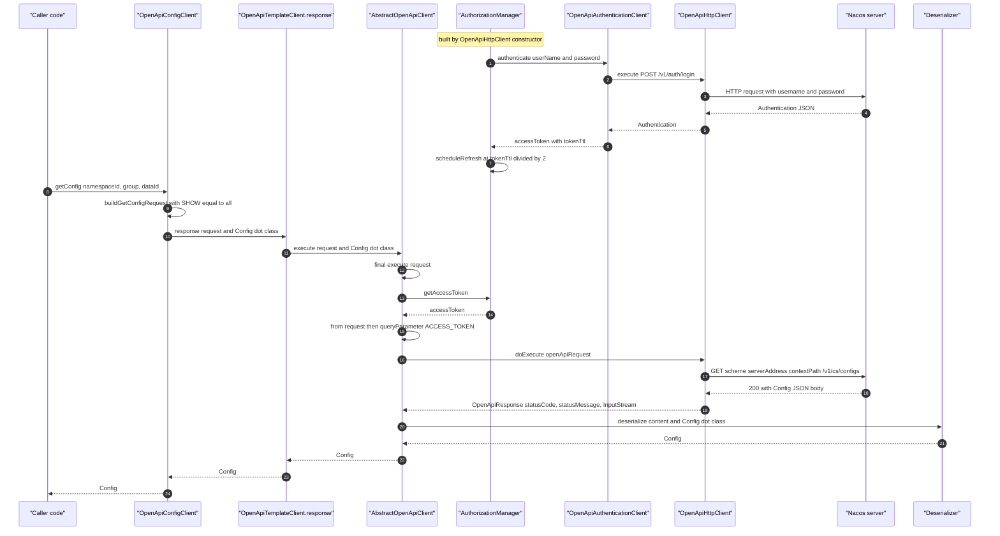
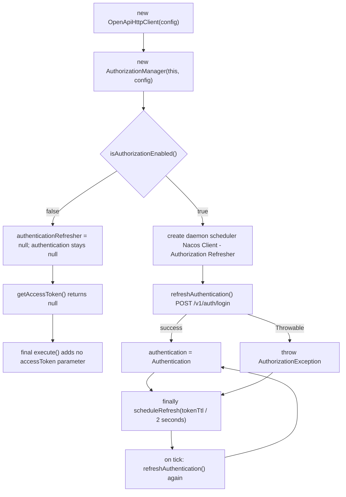
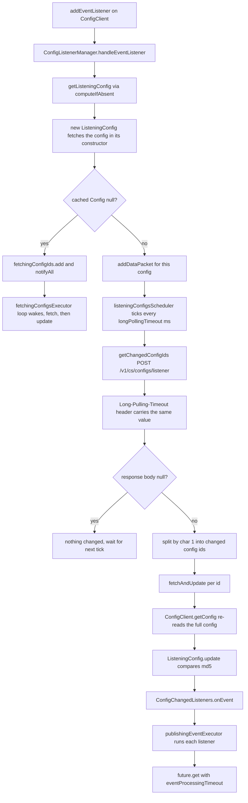
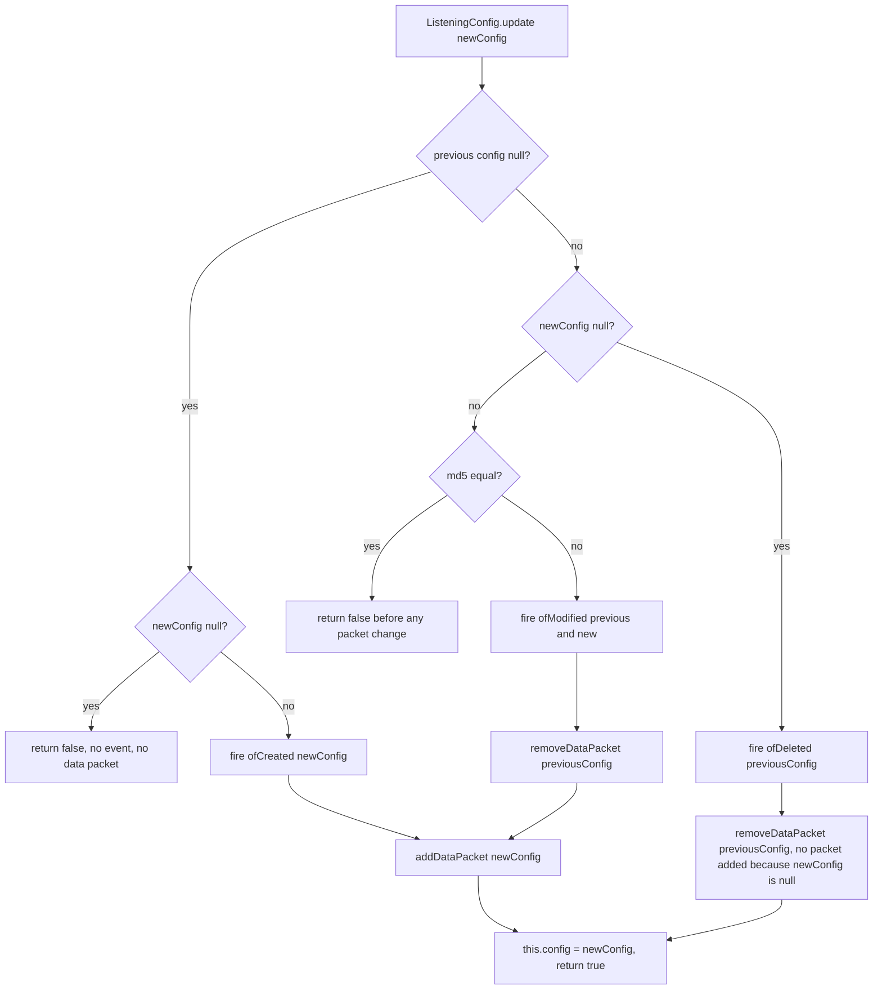
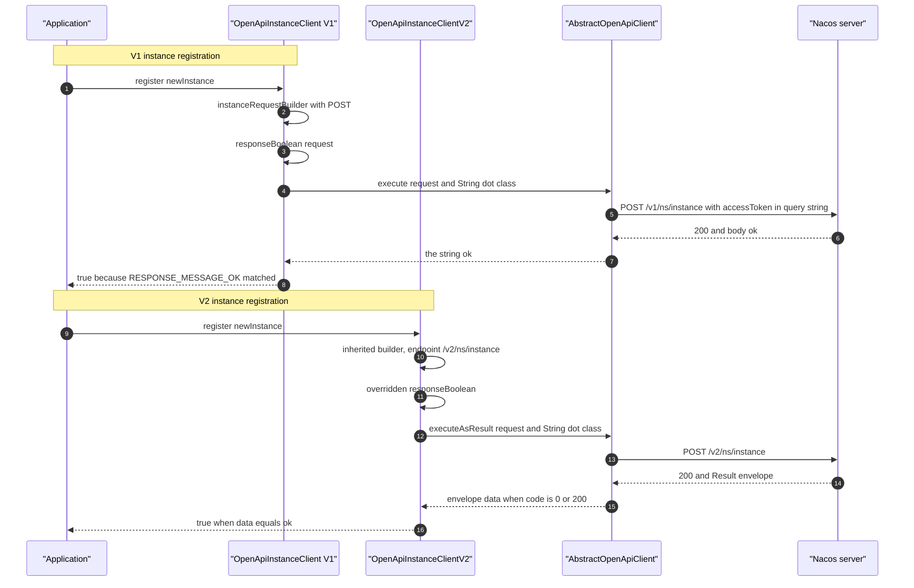
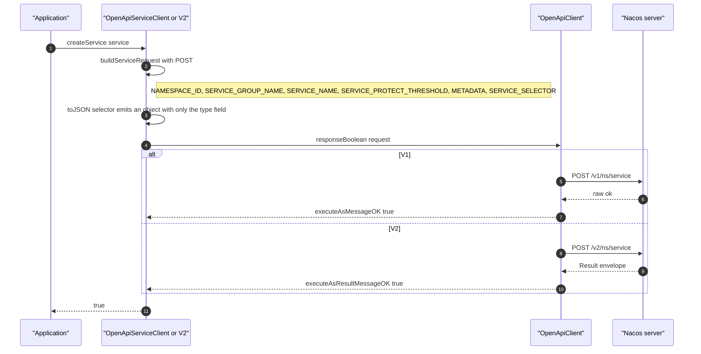
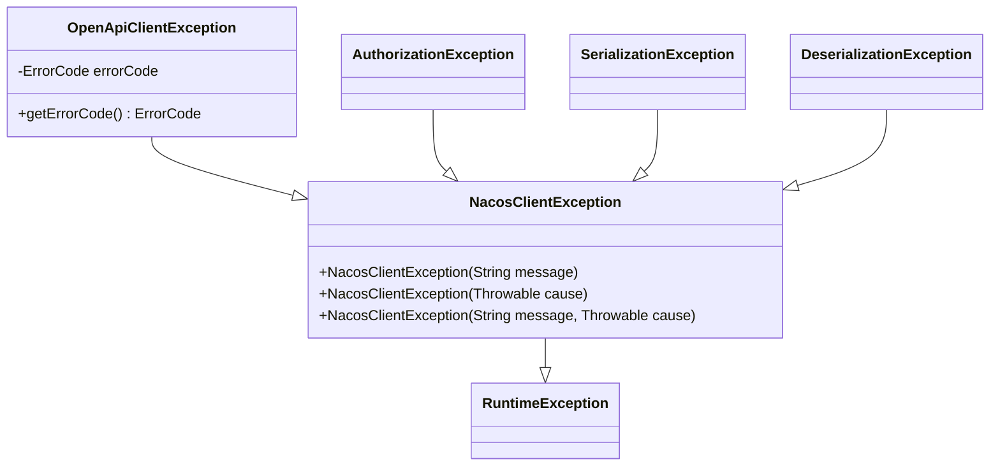

# `microsphere-nacos-openapi` — Developer Guide (`current`)

The framework-neutral Nacos Open-API client. It owns **no** Spring dependency: the whole module is plain Java plus
Apache HttpClient 4.x and Gson. Everything a caller needs — configuration, transport, serialization, versioned
endpoints, auth-token lifecycle, config long polling — lives here.

- Sources root: `microsphere-nacos-openapi/src/main/java/io/microsphere/nacos/client`
- Main `.java` files: **118**; test `.java` files: **21**
- Resources: `src/main/resources/META-INF/error-code/*.properties`,
  `src/main/resources/META-INF/services/io.microsphere.nacos.client.io.GsonDeserializer`

Evidence base for every claim in this file: the `release` branch snapshot at `.docs-work/release`. Nothing here was
built or executed.

---

## 1. Build facts from the module POM

`microsphere-nacos-openapi/pom.xml`:

| Element | Value |
| --- | --- |
| Maven parent | `io.github.microsphere-projects:microsphere-nacos-parent:${revision}` (`relativePath ../microsphere-nacos-parent/pom.xml`) |
| Coordinates | `io.github.microsphere-projects:microsphere-nacos-openapi:${revision}` |
| Packaging | `jar` |
| Compile deps | `org.apache.httpcomponents:httpclient`, `com.google.code.gson:gson` |
| Optional deps | `io.github.microsphere-projects:microsphere-annotation-processor`, `io.github.microsphere-projects:microsphere-java-core` |
| Test deps | `org.junit.jupiter:junit-jupiter`, `microsphere-java-test`, `microsphere-logging-test`, `ch.qos.logback:logback-classic` |
| Version numbers in the POM | none written — every dependency inherits `dependencyManagement` |

`httpclient` is managed to `4.5.14` by `microsphere-nacos-parent`; every other version is owned by the external
`microsphere-spring-cloud-parent:0.2.26` / `microsphere-spring-cloud-dependencies:0.2.26` chain and is **not verifiable
from this snapshot**. See [microsphere-nacos-parent.md](microsphere-nacos-parent.md).

The absence of any Spring artifact is the module's central design fact: it is what lets
[microsphere-nacos-discovery-spring-cloud.md](microsphere-nacos-discovery-spring-cloud.md) stay a thin adapter.

---

## 2. Package map

| Package (under `io.microsphere.nacos.client`) | Files | Responsibility | Section |
| --- | --- | --- | --- |
| `.` (root) | 6 | `Client` root contract, `AbstractClient`, `NacosClientConfig`, `OpenApiVersion`, `ErrorCode`, `NacosClientException` | §3 |
| `transport` | 8 | Request/response model, HTTP transport, request-parameter and header enums, `OpenApiClientException` | §4 |
| `common` | 1 | `OpenApiTemplateClient` — the version-aware seam between domain clients and transport | §5 |
| `common.auth` (+ `model`) | 4 + 1 | Token acquisition, refresh scheduling, `Authentication` model, `AuthorizationException` | §6 |
| `io` | 7 | `Serializer` / `Deserializer` strategy, Gson defaults, `GsonDeserializer` template, serialization exceptions | §7 |
| `common.model` | 3 | `Model`, `Result<T>`, `Page<E>` | §8 |
| `common.config` (+ `event`, `io`, `model`) | 3 + 2 + 4 + 5 | Config contract, change events, config deserializers, config models | §9 |
| `common.discovery` (+ `model`) | 3 + 17 | `InstanceClient`, `ServiceClient`, `ConsistencyType`, 17 discovery models | §10 |
| `common.namespace` (+ `io`, `model`) | 1 + 1 + 2 | `NamespaceClient`, `NamespaceDeserializer`, namespace models | §11 |
| `v1.server` (+ `io`, `model`) | 6 + 3 + 5 | Server state / switch / metrics / cluster-list contracts and V1 implementation | §12 |
| `v1.raft` (+ `io`, `model`) | 2 + 1 + 2 | `RaftClient`, `/v1/ns/raft/leader`, `RaftModel` | §12 |
| `v1`, `v2` (facades) | 2 + 2 | `NacosClient`/`OpenApiNacosClient`, `NacosClientV2`/`OpenApiNacosClientV2` | §13, §14 |
| `v1.config`, `v1.discovery`, `v1.namespace` | 2, 2, 1 | V1 implementations (plus `v1.config.util`) | §9, §10, §11 |
| `v2.config`, `v2.discovery`, `v2.namespace`, `v2.client.*` | 1, 2, 1, 7 | V2 subclasses and the V2-only client-introspection surface | §14 |
| `constants` | 1 | `Constants`: property names, defaults, separators, thread names | §15 |
| `http` | 1 | `HttpMethod` enum (own type, not Spring's or HttpClient's) | §4 |
| `util` | 8 | `OpenApiUtils`, `ModelUtils`, `JsonUtils`, `IOUtils`, `StringUtils`, `TypeUtils`, `CollectionUtils`, `ErrorCodeControl` | §16 |

There are **118** files in total; no package in this module contains a `package-info.java`, and no class in the module
uses Lombok or Spring annotations.

---

## 3. Root package: the contracts everything implements

| Class | Kind | Contract |
| --- | --- | --- |
| `Client` | interface | exactly one method: `NacosClientConfig getNacosClientConfig()` |
| `AbstractClient` | abstract class | holds `protected final NacosClientConfig nacosClientConfig`; `getNacosClientConfig()` is `final` |
| `OpenApiVersion` | enum | `V1("/v1")`, `V2("/v2")`; `getEndpointPath()`, `getVersion(String endpoint)` |
| `NacosClientConfig` | POJO, `Serializable` | all connection/auth/timeout/thread/encoding settings; `isAuthorizationEnabled()` |
| `NacosClientException` | `RuntimeException` | root unchecked exception for the whole module |
| `ErrorCode` | enum, 39 constants | numeric Nacos + client error codes with localized messages |

`AbstractClient` establishes the module's null-check convention:

```java
public AbstractClient(NacosClientConfig nacosClientConfig) {
    Objects.requireNonNull(nacosClientConfig, "The 'nacosClientConfig' argument must not be null");
    this.nacosClientConfig = nacosClientConfig;
}
```

**`NacosClientConfig` carries no version.** The full field list (each with a getter/setter):

| Field | Default | Notes |
| --- | --- | --- |
| `name` | `null` | client identity, used by the Spring Cloud child-context factory |
| `applicationName` | `Constants.APPLICATION_NAME` | overridable via `microsphere.nacos.client.app-name` |
| `serverAddress` | `null` | required; host[:port], scheme prefix optional |
| `scheme` | `"http"` | |
| `contextPath` | `"/nacos"` | |
| `userName`, `password` | `null` | both non-null ⇒ authorization on |
| `accessKey`, `secretKey` | `null` | declared, **never read** anywhere in this module's sources |
| `maxConnections` | `Constants.MAX_CONNECTIONS` (1000) | |
| `maxPerRoute` | `Constants.MAX_PER_ROUTE_CONNECTIONS` (200) | |
| `connectionTimeout` | `Constants.CONNECTION_TIMEOUT` (60 000 ms) | |
| `readTimeout` | `Constants.READ_TIMEOUT` (180 000 ms) | |
| `longPollingTimeout` | `Constants.LONG_POLLING_TIMEOUT` (30 000 ms) | |
| `eventProcessingTimeout` | `Constants.EVENT_PROCESSING_TIMEOUT` | see §15 anomaly |
| `fetchingConfigThreadName` | `"Nacos Client - Fetching Config Executor"` | |
| `listenerConfigThreadName` | `"Nacos Client - Listening Config Scheduler"` | |
| `publishingConfigEventThreadName` | `"Nacos Client - Config Event Publisher"` | |
| `encoding` | `Constants.ENCODING` (`"UTF-8"`) | |

`isAuthorizationEnabled()` is exactly `userName != null && password != null`. Because the flag gates the whole auth
subsystem, a config with only `accessKey`/`secretKey` never authenticates.

---

## 4. `transport` — the request lifecycle

### 4.1 Class inventory

| Class | Kind | Role |
| --- | --- | --- |
| `OpenApiClient` | interface, `extends AutoCloseable` | `execute(request)`, `execute(request, Type)`, `default executeAsResult(request, dataType)`, `getSerializer()`, `getDeserializer()`, `getEncoding()` |
| `AbstractOpenApiClient` | abstract | **final** `execute(request)`; the generic `execute(request, Type)`; abstract `doExecute`, `getAccessToken` |
| `OpenApiHttpClient` | concrete, only implementation | Apache HttpClient 4.x: pooling, URI building, response mapping, owns `AuthorizationManager` |
| `OpenApiRequest` | immutable + nested `Builder` | endpoint, `HttpMethod`, query params, headers |
| `OpenApiResponse` | value | `statusCode`, `statusMessage`, `InputStream content` |
| `OpenApiRequestParam` | enum, 53 constants | typed parameter names with overridable `toValue(Object)` |
| `OpenApiRequestHeader` | enum, 14 constants | header names (`Long-Pulling-Timeout`, `Client-Version`, …) |
| `OpenApiClientException` | `NacosClientException` | carries a non-null `ErrorCode` |

`http.HttpMethod` is a module-local enum (`OPTIONS`, `HEAD`, `GET`, `POST`, `PUT`, `DELETE`, `PATCH`, `TRACE`) so that
domain clients never import `org.apache.http` or Spring's method type.

### 4.2 The two-step `execute`

`AbstractOpenApiClient.execute(OpenApiRequest)` is `final` — nothing may bypass token injection:

```java
@Override
public final OpenApiResponse execute(OpenApiRequest request) throws OpenApiClientException {
    String accessToken = getAccessToken();
    OpenApiRequest openApiRequest = accessToken == null ? request :
            from(request).queryParameter(ACCESS_TOKEN, accessToken).build();
    return doExecute(openApiRequest);
}
```

`AbstractOpenApiClient.execute(request, payloadType)` is the deserialization + error boundary. It is the single place
where a V2 `Result` envelope is unwrapped, and the single place that converts every failure into
`OpenApiClientException`:

```java
OpenApiResponse response = execute(request);
int statusCode = response.getStatusCode();
if (statusCode == 200) {
    if (payloadType instanceof ParameterizedType) {
        Type rawType = ((ParameterizedType) payloadType).getRawType();
        if (Result.class.equals(rawType)) {
            Result result = deserializer.deserialize(response.getContent(), payloadType);
            if (result.isSuccess()) {
                payload = (T) result.getData();
            }
        }
    }
    if (payload == null) {
        payload = deserializer.deserialize(response.getContent(), payloadType);
    }
    return payload;
}
code = statusCode;
errorMessge = isBlank(statusMessage) ? readAsString(response.getContent(), getEncoding()) : statusMessage;
```

Two details matter when you extend this class:

- Unwrapping only happens when the *requested* type is literally `Result<...>`; a model that merely **extends**
  `Result<T>` (e.g. `NamespacesList`) is deserialized as-is by the raw path.
- `errorMessge` is spelled without the second `a` in the source; it is a local variable only, so renaming it is safe.

### 4.3 URI assembly and connection pooling

`OpenApiHttpClient` constructor wires the pool once, from `NacosClientConfig`, and starts the auth manager last (so the
manager can already call `execute` on a fully built client):

```java
PoolingHttpClientConnectionManager connectionManager = new PoolingHttpClientConnectionManager();
connectionManager.setMaxTotal(maxConnections);
connectionManager.setDefaultMaxPerRoute(maxPerRoute);

RequestConfig requestConfig = RequestConfig.custom()
        .setConnectTimeout(connectionTimeout)
        .setConnectionRequestTimeout(connectionTimeout)
        .setSocketTimeout(readTimeout)
        .build();

HttpClientBuilder httpClientBuilder = HttpClientBuilder.create()
        .setConnectionManager(connectionManager)
        .setDefaultRequestConfig(requestConfig)
        .useSystemProperties();
```

`buildURI` is string concatenation followed by `URI.create`, with per-value URL encoding:

```java
urlBuilder.append(rootPath).append(request.getEndpoint());
Map<String, String> queryParameters = request.getQueryParameters();
if (!queryParameters.isEmpty()) {
    urlBuilder.append("?");
    for (Map.Entry<String, String> entry : queryParameters.entrySet()) {
        String name = entry.getKey();
        String value = entry.getValue();
        urlBuilder.append(name).append("=");
        if (value != null) {
            String encodedValue = encode(value, config.getEncoding());
            urlBuilder.append(encodedValue);
        }
        urlBuilder.append("&");
    }
}
```

Consequences you must respect when adding APIs:

- There is **no body**. Every parameter — including `content`, `metadata`, `beat`, `instances` — is a query parameter.
  `buildHttpUriRequest` creates `HttpPost`/`HttpPut`/`HttpDelete`/`HttpGet` but never sets an entity. Long config
  payloads are therefore limited by the server's maximum URI length, not by any client-side cap.
- A trailing `&` is emitted after the last parameter.
- `buildRootPath` prefixes `scheme + "://"` only when `serverAddress` does not already start with it.
- `readTimeout` maps to `setSocketTimeout`, so config long polling must stay under `DEFAULT_READ_TIMEOUT` (3 minutes).
- Requests are GET-shaped; the server sees no `Content-Type`.
- `close()` closes the `AuthorizationManager` **before** the HTTP client, so the refresher cannot fire a login against
  a closed client.

### 4.4 `OpenApiRequest.Builder`

```java
public static Builder from(OpenApiRequest request) {
    Builder builder = create(request.endpoint);
    builder.method = request.method;
    builder.queryParameters = request.queryParameters;
    builder.headers = request.headers;
    return builder;
}
```

`from(...)` shares the mutable maps with the source request; the `Builder` then puts into them. That is what makes the
`final execute(request)` token injection cheap, but it also means a `Builder` created with `from()` on a request you
did not own can mutate that request's maps. Treat `OpenApiRequest` instances as write-once: build them, hand them to
the client, never mutate them afterwards.

Typed overloads: `queryParameter(OpenApiRequestParam, Object)` routes through `param.toValue(value)`, which is the
hook that turns a `Map` into JSON, a `Collection` into a comma-delimited string, or a `ConsistencyType` into its wire
value. `queryParameter(..., String)` bypasses it, and `protected` string-name overloads exist for parameters that are
not in the enum.

### 4.5 Request lifecycle: config fetch with authentication



The same chain runs for V2, except `TPL->>ABS` calls `executeAsResult`, which wraps the payload type as
`Result<Config>` before reaching `ABS`; unwrapping happens inside `ABS` (§4.2).

---

## 5. `common.OpenApiTemplateClient` — the version seam

Every domain client extends this one class:

```java
public abstract class OpenApiTemplateClient extends AbstractClient {

    protected final OpenApiClient openApiClient;

    protected OpenApiTemplateClient(OpenApiClient openApiClient, NacosClientConfig nacosClientConfig) {
        super(nacosClientConfig);
        Objects.requireNonNull(openApiClient, "The 'openApiClient' argument must not be null!");
        this.openApiClient = openApiClient;
    }

    public final OpenApiClient getOpenApiClient() {
        return openApiClient;
    }

    public OpenApiVersion getOpenApiVersion() {
        return V1;
    }

    protected String getEndpointPath() {
        return getOpenApiVersion().getEndpointPath();
    }

    protected <T> T response(OpenApiRequest request, Type payloadType) {
        if (isOpenApiV1()) {
            return this.openApiClient.execute(request, payloadType);
        }
        return this.openApiClient.executeAsResult(request, payloadType);
    }
}
```

Design notes:

- `getOpenApiVersion()` returns `V1` **as an overridable instance method**, not an abstract one. A V2 subclass therefore
  only needs the three-line override; nothing breaks if a new domain class forgets to declare a version.
- Endpoint construction is `getEndpointPath() + SUFFIX` (`OpenApiConfigClient.getConfigEndpoint()`,
  `OpenApiInstanceClient.getInstanceEndpoint()`, `OpenApiServiceClient.getServiceEndpoint()`), which is what makes the
  `/v1`→`/v2` migration free for those endpoints.
- Console and operator endpoints in `v1.namespace`, `v1.server`, `v1.raft` and `v1.config.ConfigListenerManager` embed
  the literal `/v1` instead; they do **not** follow the version of the subclass. See §18.
- `response(...)` is protected, not final: `OpenApiServiceClientV2` overrides it to force `executeAsResult` even where
  the inherited logic would have used the raw path.

---

## 6. Authentication (`common/auth`)

| Class | File | Role |
| --- | --- | --- |
| `AuthenticationClient` | `common/auth/AuthenticationClient.java` | interface; `default authenticate()` reads `userName`/`password` from `NacosClientConfig` |
| `OpenApiAuthenticationClient` | `common/auth/OpenApiAuthenticationClient.java` | `POST /v1/auth/login` with `username` + `password` query params |
| `AuthorizationManager` | `common/auth/AuthorizationManager.java` | caches the token, refreshes it on a daemon scheduler |
| `Authentication` | `common/auth/model/Authentication.java` | `accessToken`, `tokenTtl`, `globalAdmin` |
| `AuthorizationException` | `common/auth/AuthorizationException.java` | `NacosClientException` thrown when refresh fails |

The client is deliberately minimal and **V1-pinned by literal path**:

```java
@Override
public Authentication authenticate(String userName, String password) {
    OpenApiRequest request = OpenApiRequest.Builder.create("/v1/auth/login")
            .method(POST)
            .queryParameter(USER_NAME, userName)
            .queryParameter(PASSWORD, password)
            .build();
    return openApiClient.execute(request, Authentication.class);
}
```

`AuthorizationManager` owns the lifecycle:

```java
public AuthorizationManager(OpenApiClient openApiClient, NacosClientConfig nacosClientConfig) {
    this.authenticationClient = new OpenApiAuthenticationClient(openApiClient, nacosClientConfig);
    this.nacosClientConfig = nacosClientConfig;
    this.authenticationRefresher = initAuthenticationRefresher();
    refreshAuthentication();
}

private void refreshAuthentication() throws AuthorizationException {
    if (isAuthorizationEnabled()) {
        try {
            this.authentication = this.authenticationClient.authenticate();
        } catch (Throwable e) {
            String errorMessage = "Failed to refresh Nacos Client Authentication";
            throw new AuthorizationException(errorMessage, e);
        } finally {
            scheduleRefresh();
        }
    }
}

private long getRefreshIntervalInSeconds(Authentication authentication) {
    long tokenTtlInSeconds = authentication == null ? 60 : authentication.getTokenTtl();
    return tokenTtlInSeconds / 2;
}
```

Verified behavior, with the consequences that follow:

| Fact | Consequence |
| --- | --- |
| `initAuthenticationRefresher()` returns `null` when authorization is disabled | `scheduleRefresh()` would NPE — but it is only reachable from `refreshAuthentication()`, which is itself gated by the same flag |
| `OpenApiHttpClient`'s constructor calls `new AuthorizationManager(this, config)` | constructing any client performs a synchronous login when `userName`/`password` are set; a wrong password throws `AuthorizationException` from the constructor |
| `refreshAuthentication()` runs first in the constructor | a construction-time failure propagates out of `new OpenApiHttpClient(...)`; there is no lazy path |
| `scheduleRefresh()` is in `finally` | a failed login still reschedules at 60 s / 2 = 30 s, so the manager retries forever |
| `authentication` is `volatile` | readers on request threads see the newest token without locking |
| `getAccessToken()` returns `null` when disabled | `final execute(...)` skips the `accessToken` parameter entirely |
| token goes in as `OpenApiRequestParam.ACCESS_TOKEN` = `accessToken` | it is a **query parameter**, not a header; it will appear in server access logs |
| refresh interval = `tokenTtl / 2`, integer division | `tokenTtl == 1` schedules every 0 seconds, i.e. a busy login loop |
| `close()` calls `authenticationRefresher.shutdown()` (no `shutdownNow`, no `awaitTermination`) | an in-flight refresh may still run after `close()` returns |

### Token lifecycle



---

## 7. Serialization (`io`)

| Type | Kind | Notes |
| --- | --- | --- |
| `Serializer` | interface | `serialize(Object, OutputStream)`; `default serializeAsString(Object, String encoding)` |
| `DefaultSerializer` | Gson | `buildGson()` is `new Gson()` with `// TODO support the more customized implementations` |
| `Deserializer` | interface | `deserialize(InputStream, Type)` default reads with `getEncoding()`; abstract `deserialize(String, Type)`; `default getEncoding()` returns `Constants.ENCODING` |
| `DefaultDeserializer` | Gson | registers SPI `GsonDeserializer`s on a `GsonBuilder` |
| `GsonDeserializer<T>` | abstract `JsonDeserializer<T>` | template method + field-name-tolerant getters |
| `SerializationException`, `DeserializationException` | `NacosClientException` | thrown by the default implementations |

`OpenApiHttpClient` picks implementations through `ServiceLoader`, first match wins, otherwise the defaults:

```java
private <S> S loadService(Class<S> serviceClass) {
    ServiceLoader<S> serviceLoader = load(serviceClass);
    // Try to load the first SPI by ServiceLoader SPI
    S firstService = null;
    for (S spi : serviceLoader) {
        firstService = spi;
        break;
    }
    return firstService;
}
```

`DefaultDeserializer` registers per-type adapters and discovers the type **from the subclass's generic superclass**, so
no registration metadata is needed beyond the SPI file:

```java
private Map<Type, GsonDeserializer> loadGsonDeserializers() {
    Map<Type, GsonDeserializer> gsonDeserializersMap = new HashMap<>();
    for (GsonDeserializer gsonDeserializer : ServiceLoader.load(GsonDeserializer.class)) {
        Class<?> gsonDeserializerClass = gsonDeserializer.getClass();
        Type genericSuperclass = gsonDeserializerClass.getGenericSuperclass();
        if (genericSuperclass instanceof ParameterizedType) {
            ParameterizedType parameterizedType = (ParameterizedType) genericSuperclass;
            Type[] typeArguments = parameterizedType.getActualTypeArguments();
            Type desirializedType = typeArguments[0];
            gsonDeserializersMap.put(desirializedType, gsonDeserializer);
        }
    }
    return gsonDeserializersMap;
}
```

Two rules follow from this and are easy to break:

1. A `GsonDeserializer` **must** declare its model as a direct parameterized superclass
   (`class ConfigDeserializer extends BaseConfigDeserializer<Config>`). Extending it through an extra raw layer makes
   the type invisible and silently falls back to reflection-based Gson.
2. `AbstractOpenApiClient` and `OpenApiHttpClient` are constructed before deserializers are used, so the SPI file
   `META-INF/services/io.microsphere.nacos.client.io.GsonDeserializer` must ship with any jar that adds adapters.

`GsonDeserializer<T>` returns `null` from the overridable hook to mean "not handled, use Gson":

```java
@Override
public T deserialize(JsonElement json, Type typeOfT, JsonDeserializationContext context) throws JsonParseException {
    T result = deserialize(json, typeOfT);
    return result == null ? context.deserialize(json, typeOfT) : result;
}

protected T deserialize(JsonElement json, Type typeOfT) throws JsonParseException {
    return null;
}
```

The `getBoolean/getInteger/getLong/getFloat/getString(json, memberName, otherMemberNames...)` helpers exist because
Nacos 1.x and 2.x use different key spellings for the same field; they try the primary name and then the alternatives,
skipping `JsonNull`.

The module ships **12** `GsonDeserializer` subclasses; **11** of them are registered in the SPI file (all but the
abstract base):

| Adapter | Registered | Resolves type argument | Handles |
| --- | --- | --- | --- |
| `common.config.io.BaseConfigDeserializer<C>` | no (abstract) | — | shared `BaseConfig` mapping, reused by the two config adapters below |
| `common.config.io.ConfigDeserializer` | yes | `BaseConfigDeserializer<Config>` | `configTags`, epoch-millis time fields |
| `common.config.io.HistoryConfigDeserializer` | yes | `BaseConfigDeserializer<HistoryConfig>` | history rows |
| `common.config.io.HistoryConfigPageDeserializer` | yes | direct | paged history envelope |
| `common.namespace.io.NamespaceDeserializer` | yes | direct | `namespaceShowName` / `namespaceDesc` spelling |
| `v1.server.io.ServerStateDeserializer` | yes | direct | flat key/value state map |
| `v1.server.io.ServerMetricsDeserializer` | yes | direct | metrics |
| `v1.server.io.ServerDeserializer` | yes | direct | cluster service model |
| `v1.raft.io.RaftModelDeserializer` | yes | direct | leader + peers |
| `v2.client.io.ClientInstanceDeserializer` | yes | direct | V2 published instances |
| `v2.client.io.ClientSubscriberDeserializer` | yes | direct | V2 subscribers |
| `v2.client.io.ClientInfoDeserializer` | yes | direct | V2 client info |

"direct" means the class declares `extends GsonDeserializer<TheModel>` itself; `ConfigDeserializer` and
`HistoryConfigDeserializer` inherit that parameterization through `BaseConfigDeserializer`, which still satisfies
`getGenericSuperclass()` because the intermediate superclass is itself parameterized.

### 7.1 `BaseConfigDeserializer`: a second, nested template method

`BaseConfigDeserializer<C extends BaseConfig>` fixes the algorithm for every config-shaped payload. Its
`deserialize(JsonElement, Type)` is `protected final` — subclasses cannot break the shared mapping, only supply the
hooks:

```java
@Override
protected final C deserialize(JsonElement json, Type typeOfT) throws JsonParseException {
    JsonObject jsonObject = json.getAsJsonObject();
    String namespaceId = getString(jsonObject, NAMESPACE_ID_MEMBER_NAME);
    ...
    String operator = getString(jsonObject, getOperatorMemberName());
    String operatorIp = getString(jsonObject, getOperatorIpMemberName());

    C config = newConfig();
    config.setNamespaceId(namespaceId);
    ...
    deserialize(jsonObject, config, typeOfT);
    return config;
}

protected abstract void deserialize(JsonObject jsonObject, C config, Type typeOfT) throws JsonParseException;

protected abstract C newConfig();

protected abstract String getOperatorMemberName();

protected abstract String getOperatorIpMemberName();
```

The base class also carries the member-name constants shared by both adapters — note that the namespace field is
read from the JSON key **`tenant`** (`NAMESPACE_ID_MEMBER_NAME = "tenant"`), which is the V1 spelling, and stored on
`BaseConfig.namespaceId`. If you bind a V2-shaped payload that uses `namespaceId`, that mapping will silently produce
`null`.

`ConfigDeserializer` and `HistoryConfigDeserializer` implement the hooks differently and — this is a genuine trap —
`ConfigDeserializer`'s constant **names** are inverted relative to their values:

| Class | `OPERATOR_MEMBER_NAME` | `OPERATOR_IP_MEMBER_NAME` | `getOperatorMemberName()` returns | net `BaseConfig.operator` |
| --- | --- | --- | --- | --- |
| `ConfigDeserializer` | `"createIp"` | `"createUser"` | `OPERATOR_IP_MEMBER_NAME` (`"createUser"`) | `createUser` |
| `HistoryConfigDeserializer` | `"srcUser"` | `"srcIp"` | `OPERATOR_MEMBER_NAME` (`"srcUser"`) | `srcUser` |

The crossed constants plus the crossed hook returns cancel out, so the **behavior is correct**; only the naming in
`ConfigDeserializer` is misleading. Read its source before editing it, because "fixing" either half alone would
introduce a real bug.

`HistoryConfigDeserializer` is the only adapter that parses dates itself. It builds a `SimpleDateFormat` per call with
the pattern `"YYYY-MM-DD'T'HH:mm:ss.SSSXXX"`, in which `YYYY` is the **week-based year** and `DD` the
**day-of-year**; a parse failure is wrapped in `JsonParseException`, which surfaces as
`ErrorCode.DESERIALIZATION_ERROR`.

---

## 8. Common models (`common/model`)

| Model | Fields | Behavior |
| --- | --- | --- |
| `Model` | — | `extends Serializable`; the marker for every payload type |
| `Result<T>` | `code`, `message`, `data` | `isSuccess()` = `code == 0 \|\| code == 200` |
| `Page<E>` | `totalPages`, `totalElements`, `elements`, `pageNumber`, `pageSize` | `isFirst()` = `pageNumber == 1`; `isLast()` = `pageNumber == totalPages - 1`; `hasPrevious()` = `pageNumber > 0`; `hasNext()` = `pageNumber < totalPages - 1` |

```java
public boolean isSuccess() {
    return this.code == 0 || this.code == 200;
}
```

`Page` mixes the 1-based convention (`isFirst()` compares to `1`) with the 0-based convention (`isLast()`/`hasNext()`
compare against `totalPages - 1`), and `Page(int totalElements, List<E>, int, int)` derives `totalPages` with
`Math.ceil(totalElements / pageSize)` — `1` when the element list is empty. When you consume a `Page`, prefer
`getElements()` plus the request's own `pageNumber`/`pageSize` over the boolean helpers.

---

## 9. Configuration (`common/config` + `v1/config` + `v2/config`)

### 9.1 `ConfigClient` contract

9 abstract methods, 22 defaulted overloads (`common/config/ConfigClient.java`):

| Abstract | Defaulted overloads add |
| --- | --- |
| `getConfigContent(namespaceId, group, dataId, tag)` | `dataId` → `group, dataId` → `namespaceId, group, dataId` |
| `getConfig(namespaceId, group, dataId)` | `group, dataId` |
| `publishConfig(NewConfig)` | `publishConfigContent` in 4 arities (read-then-write semantics) |
| `deleteConfig(namespaceId, group, dataId, tag)` | `dataId`, `group, dataId`, `namespaceId, group, dataId` |
| `getHistoryConfigs(namespaceId, group, dataId, pageNumber, pageSize)` | 3 arities, default page size `100` |
| `getHistoryConfig(namespaceId, group, dataId, revision)` | `dataId, revision`, `group, dataId, revision` |
| `getPreviousHistoryConfig(namespaceId, group, dataId, id)` | `dataId, id`, `group, dataId, id` |
| `addEventListener(namespaceId, group, dataId, listener)` | `dataId, listener`, `group, dataId, listener` |
| `removeEventListener(namespaceId, group, dataId, listener)` | same two shapes |

Constants: `DEFAULT_PAGE_SIZE = 100`, `MAX_PAGE_SIZE = 500`. Defaults fill in `Constants.DEFAULT_NAMESPACE_ID`
(`"public"`) and `Constants.DEFAULT_GROUP_NAME` (`"DEFAULT_GROUP"`).

Support enums: `ConfigType` (`TEXT, JSON, XML, YAML, HTML, PROPERTIES("Properties")`, plus `of(String)`),
`ConfigOperationType` (`INSERT("I")`, `UPDATE("U")`, `DELETE("D")`).

### 9.2 `OpenApiConfigClient` (V1)

Endpoints, all version-prefixed:

| Endpoint constant | Literal | Method use |
| --- | --- | --- |
| `CONFIG_ENDPOINT` | `/cs/configs` | GET / POST / DELETE |
| `CONFIG_HISTORY_ENDPOINT` | `/cs/history` | GET (single revision) |
| `CONFIG_HISTORY_PREVIOUS_ENDPOINT` | `/cs/history/previous` | GET |

Parameter assembly is centralized:

```java
protected OpenApiRequest.Builder requestBuilder(String endpoint, String namespaceId, String group, String dataId, String tag, HttpMethod method) {
    return OpenApiRequest.Builder.create(endpoint).method(method)
            .queryParameter(CONFIG_TENANT, namespaceId)
            .queryParameter(CONFIG_GROUP, group)
            .queryParameter(CONFIG_DATA_ID, dataId)
            .queryParameter(CONFIG_TAG, tag);
}

protected String getConfigEndpoint() {
    return getEndpointPath() + CONFIG_ENDPOINT;
}
```

Note `CONFIG_TENANT` = `tenant` in V1, and `getConfig(...)` vs `getConfigContent(...)`:
the detail request sets `SHOW="all"` and deserializes `Config`; the content request asks for the raw string.

`getHistoryConfigs` validates paging locally before touching the network, then stamps the page:

```java
if (pageNumber < 1) {
    throw new IllegalArgumentException("The argument 'pageNumber' must be greater than 0");
}
if (pageSize < 1) {
    throw new IllegalArgumentException("The argument 'pageSize' must be greater than 0");
}
if (pageSize > MAX_PAGE_SIZE) {
    throw new IllegalArgumentException("The argument 'pageSize' must less than or equal 1");
}
...
HistoryConfigPage page = response(request, HistoryConfigPage.class);
page.setPageNumber(pageNumber);
page.setPageSize(pageSize);
```

The third message says "or equal 1" while the guard is against `MAX_PAGE_SIZE` (500). The check is correct; only the
text is wrong. Fix the message, not the bound.

The constructor also starts the listener subsystem:

```java
public OpenApiConfigClient(OpenApiClient openApiClient, NacosClientConfig nacosClientConfig) {
    super(openApiClient, nacosClientConfig);
    this.configListenerManager = new ConfigListenerManager(this, openApiClient, nacosClientConfig);
}
```

**Every** `OpenApiConfigClient` (including `OpenApiConfigClientV2`, which extends it) therefore creates three daemon
threads and a JVM shutdown hook, even if no listener is ever added. Instantiate one config client per address, not one
per call.

### 9.3 `OpenApiConfigClientV2`

`v2/config/OpenApiConfigClientV2.java` extends the V1 class, flips the version, and changes three shapes:

| Concern | V1 | V2 |
| --- | --- | --- |
| Config endpoint | `/v1/cs/configs` | `/v2/cs/config` (`V2_CONFIG_ENDPOINT`, singular) |
| History list endpoint | `/v1/cs/history` | `/v2/cs/history/list` |
| Namespace parameter | `tenant` (`CONFIG_TENANT`) | `namespaceId` (`NAMESPACE_ID`) via overridden `requestBuilder` |
| Tags parameter | `config_tags` | `configTags` (`CONFIG_TAGS_V2`) |
| Operator parameter | `src_user` | `srcUser` (`OPERATOR_V2`) |
| `type` value | `ConfigType.getValue()` as-is | `configType.getValue().toLowerCase()` |
| `getConfig(...)` | V1 detail request | re-implemented against `V1.getEndpointPath() + CONFIG_ENDPOINT` with raw `execute` |

The last row is the important one:

```java
@Override
public Config getConfig(String namespaceId, String group, String dataId) {
    // No getConfig endpoint is not found in Open API V2
    String configEndpoint = V1.getEndpointPath() + CONFIG_ENDPOINT;
    OpenApiRequest request = OpenApiRequest.Builder.create(configEndpoint)
            .method(GET)
            .queryParameter(CONFIG_TENANT, namespaceId)
            .queryParameter(CONFIG_GROUP, group)
            .queryParameter(CONFIG_DATA_ID, dataId)
            .queryParameter(SHOW, "all")
            .build();
    return this.openApiClient.execute(request, Config.class);
}
```

It uses `tenant` and `execute` deliberately, because the fallback target is the V1 endpoint. Do not "clean this up" to
`response(...)` — the V2 envelope would then be applied to a V1 raw body.

### 9.4 Change listening: `ConfigListenerManager`

`v1/config/ConfigListenerManager.java` is **package-private** (`class ConfigListenerManager`), 383 lines, and is the
most stateful class in the module.

State:

| Field | Type | Purpose |
| --- | --- | --- |
| `listeningConfigsCache` | `ConcurrentHashMap<String, ListeningConfig>` | one entry per `dataId + group + namespaceId` key |
| `fetchingConfigIds` | `CopyOnWriteArraySet<String>` | configs that do not exist yet and must be retried |
| `listeningConfigDataPackets` | `CopyOnWriteArraySet<String>` | the wire payload sent as `Listening-Configs` |
| `fetchingConfigsExecutor` | single-thread daemon | blocking fetch loop, started immediately |
| `listeningConfigsScheduler` | single-thread daemon scheduler | `scheduleAtFixedRate(this::listen, longPollingTimeout, longPollingTimeout, MILLISECONDS)` |
| `publishingEventExecutor` | single-thread daemon | runs user listeners with a timeout |

`LISTENER_ENDPOINT` is the literal `/v1/cs/configs/listener`, so listening is a V1 feature regardless of the client's
declared version.

Registering a listener:

```java
private void handleEventListener(String namespaceId, String group, String dataId, ConfigChangedListener listener, boolean forRemoval) {
    ListeningConfig listeningConfig = getListeningConfig(namespaceId, group, dataId);
    listeningConfig.handleListener(listener, forRemoval);
    Config config = listeningConfig.config;
    if (config == null) {
        // The specified config is not existed now,
        // it will be fetched in next scheduled task
        fetchingConfigIds.add(listeningConfig.configId);
        synchronized (fetchingConfigIds) {
            fetchingConfigIds.notifyAll();
        }
    } else {
        listeningConfig.addDataPacket(config);
    }
}
```

The long-poll call:

```java
private String[] getChangedConfigIds() {
    String listeningConfigs = buildListeningConfigs();
    String[] changedConfigIds = null;
    if (listeningConfigs != null) {
        int longPollingTimeout = this.nacosClientConfig.getLongPollingTimeout();
        OpenApiRequest request = OpenApiRequest.Builder.create(LISTENER_ENDPOINT)
                .method(POST)
                .queryParameter(LISTENING_CONFIGS, listeningConfigs)
                .header(LONG_PULLING_TIMEOUT, longPollingTimeout)
                .build();
        String changedConfigIdsContent = this.openApiClient.execute(request, String.class);
        changedConfigIds = changedConfigIdsContent == null ? null : changedConfigIdsContent.split(LISTENING_CONFIG_SEPARATOR);
    }
    return changedConfigIds;
}
```

`buildListeningConfigs()` concatenates the data packets with no separator of its own; each packet already ends in
`char(1)` (`ConfigUtil.doBuildConfigId`), which is exactly the separator used for splitting the response.

Data-packet and cache-key encoding (`v1/config/util/ConfigUtil.java`):

```java
public static String buildListeningConfigDataPacket(String namespaceId, String group, String dataId, String contentMD5) {
    if (namespaceId == null || namespaceId.isEmpty()) {
        return doBuildConfigId(dataId, group, contentMD5);
    }
    return doBuildConfigId(dataId, group, contentMD5, namespaceId);
}
```

`doBuildConfigId` joins the fields with `LISTENING_CONFIG_FIELD_SEPARATOR_CHAR` (`char 2`), appends
`LISTENING_CONFIG_SEPARATOR_CHAR` (`char 1`) and URL-encodes the whole string with `IOUtils.encode`. Null fields are
skipped rather than printed as `"null"`, which is why the namespace-less variant has a separate arity.

Event dispatch is bounded by `eventProcessingTimeout`:

```java
@Override
public void onEvent(ConfigChangedEvent event) {
    Future future = publishingEventExecutor.submit(() -> {
        listeners.forEach(listener -> listener.onEvent(event));
    });
    int eventProcessingTimeout = nacosClientConfig.getEventProcessingTimeout();
    try {
        future.get(eventProcessingTimeout, TimeUnit.MILLISECONDS);
    } catch (InterruptedException e) {
        Thread.currentThread().interrupt();
    } catch (ExecutionException e) {
        throw new RuntimeException(e);
    } catch (TimeoutException e) {
        future.cancel(true);
    }
}
```

Because all listeners for one config run inside **one** task, an exception thrown by the first listener prevents the
remaining listeners of that config from running, and `ExecutionException` is rewrapped as a bare `RuntimeException` on
the scheduler thread — where `listen()`'s `catch (Throwable e)` for the whole polling cycle would otherwise have
swallowed it.

### 9.5 Poll-and-publish flow



### 9.6 Change classification



`ConfigChangedEvent` is an `EventObject` whose source is "current, else previous", with static factories
`ofCreated(current)`, `ofModified(previous, current)`, `ofDeleted(previous)` and a nested `Kind` enum
(`CREATED`, `MODIFIED`, `DELETED`). `ConfigChangedListener` is a plain one-method `EventListener`
(`void onEvent(ConfigChangedEvent)`); it carries no `@FunctionalInterface` annotation, yet the tests register it as a
lambda, so adding a second abstract method would be a source-incompatible change for every caller.

### 9.7 Config models

All five live in `common.config.model`. The hierarchy is a straight chain — `Config` is the read model, `NewConfig`
is the write model, and `HistoryConfig` branches off the shared base rather than off `Config`:

```text
Model
 └── BaseConfig (abstract)
      ├── NewConfig ── Config
      └── HistoryConfig
Page<HistoryConfig> ── HistoryConfigPage
```

| Model | Declared `serialVersionUID` | Fields **declared by this class** (inherited fields are not repeated) |
| --- | --- | --- |
| `BaseConfig` (`abstract`, `implements Model`) | `-5328340486667782465L` | `String namespaceId`, `String group`, `String dataId`, `String appName`, `String md5`, `String content`, `String operator`, `String operatorIp`, `Long createdTime`, `Long lastModifiedTime` |
| `NewConfig` `extends BaseConfig` | `7120432352020094941L` | `String description`, `Set<String> tags`, `String use`, `String effect`, `ConfigType type`, `String schema` |
| `Config` `extends NewConfig` | `178417156057616475L` | `String id` — one field only; everything else is inherited |
| `HistoryConfig` `extends BaseConfig` | `-3283127326267383094L` | `Long revision` (javadoc: "a.k.a nid"), `Long lastRevision`, `ConfigOperationType operationType` |
| `HistoryConfigPage` `extends Page<HistoryConfig>` | — | none; it only fixes the `Page` element type |

Three consequences worth internalising:

1. `BaseConfig` has **no** `encryptedDataKey` field and **no** `id`. The `id` you read back from `getConfig` is the
   V1 response's `id` member, hydrated onto `Config.id` by `ConfigDeserializer`, and it is a `String`.
2. `tags` is `Set<String>` (on `NewConfig`), not a list, and the V1 wire format for it is the comma-separated
   `configTags` string parsed by `ConfigDeserializer.parseTags` — `null` tags become `Collections.emptySet()`, not
   `null`.
3. `HistoryConfig.revision` and `lastRevision` are `Long` (nullable) while the deserializer calls
   `Long.parseLong(getString(jsonObject, "id"))` — a history row without an `id` member throws
   `NumberFormatException` from inside Gson, which `AbstractOpenApiClient` maps to `DESERIALIZATION_ERROR`.

---

## 10. Service discovery (`common/discovery` + `v1/discovery` + `v2/discovery`)

### 10.1 Contracts

`InstanceClient` — 9 abstract, 17 default overloads:

| Abstract | Notes |
| --- | --- |
| `register(NewInstance)` | POST |
| `deregister(DeleteInstance)` | DELETE |
| `refresh(UpdateInstance)` | PUT |
| `getInstance(QueryInstance)` | GET single instance |
| `getInstancesList(namespaceId, groupName, clusterName, serviceName, ip, port, healthyOnly, app)` | the widest arity all defaults funnel into |
| `sendHeartbeat(Instance)` | PUT to `/ns/instance/beat` |
| `updateHealth(UpdateHealthInstance)` | PUT to `/ns/health/instance` |
| `batchUpdateMetadata(Iterable<Instance>, Map, ConsistencyType)` | PUT to `/ns/instance/metadata/batch` |
| `batchDeleteMetadata(Iterable<Instance>, Map, ConsistencyType)` | DELETE to the same endpoint |

`ServiceClient` — 5 abstract, 7 defaults: `createService(Service)`, `deleteService(namespaceId, groupName, serviceName)`,
`updateService(Service)`, `getService(namespaceId, groupName, serviceName)`,
`getServiceNames(namespaceId, groupName, pageNumber, pageSize)`.

`ConsistencyType`: `EPHEMERAL("ephemeral")`, `PERSIST("persist")`; it is the `CONSISTENCY_TYPE` request parameter,
whose `toValue` override returns `getValue()`.

### 10.2 Models (17 in `common.discovery.model`)

| Model | Extends / implements | Own fields |
| --- | --- | --- |
| `DiscoverableModel` | `Model` | protected `namespaceId`, `clusterName`, `groupName`, `serviceName` |
| `BaseInstance` | `DiscoverableModel` (abstract) | `ip`, `port` (`int`), `ephemeral` (`Boolean`) |
| `GenericInstance` | `BaseInstance` | `enabled`, `weight`, `metadata` |
| `NewInstance` | `GenericInstance` | `healthy`; `from(NewInstance)` |
| `Instance` | `NewInstance` | `instanceId`, `service`, `valid`, `marked`, `instanceIdGenerator`, `instanceHeartBeatInterval`, `instanceHeartBeatTimeOut`, `ipDeleteTimeout`; `from(Instance)` |
| `DeleteInstance` | `BaseInstance` | none; `from(BaseInstance)` and static `build(BaseInstance)` |
| `QueryInstance` | `BaseInstance` | none; `from(BaseInstance)` |
| `UpdateInstance` | `GenericInstance` | none; `from(GenericInstance)` |
| `UpdateHealthInstance` | `BaseInstance` | `final boolean healthy` (constructor-injected); `from(BaseInstance)` |
| `Heartbeat` | `Model` | `code`, `clientBeatInterval`, `lightBeatEnabled` — the **response**, not the request |
| `Cluster` | `Model` | `healthChecker`, `metadata`, `name` |
| `HealthChecker` | plain class | `type` only |
| `Selector` | plain class | `type` only |
| `Service` | `DiscoverableModel` | `metadata`, `name`, `selector`, `protectThreshold` (`float`), `clusters` (`List<Cluster>`) |
| `ServiceList` | `Model` | `count`, `doms`, `services` |
| `InstancesList` | `Model` | `namespaceId`, `groupName`, `serviceName`, `cacheMillis`, `name`, `checksum`, `lastRefTime`, `clusters`, `allIPs`, `reachProtectionThreshold`, `valid`, `dom`, `useSpecifiedURL`, `env`, `hosts` (`List<Instance>`) |
| `BatchMetadataResult` | `Model` | `updated` (`List<String>`) |

Every `xxx.from(that)` is an instance-style copier returning `this`, which is why tests read
`new NewInstance().from(instance)`. `Heartbeat` is the *server response* type; the *request* side of a beat is built by
`ModelUtils.getHeartbeatMap(...)`, not by this model. `Selector` and `HealthChecker` do not implement `Model`, and
neither carries any field besides `type`.

`ModelUtils` (`util/`) repairs what the server does not return:

```java
public static String buildServiceName(String groupName, String serviceName) {
    return groupName == null ? serviceName : groupName + GROUP_SERVICE_NAME_SEPARATOR + serviceName;
}
```

`resolveInstanceProperties(...)` splits a `group@@service` name back into the two fields using
`Constants.GROUP_SERVICE_NAME_SEPARATOR` (the two public overloads differ in the input: `BaseInstance` reads
`getServiceName()`, `Instance` prefers `getService()` and falls back to `getServiceName()`);
`completeInstance`/`completeInstances` back-fill `namespaceId`, `groupName` and `serviceName` and then call it;
`getHeartbeatMap(instance)` builds the `beat` JSON map with exactly `ip`, `port`, `serviceName`, `cluster`, `weight`
and `metadata`.

`setPropertyIfAbsent(newValue, getter, setter)` does **not** behave like its name suggests:

```java
public static <V> boolean setPropertyIfAbsent(V newValue, Supplier<V> getter, Consumer<V> setter) {
    boolean set = false;
    V oldValue = getter.get();
    if (oldValue == null || !Objects.equals(oldValue, newValue)) {
        setter.accept(newValue);
        set = true;
    }
    return set;
}
```

It overwrites a present-but-different value, so the caller's request always wins over whatever the server returned.
That is intentional in the back-fill paths (the request is the ground truth for `namespaceId`/`groupName`/`serviceName`),
but it means you cannot use this helper to mean "fill only when unset" — use an explicit `isBlank` guard as
`OpenApiInstanceClient.getInstancesList` does for `clusters` and `dom`.

### 10.3 `OpenApiInstanceClient` (V1)

| Endpoint constant | Literal |
| --- | --- |
| `INSTANCE_ENDPOINT` | `/ns/instance` |
| `INSTANCES_LIST_ENDPOINT` | `/ns/instance/list` |
| `INSTANCE_HEARTBEAT_ENDPOINT` | `/ns/instance/beat` |
| `INSTANCE_METADATA_BATCH_ENDPOINT` | `/ns/instance/metadata/batch` |
| `INSTANCE_HEALTH_ENDPOINT` | `/ns/health/instance` |

The version-aware parameter choice:

```java
OpenApiRequestParam clusterParam = isOpenApiV1() ? CLUSTERS : CLUSTER_NAME;
...
InstancesList instancesList = response(request, InstancesList.class);
setPropertyIfAbsent(namespaceId, instancesList::getNamespaceId, instancesList::setNamespaceId);
setPropertyIfAbsent(groupName, instancesList::getGroupName, instancesList::setGroupName);
setPropertyIfAbsent(serviceName, instancesList::getServiceName, instancesList::setServiceName);
// the "clusters" is "" in the V1 Endpoint, but is "DEFAULT" in the V2 Endpoint
if (isBlank(instancesList.getClusters())) {
    instancesList.setClusters(clusterName);
}
// the "dom" is serviceName in the V1 Endpoint, but is null in the V2 Endpoint
if (isBlank(instancesList.getDom())) {
    instancesList.setDom(serviceName);
}
completeInstances(instancesList.getHosts(), namespaceId, groupName, serviceName);
```

Write operations do not return a boolean payload; V1 answers with the plain string `ok`:

```java
protected boolean responseBoolean(OpenApiRequest request) {
    return executeAsMessageOK(this.openApiClient, request);
}
```

```java
public static boolean executeAsMessageOK(OpenApiClient openApiClient, OpenApiRequest request) {
    String message = openApiClient.execute(request, String.class);
    return RESPONSE_MESSAGE_OK.equals(message);
}

public static boolean executeAsResultMessageOK(OpenApiClient openApiClient, OpenApiRequest request) {
    String message = openApiClient.executeAsResult(request, String.class);
    return RESPONSE_MESSAGE_OK.equals(message);
}
```

`OpenApiUtils.RESPONSE_MESSAGE_OK` is `"ok"`. `executeAsResultMessageOK` inherits the unwrapping rule from §4.2: if the
envelope is unsuccessful, `payload` stays `null` and the comparison returns `false` — the failure `message` is dropped.
A `false` from a V2 write therefore means either "server said not ok" or "server said ok in a failed envelope"; to find
out which, catch `OpenApiClientException` for transport-level failures and inspect `Result` yourself for
`code`/`message` semantics.

Batch metadata is the one place with cross-instance validation:

```java
boolean isV1Endpoint = endpoint.startsWith("/v1/");
consistencyType = consistencyType == null ? EPHEMERAL : consistencyType;
for (Instance instance : instances) {
    String namespaceId = instance.getNamespaceId();
    String groupName = instance.getGroupName();
    String serviceName = isV1Endpoint ? buildServiceName(groupName, instance.getServiceName()) : instance.getServiceName();
    validateDuplication(instance, namespaceIds, "namespaceId", namespaceId);
    validateDuplication(instance, groupNames, "groupName", groupName);
    validateDuplication(instance, serviceNames, "serviceName", serviceName);
    ...
}
```

All instances in one batch must share namespace, group and service, or you get an `IllegalArgumentException` naming the
offending `ip`/`port`. Note that the V1 branch is detected by a literal `/v1/` prefix on the endpoint string — another
reason the console-style hard-coded paths (§18) cannot be re-versioned casually.

### 10.4 `OpenApiInstanceClientV2`

`v2/discovery/OpenApiInstanceClientV2.java` **extends the V1 class** and overrides exactly three things:

```java
@Override
public OpenApiVersion getOpenApiVersion() {
    return V2;
}

@Override
public Heartbeat sendHeartbeat(Instance instance) {
    OpenApiRequest request = createRequestBuilder(getInstanceHeartbeatEndpoint(), PUT, instance)
            .queryParameter(SERVICE_NAME, buildServiceName(instance.getGroupName(), instance.getServiceName()))
            .queryParameter(HEARTBEAT, getHeartbeatMap(instance))
            .build();
    return this.openApiClient.execute(request, Heartbeat.class);
}

protected boolean responseBoolean(OpenApiRequest request) {
    return executeAsResultMessageOK(this.openApiClient, request);
}
```

`sendHeartbeat` calls raw `execute`, not `response(...)`, so the V2 heartbeat response is parsed as a bare `Heartbeat`
rather than a `Result<Heartbeat>`. `OpenApiServiceClientV2` shows the opposite choice — it overrides `response(...)`
itself:

```java
@Override
protected <T> T response(OpenApiRequest request, Type payloadType) {
    return this.openApiClient.executeAsResult(request, payloadType);
}

@Override
protected boolean responseBoolean(OpenApiRequest request) {
    return executeAsResultMessageOK(this.openApiClient, request);
}
```

`OpenApiConfigClientV2`, `OpenApiInstanceClientV2` and `OpenApiServiceClientV2` extend their V1 siblings;
`OpenApiNamespaceClientV2` does **not** extend `OpenApiNamespaceClient` — it re-implements `NamespaceClient` from
scratch because the V1 class hard-codes `/v1/console/namespaces`.

### 10.5 Registration: V1 vs V2





`getServiceNames` (V1 and inherited unchanged by V2 except for the envelope) does not return a `Page` from the server:

```java
ServiceList serviceList = response(request, ServiceList.class);
setPropertyIfAbsent(serviceList.getDoms(), serviceList::getServices, serviceList::setServices);
setPropertyIfAbsent(serviceList.getServices(), serviceList::getDoms, serviceList::setDoms);
return new Page<>(serviceList.getCount(), serviceList.getServices(), pageNumber, pageSize);
```

`doms` and `services` are two spellings of the same list; each fills in for the other, and the client builds the
`Page` locally from the requested paging values.

---

## 11. Namespace (`common/namespace`, `v1/namespace`, `v2/namespace`)

`NamespaceClient`: `getAllNamespaces()`, `getNamespace(String)`, `createNamespace(id, name, desc)`,
`updateNamespace(id, name, desc)`, `deleteNamespace(String)` (5 abstract, 2 defaults).

| Class | Endpoint | Response style |
| --- | --- | --- |
| `v1/namespace/OpenApiNamespaceClient` | `NAMESPACES_ENDPOINT = "/v1/console/namespaces"` (hard-coded literal) | raw `execute` |
| `v2/namespace/OpenApiNamespaceClientV2` | `NAMESPACE_ENDPOINT_V2 = "/v2/console/namespace"`, `NAMESPACES_LIST_ENDPOINT_V2 = "/v2/console/namespace/list"` | `executeAsResult` for detail and mutations; raw `execute` for the list, because `NamespacesList extends Result<List<Namespace>>` |

Both swallow "not found" for the single-namespace read:

```java
Namespace namespace = null;
try {
    namespace = this.openApiClient.execute(request, Namespace.class);
} catch (OpenApiClientException e) {
    // TODO log
}
return namespace;
```

The catch is unconditional, so a `403 Forbidden`, an `IO_ERROR` and a `DESERIALIZATION_ERROR` all collapse into
`null`. If you fix this, keep the `null`-for-unknown-namespace contract (callers and the V2 twin both rely on it) and
narrow the catch to `NOT_FOUND` / `RESOURCE_NOT_FOUND`.

Parameter enums in play: `NAMESPACE_ID` (`namespaceId`), `NAMESPACE` (`namespace`), `CUSTOM_NAMESPACE_ID`
(`customNamespaceId`), `NAMESPACE_NAME` (`namespaceName`), `NAMESPACE_SHOW_NAME` (`namespaceShowName`),
`NAMESPACE_DESCRIPTION` (`namespaceDesc`), `SHOW` (`show`). V1 uses `namespace`/`namespaceShowName` on PUT and
`customNamespaceId` on POST; V2 uses `namespaceId`/`namespaceName`/`namespaceDesc` on all three methods.

---

## 12. Server and Raft (`v1/server`, `v1/raft`)

| Contract | Methods | Implementation endpoints (all literal, V1-only) |
| --- | --- | --- |
| `ServerClient extends ServerSwitchClient, ServerMetricsClient, ServersListClient, Client` | `getServerState()` | `/v1/console/server/state` |
| `ServerSwitchClient` | `getServerSwitch()`, `updateServerSwitch(name, value, debug)` | `/v1/ns/operator/switches` (GET and PUT) |
| `ServerMetricsClient` | `getServerMetrics()` | `/v1/ns/operator/metrics` |
| `ServersListClient` | `getServersList()` | `/v1/ns/operator/servers` |
| `RaftClient` | `getRaftModel()` | `/v1/ns/raft/leader` |

`OpenApiServerClient` uses `openApiClient.execute(...)` directly (raw payloads) except
`updateServerSwitch(...)`, which uses `executeAsMessageOK`. `ServerSwitch` is the largest model in the module
(463 lines: `namespace`, `group`, `dataId`, `disabledGroups`, `disabledNamespaces`, `adxNamespaceOnly`,
`authWhiteList`, `token`, per-domain rate limits, and so on). `ServerState` is a flat `Map`-backed state model
(`version`, `state`, `starterMode`, …), `ServerMetrics` and `ServersList` (`List<Server>` with `ip`, `port`,
`address`, `failAccess`, `lastRefreshTime`, `lastRefreshTimeMs`, `checkTime`) cover cluster health, and
`ServerStatus` is the health enum used by `Server`.

Because all six endpoints embed `/v1` literally, `OpenApiNacosClientV2` wires V1 `OpenApiServerClient` and
`OpenApiRaftClient` unchanged — and `NacosClientV2` deliberately does **not** extend `ServerClient`/`RaftClient`, so
those two domain clients are reachable only through `getServerClient()` / `getRaftClient()` (see §18).

---

## 13. The V1 facade

`v1/NacosClient` is a pure intersection interface:

```java
public interface NacosClient extends AuthenticationClient, ConfigClient, ServiceClient, InstanceClient, NamespaceClient,
        ServerClient, RaftClient, Client {
}
```

`v1/OpenApiNacosClient` (555 lines, 94 public methods) is delegation only — no HTTP, no request building:

```java
private final AuthenticationClient authenticationClient;
private final ConfigClient configClient;
private final ServiceClient serviceClient;
private final InstanceClient instanceClient;
private final NamespaceClient namespaceClient;
private final ServerClient serverClient;
private final RaftClient raftClient;

public OpenApiNacosClient(NacosClientConfig nacosClientConfig) {
    this(new OpenApiHttpClient(nacosClientConfig), nacosClientConfig);
}

public OpenApiNacosClient(OpenApiClient openApiClient, NacosClientConfig nacosClientConfig) {
    super(openApiClient, nacosClientConfig);
    this.authenticationClient = new OpenApiAuthenticationClient(openApiClient, nacosClientConfig);
    this.configClient = new OpenApiConfigClient(openApiClient, nacosClientConfig);
    this.serviceClient = new OpenApiServiceClient(openApiClient, nacosClientConfig);
    this.instanceClient = new OpenApiInstanceClient(openApiClient, nacosClientConfig);
    this.namespaceClient = new OpenApiNamespaceClient(openApiClient, nacosClientConfig);
    this.serverClient = new OpenApiServerClient(openApiClient, nacosClientConfig);
    this.raftClient = new OpenApiRaftClient(openApiClient, nacosClientConfig);
}
```

The two constructors are the module's test seam: the `NacosClientConfig`-only one builds the real HTTP transport, the
two-argument one accepts any `OpenApiClient` (including a stub) — which is exactly how
`OpenApiNacosClientV2Test` and `OpenApiHttpClientTest` are written.

Each domain client is also exposed by a `getXxxClient()` getter, so a caller can use one narrow interface instead of the
facade.

---

## 14. The V2 facade and the client-introspection surface

`v2/NacosClientV2 extends AuthenticationClient, ConfigClient, ServiceClient, InstanceClient, NamespaceClient, Client`
and adds **6 abstract + 7 default** methods: `getAllClientIds()`, `getClientDetail(String)`,
`getRegisteredInstances(String)`, `getSubscribers(String)`, `getRegisteredClients(...)` (4 defaults),
`getSubscribedClients(...)` (3 defaults).

`v2/OpenApiNacosClientV2` (614 lines, 94 public methods) wires:

| Collaborator | Implementation |
| --- | --- |
| `authenticationClient` | `OpenApiAuthenticationClient` (V1 login endpoint) |
| `configClient` | `OpenApiConfigClientV2` |
| `serviceClient` | `OpenApiServiceClientV2` |
| `instanceClient` | `OpenApiInstanceClientV2` |
| `namespaceClient` | `OpenApiNamespaceClientV2` |
| `serverClient` | `OpenApiServerClient` (V1) |
| `raftClient` | `OpenApiRaftClient` (V1) |

The introspection endpoints are hard-coded V2 literals (they do **not** use `getEndpointPath()`):

| Constant | Literal |
| --- | --- |
| `CLIENT_ENDPOINT` | `/v2/ns/client` |
| `CLIENT_LIST_ENDPOINT` | `/v2/ns/client/list` |
| `CLIENT_REGISTERED_INSTANCES_ENDPOINT` | `/v2/ns/client/publish/list` |
| `CLIENT_SUBSCRIBERS_ENDPOINT` | `/v2/ns/client/subscribe/list` |
| `REGISTERED_CLIENTS_ENDPOINT` | `/v2/ns/client/service/publisher/list` |
| `SUBSCRIBED_CLIENTS_ENDPOINT` | `/v2/ns/client/service/subscriber/list` |

Generic list results need an explicit parameterized type, because `Class<List<ClientInstance>>` does not exist:

```java
@Override
public List<ClientInstance> getRegisteredInstances(String clientId) {
    OpenApiRequest request = clientRequest(CLIENT_REGISTERED_INSTANCES_ENDPOINT, clientId);
    return response(request, ofParameterizedType(List.class, ClientInstance.class));
}

private OpenApiRequest clientRequest(String endpoint, String clientId) {
    return OpenApiRequest.Builder.create(endpoint)
            .method(GET)
            .queryParameter(CLIENT_ID, clientId)
            .build();
}
```

`ofParameterizedType` comes from `util/TypeUtils`. `getAllClientIds()` is the exception to that discipline:

```java
public List<String> getAllClientIds() {
    OpenApiRequest request = OpenApiRequest.Builder.create(CLIENT_LIST_ENDPOINT)
            .method(GET)
            .build();
    return response(request, LinkedList.class);
}
```

`LinkedList.class` as a raw type gives Gson an untyped list element; it works for a JSON array of strings but is not a
`List<String>` the compiler can check. If you touch this method, prefer `ofParameterizedType(List.class, String.class)`.

`getClients(...)` maps `ConsistencyType` onto the `ephemeral` flag rather than sending `consistencyType`:

```java
.queryParameter(INSTANCE_EPHEMERAL, EPHEMERAL.equals(consistencyType))
```

---

## 15. `constants.Constants`

`Constants` is an `interface` of `static final` members — the module's only settings registry, and the source of every
default in `NacosClientConfig`.

| Property name (`microsphere.nacos.client.` + …) | Constant | Default |
| --- | --- | --- |
| `app-name` | `APPLICATION_NAME` | `microsphere-nacos-client` |
| `max-connections` | `MAX_CONNECTIONS` | 1000 |
| `max-per-route-connections` | `MAX_PER_ROUTE_CONNECTIONS` | 200 |
| `connection-timeout` | `CONNECTION_TIMEOUT` | `MINUTES.toMillis(1)` = 60 000 |
| `read-timeout` | `READ_TIMEOUT` | `MINUTES.toMillis(3)` = 180 000 |
| `long-polling-timeout` | `LONG_POLLING_TIMEOUT` | `SECONDS.toMillis(30)` = 30 000 |
| `event-processing-timeout` | `EVENT_PROCESSING_TIMEOUT` | see below |
| `encoding` | `ENCODING` | `UTF-8` |
| `page-number` | `PAGE_NUMBER` | 1 |
| `page-size` | `PAGE_SIZE` | 10 |

Plus the non-property constants: `PROPERTY_NAME_PREFIX`, `CLIENT_NAME_PREFIX` (`"Nacos Client - "`), the three thread
names, `DEFAULT_NAMESPACE_ID` (`"public"`), `DEFAULT_GROUP_NAME` (`"DEFAULT_GROUP"`), `DEFAULT_CLUSTER_NAME`
(`"DEFAULT"`), `GROUP_SERVICE_NAME_SEPARATOR` (`"@@"`), `LISTENING_CONFIG_SEPARATOR_CHAR` (`char 1`),
`LISTENING_CONFIG_FIELD_SEPARATOR_CHAR` (`char 2`), and `SEARCH_PARAM_VALUE` (`"accurate"`).

Values are read **once** in static initializers (`getInteger(name, default)` / `getProperty(name, default)`), so
`-Dmicrosphere.nacos.client.*` must be set before the class loads; Spring Boot properties do not reach them — they are
bound to `NacosClientConfig` fields instead (see
[microsphere-nacos-discovery-spring-cloud.md](microsphere-nacos-discovery-spring-cloud.md)).

Anomaly, verified in source:

```java
/**
 * The default value of the event processing timeout for Nacos Client : 30 seconds
 */
int DEFAULT_EVENT_PROCESSING_TIMEOUT_PROPERTY_NAME = (int) SECONDS.toMicros(30);
```

`SECONDS.toMicros(30)` is 30 000 000, while `ConfigChangedListeners.onEvent` consumes the value as
`future.get(eventProcessingTimeout, TimeUnit.MILLISECONDS)`. The Javadoc says "30 seconds"; the effective wait is
30 000 seconds. Changing it to `SECONDS.toMillis(30)` alters how long a stuck listener blocks the polling thread, so
treat it as a behavioral change, not a typo fix, and re-run `OpenApiConfigClientTest`.

Also note the name itself is wrong — it is the default *value*, not a property *name*. The real property name is
`EVENT_PROCESSING_TIMEOUT_PROPERTY_NAME`.

---

## 16. `util`

| Class | Members that matter |
| --- | --- |
| `OpenApiUtils` | `RESPONSE_MESSAGE_OK = "ok"`; `executeAsMessageOK`, `executeAsResultMessageOK`, `createRequestBuilder(endpoint, method, BaseInstance)`, `createBatchMetadataRequest(...)` |
| `ModelUtils` | `setPropertyIfAbsent`, `completeInstance`, `completeInstances`, `resolveInstanceProperties` (both overloads), `buildServiceName`, `getHeartbeatMap` |
| `JsonUtils` | `toJSON(Map)`, `toJSON(List<Map<String,String>>)` — hand-assembled JSON, no Gson, used for `metadata` / `beat` / `instances` request values |
| `IOUtils` | `DEFAULT_BUFFER_SIZE_PROPERTY_NAME = "microsphere.nacos.client.io.default-buffer-size"`, `DEFAULT_BUFFER_SIZE` (4 KB), `readAsBytes`, `readAsString(InputStream, String/Charset)`, `encode(String)`, `encode(String, String)` |
| `StringUtils` | `EMPTY_STRING`, `isBlank`, `collectionToCommaDelimitedString`, `collectionToDelimitedString` (2 overloads) |
| `TypeUtils` | `ofParameterizedType(Class raw, Type... args)` |
| `CollectionUtils` | `size(Collection)` (null-safe) |
| `ErrorCodeControl` | `ResourceBundle.Control` singleton `INSTANCE`; forces `FORMAT_PROPERTIES` and reads with `Constants.DEFAULT_ENCODING` |

`StringUtils` and `CollectionUtils` exist to keep `microsphere-java-core` genuinely optional — the module compiles
without it, which is why the dependency is `<optional>true</optional>` in the POM.

`IOUtils.encode` wraps `UnsupportedEncodingException` in `IllegalArgumentException`, and `JsonUtils` builds JSON
character-by-character without escaping control characters; both are acceptable today because inputs are ids, ports
and metadata maps, but neither is a general-purpose JSON writer.

---

## 17. Design patterns, with pointers

Only patterns that are visible in code. Each "Proof" is a construct you can open.

| Pattern | Where | Proof |
| --- | --- | --- |
| Template Method | `transport/AbstractOpenApiClient` | `final execute(request)` + abstract `doExecute(request)` and abstract `getAccessToken()`; only `OpenApiHttpClient` fills the holes |
| Template Method | `AbstractClient`, `common/OpenApiTemplateClient` | `final getNacosClientConfig()`, `final getOpenApiClient()`, overridable `getOpenApiVersion()` / `response(...)` |
| Template Method | `io/GsonDeserializer` | `public final`-style `deserialize(JsonElement, Type, context)` delegating to an overridable `deserialize(json, typeOfT)` that returns `null` to opt out |
| Facade | `v1/OpenApiNacosClient`, `v2/OpenApiNacosClientV2` | implement the intersection interfaces `NacosClient` / `NacosClientV2`; 94 public methods each, all forwarding |
| Delegation | same two files | seven domain-client fields built in the constructor; the only request-building code in the V2 facade is the `/v2/ns/client*` methods |
| Strategy | `io/Serializer`, `io/Deserializer` | swapped via `ServiceLoader` with defaults `DefaultSerializer` / `DefaultDeserializer` |
| Strategy | `OpenApiVersion` | enum carries the endpoint prefix; `OpenApiTemplateClient` maps version → envelope handling |
| Builder | `transport/OpenApiRequest.Builder` | `create(endpoint)`, `from(request)`, fluent `method`/`queryParameter`/`header`/`removeParameter(s)`, `build()` |
| Observer | `common/config/event/*`, `v1/config/ConfigListenerManager` | `ConfigChangedListener extends EventListener`, `ConfigChangedEvent extends EventObject`, `ConfigChangedListeners` registry with add/remove/fire |
| Adapter | `util/ModelUtils`, domain clients | `setPropertyIfAbsent` + `completeInstance(s)` adapt server responses to the model contract |
| Registry / cache | `ConfigListenerManager` | `ConcurrentMap<String, ListeningConfig> listeningConfigsCache` keyed by `ConfigUtil.buildConfigId(...)` |
| Service Loader (SPI) | `OpenApiHttpClient.loadService`, `DefaultDeserializer.loadGsonDeserializers` | three `ServiceLoader.load(...)` call sites; one provider file ships in `src/main/resources/META-INF/services/` |
| Null-object-ish guard | `AbstractOpenApiClient.execute(request)` | `accessToken == null ? request : from(request)...` keeps unauthenticated use on the same code path |

Anti-patterns deliberately present (and to be preserved unless you change them on purpose): `Constants` as an
interface of constants; `ConfigListenerManager` as a package-private class with two inner classes holding mutable
state; swallowed exceptions with `// TODO log`.

---

## 18. Verified behavioral quirks

These are facts, not opinions. Each is traceable and each is a trap for the next change.

1. **Console/operator endpoints do not migrate.** `/v1/console/namespaces`, `/v1/console/server/state`,
   `/v1/ns/operator/switches`, `/v1/ns/operator/metrics`, `/v1/ns/operator/servers`, `/v1/ns/raft/leader`,
   `/v1/cs/configs/listener`, `/v1/auth/login` and the six `/v2/ns/client*` paths are literals. `getOpenApiVersion()`
   has no effect on them.
2. **The V2 facade exposes no server or raft calls as facade methods.** `NacosClientV2` omits those two interfaces, so
   `OpenApiNacosClientV2` has `getServerClient()` / `getRaftClient()` but no `getServerState()`/`getRaftModel()` —
   confirmed by the absence of those names in `v2/OpenApiNacosClientV2.java`.
3. **Config change listening is V1-only** because `LISTENER_ENDPOINT` is literal; an `OpenApiConfigClientV2` still
   polls `/v1/cs/configs/listener` (inherited `configListenerManager`).
4. **`HttpMethod.DELETE` declares its value as `"GET"`** (`DELETE("GET")` in `http/HttpMethod.java`). It is inert
   today because `buildHttpUriRequest` switches on the enum constant and `getValue()` has no caller in this module —
   but any code that starts using `getValue()` will send the wrong verb.
5. **`DEFAULT_EVENT_PROCESSING_TIMEOUT_PROPERTY_NAME = (int) SECONDS.toMicros(30)`** while the consumer treats it as
   milliseconds (§15).
6. **Every config client starts three daemon threads plus a shutdown hook**, regardless of listener use (§9.2).
7. **Namespace "get one" swallows every `OpenApiClientException`** in both V1 and V2 (§11).
8. **`getHistoryConfigs` rejects `pageSize > 500` with a message about 1** (§9.2).
9. **`Page` mixes 0-based and 1-based paging predicates** (§8); `OpenApiServiceClient.getServiceNames` constructs the
   `Page` client-side, so `totalPages` is derived from `count / pageSize` and may disagree with the server's own notion
   of paging.
10. **`AuthorizationManager` reschedules even on failure** (`finally { scheduleRefresh(); }`), so a wrong credential
    produces a login attempt every 30 s forever, on a daemon thread.
11. **`tokenTtl / 2` uses integer division**; `tokenTtl == 1` schedules at zero delay.
12. **Tests carry `// FIXME: V1 and V2 compatibility`** at `v1/config/OpenApiConfigClientTest.java:150` and `:200`;
    `v1/server/ServersListClientTest.java:54` questions `getLastRefreshTime() == null`.
13. **`accessKey` / `secretKey` are dead configuration** in this module: declared in `NacosClientConfig`, never read by
    any transport or client class.
14. **`ModelUtils.setPropertyIfAbsent` overwrites differing values**, not only absent ones (see §10.2). Its name and Javadoc
    say "if absent"; the condition is `oldValue == null || !Objects.equals(oldValue, newValue)`.
15. **`OpenApiVersion.getVersion(String endpoint)` returns `null`** (it does not throw) when the endpoint starts with
    neither `/v1` nor `/v2`, so a caller that passes an unprefixed path gets a `null` version.

---

## 19. Error handling model



```java
public NacosClientException(String message, Throwable cause) {
    super(message, cause, true, false);
}
```

`super(message, cause, true, false)` means: enabled suppression, **writable stack trace disabled**. Stack-train
free exceptions are cheap on hot paths, but they also mean you cannot recover the failure site from the exception
itself — the message and the `ErrorCode` are the only diagnostics, which is why `AbstractOpenApiClient` builds such
explicit messages:

```java
ErrorCode errorCode = ErrorCode.valueOf(code);
errorMessge = isBlank(errorMessge) ? errorCode.getMessage() : errorMessge;
String errorMessage = format("The Open API request[%s] is invalid , response status[code : %d , message : %s]",
        request, code, errorMessge);
throw new OpenApiClientException(errorCode, errorMessage);
```

`ErrorCode` maps an HTTP/Nacos numeric code to an enum constant and localizes the text:

```java
public static ErrorCode valueOf(int value) {
    for (ErrorCode errorCode : values()) {
        if (errorCode.value == value) {
            return errorCode;
        }
    }
    throw new IllegalArgumentException("Invalid ErrorCode value : " + value);
}

public String getMessage(Locale locale) {
    ResourceBundle resourceBundle = getBundle(ERROR_CODE_MESSAGES_BASE_NAME, locale, ErrorCodeControl.INSTANCE);
    String key = getMessageKey();
    return resourceBundle.getString(key);
}
```

Consequences:

- `ErrorCode.valueOf(int)` throws `IllegalArgumentException`, never returns `null`. The call sits **after** the
  `try`/`catch` in `AbstractOpenApiClient.execute(request, Type)`, so an HTTP status the enum does not declare (for
  example `401`, `429` or `502`) escapes as a plain `IllegalArgumentException` instead of an `OpenApiClientException`.
  Callers that only catch `OpenApiClientException` will not see those responses.
- `ERROR_CODE_MESSAGES_BASE_NAME = "META-INF/error-code/messages"`; bundles are read as `.properties` with
  `Constants.DEFAULT_ENCODING` thanks to `ErrorCodeControl`, so non-ASCII zh messages load correctly without a
  `Control` provider registration.
- If the bundle for a locale is missing, `ResourceBundle.getBundle` throws `MissingResourceException` — and
  `ErrorCodeControl.newBundle` will hit a `NullPointerException` first if the resource URL is absent for a
  partially-present bundle chain.

Ranges (all 39 constants are covered by the eight rows below):

| Range | Meaning | Examples |
| --- | --- | --- |
| `400`, `403`, `404`, `500` | Nacos 1.x HTTP statuses | `BAD_REQUEST`, `FORBIDDEN`, `NOT_FOUND`, `INTERNAL_SERVER_ERROR` |
| `10000`–`10002` | generic 2.x errors | `PARAMETER_MISSING`, `ACCESS_DENIED`, `DATA_ACCESS_ERROR` |
| `20001`–`20009` | configuration | `TENANT_PARAMETER_ERROR`, `INVALID_DATA_ID`, `CONFIG_LISTENER_ERROR` |
| `21000`–`21011` | naming/service/instance/health | `SERVICE_NAME_ERROR`, `INSTANCE_NOT_FOUND`, `HEALTH_CHECK_STILL_RUNNING` |
| `22000`–`22002` | namespace | `ILLEGAL_NAMESPACE`, `NAMESPACE_NOT_EXIST`, `NAMESPACE_ALREADY_EXIST` |
| `23000`–`23002` | cluster/state | `ILLEGAL_STATE`, `NODE_INFO_ERROR`, `NODE_DOWN_FAILURE` |
| `30000` | server | `SERVER_ERROR` |
| `40000`–`40003` | **client-side**, this module | `CLIENT_ERROR`, `IO_ERROR`, `SERIALIZATION_ERROR`, `DESERIALIZATION_ERROR` |

Bundles: `src/main/resources/META-INF/error-code/messages.properties` (English, keys are the numbers, e.g.
`400 = Bad Request`, `40003 = Deserialization Error`) and `messages_zh_CN.properties` (`400 = 非法请求`,
`40003 = 反序列化错误`). `ErrorCodeTest` asserts that English and `zh_CN` messages differ for every constant, which is
what keeps the two files from drifting into copies of each other.

Which exception you get, by failure:

| Failure | Exception | `ErrorCode` | Thrown from |
| --- | --- | --- | --- |
| non-200 HTTP status | `OpenApiClientException` | `ErrorCode.valueOf(status)` | `AbstractOpenApiClient.execute(request, Type)` |
| unknown non-200 status | `IllegalArgumentException` | — | `ErrorCode.valueOf(int)` |
| body unreadable as the requested type | `OpenApiClientException` | `DESERIALIZATION_ERROR` | `AbstractOpenApiClient.execute(request, Type)` |
| any other throwable during execute | `OpenApiClientException` | `CLIENT_ERROR` | `AbstractOpenApiClient.execute(request, Type)` |
| `IOException` in the HTTP layer | `OpenApiClientException` | `IO_ERROR` | `OpenApiHttpClient.doExecute` |
| Gson failure inside a `Deserializer` | `DeserializationException` | — | `DefaultDeserializer.deserialize` |
| Gson failure inside a `Serializer` | `SerializationException` | — | `DefaultSerializer.serialize` |
| login/refresh failure | `AuthorizationException` | — | `AuthorizationManager.refreshAuthentication` |
| null collaborator | `NullPointerException` | — | `AbstractClient`, `OpenApiTemplateClient`, `OpenApiClientException`, `OpenApiRequest` |
| paging / batch validation | `IllegalArgumentException` | — | `OpenApiConfigClient.getHistoryConfigs`, `OpenApiUtils.createBatchMetadataRequest` |

`OpenApiClientException` requires a non-null code:

```java
public OpenApiClientException(ErrorCode errorCode, String message, Throwable cause) {
    super(message, cause);
    requireNonNull(errorCode, "The 'errorCode' argument must not be null!");
    this.errorCode = errorCode;
}
```

---

## 20. Extension points and adding a new API surface

### 20.1 What is pluggable without touching this module

| Extension point | Mechanism | Registration |
| --- | --- | --- |
| Replace serialization entirely | `io.Serializer` / `io.Deserializer` | `META-INF/services/io.microsphere.nacos.client.io.Serializer` (resp. `...client.io.Deserializer`); **first** provider wins |
| Add a per-model Gson adapter | subclass `io.GsonDeserializer<T>` | add one line to `META-INF/services/io.microsphere.nacos.client.io.GsonDeserializer` |
| Replace the transport | implement `transport.OpenApiClient` (extend `AbstractOpenApiClient`) | pass it to `new OpenApiNacosClient(OpenApiClient, NacosClientConfig)` |
| Adjust a request-parameter encoding | override `OpenApiRequestParam.toValue(Object)` | enum constant body, e.g. `METADATA`, `HEARTBEAT`, `INSTANCES`, `CLUSTERS`, `CONSISTENCY_TYPE` |
| Localize error text further | `messages_<locale>.properties` | add a file next to `META-INF/error-code/` |
| New timeout/pool defaults | `-Dmicrosphere.nacos.client.*` | read once in `Constants` static initializers |

There is no interceptor, event bus, or lifecycle hook: extension happens by subclassing a domain client and passing the
subclass to the two-argument facade constructor.

### 20.2 Recipe: add `getServerOverview()` to the V1 and V2 facades

Worked from the patterns above; each step names the file to change.

1. **Model.** Add `common/server/model/ServerOverview.java` (or reuse `v1/server/model/`) implementing the existing
   `Model`; write getters/setters, `equals`, `hashCode`, `toString` by hand, and a `serialVersionUID`.
2. **Request parameter / header.** If the endpoint takes a new query parameter, add a constant to
   `transport/OpenApiRequestParam` (name + `Type`, plus a `toValue` override if the value is not `toString`-able). Do
   **not** invent ad-hoc string names in the client.
3. **Deserializer (only if the JSON does not map cleanly).** Extend `GsonDeserializer<ServerOverview>`, use
   `getLong(getString(...) , altNames...)` for key-spelling tolerance, return `null` when you do not want to override
   Gson, and append the class name to `src/main/resources/META-INF/services/io.microsphere.nacos.client.io.GsonDeserializer`.
4. **Contract.** Add `ServerOverview getServerOverview();` to `v1/server/ServerOverviewClient` (new interface
   `extends Client`) and let `ServerClient` extend it, mirroring how `ServerSwitchClient`, `ServerMetricsClient` and
   `ServersListClient` are composed.
5. **Implementation.** In `v1/server/OpenApiServerClient`:

   ```java
   @Override
   public ServerOverview getServerOverview() {
       OpenApiRequest request = OpenApiRequest.Builder.create(getServerOverviewEndpoint())
               .build();
       return response(request, ServerOverview.class);
   }

   protected String getServerOverviewEndpoint() {
       return getEndpointPath() + SERVER_OVERVIEW_ENDPOINT;
   }
   ```

   Use `response(...)` (never `openApiClient.execute(...)` directly) so the subclass's version selects the envelope,
   and build the endpoint from `getEndpointPath()` so V2 migration is automatic. If the operation is a write returning
   `ok`, use `responseBoolean(request)` and let the V2 subclass keep overriding `executeAsResultMessageOK`.
6. **V2 behaviour.** If V2 differs only by envelope, nothing to do — `OpenApiNacosClientV2` already wires the V1
   `OpenApiServerClient`. If V2 needs a different implementation, create `v2/server/OpenApiServerClientV2` that extends
   the V1 class and overrides `getOpenApiVersion()`.
7. **Facade.** Add the delegation method to `v1/OpenApiNacosClient` and to `v2/OpenApiNacosClientV2`, plus to
   `NacosClient` / `NacosClientV2` if the V2 facade should expose it; match the existing one-line forward
   `return serverClient.getServerOverview();` and, if you want it reachable under a `null`-friendly contract, mirror the
   `getNamespace` pattern only knowingly (§11 explains why swallowing is a bad default).
8. **Test.** Add `v1/server/ServerOverviewClientTest extends OpenApiTest` implementing the interface test; remember the
   suite needs a live Nacos plus `-DSERVER_ADDRESS` (§21). Assert on the parsed model, not on the raw JSON.
9. **Docs.** Update [../../user-guide/current/microsphere-nacos-openapi.md](microsphere-nacos-openapi.md)
   with the caller-facing example.

Rules to keep: `Objects.requireNonNull` for new collaborators; `final` for methods that must not be bypassed;
static-import own-module constants instead of repeating literals; keep transport concerns (`URI`, `InputStream`) out of
domain clients.

### 20.3 Adding a whole new API area

Same steps, with three additions: (a) create `common/<area>/<Area>Client` as the contract extending `Client`, (b)
create `v1/<area>/OpenApi<Area>Client extends OpenApiTemplateClient implements <Area>Client`, and (c) add a field, a
constructor assignment, a `get<Area>Client()` getter and delegating methods to both facades. If stateful background
work is needed (a cache, a scheduler), follow `ConfigListenerManager`: package-private class, daemon threads named from
`NacosClientConfig`, cleanup from `close()` or a shutdown hook, and every catch block logging rather than swallowing.

---

## 21. Tests

21 test classes under `microsphere-nacos-openapi/src/test/java/io/microsphere/nacos/client`, all JUnit 5.

| Group | Files | Requires a live server |
| --- | --- | --- |
| Base | `OpenApiTest` | yes |
| Root | `ErrorCodeTest` | no (pure, checks bundle keys and locale difference) |
| Transport | `transport/OpenApiHttpClientTest` | yes |
| Util | `util/IOUtilsTest`, `util/JsonUtilsTest`, `util/StringUtilsTest` | no |
| V1 domains | `v1/auth/OpenApiAuthenticationClientTest`, `v1/config/OpenApiConfigClientTest`, `v1/discovery/OpenApiInstanceClientTest`, `v1/discovery/OpenApiServiceClientTest`, `v1/namespace/OpenApiNamespaceClientTest`, `v1/raft/RaftClientTest`, `v1/server/{ServerClientTest, ServerMetricsClientTest, ServerSwitchClientTest, ServersListClientTest}` | yes |
| V2 domains | `v2/OpenApiNacosClientV2Test`, `v2/config/OpenApiConfigClientV2Test`, `v2/discovery/OpenApiInstanceClientV2Test`, `v2/discovery/OpenApiServiceClientV2Test`, `v2/namespace/OpenApiNamespaceClientV2Test` | yes |

The base class is the whole harness:

```java
static String getServerAddress() {
    String key = SERVER_ADDRESS_PROPERTY_NAME;
    return System.getProperty(key, System.getenv(key));
}

@BeforeEach
public void init() {
    String serverAddress = getServerAddress();
    if (serverAddress == null) {
        String errorMessage = format("The Java System Property[ name : '%s' ] for Nacos Server must be set!", SERVER_ADDRESS_PROPERTY_NAME);
        throw new IllegalArgumentException(errorMessage);
    }
    NacosClientConfig config = new NacosClientConfig();
    config.setServerAddress(serverAddress);
    customize(config);
    this.openApiClient = new OpenApiHttpClient(config);
    this.nacosClientConfig = config;

    setup();
}
```

`customize(NacosClientConfig)` and `setup()` are the two protected hooks — `OpenApiConfigClientTest` uses `customize`
to drop `longPollingTimeout` to 5 000 ms so the long-poll test finishes in seconds. `await(long seconds)` is the
sleep helper, and `destroy()` closes the client after every test.
`SERVER_ADDRESS_PROPERTY_NAME = "SERVER_ADDRESS"`, `USER_NAME`/`PASSWORD` are both `nacos`,
`TEST_NAMESPACE_ID = "test"`, `TEST_GROUP_NAME = "test-group"`.

The listener test is the reference for how to assert asynchronous behavior:

```java
public static final int LONG_POLLING_TIMEOUT = 5000;

@Override
protected void customize(NacosClientConfig nacosClientConfig) {
    nacosClientConfig.setLongPollingTimeout(LONG_POLLING_TIMEOUT);
}
...
AtomicReference<ConfigChangedEvent> eventRef = new AtomicReference<>();
client.addEventListener(TEST_NAMESPACE_ID, TEST_GROUP_NAME, TEST_DATA_ID, e -> {
    eventRef.set(e);
});
```

and it then drives the full CRUD lifecycle, asserting `Kind.CREATED`, `Kind.MODIFIED` and the delete case in order.

`OpenApiInstanceClientTest` demonstrates the error-model contract callers should rely on: `updateHealth(...)` surfaces
as an `OpenApiClientException` carrying a non-null `ErrorCode` when the server rejects it (the test registers the
instance first, calls `updateHealth`, and asserts the exception rather than a specific code):

```java
OpenApiClientException exception = null;
try {
    UpdateHealthInstance updateHealthInstance = new UpdateHealthInstance(true).from(instance);
    client.updateHealth(updateHealthInstance);
} catch (OpenApiClientException e) {
    exception = e;
}
assertNotNull(exception);
assertNotNull(exception.getErrorCode());
```

Running them: CI starts `docker compose -f "docker/test-services.yml" up -d` and then
`mvn ... test --activate-profiles test,coverage,<spring-cloud-profile>`
(see [microsphere-nacos-parent.md](microsphere-nacos-parent.md) for the profile provenance). The compose file is **not
part of this snapshot**, so the Nacos image, tag and exposed port could not be verified; only the `SERVER_ADDRESS`
contract is.

Two verified observations about the test setup:

- The module is genuinely self-contained. `src/main/java` imports only `io.microsphere.nacos.*`, Gson, `org.apache.http.*`
  and the JDK; `src/test/java` imports only `io.microsphere.nacos.*`, the JDK and JUnit 5. `microsphere-java-core`,
  `microsphere-java-test` and `microsphere-logging-test` are therefore declared but never imported by this module's
  sources.
- `src/test/resources/logback-test.xml` configures `org.testcontainers`, `tc` and `com.github.dockerjava` loggers, yet
  Testcontainers is not a dependency of `microsphere-nacos-openapi/pom.xml`. The file is a template carry-over: the
  workflow that the CI files show uses docker compose, not Testcontainers. Do not read it as evidence that Testcontainers
  is wired into this module's build.

---

## 22. Where to go next

- Architecture index, module flowchart and reading order: [README.md](README.md)
- Shared build parent, `dependencyManagement` and the `httpclient` pin: [microsphere-nacos-parent.md](microsphere-nacos-parent.md)
- Project BOM and `${revision}` CI-friendly versioning: [microsphere-nacos-dependencies.md](microsphere-nacos-dependencies.md)
- The only in-repo consumer of this client: [microsphere-nacos-discovery-spring-cloud.md](microsphere-nacos-discovery-spring-cloud.md)
- Using the client from an application: [User guide — microsphere-nacos-openapi](../../user-guide/current/microsphere-nacos-openapi.md)
- [Docs home](../../README.md) · [Repository README](../../../README.md)

## 中文

[中文](../zh/current/README.md)
