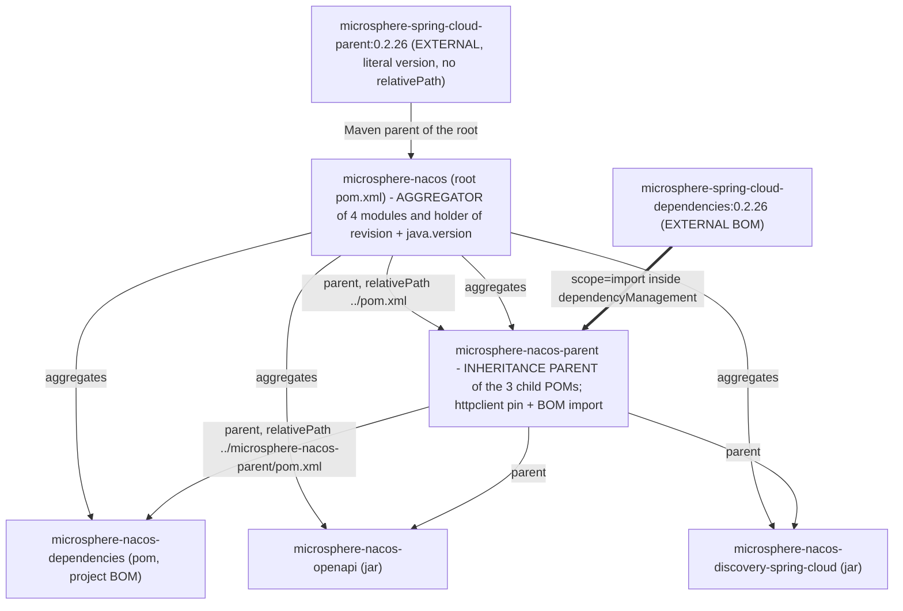

# `microsphere-nacos-parent` — Developer Guide (`current`)

A 48-line POM whose entire purpose is to hold the third-party version facts this repository owns directly: one explicit
pin (`httpclient 4.5.14`) and one BOM import (`microsphere-spring-cloud-dependencies:0.2.26`). It is not an aggregator,
has no sources, and configures no build plugin. This document maps the inheritance chain and marks, precisely, where the
verifiable knowledge stops.

## 1. Facts

| Attribute | Value | Evidence |
| --- | --- | --- |
| Coordinates | `io.github.microsphere-projects:microsphere-nacos-parent:${revision}` | `microsphere-nacos-parent/pom.xml:13-15` |
| Packaging | `pom` | `microsphere-nacos-parent/pom.xml:16` |
| Maven parent | `microsphere-nacos:${revision}`, `relativePath ../pom.xml` | `microsphere-nacos-parent/pom.xml:5-10` |
| Aggregated by the root | yes — `<module>microsphere-nacos-parent</module>` is the first entry | `pom.xml:60` |
| Length | 48 numbered lines; `wc -l` reports 47 because the file has no final newline | `microsphere-nacos-parent/pom.xml` |
| `<properties>` | 2 entries | `microsphere-nacos-parent/pom.xml:21-25` |
| `<dependencyManagement>` | 2 entries: one direct version, one BOM import | `microsphere-nacos-parent/pom.xml:27-47` |
| `<dependencies>` / `<build>` / `<profiles>` / `<modules>` / `<pluginManagement>` / `<distributionManagement>` | **none of them** | whole file |
| Managed version literals owned by this repository | `httpclient 4.5.14`, `microsphere-spring-cloud 0.2.26` | `microsphere-nacos-parent/pom.xml:22,24` |

## 2. Parent versus aggregator

Both words apply to POMs in this repository, and mixing them up is the most common POM mistake on this line.



Three separate mechanics:

1. **Aggregation** — only `<modules>` in `pom.xml:59-66` creates the multi-module build. Reactor order follows the
   declared list: `microsphere-nacos-parent`, `microsphere-nacos-dependencies`, `microsphere-nacos-openapi`,
   `microsphere-nacos-discovery-spring-cloud`.
2. **Inheritance** — each child's `<parent>` element. For a jar module the chain is four levels deep:
   `microsphere-nacos-openapi` → `microsphere-nacos-parent` → `microsphere-nacos` → `microsphere-spring-cloud-parent`.
   Nothing in the reactor can skip a level.
3. **Dependency-management import** — `<scope>import</scope>`, used exactly once in the whole repository, at
   `microsphere-nacos-parent/pom.xml:38-44`.

`microsphere-nacos-parent` is *simultaneously* aggregated and inherited from. That is legal, and it is required: the
`relativePath` in every child points at a file that must also be inside the reactor for a clean-checkout build to work.

## 3. What the POM actually contains

Properties (`microsphere-nacos-parent/pom.xml:21-25`):

```xml
<properties>
    <httpclient.version>4.5.14</httpclient.version>
    <!-- BOM versions -->
    <microsphere-spring-cloud.version>0.2.26</microsphere-spring-cloud.version>
</properties>
```

Dependency management (`:27-47`):

```xml
<dependencyManagement>
    <dependencies>

        <!-- Apache HttpClient -->
        <dependency>
            <groupId>org.apache.httpcomponents</groupId>
            <artifactId>httpclient</artifactId>
            <version>${httpclient.version}</version>
        </dependency>

        <!-- Microsphere Spring Cloud Dependencies -->
        <dependency>
            <groupId>io.github.microsphere-projects</groupId>
            <artifactId>microsphere-spring-cloud-dependencies</artifactId>
            <version>${microsphere-spring-cloud.version}</version>
            <type>pom</type>
            <scope>import</scope>
        </dependency>

    </dependencies>
</dependencyManagement>
```

Two entries, two different mechanisms — and that difference is the file's whole design. `httpclient` is pinned **by
value**, inside this repository. Everything else — `gson`, every `org.springframework.*`, JUnit, logback, and the
`io.github.microsphere-projects:microsphere-*` libraries — is pinned **by reference** to an artifact that does not exist
in this snapshot.

Order matters in this block: the direct `httpclient` entry is declared *before* the import, so if the imported BOM also
managed `httpclient`, the local `4.5.14` wins. Maven resolves `dependencyManagement` first-declaration-wins within the
effective model, and an explicit entry in the importing POM takes precedence over an imported one.

### 3.1 The consumers of these entries

| Module | Versionless dependencies that resolve through this POM | Evidence |
| --- | --- | --- |
| `microsphere-nacos-openapi` | `org.apache.httpcomponents:httpclient`, `com.google.code.gson:gson` | `microsphere-nacos-openapi/pom.xml:38-47` |
| `microsphere-nacos-openapi` (test) | `junit-jupiter`, `microsphere-java-test`, `microsphere-logging-test`, `logback-classic` | `microsphere-nacos-openapi/pom.xml:50-75` |
| `microsphere-nacos-discovery-spring-cloud` | all 11 Spring / microsphere declarations, `optional` and `test` alike | `microsphere-nacos-discovery-spring-cloud/pom.xml:23-111` |
| `microsphere-nacos-discovery-spring-cloud` | `microsphere-nacos-openapi` — **not** resolved here: it carries an explicit `${revision}` | `microsphere-nacos-discovery-spring-cloud/pom.xml:40-44` |

No POM in this repository writes a `<version>` for `httpclient` or `gson`. Grepping this repository for those numbers
finds only `4.5.14` and the `0.2.26` BOM coordinate; anything else you read about a Spring Boot or Spring Cloud version
came from somewhere outside this branch.

## 4. Provenance: what can and cannot be verified here

| Item | Value | Where it is defined | Verifiable in this snapshot? |
| --- | --- | --- | --- |
| `org.apache.httpcomponents:httpclient` | `4.5.14` | `microsphere-nacos-parent/pom.xml:22,34` | **Yes** |
| `microsphere-spring-cloud-dependencies` (imported BOM) | `0.2.26` | `microsphere-nacos-parent/pom.xml:24,41` | **Yes**, as a coordinate only — its contents are not |
| `microsphere-spring-cloud-parent` (external Maven parent) | `0.2.26` | `pom.xml:6-10` | **Yes**, as a coordinate only |
| `${revision}` for this repository's own artifacts | `0.2.0-SNAPSHOT` | `pom.xml:55` | **Yes** |
| `java.version` | `17` | `pom.xml:56` | **Yes**, as a property; the plugin that consumes it is external |
| Maven wrapper / Maven distribution | wrapper `3.3.4`, `distributionType=only-script`, Maven `3.9.16` | `.mvn/wrapper/maven-wrapper.properties:1-3` | **Yes** |
| CI JDK matrix | `17`, `21`, `25` | `.github/workflows/maven-build.yml:25` | **Yes**, as workflow inputs |
| CI Spring Cloud profile names | `spring-cloud-2022`, `2023`, `2024`, `2025` | `.github/workflows/maven-build.yml:26-27` | **Yes**, as names; the version sets they activate are **not** |
| Spring Boot / Spring Cloud / `gson` / JUnit / logback / `microsphere-*` versions | — | external `microsphere-spring-cloud-dependencies:0.2.26` | **No** |
| Compiler plugin, source/javadoc attachment, GPG signing, `install`/`deploy` repositories, profiles `test`, `coverage`, `ci`, `publish` | — | external `microsphere-spring-cloud-parent:0.2.26` | **No** |

**Provenance rule, restated for this file.** When documenting or bumping a version owned by the imported BOM, say where
it comes from and do not quote a number. Neither Spring Boot nor Spring Cloud nor any JDK release line can be pinned to a
specific version from this snapshot, and CI's `spring-cloud-2022` … `spring-cloud-2025` profile names are *selectors*, not
evidence of a Boot or Cloud version.

## 5. Why `httpclient` is pinned here and `gson` is not

`microsphere-nacos-openapi/pom.xml` declares both with no version, and both resolve through this POM — `httpclient` by
the direct entry, `gson` through the import. The asymmetry is justified by exactly one measurable property of the source
tree:

- `org.apache.http.*` — the HttpClient **4.x** package layout — is imported by one class,
  `microsphere-nacos-openapi/src/main/java/io/microsphere/nacos/client/transport/OpenApiHttpClient.java:26-39`
  (`HttpEntity`, `StatusLine`, `client.HttpClient`, `client.config.RequestConfig`, `client.methods.*`,
  `impl.client.CloseableHttpClient`, `impl.client.HttpClientBuilder`, `impl.conn.PoolingHttpClientConnectionManager`).
- `org.apache.hc` (the 5.x layout) appears **zero times** in the snapshot.

So an upstream BOM that moved `httpclient` to a 5.x line would break compilation of that single file, and the break would
not be visible until a downstream consumer pulled the new BOM. The local override is a guard rail on the one coordinate
the code is sensitive to. `gson` is imported by 15 main-source files, but only inside the openapi module's serialization
packages (`client/io`, `client/common/config/io`, `client/common/namespace/io`, `client/v1/{server,raft}/io`,
`client/v2/client/io`) and through `com.google.gson.*` types that have kept their package layout across releases, so it
needs no local override here.

The rule for contributors: **a version override belongs in this POM only when this repository's source code is
sensitive to that number.** Everything shared across the microsphere organisation stays in the external BOM so the whole
organisation can upgrade in one place.

## 6. What this POM deliberately does not do

- **No `<dependencies>`.** `dependencyManagement` adds nothing to any classpath. A module that declares `httpclient`
  without a version gets `4.5.14`; a module that never declares it gets nothing. That is why the discovery module's
  `optional` Spring declarations (§3.1) cost it nothing at runtime.
- **No `<build>`, no `<pluginManagement>`, no `<distributionManagement>`.** Compiler release, encoding, the
  source/javadoc attachments, GPG signing, the server ids used by `mvn deploy`, and the mechanism that resolves
  `${revision}` for published POMs all come from `microsphere-spring-cloud-parent:0.2.26`. Grepping every POM and every
  workflow file in this snapshot for `flatten` returns **no match**, so no POM-flattening step is declared on this branch
  — whatever substitutes `${revision}` at install/deploy time is contributed by that external parent and is not readable
  here. See [microsphere-nacos-dependencies.md](microsphere-nacos-dependencies.md) for the consumer-side consequence.
- **No `<profiles>`.** The profiles CI activates — `test`, `coverage`, `ci`, `publish` and the four `spring-cloud-*`
  selectors (`.github/workflows/maven-build.yml:54`, `.github/workflows/maven-publish.yml:63`) — are defined in the
  external parent. Their existence is evidence from the workflows; their content is not.
- **It does not own `${revision}`.** Line 8 uses it as the parent version and line 15 as its own; the property is declared
  once, at `pom.xml:55`, and reaches here by inheritance. Releasing means editing that one line — which is precisely what
  the publish workflow does with `sed` (`.github/workflows/maven-publish.yml:201`).
- **It declares no modules.** The disabled `microsphere-nacos-spring` and `microsphere-nacos-spring-boot` entries live in
  the root `pom.xml:63-64` as comments, and neither directory exists in this snapshot.

## 7. Resolving the external parent: the offline constraint

The root POM declares its parent with no `<relativePath>` override that could help (`pom.xml:6-10`):

```xml
<parent>
    <groupId>io.github.microsphere-projects</groupId>
    <artifactId>microsphere-spring-cloud-parent</artifactId>
    <version>0.2.26</version>
</parent>
```

Maven therefore needs `microsphere-spring-cloud-parent-0.2.26.pom` — and through it
`microsphere-spring-cloud-dependencies-0.2.26.pom` — in the local or a remote repository before it can build anything.

- A clean checkout on a machine with an empty local repository and no network fails at POM resolution, before a single
  source file is compiled. That is the state this documentation snapshot was produced in: Maven was not runnable, so
  **no statement in this guide comes from a completed build or an effective POM**.
- The wrapper pins a Maven distribution (`.mvn/wrapper/maven-wrapper.properties:3`, `3.9.16`) but cannot substitute for a
  missing parent POM. `.mvn/` contains only `wrapper/maven-wrapper.properties`: no `maven.config`, no `jvm.config`, no
  `extensions.xml`, nothing that alters resolution or adds a repository.
- `-Drevision=0.0.1-SNAPSHOT` in CI (`.github/workflows/maven-build.yml:52`) overrides *this repository's* coordinates
  because they are property-driven; it has no effect on the external parent, whose `0.2.26` is a literal.

## 8. Changing this POM: checklist

1. **New pin for code in this repository** → add a property plus a direct `dependencyManagement` entry, in the style of
   the `httpclient` block (lines 21-22, 31-35). Put it *before* the import if you intend to override the imported BOM.
2. **New pin for a published artifact of this repository** → that belongs in
   [microsphere-nacos-dependencies.md](microsphere-nacos-dependencies.md), not here.
3. **Bumping `microsphere-spring-cloud.version`** → `gson`, Spring, JUnit, logback and the `microsphere-*` libraries move
   together; re-run the whole CI matrix, since the four `spring-cloud-*` profiles interact with this number. Expect the
   compile classpath of `microsphere-nacos-discovery-spring-cloud` to change even though its POM does not.
4. **Upgrading Apache HttpClient to 5.x** → this POM is not the blocker; `transport/OpenApiHttpClient.java` is, because
   of the 4.x imports (§5). Treat it as a source migration, then delete the local override.
5. **Adding a build plugin or a profile here** → check first whether the external parent already provides it; nothing on
   this branch currently does, and duplicating a plugin declaration inside this POM changes behaviour for all three
   child POMs at once.
6. **Editing `<modules>` or `${revision}`** → that is the root `pom.xml` (lines 55-66), not this file.

## 9. Related documents

- [Developer guide index](README.md) — reactor overview and the build workflow
- [microsphere-nacos-dependencies.md](microsphere-nacos-dependencies.md) — the BOM that consumes this POM as its parent
- [microsphere-nacos-openapi.md](microsphere-nacos-openapi.md) — the module whose `httpclient` and `gson` versions are
  decided here
- [microsphere-nacos-discovery-spring-cloud.md](microsphere-nacos-discovery-spring-cloud.md) — the module whose Spring
  versions are decided here without being written here
- [User guide: microsphere-nacos-parent](../../user-guide/current/microsphere-nacos-parent.md)
- [Docs home](../../README.md)
- [Repository README](../../../README.md)

## 中文

[中文](../zh/current/README.md)
