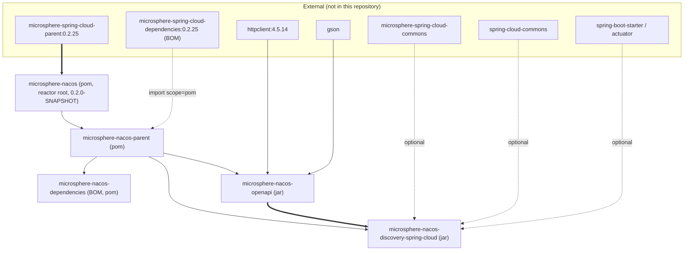

# Microsphere Nacos 1.x — 开发者指南

本指南面向 `microsphere-nacos` 的 **`1.x`** 版本线，面向的是准备修改这套代码的开发者：文档聚焦内部设计，包括包分层、
类职责、代码实际使用的设计模式、扩展点，以及本快照自带的构建与测试流程。

以下内容全部来自唯一的代码事实来源。

## 事实来源与出处

| 项目 | 取值 | 证据 |
| --- | --- | --- |
| 分析的代码树 | `release-1.x` 分支快照 | `.docs-work/release-1x` Git worktree |
| 分支顶端提交 | `e6769812884e5753032e912c00845e85e7f05f4e` — "Migrate project build from Gradle to Maven" | `git log -1` |
| 反应堆根 POM | `io.github.microsphere-projects:microsphere-nacos:${revision}`（`pom`） | `pom.xml` |
| `${revision}` | `0.2.0-SNAPSHOT` | `pom.xml`，`<properties>` |
| `java.version` | `17` | `pom.xml`，`<properties>` |
| 外部父 POM | `microsphere-spring-cloud-parent:0.2.25` | `pom.xml`，`<parent>` |
| 导入的 BOM | `microsphere-spring-cloud-dependencies:0.2.25` | `microsphere-nacos-parent/pom.xml` |

**本指南统一遵循的出处规则。** 存在于本仓库内的版本（`${revision}`、`httpclient 4.5.14`、`0.2.25`、Maven wrapper 版本）
按事实陈述。存在于*外部*父 POM 或*外部*导入 BOM 中的版本 —— Spring Boot、Spring Cloud、JUnit、Gson、Logback，以及
Maven 插件与 profile 定义 —— **在本快照中无法核实**，一律标注其来源为
`microsphere-spring-cloud-parent:0.2.25` / `microsphere-spring-cloud-dependencies:0.2.25`，而不给出具体数字。绝不臆造。

### 与默认（`release`）线的差异

本线的反应堆、模块列表、包结构以及全部 Java 源码与 `release` 快照一致。差异只在构建侧：

| 维度 | `1.x`（本线） | 默认线 |
| --- | --- | --- |
| 外部父 POM | `microsphere-spring-cloud-parent:0.2.25` | `0.2.26` |
| 导入的 BOM | `microsphere-spring-cloud-dependencies:0.2.25` | `0.2.26` |
| `httpclient` 锁定版本 | `4.5.14`，锁定在 `microsphere-nacos-parent` | 锁定在同一位置 |
| 分支顶端 | 从 Gradle 迁移到 Maven 的构建迁移提交 | 更晚的历史 |

由于 Spring Cloud 基线落后一个补丁号，在 `1.x` 上解析到的依赖版本可能与默认线上得到的值不同。请重新阅读
`microsphere-nacos-parent/pom.xml`，不要凭假设推断。

## 反应堆一览

`pom.xml` 声明了四个启用模块和两个停用模块：

| 模块 | Artifact ID | 打包方式 | 主源码文件 | 测试（主线） |
| --- | --- | --- | --- | --- |
| Parent | `microsphere-nacos-parent` | `pom` | 无 | 无 |
| Dependencies（BOM） | `microsphere-nacos-dependencies` | `pom` | 无 | 无 |
| OpenAPI | `microsphere-nacos-openapi` | `jar` | 118 个 `.java` | 21 个 `.java` |
| Discovery Spring Cloud | `microsphere-nacos-discovery-spring-cloud` | `jar` | 10 个 `.java` | 无 |

```xml
<modules>
    <module>microsphere-nacos-parent</module>
    <module>microsphere-nacos-dependencies</module>
    <module>microsphere-nacos-openapi</module>
    <!-- <module>microsphere-nacos-spring</module> -->
    <!-- <module>microsphere-nacos-spring-boot</module> -->
    <module>microsphere-nacos-discovery-spring-cloud</module>
</modules>
```

`microsphere-nacos-spring` 与 `microsphere-nacos-spring-boot` 被注释掉了。**本快照中不存在它们的目录**，因此既不可构建，
本文档也不作描述。不要新增假定它们会回归的代码。

## 模块与继承结构

这里同时存在两种不同的关系，修改 POM 时最常见的错误就是把二者混淆：

- **继承**（`<parent>`），提供插件管理、属性与 `dependencyManagement`；
- **依赖**（对 `microsphere-nacos-openapi` 的 `<dependency>`），提供类。



应当这样读这张图：反应堆根 POM 自己的 `<parent>` 是*外部*的 `microsphere-spring-cloud-parent`，而
`microsphere-nacos-parent` 是根的一个 `pom` 打包子模块，被两个 jar 模块继承。因此一个 jar 模块的有效继承链是
`module -> microsphere-nacos-parent -> microsphere-nacos -> microsphere-spring-cloud-parent:0.2.25`。

另外注意，`microsphere-nacos-discovery-spring-cloud` 用它唯一的编译依赖显式声明了 `<version>${revision}</version>`，
而不是依赖它继承而来的 BOM，所以在自己的构建里导入 `microsphere-nacos-dependencies` **并不是**构建本仓库的前提。

## 构建与测试流程（按文件定义）

### 本地构建

在本提交上，仓库是纯 Maven 的。wrapper 文件已入库：

| 文件 | 取值 |
| --- | --- |
| `.mvn/wrapper/maven-wrapper.properties` | `distributionUrl` = Apache Maven `3.9.0`；`wrapperUrl` = maven-wrapper `3.1.1` |
| `mvnw`、`mvnw.cmd` | POSIX 与 Windows 的 wrapper 脚本 |

```bash
./mvnw package
```

```powershell
mvnw.cmd package
```

版本号是 CI 参数，除 `<revision>` 之外从不硬编码：`-Drevision=<value>`。省略它时，取自 `pom.xml` 的值为
`0.2.0-SNAPSHOT`。

### CI 矩阵

`.github/workflows/maven-build.yml` 原样定义了矩阵：

```yaml
matrix:
  java: [ '17' , '21' , '25' ]
  maven-profile-spring-cloud: [ 'spring-cloud-2022' , 'spring-cloud-2023' , 'spring-cloud-2024' ,
                                'spring-cloud-2025' ]
```

构建步骤为：

```text
mvn --batch-mode --update-snapshots --file pom.xml -Drevision=0.0.1-SNAPSHOT test
    --activate-profiles test,coverage,spring-cloud-<year>
```

改动构建时有两点必须记住：

- 四个 `spring-cloud-*` profile，以及 `test`、`coverage`、`publish`、`ci`，都**定义在外部的
  `microsphere-spring-cloud-parent:0.2.25`** 中，不在本仓库。在此处看不到也改不了它们；CI 中无法解析的 profile 是父
  POM 版本问题，不是模块问题。
- CI 在测试运行中固定使用 `-Drevision=0.0.1-SNAPSHOT`。该值只是为了让测试构建不与已发布坐标冲突，它不是版本线。

### 测试需要一个运行中的 Nacos 服务器

集成测试**不是**自包含的。`OpenApiTest`（位于
`microsphere-nacos-openapi/src/test/java/io/microsphere/nacos/client/OpenApiTest.java`）在没有服务器地址时会快速失败：

```java
protected static final String SERVER_ADDRESS_PROPERTY_NAME = "SERVER_ADDRESS";

static String getServerAddress() {
    String key = SERVER_ADDRESS_PROPERTY_NAME;
    return System.getProperty(key, System.getenv(key));
}

@BeforeEach
public void init() {
    String serverAddress = getServerAddress();
    if (serverAddress == null) {
        String errorMessage = format("The Java System Property[ name : '%s' ] for Nacos Server must be set!", SERVER_ADDRESS_PROPERTY_NAME);
        throw new IllegalArgumentException(errorMessage);
    }
    NacosClientConfig config = new NacosClientConfig();
    config.setServerAddress(serverAddress);
    customize(config);
    this.openApiClient = new OpenApiHttpClient(config);
    this.nacosClientConfig = config;

    setup();
}
```

对你的工作流程的影响：

1. `microsphere-nacos-openapi` 的 21 个测试必须提供 `-DSERVER_ADDRESS=127.0.0.1:8848`（或 `SERVER_ADDRESS` 环境变量）。
2. 测试以 `nacos`/`nacos` 认证（`OpenApiTest` 中的 `USER_NAME` / `PASSWORD` 常量），并使用命名空间 `test` 与分组
   `test-group`。
3. `@AfterEach destroy()` 会关闭 `OpenApiClient`，因此每个测试方法都会建立一个真实的连接池。
4. `microsphere-nacos-discovery-spring-cloud` 在本快照中**没有任何测试源码**（`src/test` 不存在）。对该模块的改动没有
   自动化测试覆盖，必须对着真实服务器手工验证。
5. `microsphere-nacos-openapi/src/test/resources` 下的 `logback-test.xml` 配置测试日志；Logback 只在 `test` 作用域内。

### CI 中由 Compose 提供的 Nacos

CI 在 Maven 之前启动服务器，并在之后停止它，使用 `if: always()`：

```yaml
- name: Run Docker Compose
  run: docker compose -f "docker/test-services.yml" up -d
```

**出处说明：** 被引用的文件 `docker/test-services.yml` 及其所在目录 `docker/` **在本 `release-1.x` 快照中不存在**
（`ls docker` 报告没有该目录）。也就是说该 workflow 指向了一个本分支并未携带的 compose 文件，因此其镜像、标签与端口
设置在本文档中不可核实。不要依据这个 workflow 文件引用任何 Nacos 版本。应把该 compose 文件视为 CI 环境的一部分，而不
是本分支的一部分。

### 发布 workflow 与分支维护

- `.github/workflows/maven-publish.yml` 同时声明了 `on: push: branches: [ 'release' ]` **和**带必填 `revision` 输入的
  `workflow_dispatch`，但 `build` 任务被 `if: ${{ inputs.revision }}` 约束。push 事件下该输入为空，而 `release` 任务又有
  `needs: build`，因此实际发布只能通过手工 dispatch 触发。
  dispatch 会按 `^[0-9]+\.[0-9]+\.[0-9]+$` 校验输入值，然后针对 compose 提供的 Nacos 执行
  `./mvnw --batch-mode --update-snapshots --file pom.xml -Drevision=<input> -Dgpg.skip=true deploy --activate-profiles publish,ci`，
  为已发布的 `major.minor.patch` 打标签，通过 GitHub Models 生成发布说明，用 `sed -i` 把 `pom.xml` 中的 `<revision>`
  元素改写为 `major.minor.(patch+1)-SNAPSHOT`，推送该提交，并以 `--no-ff` 把 `release` 合并进 `main`。
- 由于发布是在命令行传入 `-Drevision=` 而不是先修改 POM，所有已发布构件的版本都来自 dispatch 输入。其对本 BOM 消费者
  的影响，见 [microsphere-nacos-dependencies](microsphere-nacos-dependencies.md) 中关于 `${revision}` 的注意事项。
- `.github/workflows/merge-main-to-branches.yml` 只把 `main` 合入 `dev` 与 `release`。**`release-1.x` 不在该矩阵中**，
  因此本线不会自动接收来自 `main` 的合并，只能靠下面的同步 workflow 或人工传播。
- `.github/workflows/sync-branches-from-upstream.yml` 面向 fork，每五分钟运行一次，`on.push.branches` 下列出 `main`、
  `dev` 与 `dev-1.x`。
- `.github/dependabot.yml` 对目录 `/` 启用每日 `maven` 更新，开放 PR 数量上限为 10。由于 BOM 导入与 `httpclient`
  锁定都位于 `microsphere-nacos-parent/pom.xml`，针对本仓库的 Dependabot PR 完全可能修改该文件 —— 这是预期行为。

## 文档地图

开发者指南（本目录）：

| 文档 | 覆盖内容 |
| --- | --- |
| [README.md](README.md) | 本索引：出处、反应堆、构建与测试流程 |
| [microsphere-nacos-openapi.md](microsphere-nacos-openapi.md) | 客户端架构、传输层、鉴权、反序列化、错误模型、设计模式、扩展点 |
| [microsphere-nacos-discovery-spring-cloud.md](microsphere-nacos-discovery-spring-cloud.md) | Spring Cloud 适配器、自动配置装配、调用链 |
| [microsphere-nacos-parent.md](microsphere-nacos-parent.md) | 共享父 POM：版本锁定与 BOM 导入 |
| [microsphere-nacos-dependencies.md](microsphere-nacos-dependencies.md) | 项目 BOM |

用户指南（同一份代码的使用者视角）：

- [用户指南：microsphere-nacos-openapi](../../1.x/microsphere-nacos-openapi.md)
- [用户指南：microsphere-nacos-discovery-spring-cloud](../../1.x/microsphere-nacos-discovery-spring-cloud.md)
- [用户指南：microsphere-nacos-parent](../../1.x/microsphere-nacos-parent.md)
- [用户指南：microsphere-nacos-dependencies](../../1.x/microsphere-nacos-dependencies.md)
- [用户指南索引](../../1.x/README.md)

跨目录链接：

- [文档首页](../../../README.md)
- [仓库 README](../../../../README.md)
- 当前版本线：[`current` 开发者指南](../../current/README.md)

## 对贡献代码的约定要求

以下均从源码中观察得到，新增代码时必须遵守：

- 根包是 `io.microsphere.nacos.client`，不是 `io.microsphere.nacos`。传输层位于
  `io.microsphere.nacos.client.transport`，带版本的门面位于 `.v1` 与 `.v2`，共享契约位于 `.common.*`，JSON 相关代码位于
  `.io`，工具类位于 `.util`。
- 每个公开类型都带有 Apache 许可证头，以及包含 `@author <a href="mailto:mercyblitz@gmail.com">Mercy<a/>` 和
  `@since 1.0.0` 的 Javadoc。沿用已有的 `@since` 取值；本版本线没有引入不同的值。
- 到处都以构造器注入 `NacosClientConfig`；`AbstractClient` 与 `AbstractOpenApiClient` 都会用形如
  `"The 'x' argument must not be null"` 的 `Objects.requireNonNull` 消息拒绝 null 配置。
- 不允许被覆写的访问器声明为 `final`（`AbstractClient.getNacosClientConfig()`、
  `AbstractOpenApiClient.execute(OpenApiRequest)`、`OpenApiTemplateClient.getOpenApiClient()`）。
- 以静态导入引用本模块常量是项目风格 —— 参见各领域客户端中的
  `import static io.microsphere.nacos.client.transport.OpenApiRequestParam.*` 语句块。
- 模型类手写 `equals`、`hashCode` 与 `toString`，不使用 Lombok，也不只依赖 `Objects.equals` 之类的捷径。

## English

[English](../../1.x/README.md)
