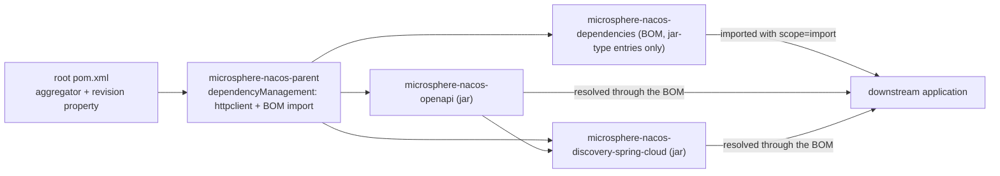

# microsphere-nacos-dependencies — 内部实现

`microsphere-nacos-dependencies` 是本仓库对外发布的 BOM（物料清单）。它只管理两个构件的版本 —— 也就是本仓库产出的两个
jar —— 此外什么都不管。它全文 38 行，没有源码，没有 build 段，而且**本反应堆中没有任何模块使用它**。

| 属性 | 取值 | 证据 |
| --- | --- | --- |
| 坐标 | `io.github.microsphere-projects:microsphere-nacos-dependencies:${revision}` | `microsphere-nacos-dependencies/pom.xml:13-15` |
| 打包方式 | `pom` | `microsphere-nacos-dependencies/pom.xml:16` |
| 父 POM | `microsphere-nacos-parent:${revision}`，`relativePath` = `../microsphere-nacos-parent/pom.xml` | `microsphere-nacos-dependencies/pom.xml:5-10` |
| 长度 | 38 行（整个文件） | `wc -l microsphere-nacos-dependencies/pom.xml` |
| 受管构件 | 2 个，均来自本仓库 | `microsphere-nacos-dependencies/pom.xml:21-37` |
| `<dependencies>` / `<build>` / `<profiles>` / `<modules>` | 无 | `microsphere-nacos-dependencies/pom.xml` |
| 被本仓库其他 POM 导入 | **没有** | 在所有 POM 中 grep `microsphere-nacos-dependencies`，只命中它自己的 `<artifactId>`（第 14 行）以及根 POM 的 `<module>` 条目（`pom.xml:61`） |

## 完整的依赖段

```xml
<dependencyManagement>
    <dependencies>

        <dependency>
            <groupId>io.github.microsphere-projects</groupId>
            <artifactId>microsphere-nacos-openapi</artifactId>
            <version>${revision}</version>
        </dependency>

        <dependency>
            <groupId>io.github.microsphere-projects</groupId>
            <artifactId>microsphere-nacos-discovery-spring-cloud</artifactId>
            <version>${revision}</version>
        </dependency>

    </dependencies>
</dependencyManagement>
```

两条条目都是 `<version>${revision}</version>`，既没有 `<type>` 也没有 `<scope>`。就这一种写法，已经包含三个设计决策：

1. **这是项目 BOM，不是平台 BOM。** 它从不给出第三方版本。`gson`、Spring Boot、Spring Cloud、JUnit、logback 与 Apache
   HttpClient 都在它之外。使用者得到的是本仓库自有构件之间的一致性，这也是本仓库唯一能承诺的一致性。
2. **`${revision}` 让 BOM 与反应堆保持同步。** `revision` 只声明一次，位于根 `pom.xml:55`（本分支上为
   `0.2.0-SNAPSHOT`）。发版只需改那一个属性，BOM 无需改动。
3. **没有 `<scope>` 与 `<type>`** —— 条目描述的是 jar 构件，因此默认的 `jar`/`compile` 处理正是消费者需要的。对比兄弟
   POM `microsphere-nacos-parent/pom.xml:38-44`，那里的被导入 BOM *确实*需要
   `<type>pom</type><scope>import</scope>`。这一对比就是“管理一个构件”与“导入一个 BOM”的全部区别。

## 该 BOM 继承了什么，对消费者意味着什么

本 POM 的父 POM 是 `microsphere-nacos-parent`，不是聚合器。`microsphere-nacos-parent` 在自己的 `dependencyManagement`
里声明了 `httpclient:4.5.14` 并导入了 `microsphere-spring-cloud-dependencies:0.2.25`（见
[microsphere-nacos-parent](microsphere-nacos-parent.md)）。Maven 会在解析 import 之前先把父 POM 的
`dependencyManagement` 合并进子 POM 的有效模型，因此已发布 BOM 的有效受管集合是：

| 条目来源 | 贡献内容 |
| --- | --- |
| `microsphere-nacos-dependencies/pom.xml:24-34` | `microsphere-nacos-openapi`、`microsphere-nacos-discovery-spring-cloud`，版本为 `${revision}` |
| 从 `microsphere-nacos-parent/pom.xml:31-35` 继承 | `org.apache.httpcomponents:httpclient:4.5.14` |
| 经由 `microsphere-nacos-parent/pom.xml:38-44` 的导入继承 | `microsphere-spring-cloud-dependencies:0.2.25` 中定义的一切 —— Spring Boot、Spring Cloud、`gson`、JUnit、logback 以及各 `microsphere-*` 库 |

如此描述后，把本 BOM 导入应用几乎就是一份一站式版本集合：它同时锁定了本项目两个构件，以及它们构建时所依据的
HttpClient 与 microsphere 版本线。

出处说明：以上是 Maven 有文档记录的模型继承语义，应用于从快照文件中读到的内容，**并未**通过运行
`mvn help:effective-pom` 得到确认，因为本环境离线无法执行 Maven；而且
`microsphere-spring-cloud-dependencies:0.2.25` 的内容属于本快照之外的外部构件。不要从本文档引用任何具体的 `gson` 或
Spring 版本号 —— 请到已发布的 BOM 中查证。

### `${revision}` 对消费者的隐患

*已发布* POM 内部的 `<version>${revision}</version>` 只有在读取它的工程自己定义了 `revision` 属性时才有意义，而正常
工程并不会定义。标准做法是在 `install`/`deploy` 阶段执行一次 POM 扁平化（flatten），把解析后的真实版本写回去。
**本快照中没有配置任何此类插件**：在所有 POM 与 workflow 中 grep `flatten` 没有任何命中，`microsphere-nacos-parent` 与本
POM 都没有 `<build>` 段。如果存在扁平化步骤，它必然由外部父 POM `microsphere-spring-cloud-parent:0.2.25` 提供，而那个构建
配置在此不可读。

对任何想核验发布产物的人而言，实际影响是：请检查仓库中*已发布的*
`microsphere-nacos-dependencies-<version>.pom`，而不是分支里的这个文件。如果已发布的 POM 仍然包含字面量
`${revision}`，那么该 BOM 对消费者无法解析，这属于构建流水线缺陷，而不是需要在本文件里修的问题。

## 为什么本仓库内的模块都不使用它

反应堆中每个 jar 模块都继承 `microsphere-nacos-parent`，后者已经管理了第三方版本；而仓库内部的依赖则显式写成
`${revision}`：

```xml
<!-- Microsphere Nacos OpenAPI -->
<dependency>
    <groupId>io.github.microsphere-projects</groupId>
    <artifactId>microsphere-nacos-openapi</artifactId>
    <version>${revision}</version>
</dependency>
```

这段取自 `microsphere-nacos-discovery-spring-cloud/pom.xml`。它写成字面的 `${revision}` 而不是无版本条目，正是因为 BOM
没有被导入到反应堆里 —— 这是刻意的，目的是让构建本仓库永远不依赖一份先前发布过的自身 BOM。不要以“简化”为名在父 POM
里加一条对 `microsphere-nacos-dependencies` 的导入：那会形成环（该 BOM 的父 POM 正是同一条 POM 链）。

## 在发布流程中的位置



已发布产物由 `.github/workflows/maven-publish.yml` 产出，`microsphere-nacos-dependencies` 作为 `<module>` 会与 jar 一起
被部署。决定它被发布到哪个仓库的是那个 workflow 而不是本 POM；该 workflow 做了什么、没披露什么，见
[构建与测试流程](README.md#构建与测试流程按文件定义)。

## 把一个新模块加入 BOM

当本仓库新增一个 jar 模块时：

1. 在根 `pom.xml`（第 59-66 行）加入 `<module>`，并让新模块以 `microsphere-nacos-parent` 作为 `<parent>`，配上惯用的
   `relativePath`。
2. 在本文件按与现有两条完全相同的形状再加一个 `<dependency>` 块：`groupId` 为
   `io.github.microsphere-projects`，新的 `artifactId`，`<version>${revision}</version>`，不带 scope，不带 type。
3. 把第三方版本挡在外面。如果新模块需要某个本 BOM 不提供的锁定，该版本应放在 `microsphere-nacos-parent`（当源码对它有
   敏感性时），或放在外部的 `microsphere-spring-cloud-dependencies`（当它跨组织共享时）。
4. 条目按依赖深度排序 —— `microsphere-nacos-openapi` 在
   `microsphere-nacos-discovery-spring-cloud` 之前 —— 这是现状约定，也让该文件可以当作一张依赖图来读。

## 相关文档

- [开发者指南索引](README.md)
- [microsphere-nacos-parent](microsphere-nacos-parent.md)
- [microsphere-nacos-openapi 内部实现](microsphere-nacos-openapi.md)
- [microsphere-nacos-discovery-spring-cloud 内部实现](microsphere-nacos-discovery-spring-cloud.md)
- [用户指南：microsphere-nacos-dependencies](../../1.x/microsphere-nacos-dependencies.md)
- [仓库 README](../../../../README.md)

## English

[English](../../1.x/microsphere-nacos-dependencies.md)
