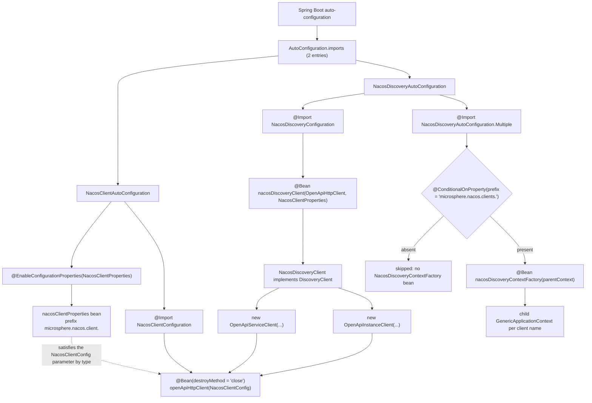
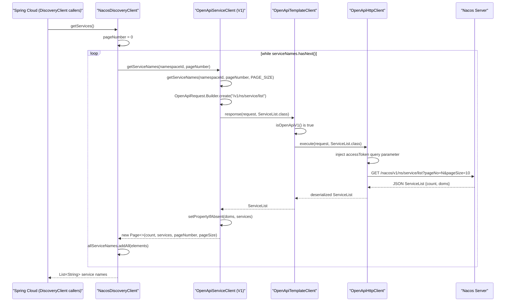

# microsphere-nacos-discovery-spring-cloud — 内部实现

`microsphere-nacos-discovery-spring-cloud` 是 Spring Cloud 适配器。它不包含任何协议逻辑：它把外部配置绑定到
`NacosClientConfig` 上，构建一个唯一的 `OpenApiHttpClient` 传输层，并通过
`org.springframework.cloud.client.discovery.DiscoveryClient` 暴露 Nacos 数据。

| 属性 | 取值 | 证据 |
| --- | --- | --- |
| 坐标 | `io.github.microsphere-projects:microsphere-nacos-discovery-spring-cloud:${revision}` | `microsphere-nacos-discovery-spring-cloud/pom.xml` |
| 打包方式 | `jar` | `microsphere-nacos-discovery-spring-cloud/pom.xml` |
| 父 POM | `microsphere-nacos-parent`（`relativePath` = `../microsphere-nacos-parent/pom.xml`） | `microsphere-nacos-discovery-spring-cloud/pom.xml` |
| 主源码 | 10 个 `.java` 文件，共 590 行 | `find src/main/java -name '*.java' \| xargs wc -l` |
| 测试源码 | **没有** —— 本模块没有 `src/test` 目录 | 目录列举 |
| 资源 | 1 个文件：`META-INF/spring/org.springframework.boot.autoconfigure.AutoConfiguration.imports` | 目录列举 |
| 非可选的编译依赖 | `microsphere-nacos-openapi:${revision}` | `microsphere-nacos-discovery-spring-cloud/pom.xml` |

零测试这个事实对构建流程有影响：[CI 矩阵](README.md#构建与测试流程按文件定义) 运行 `mvn … test`，而本模块
不为它贡献任何测试。本指南中关于它的任何行为结论都来自阅读源码，而不是来自执行过的断言。

## 依赖图：几乎一切都是 `optional`

在 13 条声明的依赖中，恰好只有一条会到达消费者。

| 声明 | `optional` | `scope` | 影响 |
| --- | --- | --- | --- |
| `microsphere-annotation-processor` | 是 | compile | 仅构建期元数据 |
| `microsphere-java-core` | 是 | compile | 被 `NacosClientUtils` 使用 |
| `microsphere-nacos-openapi:${revision}` | **否** | compile | 唯一的传递依赖 |
| `microsphere-spring-cloud-commons` | 是 | compile | 已声明；**本快照中没有任何源码文件引用它的类型** |
| `spring-cloud-commons` | 是 | compile | `DiscoveryClient`、`ServiceInstance`、`DefaultServiceInstance`、`NamedContextFactory` |
| `spring-boot-starter` | 是 | compile | Spring 上下文 |
| `spring-boot-starter-actuator` | 是 | compile | 已声明；没有被任何源码文件引用 |
| `spring-boot-configuration-processor` | 是 | compile | 生成 `spring-configuration-metadata.json` |
| `spring-boot-autoconfigure-processor` | 是 | compile | 生成 `spring-autoconfigure-metadata.properties` |
| `junit-jupiter` | 否 | test | 不存在测试 |
| `spring-boot-starter-test` | 否 | test | 不存在测试 |
| `microsphere-spring-boot-test` | 否 | test | 不存在测试 |
| `logback-classic` | 否 | test | 不存在测试 |

因为每一个 Spring 构件都是 `optional`，Maven **不会**把它们传递性地发布出去。一个只在 POM 中加入
`microsphere-nacos-discovery-spring-cloud` 的消费者得到的是 openapi 客户端，此外什么都没有 —— 没有 `DiscoveryClient`
接口，也没有 Boot 自动配置机制。因此该适配器假设宿主应用已经自行管理它的 Spring Cloud 和 Spring Boot 版本。
这是一个有意的设计：本仓库必须能在四个 `spring-cloud-2022` … `spring-cloud-2025` profile 上编译，而不锁定其中任何一个。

扩展本模块时的实用规则：**不要**为了让消费者的 `ClassNotFoundException` “变好”而移除某个 Spring 依赖上的
`optional`。请在消费者的 BOM 中修复它，正如参考应用所做的那样。

## 源码布局

所有源码都位于 `microsphere-nacos-discovery-spring-cloud/src/main/java/io/microsphere/nacos/client/` 之下。
两个包根并存：`…client.spring.*`（客户端引导）和 `…client.discovery.spring.cloud.*`（discovery 适配器）。

| 文件 | 行数 | 职责 |
| --- | --- | --- |
| `spring/boot/autoconfigure/NacosClientAutoConfiguration.java` | 41 | 入口 1：启用 `NacosClientProperties`，导入 `NacosClientConfiguration` |
| `spring/boot/NacosClientProperties.java` | 58 | 继承 `NacosClientConfig` 的 `@ConfigurationProperties("microsphere.nacos.client.")` |
| `spring/NacosClientConfiguration.java` | 37 | `@Bean(destroyMethod = "close") OpenApiHttpClient` |
| `spring/util/NacosClientUtils.java` | 51 | 多客户端属性提取：`microsphere.nacos.clients.<name>.*` |
| `discovery/spring/cloud/autoconfigure/NacosDiscoveryAutoConfiguration.java` | 51 | 入口 2：导入 discovery 配置 + 条件化的多客户端工厂 |
| `discovery/spring/cloud/NacosDiscoveryConfiguration.java` | 43 | `@Bean NacosDiscoveryClient` |
| `discovery/spring/cloud/NacosDiscoveryClient.java` | 90 | `DiscoveryClient` 实现 |
| `discovery/spring/cloud/NacosServiceInstance.java` | 83 | 基于 openapi `Instance` 模型的 `ServiceInstance` 适配器 |
| `discovery/spring/cloud/NacosDiscoveryContextFactory.java` | 54 | `NamedContextFactory`，为每个 Nacos 客户端创建一个子上下文 |
| `discovery/spring/cloud/NacosDiscoverySpecification.java` | 82 | `NamedContextFactory.Specification` 值对象 |

## 自动配置引导

Spring Boot 2.7+ 通过 `src/main/resources/META-INF/spring/org.springframework.boot.autoconfigure.AutoConfiguration.imports`
发现这些类。该文件恰好有两行，顺序如下：

```text
io.microsphere.nacos.client.spring.boot.autoconfigure.NacosClientAutoConfiguration
io.microsphere.nacos.client.discovery.spring.cloud.autoconfigure.NacosDiscoveryAutoConfiguration
```

本模块中没有遗留的 `META-INF/spring.factories`。因此应用必须运行在能读取 `AutoConfiguration.imports` 的
Spring Boot 版本上；CI 矩阵从 `spring-cloud-2022` profile 开始，它对应 Boot 3.x。



由那张图可以得出两个结构性结论。

第一，transport bean 与 discovery client 位于**不同**的自动配置类中，但两条 `@Import` 链最终汇聚到同一个
`OpenApiHttpClient` 实例，因为 `NacosDiscoveryConfiguration` 也声明了 `@Import(NacosClientConfiguration.class)`。
即使把 `NacosClientAutoConfiguration` 从 imports 文件中移除，discovery 这条路径仍然会产出它自己的 transport ——
两个入口点是相互独立的，而不是有先后顺序的。

第二，`NacosClientAutoConfiguration` **本身没有任何守卫**：

```java
@ConditionalOnPropertyPrefix(PREFIX)
@Configuration(proxyBeanMethods = false)
@EnableConfigurationProperties(NacosClientProperties.class)
@Import(value = {
        NacosClientConfiguration.class
})
public class NacosClientAutoConfiguration {
}
```

`@ConditionalOnPropertyPrefix(PREFIX)` 注解出现在那个块的最上方，但 `PREFIX` 常量是
`"microsphere.nacos.client."` —— 一个前缀，而不是一个属性名 —— 而 `ConditionalOnPropertyPrefix` 来自
`io.microsphere.spring.boot.condition`，也就是来自可选的 `microsphere-spring-cloud-commons`/microsphere-spring
依赖，而不是来自 Spring Boot。`NacosClientAutoConfiguration.java:21` import 了这个注解，而本模块把
`microsphere-spring-cloud-commons` 声明为 `optional`，所以这个配置究竟是否是有条件的，取决于 microsphere 的条件类
是否在消费者的 classpath 上。如果不在，这个类就是无条件激活的，于是 `new OpenApiHttpClient(nacosClientCOnfig)`
会在 `NacosClientProperties` 的 `serverAddress` 为 `null` 的情况下执行。

`NacosDiscoveryAutoConfiguration` 的守卫更窄、也更明确：

```java
@Configuration(proxyBeanMethods = false)
@Import(value = {
        NacosDiscoveryConfiguration.class,
        NacosDiscoveryAutoConfiguration.Multiple.class
})
public class NacosDiscoveryAutoConfiguration {

    @ConditionalOnProperty(prefix = NACOS_CLIENTS_PROPERTY_NAME_PREFIX)
    public static class Multiple {

        @Bean
        public NacosDiscoveryContextFactory nacosDiscoveryContextFactory(ConfigurableApplicationContext parentContext) {
            return new NacosDiscoveryContextFactory(parentContext);
        }
    }
}
```

`@ConditionalOnProperty(prefix = "microsphere.nacos.clients.")` 不带 `name` 属性，这是 Spring Boot 的前缀-only 形式：
嵌套的 `Multiple` 配置 —— 进而 `NacosDiscoveryContextFactory` bean —— 只有在 `microsphere.nacos.clients.` 之下至少
存在一个属性时才会存在。`NacosDiscoveryConfiguration` 本身是被无条件导入的，所以单客户端应用什么都不用配置就能
得到 `NacosDiscoveryClient`。

## 配置绑定

`NacosClientProperties` 不是一个新的配置模型；它*就是* openapi 的配置模型：

```java
@ConfigurationProperties(prefix = PREFIX)
public class NacosClientProperties extends NacosClientConfig {

    public static final String PREFIX = PROPERTY_NAME_PREFIX;

    private Discovery discovery = new Discovery();
    ...
    public static class Discovery {

        private String namespaceId;
        ...
    }
}
```

`PREFIX` 是对 openapi 模块中 `Constants.PROPERTY_NAME_PREFIX` 的静态 import，其值是字面量
`"microsphere.nacos.client."`（注意结尾的点）。继承 `NacosClientConfig` 意味着 openapi 模块中定义的每一个 setter ——
`serverAddress`、`scheme`、`contextPath`、`userName`、`password`、`accessKey`、`secretKey`、`maxConnections`、
`maxPerRoute`、`connectionTimeout`、`readTimeout`、`longPollingTimeout`、`eventProcessingTimeout`、`applicationName`、
`encoding`、三个线程名、`name` —— 都能在那个前缀下绑定，无需额外代码。本模块引入的唯一*新*键是
`discovery.namespaceId`，openapi 模块对它一无所知。

| 属性 | 目标 | 说明 |
| --- | --- | --- |
| `microsphere.nacos.client.server-address` | 继承自 `NacosClientConfig.setServerAddress` | 无默认值；未设置时为 `null` |
| `microsphere.nacos.client.scheme` | 继承 | 默认 `http` |
| `microsphere.nacos.client.context-path` | 继承 | 默认 `/nacos` |
| `microsphere.nacos.client.user-name`、`.password` | 继承 | 被授权流程使用 |
| `microsphere.nacos.client.access-key`、`.secret-key` | 继承 | 在 `NacosClientConfig` 中声明；**在本快照的主源码中没有任何消费点** |
| `microsphere.nacos.client.name` | 继承 | 也被用作*子上下文*的属性名 —— 见 `NacosDiscoveryContextFactory` |
| `microsphere.nacos.client.discovery.namespace-id` | `NacosClientProperties.Discovery` | 仅被 `NacosDiscoveryClient` 读取，在其构造函数中（`NacosDiscoveryClient.java:57`） |

第二个前缀只用于多客户端场景：`microsphere.nacos.clients.<name>.*`，它被定义为
`NacosClientUtils.NACOS_CLIENTS_PROPERTY_NAME_PREFIX`。这两个前缀互不相关 —— `microsphere.nacos.client.x`
永远不会喂给 `microsphere.nacos.clients.a.x`。

`NacosClientUtils` 是从那个命名空间到 Spring `PropertySource` 的桥梁：

```java
public static final String NACOS_CLIENTS_PROPERTY_NAME_PREFIX = "microsphere.nacos.clients.";

public static String buildNacosClientPropertyNamePrefix(String nacosClientName) {
    return NACOS_CLIENTS_PROPERTY_NAME_PREFIX + nacosClientName + ".";
}

public static Map<String, Object> getNacosClientProperties(ConfigurableEnvironment environment, String nacosClientName) {
    String prefix = buildNacosClientPropertyNamePrefix(nacosClientName);
    return getSubProperties(environment, prefix);
}

public static PropertySource getNacosCilentPropertySource(ConfigurableEnvironment environment, String nacosClientName) {
    Map properties = getNacosClientProperties(environment, nacosClientName);
    return new MapPropertySource(nacosClientName, properties);
}
```

`getSubProperties` 是对 `io.microsphere.spring.util.PropertySourcesUtils` 的静态 import，也就是来自外部的
microsphere-spring 构件。返回的 map 的键是保留还是去掉 `microsphere.nacos.clients.<name>.` 前缀，由那里决定，
而那份代码不属于本快照 —— 本指南对任何一种情况都不作断言。有两处本地观察是确定的：方法名拼写错误，为
`getNacosCilentPropertySource`（第 46 行），并且 `Map` 使用了原始类型（第 47 行）。如果你重命名这个方法，
请同时更新 `NacosDiscoveryContextFactory.java:26` 中的静态 import。

## `NacosDiscoveryClient`

这个类很小，并且不持有缓存：

```java
public class NacosDiscoveryClient implements DiscoveryClient {

    private final ServiceClient serviceClient;

    private final InstanceClient instanceClient;

    private final NacosClientProperties nacosClientProperties;

    private final String namespaceId;

    public NacosDiscoveryClient(OpenApiHttpClient openApiHttpClient, NacosClientProperties nacosClientProperties) {
        this.serviceClient = new OpenApiServiceClient(openApiHttpClient, nacosClientProperties);
        this.instanceClient = new OpenApiInstanceClient(openApiHttpClient, nacosClientProperties);
        this.nacosClientProperties = nacosClientProperties;
        this.namespaceId = nacosClientProperties.getDiscovery().getNamespaceId();
    }
```

构造函数带来三个后果，每一个都可以从被引用的源码中核实：

1. **客户端被硬接到 Open API V1。** 它直接实例化 `io.microsphere.nacos.client.v1.discovery.OpenApiServiceClient`
   和 `…v1.discovery.OpenApiInstanceClient`。`OpenApiTemplateClient.getOpenApiVersion()` 除非子类覆盖否则返回 `V1`，
   而这两个类都没有覆盖它。要在 Spring Cloud 中使用 V2 API，要么继承 `NacosDiscoveryClient`，要么自己装配 V2 客户端。
2. **领域客户端是协作者，而不是 bean。** 它们是普通的 `new` 对象，因此不可注入，也不被代理。只有它们共享的
   transport（`OpenApiHttpClient`）是 bean —— 这正是连接池和 token 缓存是全局的、而每个客户端的领域逻辑不是全局的原因。
3. **`namespaceId` 只在构造时捕获一次。** 之后修改 `microsphere.nacos.client.discovery.namespace-id`
   对已创建的客户端没有影响。

### `getServices()` 调用链

`getServices()` 是本模块中最值得关注的方法，因为它是唯一执行分页的方法。

```java
@Override
public List<String> getServices() {
    List<String> allServiceNames = new LinkedList<>();

    int pageNumber = 0;
    Page<String> serviceNames = serviceClient.getServiceNames(namespaceId, pageNumber);

    allServiceNames.addAll(serviceNames.getElements());

    while (serviceNames.hasNext()) {
        pageNumber = serviceNames.getPageSize();
        serviceNames = serviceClient.getServiceNames(namespaceId, pageNumber);
        allServiceNames.addAll(serviceNames.getElements());
    }

    return allServiceNames;
}
```



传输层的细节来自 `v1/discovery/OpenApiServiceClient.java:95-105`：

```java
public Page<String> getServiceNames(String namespaceId, String groupName, int pageNumber, int pageSize) {
    OpenApiRequest request = OpenApiRequest.Builder.create(getServicesListEndpoint())
            .queryParameter(NAMESPACE_ID, namespaceId)
            .queryParameter(SERVICE_GROUP_NAME, groupName)
            .queryParameter(PAGE_NUMBER, pageNumber)
            .queryParameter(PAGE_SIZE, pageSize)
            .build();
    ServiceList serviceList = response(request, ServiceList.class);
    ...
    return new Page<>(serviceList.getCount(), serviceList.getServices(), pageNumber, pageSize);
}
```

`OpenApiRequestParam.PAGE_NUMBER` 序列化为 `pageNo`，`PAGE_SIZE` 序列化为 `pageSize`。`getServicesListEndpoint()` 是
`getEndpointPath() + SERVICE_ENDPOINT + "/list"`，即 `/v1` + `/ns/service` + `/list`；context path（默认 `/nacos`）
以及 scheme/host 来自 transport 内部的 `NacosClientConfig`。

`NacosDiscoveryClient` 使用的两参数重载是 `ServiceClient` 上的一个 `default` 方法：

```java
default Page<String> getServiceNames(String namespaceId, int pageNumber) {
    return getServiceNames(namespaceId, pageNumber, PAGE_SIZE);
}
```

`PAGE_SIZE` 是 `Constants.PAGE_SIZE`，即 `getInteger("microsphere.nacos.client.page-size", 10)` —— 这是一个
**系统属性**，不是 `NacosClientConfig` 字段。因此通过 `application.yml` 绑定 `microsphere.nacos.client.page-size`
不会改变任何东西；只有 `-Dmicrosphere.nacos.client.page-size=…` 才能到达这条调用路径。

### 分页方面的注意点

`Page.hasNext()` 定义为：

```java
public boolean hasNext() {
    return pageNumber < totalPages - 1;
}
```

而 `totalPages` 由上面用到的构造函数（`Page.java:46-50`）计算为
`size(elements) == 0 ? 1 : (int) Math.ceil((double) totalElements / (double) pageSize)`。

把它和循环体结合起来，会产生在你依赖 `getServices()` 之前值得知道的行为：

- 循环用 `pageNumber = serviceNames.getPageSize()` 前进。`getPageSize()` 返回的是**页大小**（默认 10），
  不是 `pageNumber + 1`。当服务多于一页时，第二个请求会向服务器要 `pageNo=10`。
- 循环的第一个请求使用 `pageNo=0`，而 `Constants.DEFAULT_PAGE_NUMBER` 是 `1`，并且 `default` 重载
  `getServiceNames(String namespaceId)` 从 `PAGE_NUMBER`（1）开始。这两个入口点在页码基数上不一致。
- `hasNext()` 是相对于*刚取到的那一页*求值的，因此 `pageNumber=0`、`totalPages=ceil(count/10)` 这个组合
  决定了到底会不会发生第二个 HTTP 请求。

以上是按阅读源码记录下来的：本模块没有测试，所以没有断言钉住预期的分页语义，也没有可访问的 Nacos 服务器来
观察真实响应。如果你把循环改成 `pageNumber + 1`，请记住 `getServiceNames(namespaceId, pageNumber)` 的
`hasNext()` 契约 —— `Page` 是与配置历史 API 共享的。

### `getInstances(serviceId)` 调用链

```java
@Override
public List<ServiceInstance> getInstances(String serviceId) {
    String serviceName = serviceId;
    InstancesList instancesList = instanceClient.getInstancesList(namespaceId, serviceName);
    List<Instance> instances = instancesList.getHosts();
    return instances.stream().map(NacosServiceInstance::new).collect(Collectors.toList());
}
```

`getInstancesList(namespaceId, serviceName)` 是 `InstanceClient` 上的一个 `default`（第 441 行），它经由
`DEFAULT_GROUP_NAME` 和 `DEFAULT_CLUSTER_NAME` 扩展为八参数的抽象方法，具体实现是
`OpenApiInstanceClient.getInstancesList(...)`，位于 `v1/discovery/OpenApiInstanceClient.java:121`。那个方法包含
V1/V2 切换在 discovery 流程中唯一可见的一处：

```java
OpenApiRequestParam clusterParam = isOpenApiV1() ? CLUSTERS : CLUSTER_NAME;
```

对 V1 而言查询参数是 `clusters`；对 V2 而言是 `clusterName`。因为 `NacosDiscoveryClient` 总是构建 V1 领域客户端，
所以这里 `isOpenApiV1()` 为 `true`，参数是 `clusters`。`GET /nacos/v1/ns/instance/list` 返回一个 `InstancesList`，
它的实例数组名为 `hosts` —— 这就是适配器读取 `getHosts()` 而不是某个叫 `getInstances()` 的方法的原因。

这两个方法都没有异常处理包裹：不可达或未授权的 Nacos 会以 `AbstractOpenApiClient` 抛出的形式暴露给 Spring Cloud
（`OpenApiClientException`，或被映射的 `ErrorCode` 失败）。因此 `LoadBalancer` 的实例列表刷新会向上抛出，而不会
退化为空列表。

## `NacosServiceInstance`：适配器

`NacosServiceInstance` 持有一个 openapi `Instance` 并委派每一个访问器，其中有两个写死的回答。

| `ServiceInstance` 方法 | 实现 | 源码 |
| --- | --- | --- |
| `getInstanceId()` | `instance.getInstanceId()` | `NacosServiceInstance.java:41-43` |
| `getServiceId()` | `instance.getService()` | `NacosServiceInstance.java:46-48` |
| `getHost()` | `instance.getIp()` | `NacosServiceInstance.java:51-53` |
| `getPort()` | `instance.getPort()` | `NacosServiceInstance.java:56-58` |
| `isSecure()` | `false`，字面量 | `NacosServiceInstance.java:61-63` |
| `getUri()` | `DefaultServiceInstance.getUri(this)` | `NacosServiceInstance.java:66-68` |
| `getMetadata()` | `instance.getMetadata()` | `NacosServiceInstance.java:71-73` |
| `getScheme()` | `"http"`，字面量 | `NacosServiceInstance.java:76-78` |
| `getInstance()` | 被包装的 openapi 模型 | `NacosServiceInstance.java:80-82` |

`getUri()` 有意委派给 Spring Cloud 的静态 helper，而不是自己构造 `URI`，因此 URI 完全按框架的定义由
`getScheme()`、`getHost()`、`getPort()` 和 `getContextPath()` 组合而成。因为 `getScheme()` 返回字面量 `"http"`
而 `isSecure()` 返回 `false`，所以即便 `NacosClientConfig` 带有一个 `scheme` 字段，TLS 端点也无法通过该适配器表达 ——
这两个方法从不查询被包装的实例或客户端配置。`getInstance()` 是逃生舱口 —— 当你需要 `weight`、`healthy`、
`clusterName`、`ephemeral` 或 Nacos 特有的实例字段时，请做向下转型或解包。

`Instance` 模型位于 openapi 模块中四层继承链的末端
（`Instance` → `NewInstance` → `GenericInstance` → `BaseInstance` → `DiscoverableModel`）。适配器读取的每个值来自
不同的层级：`getInstanceId()`（`Instance.java:48`）和 `getService()`（`Instance.java:56`）是 `Instance` 自己声明的
两个访问器；`getIp()` 和 `getPort()` 来自 `BaseInstance`；`getMetadata()` 和 `getWeight()`
来自 `GenericInstance`；`getHealthy()` 来自 `NewInstance`；而 `getClusterName()`、`getServiceName()`、`getNamespaceId()`
和 `getGroupName()` 是对 `DiscoverableModel` 的 `protected` 字段的访问器。

## 多客户端支持：`NamedContextFactory`

`NacosDiscoveryContextFactory` 为每个 Nacos 客户端提供自己的子 `ApplicationContext`，遵循 Spring Cloud 用于每个
负载均衡器上下文的同一套模式。

```java
public class NacosDiscoveryContextFactory extends NamedContextFactory<NacosDiscoverySpecification> {

    private final ConfigurableApplicationContext parentContext;

    private static final String NACOS_DISCOVERY_PROPERTY_NAME = "nacos-discovery";

    public NacosDiscoveryContextFactory(ConfigurableApplicationContext parentContext) {
        super(NacosDiscoveryConfiguration.class, NACOS_DISCOVERY_PROPERTY_NAME, PREFIX + "name");
        setApplicationContext(parentContext);
        this.parentContext = parentContext;
    }

    @Override
    public GenericApplicationContext buildContext(String name) {
        GenericApplicationContext context = super.buildContext(name);
        PropertySource nacosClientPropertySource = getNacosCilentPropertySource(this.parentContext.getEnvironment(), name);
        ConfigurableEnvironment environment = context.getEnvironment();
        environment.getPropertySources().addAfter(NACOS_DISCOVERY_PROPERTY_NAME, nacosClientPropertySource);
        return context;
    }
}
```

把 `super(…)` 的参数对照 Spring Cloud 的签名
`NamedContextFactory(Class<?> defaultType, String propertySourceName, String propertyName)` 来读 —— 那个构造函数属于
外部的 `org.springframework.cloud.context.named.NamedContextFactory`，它的源码不在本快照中，因此下面的参数名是从
调用点和该构件已发布的契约推断出来的：

- `defaultType` = `NacosDiscoveryConfiguration.class` —— 默认在每一个子上下文中注册的配置类。
- `propertySourceName` = `"nacos-discovery"` —— 在这里既被用作默认的属性源名，也在
  `buildContext` 中被用作通过 `addAfter(...)` 插入的每客户端属性源的名字。
- `propertyName` = `PREFIX + "name"` = `"microsphere.nacos.client.name"` —— 这是 Spring Cloud 的
  `getDefaultProperties(name)` 播进子环境的键，因此为客户端 `order` 创建的子上下文会绑定
  `microsphere.nacos.client.name=order`。

`buildContext` 随后把真正的每客户端配置块叠在上面：对于客户端名 `order`，`getNacosCilentPropertySource`
会收割 `microsphere.nacos.clients.order.` 之下的一切，并把它作为一个名为 `order` 的 `MapPropertySource`
加到 `nacos-discovery` 之后。预期的 YAML 形态是：

```yaml
microsphere:
  nacos:
    clients:
      order:
        server-address: 127.0.0.1:8848
        user-name: nacos
        password: nacos
        discovery:
          namespace-id: order-ns
```

`setApplicationContext(parentContext)` 是 `ApplicationContextAware` 回调，而这里它是由构造函数*手动*调用的，
而不是由容器调用，因为 `@Bean` 方法把父上下文作为参数接收。工厂自身没有被注册为任何子上下文之内的 bean，
所以在第一次调用 `getContext(name)` 之前 `parentContext` 必须非空 —— `buildContext` 对
`this.parentContext.getEnvironment()` 解引用时没有做 null 检查。

子上下文的销毁在本快照中没有描述：`NacosDiscoveryContextFactory` 没有覆盖任何销毁方法，而
`NamedContextFactory` 在关闭时做的事都在外部 Spring Cloud 构件里。请把那个行为当作未验证，而不是当作默认继承而来。

`NacosDiscoverySpecification` 是工厂的泛型参数所期望的那一对值 —— 一个 `name` 加上 `Class<?>[]
configuration`，带有一个包级私有的无参构造函数，`equals`/`hashCode` 基于 `Objects.equals(name)` 和
`Arrays.equals(configuration)`，并且它的 `equals` 对 `null` 和不匹配的类返回 `false`。它不携带任何 Nacos 特有的
逻辑，在本快照中也没有任何地方实例化它；`super(NacosDiscoveryConfiguration.class, …)` 使得默认配置这条路径已经足够。

## 仅从源码断言的设计模式

| 模式 | 位置 | 证据 |
| --- | --- | --- |
| 适配器 | `NacosServiceInstance` | 在 openapi 的 `Instance` 之上实现 Spring 的 `ServiceInstance`，而不改变任何一个类型 |
| 外观 | `NacosDiscoveryClient` | 暴露两个方法（`getServices`、`getInstances`），同时隐藏分页、请求构造与反序列化 |
| 委派 / 组合 | `NacosDiscoveryClient` 构造函数 | 在一个注入的共享 `OpenApiHttpClient` 之上构建 `OpenApiServiceClient` 和 `OpenApiInstanceClient` |
| 模板方法 | `OpenApiTemplateClient.getOpenApiVersion()` → `isOpenApiV1()` → `response(...)`；`NacosDiscoveryContextFactory.buildContext` 调用 `super.buildContext`，然后添加一个属性源 | 该钩子同时选择端点前缀与载荷信封 |
| 策略（属性源） | `NacosDiscoveryContextFactory.buildContext` 配合 `addAfter` | 在多客户端场景下，源的顺序*就是*解析策略 |
| 注册表 / 上下文的工厂 | 以客户端名为键的 `NamedContextFactory` 子类 | `NacosDiscoveryContextFactory` |
| 重载阶梯 | `ServiceClient.getServiceNames` 的 `default` 链（六个重载）汇聚到四参数的抽象方法 | `common/discovery/ServiceClient.java:150-208` |

Observer、Builder 和序列化 SPI 出现在 openapi 模块中，而不是这里 —— 见
[openapi 内部实现](microsphere-nacos-openapi.md)。

## 扩展点

**新增一个响应式或支持注册的变体。** 本模块中没有任何类实现 `ReactiveDiscoveryClient`、`AutoServiceRegistration`
或 `HeartbeatMonitor`。要新增一个，请在 `io.microsphere.nacos.client.discovery.spring.cloud` 中创建该类，在
`NacosDiscoveryConfiguration`（或一个同级配置）中为它加一个 `@Bean`，并把新的自动配置类加到
`META-INF/spring/org.springframework.boot.autoconfigure.AutoConfiguration.imports`。那个文件是唯一存在的注册机制；
本模块没有 `spring.factories`，也没有 `@AutoConfigureAfter`/`@AutoConfigureBefore`，所以不要假设两个入口点之间有
先后顺序。

**把某个客户端切换到 Open API V2。** 最干净的路径是写一个 V2 配置：在同一个 `OpenApiHttpClient` bean 之上构建
`v2` 领域客户端（`io.microsphere.nacos.client.v2.discovery.*`），让你自己的 `DiscoveryClient` 实现接收它们，
而不是去尝试继承 `NacosDiscoveryClient` —— 它的字段是 `private final`，并且构造函数把 V1 的类型写成了字面量。

**让分页循环正确。** 请把修复留在 `NacosDiscoveryClient` 内部：`Page` 和 `ServiceClient` 的 `default` 实现与其他
调用方共享，而 `PAGE_SIZE` 是由 `Constants` 从系统属性读取的。

**暴露 TLS。** 两个选项，都是本地的：在由 `NacosClientConfig.getScheme()` 喂入的 `NacosServiceInstance` 子类中
覆盖 `getScheme()`/`isSecure()`（构造函数是 `public`，被包装的字段可以通过 `getInstance()` 达到），或者在自定义
适配器中映射 `instance.getSecurePort()`。不要把 `microsphere.nacos.client.scheme=https` 设上然后指望这个类遵循它。

## 本模块特有的约定

- 每一个源码文件都带有 Apache-2.0 许可证头，以及 `@author <a href="mailto:mercyblitz@gmail.com">Mercy</a>`
  和一个 `@since` 标签。这里的 `@since` 取值是类型名（`@since Configuration`、`@since ServiceInstance`、
  `@since NamedContextFactory.Specification`、`@since NacosClientConfig`）而不是版本 —— 它们由可选的
  `microsphere-annotation-processor` 约定产出，而不是手写的，所以在评审中不要动它们。
- 每一个配置类上都有 `@Configuration(proxyBeanMethods = false)`，包括 `NacosDiscoveryConfiguration` 和
  两个自动配置类。不要引入 bean 之间的方法调用。
- 通篇使用 `@Import` 而不是 `@ComponentScan`；本模块中没有任何类被标注 `@Component`。
- 常量通过静态 import 从拥有它们的类引用（`PREFIX`、
  `NACOS_CLIENTS_PROPERTY_NAME_PREFIX`、`getNacosCilentPropertySource`），与 openapi 模块的风格一致。
- 包位置遵循 openapi 模块的 `io.microsphere.nacos.client.*` 根，而不是构件名，所以
  `spring` 和 `discovery.spring.cloud` 是同一个根下的同级包。

## 本快照中观察到的局限

每一行都可以在被引用的路径上核查。

| 观察 | 位置 | 影响 |
| --- | --- | --- |
| 完全没有测试源码 | `microsphere-nacos-discovery-spring-cloud/src`（没有 `src/test`） | 四条测试依赖会被解析却什么都不运行；CI 矩阵从这个模块得不到任何信号 |
| `@ConditionalOnPropertyPrefix` 被 import，并以一个*前缀*常量应用 | `spring/boot/autoconfigure/NacosClientAutoConfiguration.java:21,34` | 守卫行为取决于可选的 microsphere 构件是否存在；没有它时，transport bean 会在 `serverAddress` 未设置的情况下被创建 |
| 把 `getPageSize()` 当作下一页的页码 | `NacosDiscoveryClient.java:83` | 第二个请求要的是 `pageNo=10`（默认页大小），而不是第 2 页 |
| 第一页以 `pageNumber = 0` 请求 | `NacosDiscoveryClient.java:77` | 与 `Constants.DEFAULT_PAGE_NUMBER = 1` 以及 `default getServiceNames(namespaceId)` 重载不一致 |
| `PAGE_SIZE` 来自系统属性，而不是 `NacosClientConfig` | `common/discovery/ServiceClient.java:161-162`、`constants/Constants.java:227` | 这条路径上 `application.yml` 中的 `microsphere.nacos.client.page-size` 会被忽略 |
| `accessKey`/`secretKey` 被绑定，但在本快照中从未读取 | `NacosClientConfig.java:82,87` | AK/SK 认证看起来可配置，但没有接入 transport |
| `isSecure()` 和 `getScheme()` 是写死的 | `NacosServiceInstance.java:61-63,76-78` | HTTPS 与按实例的 scheme 无法表达 |
| `namespaceId` 在构造函数中捕获 | `NacosDiscoveryClient.java:57,51` | 更换 namespace 需要一个新的客户端 bean |
| `getNacosCilentPropertySource` 拼写错误；`Map` 使用原始类型 | `NacosClientUtils.java:46-47` | 属于表面问题；重命名会牵动 `NacosDiscoveryContextFactory.java:26` 中的静态 import |
| `NacosDiscoverySpecification` 从未被实例化 | 整个模块 | 泛型参数的 `Specification` 槽目前未被使用 |
| `spring-boot-starter-actuator` 和 `microsphere-spring-cloud-commons` 已声明，但主源码未引用 | `pom.xml` | 要么是死声明，要么是本分支中尚不存在的 endpoint/健康指示器的占位 |
| `getInstances`/`getServices` 周围没有异常处理 | `NacosDiscoveryClient.java:66-89` | 服务器错误会传播进 Spring Cloud 的 discovery 抽象 |

## 相关文档

- [开发者指南索引](README.md)
- [microsphere-nacos-openapi 内部实现](microsphere-nacos-openapi.md)
- [microsphere-nacos-parent](microsphere-nacos-parent.md)
- [microsphere-nacos-dependencies](microsphere-nacos-dependencies.md)
- [用户指南：microsphere-nacos-discovery-spring-cloud](../../1.x/microsphere-nacos-discovery-spring-cloud.md)
- [仓库 README](../../../../README.md)

## English

[English](../../1.x/microsphere-nacos-discovery-spring-cloud.md)
