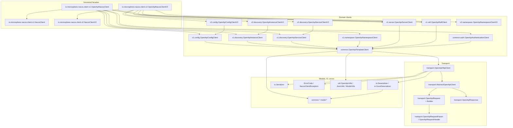
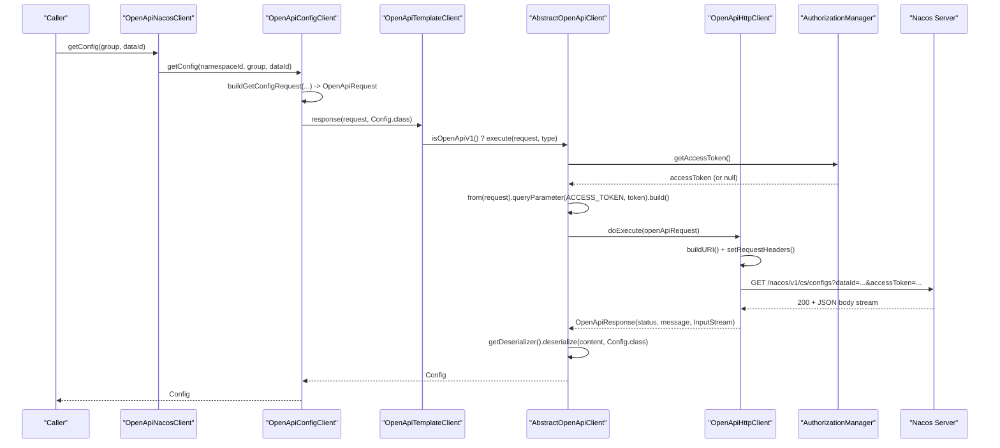
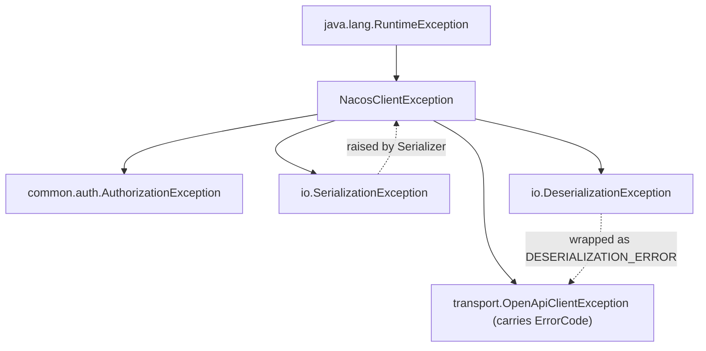
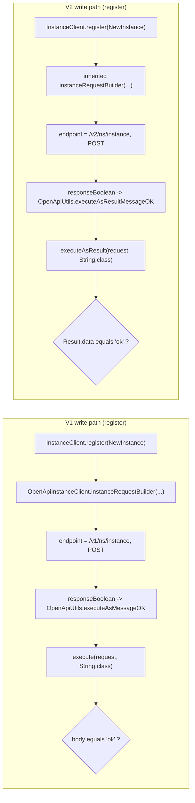
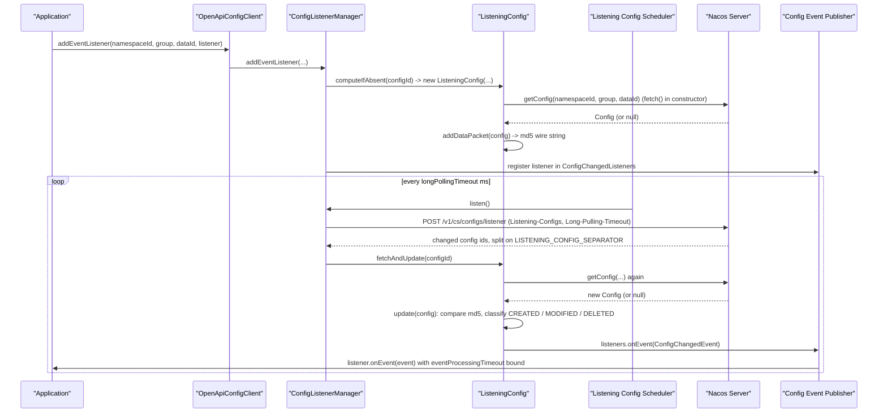

# microsphere-nacos-openapi — 内部实现

`microsphere-nacos-openapi` 是一个手写的 Nacos Open API Java 客户端。它是本仓库中唯一包含协议逻辑的模块；其余模块要么负责
配置构建，要么把本模块适配到 Spring Cloud。

| 属性 | 取值 | 证据 |
| --- | --- | --- |
| 坐标 | `io.github.microsphere-projects:microsphere-nacos-openapi:${revision}` | `microsphere-nacos-openapi/pom.xml` |
| 打包方式 | `jar` | `microsphere-nacos-openapi/pom.xml` |
| 继承自 | `microsphere-nacos-parent`（`relativePath` = `../microsphere-nacos-parent/pom.xml`） | `microsphere-nacos-openapi/pom.xml` |
| 编译依赖 | `httpclient`（版本 `4.5.14`，在 `microsphere-nacos-parent` 中锁定）、`gson`（版本来自 `microsphere-spring-cloud-dependencies:0.2.25`） | POM 文件 |
| 可选编译依赖 | `microsphere-annotation-processor`、`microsphere-java-core` | POM 文件 |
| 测试依赖 | `junit-jupiter`、`microsphere-java-test`、`microsphere-logging-test`、`logback-classic` | POM 文件 |
| 主源码 | `microsphere-nacos-openapi/src/main/java` 下的 118 个 `.java` 文件 | 目录列表 |
| 测试源码 | `microsphere-nacos-openapi/src/test/java` 下的 21 个 `.java` 文件 | 目录列表 |
| 资源 | `src/main/resources` 下的 3 个文件 | 目录列表 |

`httpclient` 和 `gson` 是仅有的两个**非可选**编译依赖。这是刻意为之：本模块的编译 classpath 上没有 Spring、没有 Nacos SDK，
也没有 servlet API。新增代码时请保持这一状态 —— 本模块是各类适配器的地基，把框架拉进它会颠倒依赖图。

## 分层架构

四层结构，每一层只了解位于它下方的层：



| 层 | 职责 | 不得了解的内容 |
| --- | --- | --- |
| 版本化门面 | 把各领域接口聚合为一个类型；把每一次调用委派给某个领域客户端 | HTTP、JSON、端点 |
| 领域客户端 | 为某一个 Open API 区域构造一个 `OpenApiRequest`，并把载荷映射成模型 | socket 生命周期、连接池 |
| 传输 | 执行一次请求：注入 access token、拼装 URI、调用 Apache HttpClient、读取状态行与响应体流 | `Config` 或 `Instance` 是什么 |
| Models / io / util | POJO、JSON（反）序列化、端点名与取值的格式化 | 网络 |

## 包清单

路径均相对于 `microsphere-nacos-openapi/src/main/java/io/microsphere/nacos/client/`。

| 包 | 文件数 | 关键类型 |
| --- | --- | --- |
| `.`（根） | 6 | `Client`, `AbstractClient`, `NacosClientConfig`, `OpenApiVersion`, `ErrorCode`, `NacosClientException` |
| `transport` | 8 | `OpenApiClient`, `AbstractOpenApiClient`, `OpenApiHttpClient`, `OpenApiRequest`, `OpenApiResponse`, `OpenApiRequestHeader`, `OpenApiRequestParam`, `OpenApiClientException` |
| `io` | 7 | `Serializer`, `Deserializer`, `GsonDeserializer`, `DefaultSerializer`, `DefaultDeserializer`, `SerializationException`, `DeserializationException` |
| `util` | 8 | `OpenApiUtils`, `JsonUtils`, `ModelUtils`, `ErrorCodeControl`, `IOUtils`, `StringUtils`, `TypeUtils`, `CollectionUtils` |
| `constants` | 1 | `Constants` |
| `http` | 1 | `HttpMethod` |
| `common` | 1 | `OpenApiTemplateClient` |
| `common/model` | 3 | `Model`, `Page`, `Result` |
| `common/auth` | 4 + 1 model | `AuthenticationClient`, `OpenApiAuthenticationClient`, `AuthorizationManager`, `AuthorizationException`, `model.Authentication` |
| `common/config` | 3 + 5 model + 4 io + 2 event | `ConfigClient`, `ConfigType`, `ConfigOperationType`, `model.{BaseConfig,NewConfig,Config,HistoryConfig,HistoryConfigPage}`, `io.*`, `event.*` |
| `common/discovery` | 3 + 17 model | `InstanceClient`, `ServiceClient`, `ConsistencyType`, `model.{BaseInstance,GenericInstance,NewInstance,Instance,...}` |
| `common/namespace` | 1 + 2 model + 1 io | `NamespaceClient`, `model.{Namespace,NamespacesList}`, `io.NamespaceDeserializer` |
| `v1` | 2 | `NacosClient`, `OpenApiNacosClient` |
| `v1/config` | 2 + 1 util | `OpenApiConfigClient`, `ConfigListenerManager`（package-private）, `util.ConfigUtil` |
| `v1/discovery` | 2 | `OpenApiInstanceClient`, `OpenApiServiceClient` |
| `v1/namespace` | 1 | `OpenApiNamespaceClient` |
| `v1/server` | 6 + 5 model + 3 io | `ServerClient`, `OpenApiServerClient`, `ServerSwitchClient`, `ServerMetricsClient`, `ServersListClient`, `ServerStatus`、各模型与反序列化器 |
| `v1/raft` | 2 + 2 model + 1 io | `RaftClient`（`@Deprecated`）, `OpenApiRaftClient`, `model.{RaftModel,RaftPeer}`, `io.RaftModelDeserializer` |
| `v2` | 2 | `NacosClientV2`, `OpenApiNacosClientV2` |
| `v2/config` | 1 | `OpenApiConfigClientV2` |
| `v2/discovery` | 2 | `OpenApiInstanceClientV2`, `OpenApiServiceClientV2` |
| `v2/namespace` | 1 | `OpenApiNamespaceClientV2` |
| `v2/client` | 0 + 4 model + 3 io | `model.{ClientInfo,ClientDetail,ClientInstance,ClientSubscriber}`, `io.*` 各反序列化器 —— **没有客户端类**；`/v2/ns/client` 相关调用是在门面内部实现的 |

## Open API 版本与配置如何选择实现

这是最容易被误解的部分，因此要精确说明：

1. **`NacosClientConfig` 不携带版本。** 读一下它的字段（`microsphere-nacos-openapi/src/main/java/io/microsphere/nacos/client/NacosClientConfig.java`）：
   `name`, `applicationName`, `serverAddress`, `scheme`, `contextPath`, `userName`, `password`, `accessKey`, `secretKey`,
   `maxConnections`, `maxPerRoute`, `connectionTimeout`, `readTimeout`, `longPollingTimeout`, `eventProcessingTimeout`,
   `fetchingConfigThreadName`, `listenerConfigThreadName`, `publishingConfigEventThreadName`, `encoding`。没有
   `openApiVersion` 属性。**版本由你实例化哪个门面来决定**，而不是由配置决定：
   `new OpenApiNacosClient(config)` 得到 V1，`new OpenApiNacosClientV2(config)` 得到 V2。
2. **`OpenApiVersion` 是一个端点前缀枚举**，它驱动的是路径拼装，而不是类选择：

   ```java
   public enum OpenApiVersion {

       V1("/v1"),

       V2("/v2");

       private final String endpointPath;

       // ...

       public static OpenApiVersion getVersion(String endpoint) {
           for (OpenApiVersion version : values()) {
               if (endpoint.startsWith(version.endpointPath)) {
                   return version;
               }
           }
           return null;
       }
   }
   ```
   （`OpenApiVersion.java`）。`getVersion(String)` 存在，但在本快照的主源码中没有任何地方调用它 ——
   端点字符串是改用拼接构造的。不要假设这个枚举会反向解析响应。

3. **`OpenApiTemplateClient` 是版本转化为行为的地方。** 每个领域客户端都继承它，而它暴露了三个依赖版本的钩子：

   ```java
   public OpenApiVersion getOpenApiVersion() {
       return V1;
   }

   protected String getEndpointPath() {
       return getOpenApiVersion().getEndpointPath();
   }

   protected boolean isOpenApiV1() {
       return V1.equals(getOpenApiVersion());
   }

   protected boolean isOpenApiV2() {
       return V2.equals(getOpenApiVersion());
   }

   protected <T> T response(OpenApiRequest request, Type payloadType) {
       if (isOpenApiV1()) {
           return this.openApiClient.execute(request, payloadType);
       }
       return this.openApiClient.executeAsResult(request, payloadType);
   }
   ```
   （`common/OpenApiTemplateClient.java`）

   `response()` 是整个模块中最关键的一行：**V1 载荷按原始内容读取，V2 载荷则从 `Result<T>` 信封中被解包**
   （`common/model/Result.java`，它的 `isSuccess()` 接受编码 `0` 或 `200`）。
4. **只有四个类覆写了 `getOpenApiVersion()`** —— 通过对整个模块 grep 验证：
   `v2/OpenApiNacosClientV2`, `v2/config/OpenApiConfigClientV2`, `v2/discovery/OpenApiInstanceClientV2`,
   `v2/discovery/OpenApiServiceClientV2`。`v2/namespace/OpenApiNamespaceClientV2` 并**不**覆写它：它保留
   `V1`，却硬编码了 `/v2/console/namespace` 路径，并直接调用 `openApiClient.executeAsResult(...)` 而不是
   `response(...)`。这种不对称是真实存在且承重的 —— 参见
   [本快照中观察到的限制](#本快照中观察到的限制)。
5. **V2 整体复用 V1。** `OpenApiConfigClientV2 extends OpenApiConfigClient`,
   `OpenApiInstanceClientV2 extends OpenApiInstanceClient`, `OpenApiServiceClientV2 extends OpenApiServiceClient`，而
   `OpenApiNacosClientV2` 的构造函数原样接入了 `OpenApiServerClient` 和 `OpenApiRaftClient` —— 即仅有 V1 的 server 与 RAFT
   领域。因此在本模块中，Server、RAFT 与认证没有 V2 端点。

## 传输层

`OpenApiClient` 是其余代码所依赖的、SPI 形状的契约：

```java
public interface OpenApiClient extends AutoCloseable {

    OpenApiResponse execute(OpenApiRequest request) throws OpenApiClientException;

    <T> T execute(OpenApiRequest request, Type payloadType) throws OpenApiClientException;

    default <T> T executeAsResult(OpenApiRequest request, Type dataType) throws OpenApiClientException {
        ParameterizedType payloadType = ofParameterizedType(Result.class, dataType);
        return execute(request, payloadType);
    }

    Serializer getSerializer();

    Deserializer getDeserializer();

    String getEncoding();
}
```
（`transport/OpenApiClient.java`）

`executeAsResult` 使用 `TypeUtils.ofParameterizedType(Result.class, dataType)` 合成一个 `Result<T>` 类型令牌，
这就是在没有 `Class<Result<T>>`（在 Java 中不可能）的情况下完成泛型解包的方式。`TypeUtils.ParameterizedTypeImpl`
是手写的 `java.lang.reflect.ParameterizedType` 实现，正是它让这件事合法。

`AbstractOpenApiClient` 固定了算法，只留下两个空位：

```java
@Override
public final OpenApiResponse execute(OpenApiRequest request) throws OpenApiClientException {
    String accessToken = getAccessToken();
    OpenApiRequest openApiRequest = accessToken == null ? request :
            from(request).queryParameter(ACCESS_TOKEN, accessToken).build();
    return doExecute(openApiRequest);
}

protected abstract OpenApiResponse doExecute(OpenApiRequest request) throws OpenApiClientException;

protected abstract String getAccessToken();
```
（`transport/AbstractOpenApiClient.java`）

两参数的 `execute(request, payloadType)` 是响应处理、反序列化与错误转换汇合的地方。调试时它的操作顺序很重要：

1. 调用 `execute(request)`（已注入 token）并读取 `statusCode`。
2. `200` 时：若 `payloadType` 是一个原始类型为 `Result` 的 `ParameterizedType`，就反序列化成 `Result`，并且在
   `result.isSuccess()` 时取 `result.getData()`。否则（或解包后的载荷仍为 `null`）把流直接反序列化成 `payloadType`。
3. 非 `200` 时：捕获状态码，并在 reason phrase 为空时用响应体作为消息。
4. `DeserializationException` → `OpenApiClientException(DESERIALIZATION_ERROR, "The payload[%s] can't be deserialized", e)`。
   其他任何 `Throwable` → `OpenApiClientException(CLIENT_ERROR, ...)`。
5. 继续向下走到 `ErrorCode.valueOf(code)` 并抛出 `OpenApiClientException(errorCode, ...)`。

`OpenApiHttpClient` 为那个模板提供了 Apache HttpClient 4.x 的实现体。它的构造函数是整个模块的装配点：

```java
public OpenApiHttpClient(NacosClientConfig nacosClientConfig) {
    super(nacosClientConfig);
    int maxConnections = nacosClientConfig.getMaxConnections();
    int maxPerRoute = nacosClientConfig.getMaxPerRoute();
    int connectionTimeout = nacosClientConfig.getConnectionTimeout();
    int readTimeout = nacosClientConfig.getReadTimeout();

    PoolingHttpClientConnectionManager connectionManager = new PoolingHttpClientConnectionManager();
    connectionManager.setMaxTotal(maxConnections);
    connectionManager.setDefaultMaxPerRoute(maxPerRoute);

    RequestConfig requestConfig = RequestConfig.custom()
            .setConnectTimeout(connectionTimeout)
            .setConnectionRequestTimeout(connectionTimeout)
            .setSocketTimeout(readTimeout)
            .build();

    HttpClientBuilder httpClientBuilder = HttpClientBuilder.create()
            .setConnectionManager(connectionManager)
            .setDefaultRequestConfig(requestConfig)
            .useSystemProperties();

    this.httpClient = httpClientBuilder.build();
    this.nacosClientConfig = nacosClientConfig;
    this.serializer = loadSerializer(nacosClientConfig);
    this.deserializer = loadDeserializer(nacosClientConfig);
    this.authorizationManager = new AuthorizationManager(this, nacosClientConfig);
}
```
（`transport/OpenApiHttpClient.java`）

三个必须保留的细节：

- 最后一行把 `this` 传给了 `AuthorizationManager`，因此认证客户端的登录是**在它自身所构建的那个传输之上**执行的。
  `getAccessToken()` 之所以要对 `authorizationManager` 做空检查，正是这个原因 —— 在构造期间它仍未被赋值。
- `buildURI()` 会用 `config.getEncoding()` 对 query 值做百分号编码，但从不编码名称，并在最后一个参数之后追加 `&`。
  端点路径是被逐字拼接到 `scheme://serverAddress + contextPath` 上的；如果 `serverAddress` 已经以 `scheme://` 开头，
  前缀不会被重复添加（`buildRootPath`）。
- `doExecute()` 只把 `IOException` 映射为 `OpenApiClientException(IO_ERROR, ...)`，其他异常不管；`close()` 会先关闭
  `AuthorizationManager`，再关闭 `httpClient`。

`OpenApiRequest` 是不可变的（endpoint、`HttpMethod`、query map、header map），并带一个嵌套的可变 `Builder`。
`Builder.from(request)` 就是 `AbstractOpenApiClient` 用来「克隆并增强」的方式，这也是为什么添加 token 不会修改调用方的
请求。`OpenApiResponse` 持有 `statusCode`、`statusMessage` 和一个原始 `InputStream` —— 该流由 `Deserializer` 惰性读取，
因此响应体必须在连接被回收之前消费完。

`OpenApiRequestParam` 是一个 394 行的枚举，覆盖 Open API 中的每一个 query 参数名。它有意思的地方在于常量可以通过覆写
`toValue(Object)` 携带自己的取值转换：

```java
CONSISTENCY_TYPE("consistencyType", ConsistencyType.class) {
    @Override
    public String toValue(Object rawValue) {
        return ((ConsistencyType) rawValue).getValue();
    }
},
```
```java
INSTANCES("instances", List.class) {
    @Override
    public String toValue(Object rawValue) {
        List<Map<String, String>> instances = (List<Map<String, String>>) rawValue;
        return toJSON(instances);
    }
},
```
（`transport/OpenApiRequestParam.java`）

所以逐参数的编组是每个常量各自的策略，而不是一个集中的 switch。`OpenApiRequestHeader` 是 header 侧对应的枚举
（`Long-Pulling-Timeout`, `Client-Version`, `User-Agent`, `Request-Source`, `Content-Type`, `Accept-Charset`,
`Requester`, `RequestId`, `Request-Module`, `app`, `clientIp`, …），其 `toValue` 默认实现为 `toString`。

## 认证与 access token 生命周期

`AuthorizationManager`（`common/auth/AuthorizationManager.java`）掌管 token。它每个传输实例创建一次，是 `AutoCloseable`
的，并把当前状态保存在一个 `volatile Authentication` 字段中。

```java
private void refreshAuthentication() throws AuthorizationException {
    if (isAuthorizationEnabled()) {
        try {
            this.authentication = this.authenticationClient.authenticate();
        } catch (Throwable e) {
            String errorMessage = "Failed to refresh Nacos Client Authentication";
            throw new AuthorizationException(errorMessage, e);
        } finally {
            scheduleRefresh();
        }
    }
}

private void scheduleRefresh() {
    this.authenticationRefresher.schedule(this::refreshAuthentication, getRefreshIntervalInSeconds(getAuthentication()), SECONDS);
}

private long getRefreshIntervalInSeconds(Authentication authentication) {
    long tokenTtlInSeconds = authentication == null ? 60 : authentication.getTokenTtl();
    return tokenTtlInSeconds / 2;
}
```

它所定义的行为（你不该无意间改掉）：

| 条件 | 行为 |
| --- | --- |
| `userName` 或 `password` 为 null | `isAuthorizationEnabled()` 为 false；`initAuthenticationRefresher()` 返回 `null`；**不会创建调度器**，且 `getAccessToken()` 返回 `null` |
| 认证开启 | 登录**在构造函数中急切执行**，随后按服务端报告的 `tokenTtl` 的一半重新调度 |
| 登录抛出异常 | 会抛出 `AuthorizationException`，但 `finally` 仍会调度一次重试；`authentication` 保持 `null`，因此回退间隔是 `60 / 2 = 30` 秒 |
| 读取 token | `getAccessToken()` → `authentication.getAccessToken()`，没有 `Authentication` 时返回 `null` |

`Authentication`（`common/auth/model/Authentication.java`）就是被反序列化出来的登录响应体：`accessToken`, `tokenTtl`,
`globalAdmin`。

登录调用本身是由 `OpenApiAuthenticationClient` 构造的普通 V1 请求：

```java
@Override
public Authentication authenticate(String userName, String password) {
    OpenApiRequest request = OpenApiRequest.Builder.create("/v1/auth/login")
            .method(POST)
            .queryParameter(USER_NAME, userName)
            .queryParameter(PASSWORD, password)
            .build();
    return openApiClient.execute(request, Authentication.class);
}
```
（`common/auth/OpenApiAuthenticationClient.java`）

注意它调用的是 `execute(..., Authentication.class)` —— 原始的、非 `Result` 的路径 —— 因为 `/v1/auth/login` 直接返回该模型。
还要注意凭据是**作为 POST 的 query 参数**传输的，这与 Nacos Open API 一致，所以 access key 与 secret 自身并不是 percent-safe 的；
编码由 `buildURI()` 完成。

`doExecute` → `authenticate` → `execute` → `doExecute` 这个递归之所以不会成环，是因为
`AbstractOpenApiClient.execute()` 只在 `getAccessToken()` 返回非 null 时才注入 token，而 manager 的
`authentication` 字段在第一次（登录）调用时仍是 `null`。



## 反序列化流水线

两个接口、一个基于 Gson 的默认实现、一个 SPI。

`Deserializer` 把流读取成某个类型令牌；流式重载是一个基于 `IOUtils.readAsString` 的 default 方法：

```java
public interface Deserializer {

    default <T> T deserialize(InputStream inputStream, Type deserializedType) throws DeserializationException {
        String content = null;
        try {
            content = readAsString(inputStream, getEncoding());
        } catch (IOException e) {
            throw new DeserializationException(e.getMessage(), e);
        }
        return deserialize(content, deserializedType);
    }

    <T> T deserialize(String content, Type deserializedType) throws DeserializationException;

    default String getEncoding() {
        return ENCODING;
    }
}
```
（`io/Deserializer.java`）

`DefaultDeserializer` 创建一个 `Gson`，并注册通过 `ServiceLoader` 发现的按类型适配器。这个注册表是通过读取
**每个实现的直接父类的第一个泛型类型实参**构建出来的：

```java
private Map<Type, GsonDeserializer> loadGsonDeserializers() {
    Map<Type, GsonDeserializer> gsonDeserializersMap = new HashMap<>();
    for (GsonDeserializer gsonDeserializer : ServiceLoader.load(GsonDeserializer.class)) {
        Class<?> gsonDeserializerClass = gsonDeserializer.getClass();
        Type genericSuperclass = gsonDeserializerClass.getGenericSuperclass();
        if (genericSuperclass instanceof ParameterizedType) {
            ParameterizedType parameterizedType = (ParameterizedType) genericSuperclass;
            Type[] typeArguments = parameterizedType.getActualTypeArguments();
            Type desirializedType = typeArguments[0];
            gsonDeserializersMap.put(desirializedType, gsonDeserializer);
        }
    }
    return gsonDeserializersMap;
}
```
（`io/DefaultDeserializer.java`）

新增反序列化器时必须遵守的两个推论：

- **`extends GsonDeserializer<YourModel>` 必须是直接父类，并且必须带参数化类型。** 直接实现 `JsonDeserializer` 的类，
  或者继承未参数化中间类型的类，会被静默跳过 —— 它会被 `ServiceLoader` 加载，但不会产生任何注册。
- 每个适配器都会收到一个反向引用（`buildGson()` 内部的 `gsonDeserializer.setDeserializer(this)`），因此它可以递归调用
  父 `Deserializer`。`GsonDeserializer.setDeserializer` 是 **package-private** 的，所以只有
  `io.microsphere.nacos.client.io` 中的类能装配它；你自己的适配器通过 SPI 免费获得它。

`GsonDeserializer<T>` 本身就是一个带安全回退的模板方法：

```java
@Override
public T deserialize(JsonElement json, Type typeOfT, JsonDeserializationContext context) throws JsonParseException {
    T result = deserialize(json, typeOfT);
    return result == null ? context.deserialize(json, typeOfT) : result;
}

protected T deserialize(JsonElement json, Type typeOfT) throws JsonParseException {
    return null;
}
```
（`io/GsonDeserializer.java`）

在受保护的 overload 中返回 `null` 意味着「交给 Gson 的反射绑定」—— 这就是为什么只有那些 JSON 形状与 Java 形状不一致的模型
才配有反序列化器。该类还提供了空值安全的字段读取方法（`getString`, `getInteger`, `getLong`, `getFloat`, `getBoolean`），
它们接受**备选成员名**，并把 `JsonNull` 视为缺失：

```java
protected <T> T getFieldValue(JsonObject jsonObject, String memberName, String[] otherMemberNames, Function<JsonElement, T> asTypeFunction) {
    JsonElement fieldElement = get(jsonObject, memberName);
    if (fieldElement == null) {
        for (String otherMemberName : otherMemberNames) {
            fieldElement = get(jsonObject, otherMemberName);
            if (fieldElement != null) {
                break;
            }
        }
    }
    if (fieldElement == null) {
        return null;
    }
    return asTypeFunction.apply(fieldElement);
}
```

那个变参的备选名称能力，就是处理 V1/V2 字段名漂移所使用的机制；当某个端点重命名了字段而不是新增模型时，它就是合适的工具。

### 已注册的反序列化器

`microsphere-nacos-openapi/src/main/resources/META-INF/services/io.microsphere.nacos.client.io.GsonDeserializer` 列出了
十一个实现：

| 注册项 | 目标模型 | 为什么需要自定义反序列化器 |
| --- | --- | --- |
| `common.config.io.ConfigDeserializer` | `Config` | 字段重命名（`desc`, `configTags`, `createUser`, `createIp`, `modifyTime`）以及 `type` → `ConfigType` |
| `common.config.io.HistoryConfigDeserializer` | `HistoryConfig` | revision/操作类型的映射 |
| `common.config.io.HistoryConfigPageDeserializer` | `HistoryConfigPage` | `totalCount`/`pageNumber`/`pagesAvailable`/`pageItems` → `Page` 形状 |
| `common.namespace.io.NamespaceDeserializer` | `Namespace` | 控制台的 namespace 字段命名 |
| `v1.server.io.ServerStateDeserializer` | `ServerState` | 被拍平的状态文档 |
| `v1.server.io.ServerMetricsDeserializer` | `ServerMetrics` | 嵌套的指标 map |
| `v1.server.io.ServerDeserializer` | `Server` | 嵌套的服务端条目 |
| `v1.raft.io.RaftModelDeserializer` | `RaftModel` | `leader` 是以 **JSON 字符串**形式到达的，需要第二次 `deserialize` |
| `v2.client.io.ClientInfoDeserializer` | `ClientInfo` | V2 的客户端形状 |
| `v2.client.io.ClientInstanceDeserializer` | `ClientInstance` | V2 的已发布实例形状 |
| `v2.client.io.ClientSubscriberDeserializer` | `ClientSubscriber` | V2 的订阅者形状 |

`RaftModelDeserializer` 是反向引用技巧的示范样例：

```java
@Override
protected RaftModel deserialize(JsonElement json, Type typeOfT) throws JsonParseException {
    JsonObject jsonObject = json.getAsJsonObject();
    String leaderJson = getString(jsonObject, LEADER_MEMBER_NAME);
    Deserializer deserializer = getDeserializer();
    RaftPeer leader = deserializer.deserialize(leaderJson, RaftPeer.class);
    RaftModel raftModel = new RaftModel();
    raftModel.setLeader(leader);
    return raftModel;
}
```
（`v1/raft/io/RaftModelDeserializer.java`）

`common/config/io/BaseConfigDeserializer<C extends BaseConfig>` 抽取了共享的 config 映射，它本身就是一个模板方法 ——
具体化的部分是四个抽象钩子：

```java
protected abstract void deserialize(JsonObject jsonObject, C config, Type typeOfT) throws JsonParseException;

protected abstract C newConfig();

protected abstract String getOperatorMemberName();

protected abstract String getOperatorIpMemberName();
```

`Serializer` 是它的镜像，但要薄得多：`DefaultSerializer` 包装了一个朴素的 `new Gson()`，它的 `buildGson()` 里带着
`// TODO support the more customized implementations`。传输层并不使用请求体序列化（所有请求都基于 query 参数），
因此 `Serializer` 目前只能通过 `OpenApiClient.getSerializer()` 触达。`OpenApiHttpClient` 仍然尊重 SPI：
`loadSerializer`/`loadDeserializer` 各取 `ServiceLoader` 中的**第一个**元素，没有注册项时回退到
`DefaultSerializer`/`DefaultDeserializer`。本模块中只有 `GsonDeserializer` 有 services 文件，因此 `Deserializer` 与
`Serializer` 的 SPI 槽位是开放的，下游项目可以全局覆盖它们。

## 错误模型

单一无检异常层次，根是 `NacosClientException`，它关闭了栈填充与抑制：

```java
public NacosClientException(String message, Throwable cause) {
    super(message, cause, true, false);
}
```
（`NacosClientException.java`）



`ErrorCode` 是一个 40 个常量的枚举，其数值是 HTTP 状态码、Nacos 2.x 业务码与客户端侧码的并集；各区间在源码里本身就有注释：

| 区间 | 含义 | 示例 |
| --- | --- | --- |
| 400–500 | Nacos 1.x / HTTP 状态码 | `BAD_REQUEST(400)`, `FORBIDDEN(403)`, `NOT_FOUND(404)`, `INTERNAL_SERVER_ERROR(500)` |
| 10000–10002 | Nacos 2.x 通用 | `PARAMETER_MISSING`, `ACCESS_DENIED`, `DATA_ACCESS_ERROR` |
| 20000–20099 | 配置 | `CONFIG_LISTENER_IS_NULL(20006)`, `INVALID_DATA_ID(20008)` |
| 21000–21099 | 命名/服务/实例 | `SERVICE_NOT_EXIST(21008)`, `INSTANCE_NOT_FOUND(21003)` |
| 22000–22099 | 命名空间 | `NAMESPACE_NOT_EXIST(22001)` |
| 23000–23099 | 节点/状态 | `ILLEGAL_STATE(23000)`, `NODE_DOWN_FAILURE(23002)` |
| 30000 | 服务端 | `SERVER_ERROR` |
| 40000–49999 | 本客户端，而非服务端 | `CLIENT_ERROR(40000)`, `IO_ERROR(40001)`, `SERIALIZATION_ERROR(40002)`, `DESERIALIZATION_ERROR(40003)` |

`ErrorCode.valueOf(int)` 对未知值抛出 `IllegalArgumentException` —— 因此枚举之外的服务端错误码会以 `IllegalArgumentException`
的形式浮出水面，而**不是** `OpenApiClientException`。如果你新增的端点可能返回枚举未建模的码，请先补充常量。

消息通过 `ResourceBundle` 做本地化，键是数值，来自两个 properties 文件：

- `microsphere-nacos-openapi/src/main/resources/META-INF/error-code/messages.properties`
- `microsphere-nacos-openapi/src/main/resources/META-INF/error-code/messages_zh_CN.properties`

`util/ErrorCodeControl` 之所以存在，是因为默认的 `ResourceBundle` control 会按 ISO-8859-1 读取 `.properties`；它固定使用
`FORMAT_PROPERTIES`，并通过 `new InputStreamReader(stream, DEFAULT_ENCODING)` 读取流（`DEFAULT_ENCODING` 来自
`Constants`，为 `UTF-8`）。`ErrorCodeControl.INSTANCE` 是 `ErrorCode.getMessage(Locale)` 使用的单例。
`ErrorCodeTest.testGetMessage()` 断言每个常量在英文和简体中文中都能解析出来，并且两者不同，所以**新增常量必须同时加进两个文件，
否则测试套件会失败。**

## 领域客户端与端点

下面的常量是源码中的字面字符串；`getEndpointPath()` 依据 `getOpenApiVersion()` 取 `"/v1"` 或 `"/v2"`。

### V1

| 客户端 | 端点 |
| --- | --- |
| `OpenApiConfigClient` | `getEndpointPath() + "/cs/configs"`, `"/cs/history"`, `"/cs/history/previous"`；监听端点 `/v1/cs/configs/listener`（在 `ConfigListenerManager` 中） |
| `OpenApiServiceClient` | `getEndpointPath() + "/ns/service"`, `"/ns/service/list"` |
| `OpenApiInstanceClient` | `getEndpointPath() + "/ns/instance"`, `"/ns/instance/list"`, `"/ns/instance/beat"`, `"/ns/instance/metadata/batch"`, `getEndpointPath() + "/ns/health/instance"` |
| `OpenApiNamespaceClient` | `/v1/console/namespaces`（硬编码，未使用 `getEndpointPath()`） |
| `OpenApiServerClient` | `/v1/console/server/state`, `/v1/ns/operator/switches`, `/v1/ns/operator/metrics`, `/v1/ns/operator/servers` |
| `OpenApiRaftClient` | `/v1/ns/raft/leader` |
| `OpenApiAuthenticationClient` | `/v1/auth/login` |

### V2

| 客户端 | 端点 |
| --- | --- |
| `OpenApiConfigClientV2` | `getEndpointPath() + "/cs/config"` 和 `"/cs/history/list"`；**`getConfig` 是刻意回退到 `V1.getEndpointPath() + "/cs/configs"`** 的，注释写着 "No getConfig endpoint is not found in Open API V2" |
| `OpenApiInstanceClientV2` | 继承 `/v2/ns/...` 下的路径；覆写 `sendHeartbeat`，加上按 `groupName@@serviceName` 构造的 `serviceName` |
| `OpenApiServiceClientV2` | 继承 `/v2/ns/...` 下的路径；覆写 `response()` 以总是解包 `Result` |
| `OpenApiNamespaceClientV2` | `/v2/console/namespace`, `/v2/console/namespace/list`（硬编码） |
| `OpenApiNacosClientV2`（内联） | `/v2/ns/client`, `/v2/ns/client/list`, `/publish/list`, `/subscribe/list`, `/service/publisher/list`, `/service/subscriber/list` |

V1 与 V2 写路径的差异可以用两个 `responseBoolean` 实现来概括，也正是因此，"ok" 字符串比较与 `response()` 是分版本处理的：



两条流程都发起 `POST`，并把实例的各字段**仅作为 query 参数**传递 —— 整个模块里没有任何请求体。
`NewInstance`/`GenericInstance`/`BaseInstance`/`QueryInstance`/`UpdateInstance`/`DeleteInstance`/
`UpdateHealthInstance` 是参数来源对象，它们的区别在于各自贡献哪些额外参数
（`INSTANCE_HEALTHY`, `INSTANCE_WEIGHT`, `INSTANCE_ENABLED`, `INSTANCE_EPHEMERAL`, `METADATA`）。

`ModelUtils.completeInstance(...)` / `completeInstances(...)` 与 `ModelUtils.setPropertyIfAbsent(newValue, getter, setter)`
在反序列化之后做响应归一化：以 `@@` 分隔的 `serviceName` 会被重新拆分回 `groupName` + `serviceName`，
而服务端遗漏的请求侧坐标会被写回响应模型。`OpenApiInstanceClient.getInstancesList` 还会额外修补 `clusters`
（V1 中为空，V2 中为 `DEFAULT`）和 `dom`（V1 中是服务名，V2 中是 `null`）—— 即两个有注释记录的兼容性缺口，
源码注释里可以直接看到：

```java
// the "clusters" is "" in the V1 Endpoint, but is "DEFAULT" in the V2 Endpoint
if (isBlank(instancesList.getClusters())) {
    instancesList.setClusters(clusterName);
}

// the "dom" is serviceName in the V1 Endpoint, but is null in the V2 Endpoint
if (isBlank(instancesList.getDom())) {
    instancesList.setDom(serviceName);
}
```

## 配置监听器：观察者机制

`OpenApiConfigClient` 组合了一个 **package-private** 的 `ConfigListenerManager`
（`v1/config/ConfigListenerManager.java`，`class ConfigListenerManager` —— 不是 `public`）。两个门面都暴露
`addEventListener`/`removeEventListener` 并直接转发给它。

每个配置客户端持有的状态：

| 字段 | 类型 | 作用 |
| --- | --- | --- |
| `listeningConfigsCache` | `ConcurrentMap<String, ListeningConfig>` | 每个 `configId` 一个条目，由 `computeIfAbsent` 填充 |
| `fetchingConfigIds` | `CopyOnWriteArraySet<String>` | 尚未取到的配置的工作队列；同时也是 `wait()`/`notifyAll()` 的监视对象 |
| `listeningConfigDataPackets` | `CopyOnWriteArraySet<String>` | 以 POST 发往监听端点的 `dataId^2group^2md5^2tenant` 线格式字符串 |
| `fetchingConfigsExecutor` | 单线程 `ExecutorService`，守护线程，名称取自 `getFetchingConfigThreadName()` | 永远运行 `fetchConfigs()` |
| `listeningConfigsScheduler` | 单线程 `ScheduledExecutorService`，守护线程，名称取自 `getListenerConfigThreadName()` | `scheduleAtFixedRate(this::listen, longPollingTimeout, longPollingTimeout, MILLISECONDS)` |
| `publishingEventExecutor` | 单线程 `ExecutorService`，守护线程，名称取自 `getPublishingConfigEventThreadName()` | 把事件分发给用户监听器 |

三个线程，全都是守护线程，名称都取自 `NacosClientConfig` —— 这就是那三个线程名属性存在的原因。
该 manager 还注册了 `getRuntime().addShutdownHook(new Thread(this::destroy))`，它会关闭这三个执行器并清空这三个集合。

`configId` 与数据包由 `v1/config/util/ConfigUtil` 构造，使用 `Constants` 中的两个控制字符
（`LISTENING_CONFIG_SEPARATOR_CHAR = (char) 1`, `LISTENING_CONFIG_FIELD_SEPARATOR_CHAR = (char) 2`），随后再
`IOUtils.encode(...)`。没有 namespace 的配置得到两字段 id，有 namespace 的是三字段 —— 区分它们的是「省略」，而不是空字符串。

变更检测位于 `ListeningConfig.update(Config)` 中，并由 md5 驱动：

```java
boolean update(Config config) {
    Config previousConfig = this.config;
    if (previousConfig == null) {
        if (config != null) {
            // The Config was created in first time
            listeners.onEvent(ofCreated(config));
        } else {
            // otherwise does nothing
            return false;
        }
    } else {
        if (config == null) {
            // The Config was deleted
            listeners.onEvent(ofDeleted(previousConfig));
        } else {
            if (Objects.equals(previousConfig.getMd5(), config.getMd5())) {
                return false;
            }
            // The Config was modified
            listeners.onEvent(ofModified(previousConfig, config));
        }
        // Remove the previous Data Package
        removeDataPacket(previousConfig);
    }

    if (config != null) {
        // Add new Data Package
        addDataPacket(config);
    }

    this.config = config;
    return true;
}
```

`ConfigChangedEvent`（`common/config/event/`）是一个 `java.util.EventObject`，带静态工厂 `ofCreated`, `ofModified`,
`ofDeleted` 和一个 `Kind` 枚举；`getConfig()` 解析为 `current == null ? previous : current`，正是它让删除事件上的
`getNamespaceId()`/`getGroup()`/`getDataId()`/`getContent()` 不为 null。
`ConfigChangedListener` 是一个 `java.util.EventListener`，只有一个方法 `onEvent(ConfigChangedEvent)` ——
是个函数式接口，因此测试和调用方都可以传 lambda。

投递是有界的，在 `ConfigChangedListeners.onEvent` 中：

```java
@Override
public void onEvent(ConfigChangedEvent event) {
    Future future = publishingEventExecutor.submit(() -> {
        listeners.forEach(listener -> listener.onEvent(event));
    });
    int eventProcessingTimeout = nacosClientConfig.getEventProcessingTimeout();
    try {
        future.get(eventProcessingTimeout, TimeUnit.MILLISECONDS);
    } catch (InterruptedException e) {
        Thread.currentThread().interrupt();
    } catch (ExecutionException e) {
        throw new RuntimeException(e);
    } catch (TimeoutException e) {
        future.cancel(true);
    }
}
```

来自用户代码的 `ExecutionException` 会被重新包装成裸的 `RuntimeException`；超时则取消任务。两者都不记日志 ——
外层的 `listen()` 与 `fetchConfigs()` 方法用 `// TODO Log` 注释吞掉了 `Throwable`。



`fetchConfigs()` 处理的是「监听器注册时配置还不存在」这种情况：`handleEventListener` 把 `configId` 放进
`fetchingConfigIds` 并对监视对象 `notifyAll()`，循环会一直取，直到出现非 null 的 `Config`，然后 `update()` 把它归类为
`CREATED`。`OpenApiConfigClientTest` 正是走完了这条序列 ——
删除、发布（期望 `CREATED`）、发布新内容（期望 `MODIFIED`）、删除（期望 `DELETED`）—— 并把
`LONG_POLLING_TIMEOUT = 5000` 通过 `customize(NacosClientConfig)` 钩子设置进去。

## 本模块中的设计模式

只在代码确实体现的地方断言。

| 模式 | 位置 | 源码中的证据 |
| --- | --- | --- |
| **模板方法** | `AbstractOpenApiClient.execute`（声明为 `final`）基于抽象的 `doExecute` + `getAccessToken`；`OpenApiTemplateClient.response()` 基于 `getOpenApiVersion()`；`BaseConfigDeserializer.deserialize`（`final`）基于 `newConfig`/`getOperatorMemberName`/`getOperatorIpMemberName`；`GsonDeserializer.deserialize(json,typeOfT)` 默认返回 `null` | `transport/AbstractOpenApiClient.java:52-57,111-118`；`common/OpenApiTemplateClient.java:62-106`；`common/config/io/BaseConfigDeserializer.java:50-82`；`io/GsonDeserializer.java:42-58` |
| **门面** | `v1.NacosClient` / `v1.OpenApiNacosClient` 与 `v2.NacosClientV2` / `v2.OpenApiNacosClientV2`；每个门面接口都是所有领域接口的交集 | `public interface NacosClient extends AuthenticationClient, ConfigClient, ServiceClient, InstanceClient, NamespaceClient, ServerClient, RaftClient, Client` |
| **委派** | 每个门面方法体都是对某个字段的一行转发；`OpenApiNacosClient` 在构造函数中围绕一个共享的 `OpenApiClient` 构建七个领域客户端 | `v1/OpenApiNacosClient.java:76-85, 116-134` |
| **策略（版本）** | `getOpenApiVersion()` 决定 `response()` 中是原始读取还是 `Result` 解包，并决定 `getInstancesList` 中用 `CLUSTERS` 还是 `CLUSTER_NAME` | `common/OpenApiTemplateClient.java:101-106`；`v1/discovery/OpenApiInstanceClient.java`（`OpenApiRequestParam clusterParam = isOpenApiV1() ? CLUSTERS : CLUSTER_NAME;`） |
| **策略（序列化）** | `Serializer` / `Deserializer` 接口在运行时通过 `ServiceLoader` 选择，默认落到 Gson 实现 | `transport/OpenApiHttpClient.java:163-182` |
| **策略（逐参数编组）** | `OpenApiRequestParam.toValue(Object)` 按常量逐个覆写 | `transport/OpenApiRequestParam.java`（`CONSISTENCY_TYPE`, `INSTANCES`） |
| **通过 SPI 构建注册表** | `ServiceLoader.load(GsonDeserializer.class)` + 泛型父类反射 → `Map<Type, GsonDeserializer>`，注册到 `GsonBuilder` 上 | `io/DefaultDeserializer.java:65-92`；`META-INF/services/io.microsphere.nacos.client.io.GsonDeserializer` |
| **观察者** | `ConfigChangedListener extends EventListener`、`ConfigChangedEvent extends EventObject`、每个配置一个监听器的 `CopyOnWriteArrayList`、由 md5 差异驱动的触发 | `common/config/event/*.java`；`v1/config/ConfigListenerManager.java:285-347,350-382` |
| **建造者** | `OpenApiRequest.Builder`（`create`, `from`，流式的 `method`/`queryParameter`/`header`/`removeParameters`，`build`） | `transport/OpenApiRequest.java:106-223` |
| **角色接口隔离** | `ServerClient extends ServerSwitchClient, ServerMetricsClient, ServersListClient, Client` | `v1/server/ServerClient.java:16` |
| **重载阶梯** | `ConfigClient`、`InstanceClient` 与 `ServiceClient` 暴露从 1 参数到全参数的 `default` 方法，用于填充 `DEFAULT_NAMESPACE_ID` / `DEFAULT_GROUP_NAME` / `Constants.PAGE_NUMBER` / `PAGE_SIZE` | `common/config/ConfigClient.java:61-104`；`common/discovery/ServiceClient.java:150-208` |
| **适配器** | `NamespacesList extends Result<List<Namespace>>` 把 V1 的列表响应建模为 `Result` 的子类型 | `common/namespace/model/NamespacesList.java:33` |
| **值对象拷贝构造器** | `Instance.from(...)`, `NewInstance.from(...)`, `DeleteInstance.build(...)` | `common/discovery/model/Instance.java:112`, `NewInstance.java` |

这里没有值得臆造的模式：没有代理、没有响应式传输、没有 `@Retryable` 式重试，也没有缓存层。
唯一的池化是 Apache HttpClient 的连接池。

## 扩展点

### 新增一个领域客户端

1. **在 `common/<domain>` 中声明契约**：一个继承 `Client` 的接口，配上填充
   `Constants.DEFAULT_NAMESPACE_ID` / `DEFAULT_GROUP_NAME` 的 `default` 重载，让调用方得到其他客户端都有的重载阶梯。
2. **在 `common/<domain>/model` 中新增模型**，实现 `Model`（即 `Serializable`）。沿用现有的请求侧（`NewXxx`）与
   响应侧（`Xxx`）模型的划分 —— 注意本处的局部约定：响应类型继承请求类型
   （`Config extends NewConfig`, `Instance extends NewInstance`）。
3. **在 `v1/<domain>/OpenApiXxxClient extends OpenApiTemplateClient implements XxxClient` 中实现 V1 客户端**。
   路径要由 `getEndpointPath() + CONSTANT_SUFFIX` 推导，这样 V2 子类才能复用它们；读取载荷请用
   `response(request, Type)` 而不是 `openApiClient.execute(...)`，好让版本处理保持集中。
4. **在 `v2/<domain>/OpenApiXxxClientV2 extends OpenApiXxxClient` 中实现 V2 客户端**，覆写
   `getOpenApiVersion()` 返回 `V2`，并且只覆写那些真正不同的端点钩子。
5. **注册一个 `GsonDeserializer`**：如果 JSON 形状与模型不匹配，就在 `<domain>/io` 中实现它，把它加入
   `src/main/resources/META-INF/services/io.microsphere.nacos.client.io.GsonDeserializer`，并确保该类
   **直接** `extends GsonDeserializer<YourModel>`。
6. **接线两个门面**：在 `OpenApiNacosClient` 与 `OpenApiNacosClientV2` 中添加字段 + 构造行 + getter，把接口加入
   `NacosClient` / `NacosClientV2` 的 `extends` 子句，并添加一行式的委派方法。共享领域方面，`OpenApiNacosClientV2`
   也必须与 V1 同步更新。
7. **在 `src/test/java/.../v1/<domain>/` 中添加一个继承 `OpenApiTest` 的集成测试**，使用 `customize()` 与 `setup()`
   钩子，而不是重新实现传输构造。

步骤 1–6 都是机械性的；之所以按这个顺序列出，是因为 `ServiceLoader` 文件和门面的 `extends` 子句这两处，漏改会产生运行时
失败而不是编译错误。

### 其他扩展点

| 扩展点 | 机制 | 作用范围 |
| --- | --- | --- |
| 全局替换反序列化 | 在**你的**项目中注册 `META-INF/services/io.microsphere.nacos.client.io.Deserializer` | `OpenApiHttpClient.loadDeserializer` 取它找到的第一个 SPI；只有不存在时才用默认实现 |
| 全局替换序列化 | 注册 `META-INF/services/io.microsphere.nacos.client.io.Serializer` | 同上 |
| 支持被重命名的 JSON 字段 | 覆写 `GsonDeserializer.deserialize(JsonElement, Type)`，并把备选成员名传给 `getString(jsonObject, "newName", "oldName")` | 若反序列化器已注册，无需任何接线改动 |
| 替换传输 | 实现 `OpenApiClient`（或继承 `AbstractOpenApiClient`）并把它传给 `new OpenApiNacosClient(openApiClient, nacosClientConfig)` | 两个门面都正是为此暴露了一个两参数构造函数 |
| 为新错误码做本地化 | 把数值键加入两个 `messages.properties` 文件 | 由 `ErrorCodeTest.testGetMessage()` 强制保证 |
| 调整超时/池化/线程 | `NacosClientConfig` 上的 setter（全部 19 个属性），或 `Constants` 中 `microsphere.nacos.client.*` 的系统属性默认值 | `Constants` 通过 `getInteger(PROPERTY, FALLBACK)` 读取每个默认值 |

`Constants` 暴露了 `PROPERTY_NAME_PREFIX = "microsphere.nacos.client."` 以及逐属性的名称，例如
`microsphere.nacos.client.max-connections`, `...connection-timeout`, `...read-timeout`, `...long-polling-timeout`,
`...event-processing-timeout`, `...encoding`, `...page-number`, `...page-size`, `...app-name`。这些是 JVM 级别的默认值，
在接口初始化时**只解析一次**，因此它们是 `NacosClientConfig` 的回退值，而不是实时覆盖。

## 本快照中观察到的限制

按读到的原样记录，因为任何扩展本模块的人都会被它们咬到。每一条都可以在被引用的行上验证。

| 观察 | 位置 | 影响 |
| --- | --- | --- |
| `HttpMethod.DELETE("GET")` —— 该枚举的 `value` 字符串是 `"GET"` | `http/HttpMethod.java:42` | 目前无害：`buildHttpUriRequest` 是按枚举常量分支的，从不按 `getValue()`。改掉这个字符串是安全的，但不要通过改为按 `getValue()` 路由来「修正」它 |
| `Constants.DEFAULT_EVENT_PROCESSING_TIMEOUT_PROPERTY_NAME = (int) SECONDS.toMicros(30)` | `constants/Constants.java` | 30 秒被写成了**微**秒（30,000,000）却当作毫秒超时使用，即事件截止期限实际上无限长 |
| `OpenApiConfigClientV2.publishConfig` 在 `type` 可能为 `null` 之后调用 `type.toLowerCase()` | `v2/config/OpenApiConfigClientV2.java` | 发布一个 `type` 未设置的 `NewConfig` 时会抛 `NullPointerException`（V1 通过 `queryParameter(CONFIG_TYPE, type)` 是能容忍的） |
| `getHistoryConfigs` 以消息 `"The argument 'pageSize' must less than or equal 1"` 拒绝 `pageSize > MAX_PAGE_SIZE` | `v1/config/OpenApiConfigClient.java:~120` | 校验文案有误导；`MAX_PAGE_SIZE` 是 `500`（`ConfigClient`） |
| `ConfigDeserializer` 的常量命名是反的（`OPERATOR_IP_MEMBER_NAME = "createUser"`, `OPERATOR_MEMBER_NAME = "createIp"`），并在钩子方法里对调使用 | `common/config/io/ConfigDeserializer.java:40-42, 78-86` | 最终映射是正确的（`operator` ← `createUser`, `operatorIp` ← `createIp`）；只是常量名读起来是颠倒的 |
| `OpenApiNamespaceClientV2` 没有覆写 `getOpenApiVersion()` | `v2/namespace/OpenApiNamespaceClientV2.java` | 对一个 V2 客户端而言 `isOpenApiV1()` 是 `true`；正确性之所以还在，只是因为它直接调用 `execute`/`executeAsResult`。`getAllNamespaces()` 读取的是原始（非 `Result`）载荷，而其余四个方法会解包 |
| `ConfigListenerManager.listen()` 与 `fetchConfigs()` 用 `// TODO Log` 吞掉一切 `Throwable` | `v1/config/ConfigListenerManager.java:202-205, 225-228` | 一个永不触发的监听器是无声的；此外 `OpenApiNamespaceClientV2.getNamespace` 捕获 `OpenApiClientException` 并返回 `null`，同样带着 `// TODO log` |
| `ErrorCode` 的 Javadoc 里有 `@see ErrorCodeResourceBundleControlProvider`，但模块中不存在该类型 | `ErrorCode.java:151,163` | 悬空的 Javadoc 引用；真正的实现是 `util/ErrorCodeControl` |
| `OpenApiNacosClient` 与 `OpenApiNacosClientV2` 都不是 `AutoCloseable` | `v1/OpenApiNacosClient.java`, `v2/OpenApiNacosClientV2.java` | 只有底层的 `OpenApiClient` 会关闭。关闭一个门面需要先取到 `getConfigClient()`/`getOpenApiClient()` 再显式 `close()` |
| `OpenApiUtils.executeAsMessageOK` 把整个响应体读进一个 `String` 并与 `"ok"` 比较 | `util/OpenApiUtils.java:71-74` | 写操作没有结构化的错误出口；非 200 响应仍然通过 `AbstractOpenApiClient` 抛出 |

## 相关文档

- [开发者指南索引](README.md)
- [microsphere-nacos-discovery-spring-cloud](microsphere-nacos-discovery-spring-cloud.md)
- [microsphere-nacos-parent](microsphere-nacos-parent.md)
- [microsphere-nacos-dependencies](microsphere-nacos-dependencies.md)
- [用户指南：microsphere-nacos-openapi](../../1.x/microsphere-nacos-openapi.md)
- [仓库 README](../../../../README.md)

## English

[English](../../1.x/microsphere-nacos-openapi.md)
