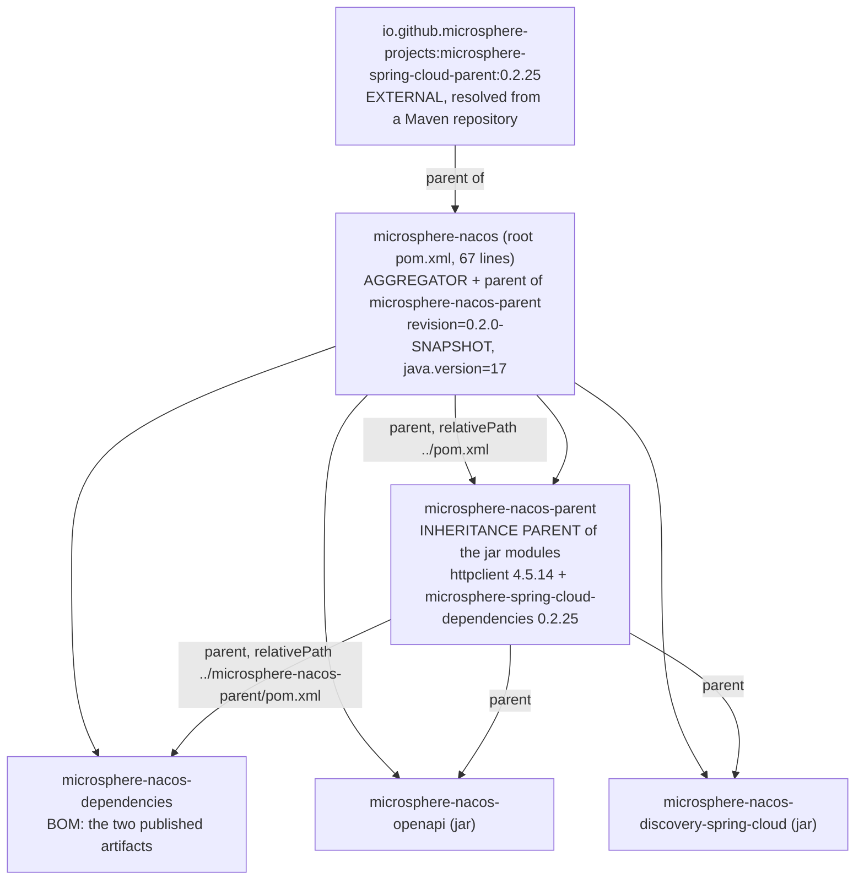

# microsphere-nacos-parent — 内部实现

`microsphere-nacos-parent` 是一个 48 行的 POM，它唯一的工作是承载本仓库直接拥有的第三方版本锁定。它不是聚合器，没有
源码，也没有构建配置。如果你在寻找编译器设置、插件管理或发布 profile，它们是从本仓库之外的构件继承而来的 —— 本文档
会准确说明每条边界在哪里。

| 属性 | 取值 | 证据 |
| --- | --- | --- |
| 坐标 | `io.github.microsphere-projects:microsphere-nacos-parent:${revision}` | `microsphere-nacos-parent/pom.xml:13-15` |
| 打包方式 | `pom` | `microsphere-nacos-parent/pom.xml:16` |
| 父 POM | `microsphere-nacos:${revision}`，`relativePath` = `../pom.xml` | `microsphere-nacos-parent/pom.xml:5-10` |
| 长度 | 48 行（整个文件） | `wc -l microsphere-nacos-parent/pom.xml` |
| `<dependencies>` 段 | 无 | `microsphere-nacos-parent/pom.xml` |
| `<build>` 段 | 无 | `microsphere-nacos-parent/pom.xml` |
| `<profiles>` 段 | 无 | `microsphere-nacos-parent/pom.xml` |
| 模块 | 无 —— 它不聚合任何模块 | `microsphere-nacos-parent/pom.xml` |
| 受管依赖 | 2 条（1 条直接给出版本，1 条通过 BOM 导入） | `microsphere-nacos-parent/pom.xml:27-47` |

## 父 POM 与聚合器的区别

这是首先要分清的，因为两者都在本仓库中，也都使用 “parent” 这个词。



这里同时发挥着三种不同的 Maven 机制：

1. **聚合（Aggregation）** —— 只有根 `pom.xml` 中的 `<modules>`（第 59-66 行）才会创建多模块构建。反应堆顺序按声明列表
   排列：`microsphere-nacos-parent`、`microsphere-nacos-dependencies`、`microsphere-nacos-openapi`、
   `microsphere-nacos-discovery-spring-cloud`。
2. **继承（Inheritance）** —— 模块的 `<parent>` 元素。两个 jar 模块和 BOM 都指向 `microsphere-nacos-parent`；该 POM 又
   指向根 POM；根 POM 指向 `microsphere-spring-cloud-parent:0.2.25`。因此一个 jar 模块的继承深度是四层。
3. **依赖管理导入（Dependency management import）** —— `dependencyManagement` 内部的 `<scope>import</scope>`，本仓库
   只用了一次，就在本 POM 中。

`microsphere-nacos-parent` 同时既是被聚合的（它是一个 `<module>`），又是被继承的（它是一个 `<parent>`）。这是合法的，
也正是版本得以解析的原因：要让 `relativePath` 在干净检出时生效，父 POM 必须处于反应堆之内。

## 该 POM 实际包含的内容

属性（第 21-25 行）：

```xml
<properties>
    <httpclient.version>4.5.14</httpclient.version>
    <!-- BOM versions -->
    <microsphere-spring-cloud.version>0.2.25</microsphere-spring-cloud.version>
</properties>
```

依赖管理（第 27-47 行）：

```xml
<dependencyManagement>
    <dependencies>

        <!-- Apache HttpClient -->
        <dependency>
            <groupId>org.apache.httpcomponents</groupId>
            <artifactId>httpclient</artifactId>
            <version>${httpclient.version}</version>
        </dependency>

        <!-- Microsphere Spring Cloud Dependencies -->
        <dependency>
            <groupId>io.github.microsphere-projects</groupId>
            <artifactId>microsphere-spring-cloud-dependencies</artifactId>
            <version>${microsphere-spring-cloud.version}</version>
            <type>pom</type>
            <scope>import</scope>
        </dependency>

    </dependencies>
</dependencyManagement>
```

两条条目，两种不同机制。`httpclient` 是按值锁定的。而 `gson`、所有 Spring 构件、JUnit 以及 microsphere 各库是通过
*导入*另一个 BOM 来锁定的 —— 也就是说它们的版本根本不在这个仓库里。

### 你能核实与不能核实的版本，其出处

| 构件 | 版本 | 定义位置 | 本快照中可核实？ |
| --- | --- | --- | --- |
| `org.apache.httpcomponents:httpclient` | `4.5.14` | `microsphere-nacos-parent/pom.xml:22,34` | **可以** |
| `microsphere-spring-cloud-dependencies` 中的所有内容（例如 `gson`、`spring-boot-*`、`spring-cloud-*`、`junit-jupiter`、`logback-classic`、`microsphere-*`） | 定义在那个外部 BOM 中 | 外部构件 `io.github.microsphere-projects:microsphere-spring-cloud-dependencies:0.2.25` | **不可以** |
| `microsphere-spring-cloud-parent` | `0.2.25` | `pom.xml:9`（根 POM，字面版本） | **可以**，但仅限坐标 |
| 本仓库自有构件的 `${revision}` | `0.2.0-SNAPSHOT` | `pom.xml:55` | **可以** |
| Java 版本 | `17`（`<java.version>`） | `pom.xml:56` | 作为属性**可以**；消费它的插件是外部的 |
| Maven 自身 | `3.9.0` | `.mvn/wrapper/maven-wrapper.properties` | **可以** |

在记录或升级位于被导入 BOM 中的版本时，请说明它的来源。jar 模块刻意只写 `<artifactId>` 而不写 `<version>`（例如
`microsphere-nacos-openapi/pom.xml` 中的 `gson`），所以在仓库内搜索是找不到那些数字的。不要推断它们。

## 为什么 `httpclient` 锁定在这里，而 `gson` 不是

`microsphere-nacos-openapi/pom.xml` 声明了这两者，都不带版本。两者都经由本 POM 解析，但路径不同：`httpclient` 走上面
那条直接条目，`gson` 走被导入的 BOM。在本仓库单独锁定 `httpclient`，表达的是本仓库的传输层与 Apache HttpClient 4.x
强绑定 —— 代码 import 的是 `org.apache.http.client.*`（4.x 的包结构），而不是 HttpClient 5 的 `org.apache.hc.client5.*`
包。若某个 BOM 以后把 `httpclient` 移到 5.x 线，编译就会失败，因此这条覆盖是一个护栏。

给贡献者的规则：只有当仓库的*源码*对某个版本号敏感时，版本覆盖才应放在 `microsphere-nacos-parent`。其余一切留在被导入
的 BOM 里，这样整个 microsphere 组织就能在一个地方统一升级。

## 该 POM 刻意不做什么

- **没有 `<dependencies>`。** 单独的 `dependencyManagement` 不会给任何 classpath 增加内容。声明了 `httpclient` 但不写
  版本的模块会得到 `4.5.14`；没声明的模块什么都得不到。
- **没有 `<build>`、没有 `<pluginManagement>`、没有 `<distributionManagement>`。** 编译级别、源码/target 编码、
  `maven-source-plugin`/`maven-javadoc-plugin` 附件、`maven-gpg-plugin` 签名、`Sonatype`/`Central` 的 server id，以及
  `${revision}` 所必需的 flatten 步骤，全部来自 `microsphere-spring-cloud-parent:0.2.25`。那个 POM 不在本仓库中，因此
  它确切的插件版本无法在此说明。
- **没有 `<profiles>`。** CI 激活的 profile —— `test` 与 `coverage`，以及 `spring-cloud-2022` … `spring-cloud-2025`
  这几个选择器 —— 定义在同一个外部父 POM 中。命令以及离线状态下无法核实的内容，见
  [构建与测试流程](README.md#构建与测试流程按文件定义)。
- **它不重新导出 `${revision}`。** `microsphere-nacos-parent/pom.xml:8` 把 `${revision}` 用作父版本，第 15 行用作自身
  版本；该属性本身定义在根 POM 第 55 行，通过继承到达这里。发布一次版本意味着只改一行，即 `pom.xml:55`。

## 外部父 POM 的解析：离线约束

根 POM 声明父 POM 时没有带 `<relativePath>`：

```xml
<parent>
    <groupId>io.github.microsphere-projects</groupId>
    <artifactId>microsphere-spring-cloud-parent</artifactId>
    <version>0.2.25</version>
</parent>
```

于是 Maven 需要在本地仓库或远程仓库中找到 `microsphere-spring-cloud-parent-0.2.25.pom`（以及经由它引入的
`microsphere-spring-cloud-dependencies-0.2.25.pom`）。由此产生的、在尝试构建本分支之前值得记录的事实：

- 在一个 `~/.m2` 为空且没有网络的机器上，首次构建会在 POM 解析阶段失败，连一个模块都不会编译。本文档所处的正是这种
  状态：这里无法运行 Maven，因此本指南中没有任何结论来自一次完整构建。
- `mvnw` 固定了 Maven `3.9.0`，但它无法替代缺失的父 POM；`.mvn/` 目录下只有
  `wrapper/maven-wrapper.properties` 与 `wrapper/maven-wrapper.jar` —— 没有 `maven.config`，没有 `jvm.config`，也没有
  会改变解析行为的 `extensions.xml`。
- CI 中使用 `-Drevision=0.0.1-SNAPSHOT` 覆盖，恰恰是因为本仓库自身的坐标是属性驱动的；该覆盖不影响外部父 POM，后者的
  版本 `0.2.25` 是字面量。

## 修改本 POM 的检查清单

1. 为本仓库内的代码新增版本锁定 → 在本文件新增一个属性与一条 `dependencyManagement` 条目，沿用现有 `httpclient` 块的
   写法。
2. 为本仓库*发布的*构件新增锁定 → 那属于
   [microsphere-nacos-dependencies](microsphere-nacos-dependencies.md)，不属于这里。
3. 升级 `microsphere-spring-cloud.version` → 预期 `gson`、Spring、JUnit 与 microsphere 各库的版本会一起移动；请重跑完整
   CI 矩阵，因为四个 `spring-cloud-*` profile 会与这个数字相互影响。
4. 把 Apache HttpClient 升到 5.x → 阻碍不在本 POM，而在 `transport/OpenApiHttpClient.java`，因为它 import 的是 4.x 的包。
   这是一次源码迁移，不是版本迁移。
5. 修改 `<modules>` → 那是根 `pom.xml`，不是本文件。

## 相关文档

- [开发者指南索引](README.md)
- [microsphere-nacos-dependencies](microsphere-nacos-dependencies.md)
- [microsphere-nacos-openapi 内部实现](microsphere-nacos-openapi.md)
- [microsphere-nacos-discovery-spring-cloud 内部实现](microsphere-nacos-discovery-spring-cloud.md)
- [用户指南：microsphere-nacos-parent](../../1.x/microsphere-nacos-parent.md)
- [仓库 README](../../../../README.md)

## English

[English](../../1.x/microsphere-nacos-parent.md)
