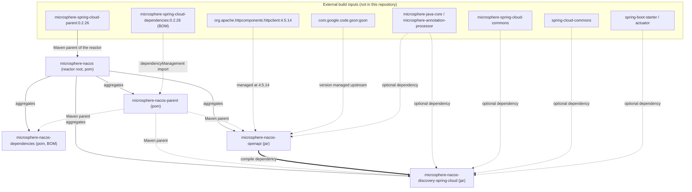
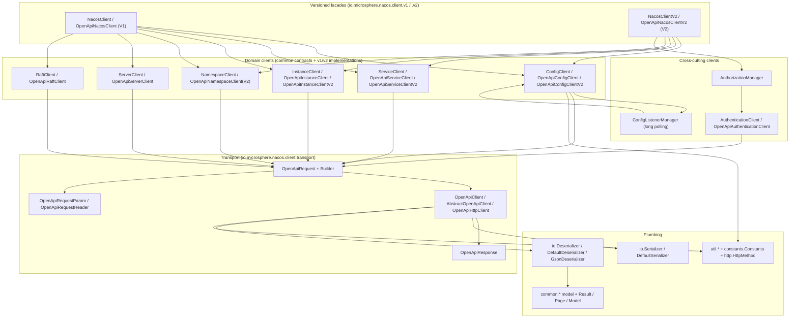
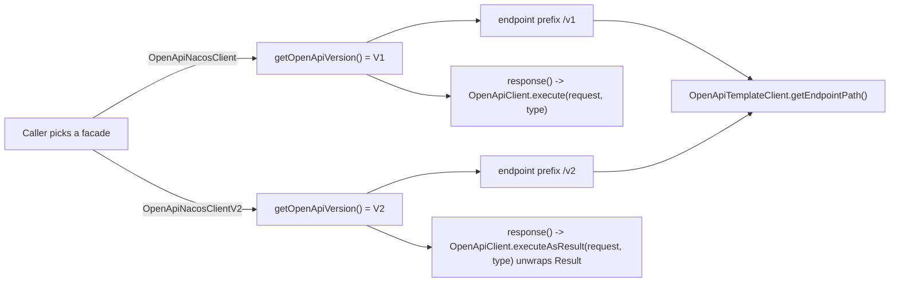
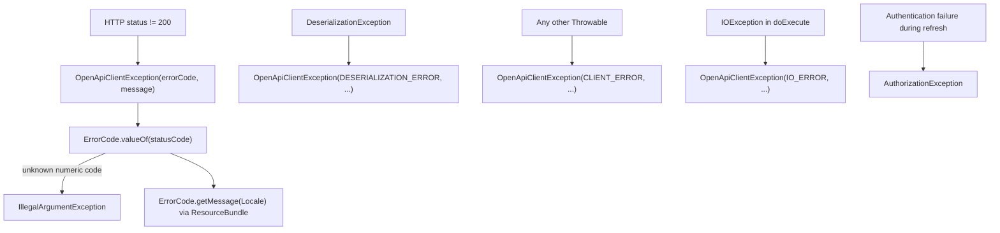

# Microsphere Nacos — 开发者指南（`current`）

本指南面向 `microsphere-nacos` 的 **`current`** 版本线：一个 Nacos **Open-API** 客户端库，外加构建在其之上的一个
Spring Cloud `DiscoveryClient` 适配器。它记录内部设计：模块结构、包分层、类职责、代码实际使用的模式、改动它们之前必须
理解的流程、扩展点，以及构建与测试流程。

以下内容全部读取自唯一的事实来源。

## 事实来源与出处

| 条目 | 取值 | 证据 |
| --- | --- | --- |
| 分析的代码树 | `release` 分支快照 | `.docs-work/release` Git worktree（detached HEAD `876f588`） |
| 反应堆根 POM | `io.github.microsphere-projects:microsphere-nacos:${revision}`（`pom`） | `pom.xml` |
| `${revision}` | `0.2.0-SNAPSHOT` | `pom.xml`，`<properties>` |
| `java.version` | `17` | `pom.xml`，`<properties>` |
| 外部 Maven 父 POM | `microsphere-spring-cloud-parent:0.2.26` | `pom.xml`，`<parent>` |
| 导入的 BOM | `microsphere-spring-cloud-dependencies:0.2.26` | `microsphere-nacos-parent/pom.xml` |
| 锁定的第三方版本 | `org.apache.httpcomponents:httpclient:4.5.14` | `microsphere-nacos-parent/pom.xml` |
| Maven wrapper | wrapper `3.3.4`，`distributionType=only-script`，Maven `3.9.16` | `.mvn/wrapper/maven-wrapper.properties` |

**本指南统一遵循的出处规则。** 由本仓库掌握的版本（`${revision}`、`httpclient 4.5.14` 锁定、wrapper 坐标）按事实陈述。
由*外部*父 POM 与*外部*导入 BOM 掌握的版本 —— Spring Boot、Spring Cloud、Gson、JUnit、Logback、Microsphere 各库，
以及每个 Maven 插件和每个构建 profile（`test`、`coverage`、`publish`、`ci`、`spring-cloud-2022` … `spring-cloud-2025`）——
**在本快照中无法核实**。它们一律被表述为“由 `microsphere-spring-cloud-parent:0.2.26` 提供”，绝不以数字引用。

## 反应堆一览

`pom.xml` 声明了四个启用模块与两个停用模块：

```xml
<modules>
    <module>microsphere-nacos-parent</module>
    <module>microsphere-nacos-dependencies</module>
    <module>microsphere-nacos-openapi</module>
    <!-- <module>microsphere-nacos-spring</module> -->
    <!-- <module>microsphere-nacos-spring-boot</module> -->
    <module>microsphere-nacos-discovery-spring-cloud</module>
</modules>
```

| 模块 | Artifact ID | 打包方式 | 主 `.java` | 测试 `.java` | 指南 |
| --- | --- | --- | --- | --- | --- |
| 父 POM | `microsphere-nacos-parent` | `pom` | 无 | 无 | [microsphere-nacos-parent.md](microsphere-nacos-parent.md) |
| 依赖 BOM | `microsphere-nacos-dependencies` | `pom`（BOM） | 无 | 无 | [microsphere-nacos-dependencies.md](microsphere-nacos-dependencies.md) |
| OpenAPI 客户端 | `microsphere-nacos-openapi` | `jar` | 118 | 21 | [microsphere-nacos-openapi.md](microsphere-nacos-openapi.md) |
| 服务发现适配器 | `microsphere-nacos-discovery-spring-cloud` | `jar` | 10 | 0 | [microsphere-nacos-discovery-spring-cloud.md](microsphere-nacos-discovery-spring-cloud.md) |

`microsphere-nacos-spring` 与 `microsphere-nacos-spring-boot` 既被注释掉了，**在本快照中也没有对应目录**。它们无法
构建，这里也不做说明；不要编写假定它们存在的代码。

## 模块依赖与继承关系流程图

这里有两种不同的关系在起作用，把它们混淆是 POM 错误最常见的来源：**Maven 父 POM**关系（构建继承）与**构件依赖**
关系（classpath）。



读图要点：

- 在本仓库内部，**唯一**跨越模块边界的 compile 作用域依赖是
  `microsphere-nacos-openapi` → 被 `microsphere-nacos-discovery-spring-cloud` 使用
  （`microsphere-nacos-discovery-spring-cloud/pom.xml`）。
- `microsphere-nacos-parent` 不拥有任何源码；它存在的意义是给三个可构建模块提供同一份
  `dependencyManagement` 声明块。
- `microsphere-nacos-dependencies`（BOM）管理的**只是本项目自身的构件**；它面向下游使用者，反应堆中没有任何模块依赖它。
- Spring Boot / Spring Cloud / Microsphere-Spring-Cloud 在服务发现模块中都是 `optional`，因此使用者必须自行引入。
  见 [microsphere-nacos-discovery-spring-cloud.md](microsphere-nacos-discovery-spring-cloud.md)。

## 客户端的分层架构

`microsphere-nacos-openapi` 是一个严格的自底向上技术栈。每一层只依赖它之下的层。



关键结构事实，全部可在源码中核实：

- `Client`（`.../nacos/client/Client.java`）是那个只有一个方法的根契约：`NacosClientConfig getNacosClientConfig()`。
  每个领域客户端和每个门面最终都实现它。
- `AbstractClient` 以 `final` 方式实现它一次，并保存配置；`OpenApiTemplateClient extends AbstractClient`
  增加了 `OpenApiClient` 协作者以及带版本感知能力的请求/响应辅助方法。就是这一个类构成了“领域客户端”与“传输层”
  之间的接缝。
- 传输层只被选定一次：`OpenApiHttpClient` 是本快照中唯一的 `OpenApiClient` 实现
  （`io.microsphere.nacos.client.transport.OpenApiHttpClient`）。
- 领域客户端从不构造 `URI` 字符串，也不碰 Apache HTTP 对象；它们构造 `OpenApiRequest`，然后交给被注入的
  `OpenApiClient`。

## 实现如何被选定（V1 与 V2）

`NacosClientConfig` 中**没有**版本字段（见
`.../nacos/client/NacosClientConfig.java` —— 地址、scheme、context path、凭据、连接池与超时设置、线程名、编码，别无其他）。
版本选择是结构性的：它发生在你选择门面类与领域客户端类的那一刻，随后通过 `OpenApiVersion` 传播开来。



| 关注点 | V1 | V2 | 证据 |
| --- | --- | --- | --- |
| 路径前缀 | `/v1` | `/v2` | `OpenApiVersion.V1("/v1")`，`V2("/v2")` |
| 载荷封装 | 原始响应体 | `Result<T>` 包装，`isSuccess()` 时解包 | `OpenApiTemplateClient.response(...)`，`AbstractOpenApiClient.execute(request, payloadType)` |
| 成功哨兵 | 响应体等于 `"ok"` | `Result` 载荷等于 `"ok"` | `OpenApiUtils.executeAsMessageOK` 与 `executeAsResultMessageOK` |
| 集群查询参数 | `clusters` | `clusterName` | `OpenApiInstanceClient.getInstancesList(...)`：`isOpenApiV1() ? CLUSTERS : CLUSTER_NAME` |
| 配置读取端点 | `/v1/cs/configs` | 无 V2 等价端点；V2 客户端回落到 V1 路径 | `OpenApiConfigClientV2.getConfig(...)` 的注释与代码 |
| 门面暴露面 | 配置 + 服务 + 实例 + 命名空间 + 服务端 + raft + 鉴权 | 配置 + 服务 + 实例 + 命名空间 + 鉴权 + V2 独有的*客户端*自省 | `v1.NacosClient`，`v2.NacosClientV2` |

V2 门面仍然装配了 `OpenApiServerClient` 和 `OpenApiRaftClient`（V1 专用实现），并通过
`getServerClient()` / `getRaftClient()` 暴露它们；但由于 `NacosClientV2` 并不继承 `ServerClient` 或 `RaftClient`，
V2 门面上不存在任何 server/raft 委托方法 —— 这一点可由 `v2/OpenApiNacosClientV2.java` 中没有 `getServerState`、
`getServerMetrics`、`getServersList` 与 `getRaftModel` 得到确认。

## 一页看懂鉴权与 token 生命周期

- `NacosClientConfig.isAuthorizationEnabled()` 就是 `userName != null && password != null`。
- `OpenApiHttpClient` 的构造器创建 `AuthorizationManager`，后者立即针对
  `POST /v1/auth/login` 调用 `authenticate()`，并启动一个守护线程调度器。
- `AbstractOpenApiClient.execute(OpenApiRequest)` 是 `final` 的，也是 token 的**唯一**注入点：

```java
@Override
public final OpenApiResponse execute(OpenApiRequest request) throws OpenApiClientException {
    String accessToken = getAccessToken();
    OpenApiRequest openApiRequest = accessToken == null ? request :
            from(request).queryParameter(ACCESS_TOKEN, accessToken).build();
    return doExecute(openApiRequest);
}
```

- token 是一个名为 `accessToken` 的**查询参数**（`OpenApiRequestParam.ACCESS_TOKEN`），绝不是请求头。
- 刷新发生在服务端所报 TTL 的一半时刻，执行线程名为 `Nacos Client - Authorization Refresher`。
- 完整时序图与失败语义：
  [microsphere-nacos-openapi.md](microsphere-nacos-openapi.md)。

## 一页看懂错误模型



它们全部继承 `NacosClientException extends RuntimeException`，构造时使用
`super(message, cause, true, false)` —— 启用抑制、**禁用可写栈轨迹**，因此在热点路径上异常开销极低。细节、表格与
本地化消息包：[microsphere-nacos-openapi.md](microsphere-nacos-openapi.md)。

## 代码中真实存在的设计模式

这里只列出有代码指引的模式。“位置”一列是你应当打开确认的文件。

| 模式 | 所在位置 | 文件 |
| --- | --- | --- |
| 模板方法 | `AbstractOpenApiClient.execute(...)`（final）调用抽象的 `doExecute(...)` 与 `getAccessToken()` | `.../client/transport/AbstractOpenApiClient.java` |
| 模板方法 | `AbstractClient` 固定了 `getNacosClientConfig()`；`OpenApiTemplateClient` 固定了 `response(...)` | `.../client/AbstractClient.java`，`.../client/common/OpenApiTemplateClient.java` |
| 外观 | `OpenApiNacosClient` / `OpenApiNacosClientV2` 实现 `NacosClient` / `NacosClientV2`，并转发每一次调用 | `.../client/v1/OpenApiNacosClient.java`，`.../client/v2/OpenApiNacosClientV2.java` |
| 委托 | 门面持有七个在构造器中建立的领域客户端字段，内部不含任何 HTTP 逻辑 | 同上两个文件 |
| 策略 | `Serializer` / `Deserializer` 接口，配合 `DefaultSerializer` / `DefaultDeserializer`（Gson） | `.../client/io/` |
| 策略 | `OpenApiVersion` 选定端点前缀与响应封装 | `.../client/OpenApiVersion.java`，`.../client/common/OpenApiTemplateClient.java` |
| 建造者 | `OpenApiRequest.Builder`（`create`、`from`、`method`、`queryParameter`、`header`、`build`） | `.../client/transport/OpenApiRequest.java` |
| 观察者 | `ConfigChangedListener extends EventListener`、`ConfigChangedEvent extends EventObject`、`ConfigListenerManager` + `ConfigChangedListeners` | `.../client/common/config/event/`，`.../client/v1/config/ConfigListenerManager.java` |
| 适配器 | `NacosServiceInstance` 把 Nacos 的 `Instance` 映射到 Spring Cloud 的 `ServiceInstance` | `.../discovery/spring/cloud/NacosServiceInstance.java` |
| 注册表 / 缓存 | `ConcurrentMap<String, ListeningConfig> listeningConfigsCache`，以 `ConfigUtil.buildConfigId(...)` 为键 | `.../client/v1/config/ConfigListenerManager.java` |
| Service Loader（SPI） | `ServiceLoader.load(Serializer.class)`、`Deserializer.class`、`GsonDeserializer.class` | `.../client/transport/OpenApiHttpClient.java`，`.../client/io/DefaultDeserializer.java` |
| 具名子上下文 | `NacosDiscoveryContextFactory extends NamedContextFactory<NacosDiscoverySpecification>` | `.../discovery/spring/cloud/NacosDiscoveryContextFactory.java` |

## 阅读顺序

请按下列顺序阅读；每一步只依赖前面各步已经建立的内容。

| # | 文档 | 为什么先读 |
| --- | --- | --- |
| 1 | 本文件 | 反应堆、分层、模式清单 |
| 2 | [microsphere-nacos-parent.md](microsphere-nacos-parent.md) | 每个依赖版本的来源，以及 `httpclient` 为何锁定为 4.5.14 |
| 3 | [microsphere-nacos-dependencies.md](microsphere-nacos-dependencies.md) | `${revision}` / CI 友好版本方案，以及 BOM 管什么、不管什么 |
| 4 | [microsphere-nacos-openapi.md](microsphere-nacos-openapi.md) | 深入剖析：传输层、鉴权、序列化、长轮询、错误模型、扩展点 |
| 5 | [microsphere-nacos-discovery-spring-cloud.md](microsphere-nacos-discovery-spring-cloud.md) | 本仓库中该客户端的唯一使用者，以及它附加的 Spring Boot bootstrap |

如果你正准备新增一个 API 方法，直接跳到
[microsphere-nacos-openapi.md → 扩展点](microsphere-nacos-openapi.md)。

## 构建与测试流程（依据文件描述，此处从未执行）

- Wrapper：`.mvn/wrapper/maven-wrapper.properties` 锁定 Maven `3.9.16` 且 `distributionType=only-script`；`mvnw` 与
  `mvnw.cmd` 都位于仓库根目录。根 `README.md` 记录了 `./mvnw package`（Linux/macOS）与
  `mvnw.cmd package`（Windows）。
- CI 构建矩阵（`.github/workflows/maven-build.yml`）：JDK `17`、`21`、`25` × profile `spring-cloud-2022`、
  `spring-cloud-2023`、`spring-cloud-2024`、`spring-cloud-2025`，执行 `mvn --batch-mode --update-snapshots
  --file pom.xml -Drevision=0.0.1-SNAPSHOT test --activate-profiles test,coverage,<profile>`。
- 测试环境：CI 在 Maven 运行之前启动 `docker compose -f "docker/test-services.yml" up -d`，结束后关闭它。**本快照中
  没有 `docker/test-services.yml`**，因此确切的 Nacos 镜像、端口以及导出为 `SERVER_ADDRESS` 的值都无法核实。
- 测试入口：`microsphere-nacos-openapi/src/test/java/io/microsphere/nacos/client/OpenApiTest.java` 在缺少 Nacos 地址时
  快速失败：

```java
static String getServerAddress() {
    String key = SERVER_ADDRESS_PROPERTY_NAME;
    return System.getProperty(key, System.getenv(key));
}
```

  其中 `SERVER_ADDRESS_PROPERTY_NAME = "SERVER_ADDRESS"`，并且当该属性解析为 `null` 时 `init()` 会抛出点名该属性的
  `IllegalArgumentException`。因此每个 API 测试都需要一个运行中的 Nacos 服务端，外加
  `-DSERVER_ADDRESS=...`（或同名环境变量）。该基类中的用户名/密码默认值为 `nacos`/`nacos`。
- 发布（`.github/workflows/maven-publish.yml`）：要求传入 `major.minor.patch` 形式的输入，执行
  `./mvnw ... -Drevision=${{ inputs.revision }} -Dgpg.skip=true deploy --activate-profiles publish,ci`，随后打标签、
  生成 release notes、用 `sed` 把 `pom.xml` 中的 `<revision>` 改写为下一个 `-SNAPSHOT` 补丁号，并把 `release`
  合并进 `main`。反应堆自身除了 `${revision}` 之外从不锁定任何 Maven 版本。
- `microsphere-nacos-discovery-spring-cloud` 在本快照中**没有测试源码**（`src/` 下只有 `main/`），
  因此那里的回归只能由下游应用发现。
- profile `test`、`coverage`、`ci`、`publish` 以及各 `spring-cloud-*` profile **在本快照的任何 POM 中都未声明**；它们来自
  `microsphere-spring-cloud-parent:0.2.26`，在此无法核实。

## 文档地图

开发者指南（本目录）：

| 文档 | 覆盖内容 |
| --- | --- |
| [README.md](README.md) | 本索引：出处、反应堆、分层、模式、阅读顺序、构建流程 |
| [microsphere-nacos-openapi.md](microsphere-nacos-openapi.md) | 逐包源码剖析、请求生命周期、长轮询、错误模型、扩展点 |
| [microsphere-nacos-discovery-spring-cloud.md](microsphere-nacos-discovery-spring-cloud.md) | `DiscoveryClient` 适配器、自动配置 bootstrap、多客户端上下文 |
| [microsphere-nacos-parent.md](microsphere-nacos-parent.md) | 共享父 POM：`dependencyManagement` 策略、`httpclient` 锁定 |
| [microsphere-nacos-dependencies.md](microsphere-nacos-dependencies.md) | 项目 BOM、`${revision}` CI 友好版本方案 |

用户指南（同一份代码的使用者视角）：

- [用户指南：microsphere-nacos-openapi](../../../user-guide/zh/current/microsphere-nacos-openapi.md)
- [用户指南：microsphere-nacos-discovery-spring-cloud](../../../user-guide/zh/current/microsphere-nacos-discovery-spring-cloud.md)
- [用户指南：microsphere-nacos-parent](../../../user-guide/zh/current/microsphere-nacos-parent.md)
- [用户指南：microsphere-nacos-dependencies](../../../user-guide/zh/current/microsphere-nacos-dependencies.md)
- [用户指南索引](../../../user-guide/zh/current/README.md)

交叉入口：

- [文档主页](../../../README.md)
- [仓库 README](../../../../README.md)
- `1.x` 版本线：[`1.x` 开发者指南](../../1.x/README.md)

## 对贡献代码的约定要求

以下都是在这些源码中观察到的，新增代码时必须遵守：

- 根包是 `io.microsphere.nacos.client`。传输层在 `.transport`，JSON 相关代码在 `.io`，共享契约与模型在
  `.common.<domain>`，按版本的实现类在 `.v1` / `.v2`，辅助工具在 `.util`，键名在 `.constants`。
- 每个文件都有 Apache 许可证头，Javadoc 带有
  `@author <a href="mailto:mercyblitz@gmail.com">Mercy<a/>` 和 `@since 1.0.0`。这一版本线没有引入不同的
  `@since` 取值 —— 请沿用 `1.0.0`。
- `NacosClientConfig` 会被传入每个构造器；`AbstractClient` 以及 `AbstractClient` 的派生类都用
  `Objects.requireNonNull(..., "The 'x' argument must not be null")` 拒绝 null 协作者。
- 不允许被绕过的钩子方法声明为 `final`：`AbstractClient.getNacosClientConfig()`、
  `AbstractOpenApiClient.execute(OpenApiRequest)`、`OpenApiTemplateClient.getOpenApiClient()`。
- 端点路径以 `getEndpointPath() + CONSTANT_SUFFIX` 的方式拼装，从而版本前缀永远不会硬编码在领域客户端里
  （见 `OpenApiConfigClient.getConfigEndpoint()`）。例外是控制台端点
  （`/v1/console/namespaces`、`/v1/console/server/state`、`/v1/ns/operator/*`、`/v1/ns/raft/leader`、
  `/v1/cs/configs/listener`），它们显式嵌入了 `/v1`，因此无法只靠继承就迁移到 V2。
- 模型实现 `Model extends Serializable`，并手写 `equals`、`hashCode`、`toString`。
- 在本模块内以静态导入引用常量（`OpenApiRequestParam.*`、`HttpMethod.*`）是领域客户端的固有风格。

## English

[English](../../current/README.md)
