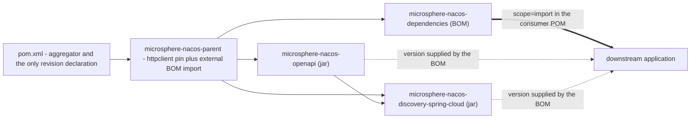

# `microsphere-nacos-dependencies` — 开发者指南（`current`）

本仓库对外发布的 BOM（bill of materials）。它恰好管理两个构件的版本 —— 即这条分支产出的那两个 jar ——
此外什么都不管。38 个带编号的行，没有源码，没有 build 段，而且**本仓库反应堆里没有任何模块使用它**。

## 1. 事实

| 属性 | 取值 | 证据 |
| --- | --- | --- |
| 坐标 | `io.github.microsphere-projects:microsphere-nacos-dependencies:${revision}` | `microsphere-nacos-dependencies/pom.xml:13-15` |
| 打包方式 | `pom` | `microsphere-nacos-dependencies/pom.xml:16` |
| Maven 父 POM | `microsphere-nacos-parent:${revision}`、`relativePath ../microsphere-nacos-parent/pom.xml` | `microsphere-nacos-dependencies/pom.xml:5-10` |
| 被根 POM 聚合 | 是，第二个模块条目 | `pom.xml:61` |
| 长度 | 38 个带编号的行；`wc -l` 报告 37（结尾无换行） | `microsphere-nacos-dependencies/pom.xml` |
| 受管构件 | 2 个，都由本仓库产出 | `microsphere-nacos-dependencies/pom.xml:21-37` |
| `<dependencies>` / `<build>` / `<profiles>` / `<modules>` / `<properties>` | 无 | 整个文件 |
| 被本反应堆中任何 POM 导入 | **否** | `grep -rn "microsphere-nacos-dependencies" --include=pom.xml .` 只匹配到它自己的 `<artifactId>`（第 14 行）和根 `<module>`（`pom.xml:61`） |

## 2. 完整的依赖段

```xml
<dependencyManagement>
    <dependencies>

        <dependency>
            <groupId>io.github.microsphere-projects</groupId>
            <artifactId>microsphere-nacos-openapi</artifactId>
            <version>${revision}</version>
        </dependency>

        <dependency>
            <groupId>io.github.microsphere-projects</groupId>
            <artifactId>microsphere-nacos-discovery-spring-cloud</artifactId>
            <version>${revision}</version>
        </dependency>

    </dependencies>
</dependencyManagement>
```

（`microsphere-nacos-dependencies/pom.xml:21-37`。）两个条目都是 `<version>${revision}</version>`，
既没有 `<type>` 也没有 `<scope>`。就这一个形状编码了三个决定：

1. **这是一个项目 BOM，不是平台 BOM。** 它从不声明任何第三方版本。`gson`、Apache HttpClient、Spring Boot、
   Spring Cloud、JUnit 和 logback 都在这个文件*所声明*的内容之外。消费者得到的是本仓库自有构件之间的一致性 ——
   这是本仓库唯一能承诺的一致性。
2. **`${revision}` 让 BOM 与反应堆保持同一步调。** 该属性只声明一次，在根
   `pom.xml:55`（这条分支上是 `0.2.0-SNAPSHOT`）。发版时改的就是那一行；BOM 不需要改动。
3. **没有 `<scope>` 也没有 `<type>`。** 这些条目描述的是 jar 构件，所以默认的 `jar`/`compile` 处理正是消费者
   需要的。对照同级的 `microsphere-nacos-parent/pom.xml:38-44`，那里*被导入的* BOM 确实需要
   `<type>pom</type><scope>import</scope>`。这一处对照就是“管理一个构件”与“导入一个 BOM”之间的全部区别，
   也是评审者绝不能去“顺手整理”的那一点。

排序依据依赖深度：`microsphere-nacos-openapi`（库）排在
`microsphere-nacos-discovery-spring-cloud`（依赖它的适配器）之前 —— 于是这一块可以直接读成反应堆自身的图
（`microsphere-nacos-discovery-spring-cloud/pom.xml:40-44`）。

## 3. 该 BOM 继承了什么，对消费者意味着什么

本 POM 的父 POM 是 `microsphere-nacos-parent`，不是聚合器。那个父 POM 在自己的 `dependencyManagement` 里声明
`httpclient:4.5.14` 并导入 `microsphere-spring-cloud-dependencies:0.2.26`
（[microsphere-nacos-parent.md](microsphere-nacos-parent.md)）。Maven 会在展开 import 之前先把父 POM 的
`dependencyManagement` 合并进子 POM 的有效模型，所以已发布 BOM 的*有效*受管集合比这 38 行看起来的要宽：

| 条目来源 | 它贡献了什么 |
| --- | --- |
| `microsphere-nacos-dependencies/pom.xml:24-34` | 处于 `${revision}` 的 `microsphere-nacos-openapi`、`microsphere-nacos-discovery-spring-cloud` |
| 从 `microsphere-nacos-parent/pom.xml:31-35` 继承 | `org.apache.httpcomponents:httpclient:4.5.14` |
| 通过在 `microsphere-nacos-parent/pom.xml:38-44` 的导入继承而来 | 外部 `microsphere-spring-cloud-dependencies:0.2.26` 里的一切 —— Spring Boot、Spring Cloud、`gson`、JUnit、logback、`microsphere-*` 各库 |

可以这样理解：把这个 BOM 导入一个应用，几乎就是一套一站式版本集合 —— 它既锁定本项目的两个构件，
*也*锁定它们构建时所依据的 HttpClient 与 microsphere 版本线。

**本节的出处。** 它是 Maven 有文档记载的模型继承行为，套用从快照读到的文件得出。它 **没有** 被
`mvn help:effective-pom` 确认过，因为本环境中无法执行 Maven，也因为
`microsphere-spring-cloud-dependencies:0.2.26` 的内容位于本分支之外的某个构件里。不要从本文引用任何具体的
Spring Boot、Spring Cloud 或 `gson` 版本 —— 请到已发布的 BOM 里查。

### 3.1 优先级：当消费者已经导入了其他 BOM

`dependencyManagement` 是先声明者优先，所以消费者自己 POM 里 `<dependencyManagement><dependencies>` 条目的顺序，
决定了发生重叠时由哪个 BOM 作答。给任何把这个 BOM 与 `spring-boot-dependencies` 或
`spring-cloud-dependencies` 并列添加的人两条实用提示：

- 如果你希望本仓库构建时所依据的版本胜出，就把这个 BOM 声明在平台 BOM **之前**；若希望你的平台胜出，就放在
  它们之后。
- 消费者直接声明的条目，无论哪个方向都优先于任何被导入的 BOM。

这是 Maven 的规则，不是这个文件的属性；快照里没有任何东西强制执行或测试它。

## 4. `${revision}`：CI 友好版本方案，如这些 POM 所示

`${revision}` 恰好声明一次，被使用了十二次：

| 位置 | 角色 |
| --- | --- |
| `pom.xml:55` | **唯一的声明**：`<revision>0.2.0-SNAPSHOT</revision>` |
| `pom.xml:14` | 聚合器自己的 `<version>` |
| `microsphere-nacos-parent/pom.xml:8,15` | 父坐标 + 自身坐标 |
| `microsphere-nacos-dependencies/pom.xml:8,15` | 父坐标 + 自身坐标 |
| `microsphere-nacos-dependencies/pom.xml:27,33` | 两个受管构件的版本 |
| `microsphere-nacos-openapi/pom.xml:9,15` | 父坐标 + 自身坐标 |
| `microsphere-nacos-discovery-spring-cloud/pom.xml:9,17,43` | 父坐标 + 自身坐标 + 对 `microsphere-nacos-openapi` 的仓库内依赖 |

有两个 POM 刻意 **不** 使用它：外部父 POM 坐标 `microsphere-spring-cloud-parent:0.2.26`
（`pom.xml:6-10`），以及外部 BOM 坐标 —— 后者使用的是
专用的 `microsphere-spring-cloud.version` 属性（`microsphere-nacos-parent/pom.xml:24,41`）。若把两者混用，
发布自动化就会去改写它本不该碰的坐标。

这套方案在本分支自身的自动化中是如何被演练的：

- **CI** 每次运行时覆盖它：`-Drevision=0.0.1-SNAPSHOT`（`.github/workflows/maven-build.yml:52`），与 JDK
  矩阵 `17`/`21`/`25` 以及 `spring-cloud-2022` … `spring-cloud-2025` profile 选择器并列（第 25-27 行）。CI 因此
  从不发布；它构建一个随意的一次性版本，用来证明代码在每条平台线上都能编译、测试都能通过。
- **Release** 把真实数字传进去：`-Drevision=${{ inputs.revision }}`
  （`.github/workflows/maven-publish.yml:60`），其中 `workflow_dispatch` 输入 `revision` 在第 16-19 行声明，
  并在第 28-31 行按 `^[0-9]+\.[0-9]+\.[0-9]+$` 校验；deploy 在 `publish,ci` profile 下运行
  （第 63 行）。之后 "Increment patch version" 步骤（第 193-202 行）重新算出 `major.minor.(patch+1)-SNAPSHOT`
  并用
  `sed "s|^\( *\)<revision>[^<]*</revision>|\1<revision>${NEXT_VERSION}</revision>|" pom.xml`
  （第 201 行）改写该属性 —— 注意目标：**只有 `pom.xml`**，那唯一的声明点。tag 与 GitHub release 用的是
  输入值（第 94、185 行）。

反应堆自身从不在 POM 里锁定 Maven 版本；是 wrapper 在做：`wrapperVersion=3.3.4`、
`distributionType=only-script`、`distributionUrl=…/apache-maven-3.9.16-bin.zip`
（`.mvn/wrapper/maven-wrapper.properties:1-3`）—— 也就是一个 Maven **3.x** 发行版。

### 4.1 展平：能观察到与不能观察到的

已*发布* POM 里的 `${revision}` 只对定义了该属性的读取者有意义 —— 而下游应用通常并没有定义它。
Maven 3.x 构建的标准补救措施是在 `install`/`deploy` 阶段做一次 POM 展平
（`flatten-maven-plugin`，通常配 `flattenMode=resolveCiFriendliesOnly`），把解析出的版本替换进去，
并剥掉 `${revision}` 占位符。

在本快照中：**这样的配置并不存在。** 对每个 POM 和每个 workflow grep `flatten` 返回零匹配；
`microsphere-nacos-dependencies` 和 `microsphere-nacos-parent` 都根本没有 `<build>` 段
（[microsphere-nacos-parent.md](microsphere-nacos-parent.md)）。无论是什么在执行替换（如果真有东西在做），
都由外部 `microsphere-spring-cloud-parent:0.2.26` 贡献，而它的构建配置在此读不到。
Maven 关于 `<parent><version>` 里 `${revision}` 的 3.x 告诫（本反应堆中有三处这样用，§4）也落在同一个
无法核实的筐里。

对任何审计发布产物的人来说，实际结论是：检查*已发布的*
`microsphere-nacos-dependencies-<version>.pom`，而不是这条分支上的文件。如果已发布的 POM 里仍带有
字面量 `${revision}`，那么这个 BOM 对消费者就无法解析 —— 那是构建流水线的缺陷，不是靠编辑这个文件能修好的。

## 5. 为什么本仓库内的模块都不使用它

每个 jar 模块都继承 `microsphere-nacos-parent`，而它已经管理了第三方版本；仓库内的依赖则用显式的
`${revision}` 表达：

```xml
<!-- Microsphere Nacos OpenAPI -->
<dependency>
    <groupId>io.github.microsphere-projects</groupId>
    <artifactId>microsphere-nacos-openapi</artifactId>
    <version>${revision}</version>
</dependency>
```

（`microsphere-nacos-discovery-spring-cloud/pom.xml:39-44`。）这里写的是字面版本，而不是一个不写版本的条目，
因为这个 BOM 并没有被导入反应堆 —— 这是刻意的，好让构建本仓库时永远不依赖它自己 BOM 的某个先前发布版本。
不要靠给 `microsphere-nacos-parent` 添加一条对 `microsphere-nacos-dependencies` 的导入来“简化”它：
该 BOM 的 `<parent>` **就是**那个 POM，所以这条导入会是循环的
（`microsphere-nacos-dependencies/pom.xml:5-10`）。

## 6. 导入与继承的区别

| 你的处境 | 用什么 | 原因 |
| --- | --- | --- |
| 一个希望本项目 jar 版本保持一致的下游应用 | 在你自己的 `dependencyManagement` 里对 `microsphere-nacos-dependencies:${version}` 使用 `<scope>import</scope>` + `<type>pom</type>` | 导入只合并受管的*坐标*，而不继承一个构建模型 |
| 一个只需要单个构件的下游应用 | 为该构件写 `<version>` | 只有当两个或更多这些构件被一起使用时，这个 BOM 才值回它的开销；今天它恰好只管理两个 |
| 一个**在本反应堆内**新增的模块 | `<parent>` = `microsphere-nacos-parent`，配 `relativePath ../microsphere-nacos-parent/pom.xml` | 提供第三方版本的是继承；BOM 不在反应堆的构建输入 classpath 上（§5） |
| 一个只想要本项目版本、别的一概不要的模块 | 导入 BOM，绝不继承它 | 继承还会把整条外部父 POM 链拖进来，包括你没要求的插件与发布配置 |

经验法则：**反应堆之内用继承，之外用导入。** `${revision}` 让这种不对称在内部是安全的（第 4 节），
而它也正是消费者必须读展平后的 POM、而不是读分支文件的原因。

## 7. 在发布流程中的位置



四个模块一起 deploy，因为这个 BOM 是一个 `<module>`（`pom.xml:61`），而发布任务在整个反应堆上运行
`deploy`（`.github/workflows/maven-publish.yml:55-63`）。决定目标仓库的是 workflow，不是这个 POM；
workflow 披露了什么、没披露什么，见 [README → 构建与测试流程](README.md)。

## 8. 把一个新模块加入 BOM

1. 在根 `pom.xml`（第 59-66 行）加 `<module>`，并把 `microsphere-nacos-parent` 作为新模块的
   `<parent>`，配上惯常的 `relativePath`。
2. 在这里加第三个 `<dependency>` 块，与现有两个形状一致：groupId
   `io.github.microsphere-projects`，新的 artifactId，`<version>${revision}</version>`，不带 scope，不带 type
   （§2，决定 3）。
3. 把第三方版本挡在外面。如果新模块需要一处本 BOM 不提供的锁定，那么当源码对它敏感时，这个数字属于
   `microsphere-nacos-parent`；当它是组织共享的，就属于外部
   `microsphere-spring-cloud-dependencies` —— 见
   [microsphere-nacos-parent.md](microsphere-nacos-parent.md)。
4. 让条目按依赖深度排序（叶子库在前，适配器在后）。
5. 如果新模块是一个 `pom` 打包的 BOM 或 starter 而不是 jar，就明确决定消费者是否应当管理它：
   这类条目需要 `<type>pom</type>`，而在这里加上它会让本文件成为仓库中第一个管理非 jar 坐标的地方。

## 9. 相关文档

- [开发者指南索引](README.md)
- [microsphere-nacos-parent.md](microsphere-nacos-parent.md) —— 该 BOM 所继承的父 POM，也是第三方版本真正的来处
- [microsphere-nacos-openapi.md](microsphere-nacos-openapi.md) —— 受管构件 1
- [microsphere-nacos-discovery-spring-cloud.md](microsphere-nacos-discovery-spring-cloud.md) —— 受管构件 2，也是
  本反应堆中唯一依赖构件 1 的模块
- [用户指南：microsphere-nacos-dependencies](../../../user-guide/zh/current/microsphere-nacos-dependencies.md)
- [文档主页](../../../README.md)
- [仓库 README](../../../../README.md)

## English

[English](../../current/microsphere-nacos-dependencies.md)
