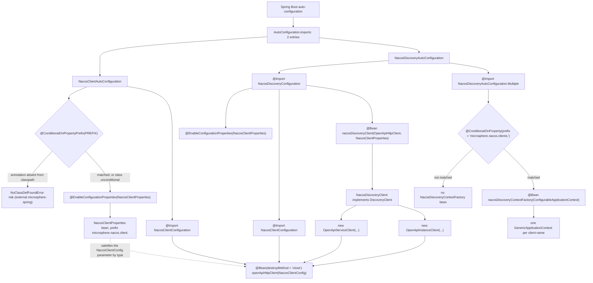
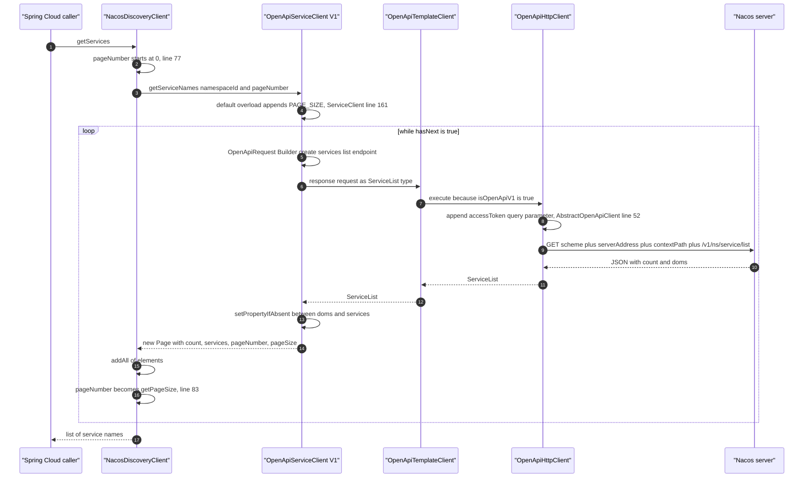
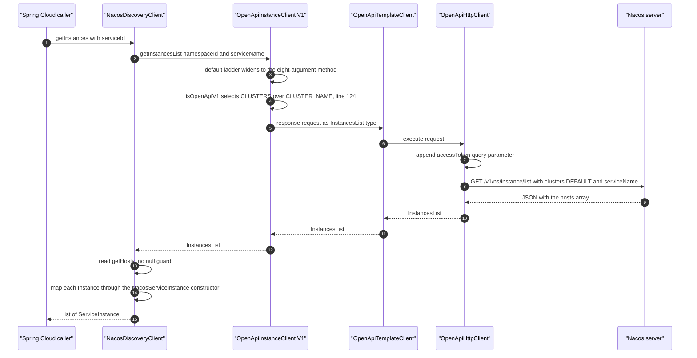

# `microsphere-nacos-discovery-spring-cloud` — 开发者指南（`current`）

Spring Cloud 适配器。它**不含任何协议逻辑**：它把外部配置绑定到 openapi 模块的 `NacosClientConfig` 上，构建一个
`OpenApiHttpClient` 传输层 bean，并通过 `org.springframework.cloud.client.discovery.DiscoveryClient` 暴露 Nacos 数据。
十个类，590 行 Java，一个资源文件，零测试。

证据基础：位于 `.docs-work/release` 的 `release` 分支快照（游离 HEAD `876f588`）。这里没有任何内容被编译、被执行、
或在 Spring 上下文中被启动过 —— 见[出处规则](README.md)。

## 1. 模块事实

| 属性 | 取值 | 证据 |
| --- | --- | --- |
| 坐标 | `io.github.microsphere-projects:microsphere-nacos-discovery-spring-cloud:${revision}` | `microsphere-nacos-discovery-spring-cloud/pom.xml:15-17` |
| 本版本线上的 `${revision}` | `0.2.0-SNAPSHOT` | `pom.xml:55` |
| 打包方式 | `jar` | `microsphere-nacos-discovery-spring-cloud/pom.xml:18` |
| Maven 父 POM | `microsphere-nacos-parent`、`relativePath ../microsphere-nacos-parent/pom.xml` | `microsphere-nacos-discovery-spring-cloud/pom.xml:6-11` |
| 主源码 | 10 个 `.java` 文件，590 行（`wc -l` 总计） | `src/main/java/io/microsphere/nacos/client` |
| 测试源码 | **没有** —— 不存在 `src/test` 目录 | 目录列举 |
| 资源 | 1 个文件：`src/main/resources/META-INF/spring/org.springframework.boot.autoconfigure.AutoConfiguration.imports` | 目录列举 |
| 非可选依赖 | `microsphere-nacos-openapi:${revision}` | `pom.xml:40-44` |
| 其余全部 | `optional`（compile）或 `test` | `pom.xml:23-111` |

因为本模块没有测试，CI 的 `mvn … test` 运行
（[README → 构建与测试流程](README.md)）不会从它那里得到任何信号。下面每一条关于行为的论断都来自阅读源码，
绝不来自执行过的断言。

## 2. 依赖图：几乎一切都是 `optional`

十三条声明的依赖；恰好只有一条会传递性地到达消费者。

| 声明（`pom.xml`） | `optional` | scope | 在主源码中可达的使用 |
| --- | --- | --- | --- |
| `microsphere-annotation-processor`（`:26-30`） | 是 | compile | 仅构建期元数据；解释了那些反常的 `@since` 取值（见 §11） |
| `microsphere-java-core`（`:33-37`） | 是 | compile | 本模块中没有任何文件 import 它 |
| `microsphere-nacos-openapi:${revision}`（`:40-44`） | **否** | compile | `InstanceClient`、`ServiceClient`、`Instance`、`InstancesList`、`Page`、`OpenApiHttpClient`、`OpenApiServiceClient`、`OpenApiInstanceClient`、`NacosClientConfig` |
| `microsphere-spring-cloud-commons`（`:47-51`） | 是 | compile | `io.microsphere.spring.boot.condition.ConditionalOnPropertyPrefix`、`io.microsphere.spring.util.PropertySourcesUtils` —— 见下方告诫 |
| `spring-cloud-commons`（`:54-58`） | 是 | compile | `DiscoveryClient`、`ServiceInstance`、`DefaultServiceInstance`、`NamedContextFactory` |
| `spring-boot-starter`（`:61-65`） | 是 | compile | `@Configuration`、`@Bean`、`@Import`、`@ConfigurationProperties`、`@EnableConfigurationProperties`、`@ConditionalOnProperty`、`Environment`、`PropertySource` |
| `spring-boot-starter-actuator`（`:67-71`） | 是 | compile | **本模块中不存在对任何 actuator 类型的 import** |
| `spring-boot-configuration-processor`（`:73-77`） | 是 | compile | 构建期生成 `spring-configuration-metadata.json` |
| `spring-boot-autoconfigure-processor`（`:79-83`） | 是 | compile | 生成 `spring-autoconfigure-metadata.properties` |
| `junit-jupiter`、`spring-boot-starter-test`、`microsphere-spring-boot-test`、`logback-classic`（`:86-111`） | 否 | test | 能被解析，但不运行任何东西 —— 没有 `src/test` |

在你修改这个 POM 之前，有两条后果值得牢记：

1. `optional` **不具备**传递性。只添加本构件的消费者得到的是 openapi 客户端，此外什么都没有：
   没有 `DiscoveryClient` 接口，没有 Boot 自动配置机制，也没有 `microsphere-spring` 类。宿主应用必须已经自行管理
   Spring Boot / Spring Cloud 版本 —— 而这恰恰让本仓库能在四个 `spring-cloud-2022` … `spring-cloud-2025` CI profile
   下编译，而不锁定其中任何一个（`.github/workflows/maven-build.yml:26-27`）。
2. `ConditionalOnPropertyPrefix` 与 `PropertySourcesUtils` 位于 `io.microsphere.spring.*` 包中，而本仓库产出的
   任何构件都不提供这些包。唯一能为它们供货的声明是
   `microsphere-spring-cloud-commons`，而它的传递性布局**属于外部、无法从本快照核实**。
   如果运行时缺少这些类，`NacosClientAutoConfiguration` 与 `NacosClientUtils` 会以
   `NoClassDefFoundError` 失败 —— 这是打包问题，不是代码问题。

不要用在本模块去掉 `optional` 的方式来“修复”消费者的 `ClassNotFoundException`；请修复消费者的 BOM。

## 3. 类清单

所有路径都相对于 `microsphere-nacos-discovery-spring-cloud/src/main/java/`。

| 文件 | 行数 | 职责 |
| --- | --- | --- |
| `io/microsphere/nacos/client/spring/boot/autoconfigure/NacosClientAutoConfiguration.java` | 41 | 自动配置入口 1：条件化，启用 properties bean，导入传输层配置 |
| `io/microsphere/nacos/client/spring/boot/NacosClientProperties.java` | 58 | `@ConfigurationProperties("microsphere.nacos.client.")`，**继承** openapi 的 `NacosClientConfig`，新增 `discovery.namespace-id` |
| `io/microsphere/nacos/client/spring/NacosClientConfiguration.java` | 37 | `@Bean(destroyMethod = "close") OpenApiHttpClient` —— 唯一持有连接池与 token 缓存的 bean |
| `io/microsphere/nacos/client/spring/util/NacosClientUtils.java` | 51 | 前缀常量，以及针对 `microsphere.nacos.clients.<name>.*` 的按客户端属性抽取 |
| `io/microsphere/nacos/client/discovery/spring/cloud/autoconfigure/NacosDiscoveryAutoConfiguration.java` | 51 | 自动配置入口 2：导入 discovery 配置，外加条件化的嵌套 `Multiple` 配置 |
| `io/microsphere/nacos/client/discovery/spring/cloud/NacosDiscoveryConfiguration.java` | 43 | `@Configuration(proxyBeanMethods = false)`、`@Import(NacosClientConfiguration.class)`，声明 `nacosDiscoveryClient` |
| `io/microsphere/nacos/client/discovery/spring/cloud/NacosDiscoveryClient.java` | 90 | `DiscoveryClient` 实现：`description()`、`getInstances()`、`getServices()` |
| `io/microsphere/nacos/client/discovery/spring/cloud/NacosServiceInstance.java` | 83 | 适配器：openapi `Instance` → Spring Cloud `ServiceInstance` |
| `io/microsphere/nacos/client/discovery/spring/cloud/NacosDiscoveryContextFactory.java` | 54 | `NamedContextFactory`，为每个具名 Nacos 客户端创建一个子上下文 |
| `io/microsphere/nacos/client/discovery/spring/cloud/NacosDiscoverySpecification.java` | 82 | `NamedContextFactory.Specification` 值对象 —— 上述工厂的泛型参数 |

两个包根并存在同一个根包（`io.microsphere.nacos.client`）之下，它们对齐的是 openapi 模块而不是构件名：
`…client.spring.*`（客户端引导，对 Spring 通用）与
`…client.discovery.spring.cloud.*`（discovery 适配器，Spring Cloud 专属）。

## 4. 自动配置引导

`AutoConfiguration.imports` 恰好包含两行，顺序如下
（`src/main/resources/META-INF/spring/org.springframework.boot.autoconfigure.AutoConfiguration.imports`）：

```text
io.microsphere.nacos.client.spring.boot.autoconfigure.NacosClientAutoConfiguration
io.microsphere.nacos.client.discovery.spring.cloud.autoconfigure.NacosDiscoveryAutoConfiguration
```

本模块没有 `META-INF/spring.factories`，因此宿主应用必须运行在能读取 `AutoConfiguration.imports` 的 Spring Boot
版本上。两个条目都标注了 `@Configuration`，**不是** `@AutoConfiguration`，也都没有声明
`@AutoConfigureAfter`/`@AutoConfigureBefore`：两个入口点之间的顺序是 Boot 默认的按字母/按注册顺序，
不是本模块能控制的事。



从这张图中读出三件事。

**(a) 两个入口点彼此独立，没有顺序关系。** `NacosDiscoveryConfiguration` 自己就声明了
`@Import(NacosClientConfiguration.class)`（`NacosDiscoveryConfiguration.java:35`）和
`@EnableConfigurationProperties(NacosClientProperties.class)`（`:34`）。所以即使把
`NacosClientAutoConfiguration` 从 imports 文件里删掉，discovery 这条路径仍然会产出一个 properties bean
和一个传输层 bean。这种冗余是有意的：discovery 模块在没有客户端自动配置的情况下也能用。

**(b) `NacosClientAutoConfiguration` 的守卫条件来自外部。** 整个类就是：

```java
@ConditionalOnPropertyPrefix(PREFIX)
@Configuration(proxyBeanMethods = false)
@EnableConfigurationProperties(NacosClientProperties.class)
@Import(value = {
        NacosClientConfiguration.class
})
public class NacosClientAutoConfiguration {
}
```

（`spring/boot/autoconfigure/NacosClientAutoConfiguration.java:34-41`；`PREFIX` 在第 26 行从
`NacosClientProperties` 静态导入。）`ConditionalOnPropertyPrefix` 属于 `io.microsphere.spring.boot.condition`
（第 21 行）—— 它不是 Spring Boot 的注解 —— 所以它的匹配规则无法从本快照读出。注意这个风险的形状，它*确实*
是本地的：`NacosClientConfiguration.openApiHttpClient(NacosClientConfig)` 无条件地构造
`new OpenApiHttpClient(nacosClientCOnfig)`（`spring/NacosClientConfiguration.java:33-36`），因此如果守卫条件
没有生效，而 `server-address` 又从未被设置，那么传输层就会带着 `serverAddress == null` 被构建出来。它最先在哪里
失败，是 openapi 模块的属性（`transport/OpenApiHttpClient.java`、`buildRootPath`）。

**(c) 嵌套的 `Multiple` 配置使用的是 Spring Boot 的注解，只给前缀、不给名字。**

```java
@Configuration(proxyBeanMethods = false)
@Import(value = {
        NacosDiscoveryConfiguration.class,
        NacosDiscoveryAutoConfiguration.Multiple.class
})
public class NacosDiscoveryAutoConfiguration {

    @ConditionalOnProperty(prefix = NACOS_CLIENTS_PROPERTY_NAME_PREFIX)
    public static class Multiple {

        @Bean
        public NacosDiscoveryContextFactory nacosDiscoveryContextFactory(ConfigurableApplicationContext parentContext) {
            return new NacosDiscoveryContextFactory(parentContext);
        }
    }
}
```

（`discovery/spring/cloud/autoconfigure/NacosDiscoveryAutoConfiguration.java:35-49`，其中
`NACOS_CLIENTS_PROPERTY_NAME_PREFIX = "microsphere.nacos.clients."` 在第 27 行静态导入、在
`spring/util/NacosClientUtils.java:35` 定义。）`org.springframework.boot.autoconfigure.condition.ConditionalOnProperty`
在第 21 行导入，并且只带 `prefix` 使用 —— 没有 `name`，没有 `value`，没有 `havingValue`，没有 `matchIfMissing`。
它到底意味着什么，由 Spring Boot 的 `OnPropertyCondition` 决定，而那个类在这里属于外部，所以 **本指南不断言它会
匹配“前缀之下至少存在一个属性”**。如果你依赖这个多客户端上下文工厂，请用 `--debug`（条件评估报告）实际验证一次，
而不是靠推断。周边的这个不对称是本地且确定的：`NacosDiscoveryConfiguration` 是无条件导入的，所以单客户端应用
不做任何配置也会得到一个 `NacosDiscoveryClient` bean。

## 5. 配置绑定

`NacosClientProperties` 并不是一个平行的配置模型 —— 它*就是* openapi 的那个模型：

```java
@ConfigurationProperties(prefix = PREFIX)
public class NacosClientProperties extends NacosClientConfig {

    public static final String PREFIX = PROPERTY_NAME_PREFIX;

    private Discovery discovery = new Discovery();
    ...
    public static class Discovery {
        private String namespaceId;
    }
}
```

（`spring/boot/NacosClientProperties.java:31-57`。）`PREFIX` 解析为 openapi 模块的
`Constants.PROPERTY_NAME_PREFIX`，其字面量是 `"microsphere.nacos.client."`，包含结尾的点
（`microsphere-nacos-openapi/src/main/java/io/microsphere/nacos/client/constants/Constants.java:38`）。正是继承
`NacosClientConfig` 让绑定变成免费的：那个类里的每一个 setter 都能在这个前缀下绑定，自身不需要任何注解。

| 属性（前缀 `microsphere.nacos.client.`） | 声明位置 | 默认值 / 说明 |
| --- | --- | --- |
| `server-address` | openapi `NacosClientConfig:57` | 无默认值，不设置即为 `null` |
| `scheme` | openapi `NacosClientConfig:62` | `http` |
| `context-path` | openapi `NacosClientConfig:67` | `/nacos` |
| `user-name`、`password` | openapi `NacosClientConfig:72,77` | 决定 `isAuthorizationEnabled()` |
| `access-key`、`secret-key` | openapi `NacosClientConfig:82,87` | 会被绑定，但 **本快照中本模块的任何主源码都不读取它** |
| `name` | openapi `NacosClientConfig:47` | 被复用为子上下文的属性名，§8 |
| `application-name`、`encoding` | openapi `NacosClientConfig:52,137` | |
| `max-connections`、`max-per-route` | openapi `NacosClientConfig:92,97` | 默认值来自 `Constants`（系统属性） |
| `connection-timeout`、`read-timeout`、`long-polling-timeout`、`event-processing-timeout` | openapi `NacosClientConfig:102-117` | 同上 |
| `fetching-config-thread-name`、`listener-config-thread-name`、`publishing-config-event-thread-name` | openapi `NacosClientConfig:122-137` | |
| `discovery.namespace-id` | **本模块**，`NacosClientProperties.Discovery:48` | 只被读取一次，在 `NacosDiscoveryClient` 的构造器里 |

第二个、与此无关的前缀只服务于多客户端场景：`microsphere.nacos.clients.<name>.*`
（`spring/util/NacosClientUtils.java:35`）。`microsphere.nacos.client.x` 永远不会去填充 `microsphere.nacos.clients.a.x`；
这两个命名空间之间唯一的桥是 `NacosClientUtils`，它把某个客户端的配置块变成一个 `PropertySource`，让子上下文可以
像读取扁平的 `microsphere.nacos.client.*` 命名空间那样读取它（§8）。

`NacosClientUtils` 很小，只有三个成员：

```java
public static final String NACOS_CLIENTS_PROPERTY_NAME_PREFIX = "microsphere.nacos.clients.";

public static String buildNacosClientPropertyNamePrefix(String nacosClientName) { ... + nacosClientName + "."; }

public static Map<String, Object> getNacosClientProperties(ConfigurableEnvironment environment, String nacosClientName) {
    String prefix = buildNacosClientPropertyNamePrefix(nacosClientName);
    return getSubProperties(environment, prefix);
}

public static PropertySource getNacosCilentPropertySource(ConfigurableEnvironment environment, String nacosClientName) {
    Map properties = getNacosClientProperties(environment, nacosClientName);
    return new MapPropertySource(nacosClientName, properties);
}
```

（`spring/util/NacosClientUtils.java:35-49`；该类是 `abstract`，只有静态成员 —— 是工具类，不是 bean。）
`getSubProperties` 是从 `io.microsphere.spring.util.PropertySourcesUtils` 静态导入的（第 25 行）。 **返回的 key
到底保留还是去掉 `microsphere.nacos.clients.<name>.` 前缀，由那个外部类内部决定，无法从本快照核实** ——
而且没有任何测试覆盖它。两条本地观察是确定的：方法名拼错了，是 `getNacosCilentPropertySource`（第 46 行），
并且 `Map` 用的是裸类型（第 47 行）。若要重命名这个方法，就得同时更新 `NacosDiscoveryContextFactory.java:26`
的静态导入。

## 6. `NacosDiscoveryClient`

```java
public class NacosDiscoveryClient implements DiscoveryClient {

    private final ServiceClient serviceClient;

    private final InstanceClient instanceClient;

    private final NacosClientProperties nacosClientProperties;

    private final String namespaceId;

    public NacosDiscoveryClient(OpenApiHttpClient openApiHttpClient, NacosClientProperties nacosClientProperties) {
        this.serviceClient = new OpenApiServiceClient(openApiHttpClient, nacosClientProperties);
        this.instanceClient = new OpenApiInstanceClient(openApiHttpClient, nacosClientProperties);
        this.nacosClientProperties = nacosClientProperties;
        this.namespaceId = nacosClientProperties.getDiscovery().getNamespaceId();
    }
```

（`discovery/spring/cloud/NacosDiscoveryClient.java:43-58`。）四条后果，全部都能从这几行读出来：

1. **硬编码到 Open API V1。** 它构造的是 `io.microsphere.nacos.client.v1.discovery.OpenApiServiceClient` 与
   `…v1.discovery.OpenApiInstanceClient`（第 26-27 行的 import）。`OpenApiTemplateClient.getOpenApiVersion()` 返回
   `V1`，除非子类覆写它，而这两个 V1 客户端都没有覆写它。从 Spring Cloud 走到 V2 意味着换一个 `DiscoveryClient`，
   而不是加一个开关。
2. **领域客户端是协作者，不是 bean。** 它们是普通的 `new` 对象（第 54-55 行），所以既不可注入也不可被代理。
   只有共享的传输层是 bean —— 这正是连接池与 access-token 缓存是全局的、而按客户端的领域逻辑不是的原因。
3. **`namespaceId` 在构造时被捕获**（第 57 行）。之后修改 `microsphere.nacos.client.discovery.namespace-id`
   对已有客户端没有任何影响；`nacosClientProperties` 被存了下来（第 56 行），却从未被重新读取。
4. **参数类型是具体的 `OpenApiHttpClient`**，而不是 `OpenApiClient` 接口（第 53 行），尽管两个 V1 客户端的构造器
   都接受 `OpenApiClient`
   （`v1/discovery/OpenApiServiceClient.java:61`、`v1/discovery/OpenApiInstanceClient.java:90`）。因此要把传输层
   换成测试替身，就必须子类化本类。

`description()` 返回字面量 `"DiscoveryClient - Nacos"`（第 60-63 行）。

### 6.1 `getServices()` —— 唯一会翻页的路径

```java
@Override
public List<String> getServices() {
    List<String> allServiceNames = new LinkedList<>();

    int pageNumber = 0;
    Page<String> serviceNames = serviceClient.getServiceNames(namespaceId, pageNumber);

    allServiceNames.addAll(serviceNames.getElements());

    while (serviceNames.hasNext()) {
        pageNumber = serviceNames.getPageSize();
        serviceNames = serviceClient.getServiceNames(namespaceId, pageNumber);
        allServiceNames.addAll(serviceNames.getElements());
    }

    return allServiceNames;
}
```

（`NacosDiscoveryClient.java:73-89`。）



报文层面的细节，来自 openapi 模块：

| 步骤 | 代码 | 结果 |
| --- | --- | --- |
| 端点 | `getServicesListEndpoint()` = `getEndpointPath() + SERVICES_LIST_ENDPOINT`（`v1/discovery/OpenApiServiceClient.java:59,136`） | `/v1` + `/ns/service/list` |
| 查询参数 | `NAMESPACE_ID`、`SERVICE_GROUP_NAME`、`PAGE_NUMBER`、`PAGE_SIZE`（`OpenApiServiceClient.java:96-101`） | `namespaceId`、`groupName`、`pageNo`、`pageSize`（`transport/OpenApiRequestParam.java:60,65,124,245`） |
| 分页大小 | `ServiceClient.getServiceNames(namespaceId, pageNumber)` → `PAGE_SIZE`（`common/discovery/ServiceClient.java:161-162`） | `Constants.PAGE_SIZE = getInteger("microsphere.nacos.client.page-size", 10)`（`constants/Constants.java:227`）—— 这是一个 **系统属性**，不是 `NacosClientConfig` 的字段，所以在这条路径上 `application.yml` 无法改变它 |
| 完整 URL | `buildURI` / `buildRootPath`（`transport/OpenApiHttpClient.java:184-233`） | `scheme://serverAddress + contextPath + endpoint + ?query` |
| 返回类型 | `new Page<>(serviceList.getCount(), serviceList.getServices(), pageNumber, pageSize)`（`OpenApiServiceClient.java:105`） | `Page.getElements()` 是 null 安全的（`common/model/Page.java:55`） |

### 6.2 分页方面的注意点，由 `Page` 推导

`Page` 自身的定义（`common/model/Page.java`）：

```java
public boolean hasNext() {
    return pageNumber < totalPages - 1;
}
...
public Page(int totalElements, List<E> elements, int pageNumber, int pageSize) {
    this((size(elements) == 0 ? 1 : (int) Math.ceil((double) totalElements / (double) pageSize)), totalElements, elements);
```

其中 `totalPages` 是根据*已取回*那一页的元素个数算出来的，而 `isFirst()` 判断的是 `pageNumber == 1`（第 126 行），
`isLast()`/`hasNext()` 却使用 0 基比较（第 135、153 行）—— `Page` 内部同时混用了两套约定。

把这些和循环体放在一起，就得到你在依赖 `getServices()` 之前必须知道的行为：

- 循环用 `pageNumber = serviceNames.getPageSize()` 前进（第 83 行）。`getPageSize()` 是**分页大小**（默认 10），
  不是 `pageNumber + 1`。因此第二个请求要的是 `pageNo=10`，而不是第 2 页。
- 第一个请求使用 `pageNumber = 0`（第 77 行），而 `Constants.DEFAULT_PAGE_NUMBER` 是 `1`（`Constants.java:153`），
  不带页号的那个重载从 `PAGE_NUMBER` 开始（`ServiceClient.java:151`）。这些入口在页号的基数上并不一致。
- 从算术上看，在 `pageSize = 10` 时：`count <= 10` → 一次请求；`11 <= count <= 110` → 发出第二个 `pageNo=10`
  请求，其结果极可能为空，`totalPages` 变成 `1`，`hasNext()` 即 `10 < 0` = false，于是循环
  **在跳过了第 1..9 页之后**停止；`count >= 111` → `totalPages >= 12`，`hasNext()` 一直为 true 而 `pageNumber`
  被永远重置成同一个 `10`，于是循环反复请求同一页并把它追加进一个 `LinkedList`，永不终止。

其中唯一不属于本地推断的部分，是真实 Nacos 服务器对 `pageNo=10` 会回答什么；撰写本文时没有任何可访问的服务器，
也没有任何测试把它钉住。如果你要修复这个循环，请把修复留在 `NacosDiscoveryClient` 内部：`Page` 和
`ServiceClient` 的 default 重载还与配置历史等其他调用路径共用。

### 6.3 `getInstances(serviceId)`

```java
@Override
public List<ServiceInstance> getInstances(String serviceId) {
    String serviceName = serviceId;
    InstancesList instancesList = instanceClient.getInstancesList(namespaceId, serviceName);
    List<Instance> instances = instancesList.getHosts();
    return instances.stream().map(NacosServiceInstance::new).collect(Collectors.toList());
}
```

（`NacosDiscoveryClient.java:65-71`。）



逐级放宽的阶梯是 `InstanceClient` 上一串 `default` 方法：适配器第 68 行的两参数调用解析到
`InstanceClient.java:441` → `getInstancesList(namespaceId, serviceName, null, (Integer) null)`（第 455 行）→
`getInstancesList(namespaceId, DEFAULT_GROUP_NAME, serviceName, ip, port)`（第 483 行）→
`getInstancesList(namespaceId, groupName, DEFAULT_CLUSTER_NAME, serviceName, ip, port)`（第 515 行）→ … →
唯一那个抽象的八参数方法（`InstanceClient.java:591-592`）。`DEFAULT_GROUP_NAME` 是 `"DEFAULT_GROUP"`，
`DEFAULT_CLUSTER_NAME` 是 `"DEFAULT"`，`DEFAULT_HEALTHY_ONLY` 是 `false`（`constants/Constants.java:237,242,163`）。
具体实现是 `OpenApiInstanceClient.getInstancesList(...)`，位于 `v1/discovery/OpenApiInstanceClient.java:121`，
对应的端点是 `/v1/ns/instance/list`（`:82,223`）；这也是 discovery 流程中唯一能看见版本切换的地方：
`OpenApiRequestParam clusterParam = isOpenApiV1() ? CLUSTERS : CLUSTER_NAME;`（`:124`）。对本模块而言，
答案始终是 `clusters`。

V1 响应里的实例数组名为 `hosts` —— 这就是适配器读取 `getHosts()`
（`common/discovery/model/InstancesList.java:63,177`）而不是某个 `getInstances()` 的原因。与 `Page.getElements()`
不同，那个 getter 没有 null 兜底：不含 `hosts` 键的响应会让该字段保持 `null`，于是 `instances.stream()`（第 70 行）
会在 Spring Cloud 的发现调用里抛出 `NullPointerException`。

两个方法都没有 `try`/`catch` 包裹。不可达或未授权的服务器会以 openapi 模块抛出的形式浮现
（`OpenApiClientException` 及其同类 —— 见
[microsphere-nacos-openapi.md](microsphere-nacos-openapi.md)），所以负载均衡器刷新时异常会一路上抛，
而不是退化成空列表。

## 7. `NacosServiceInstance`：适配器

一个被包装的 openapi 模型，所有访问器都委托出去，两个硬编码的答复。

| `ServiceInstance` 方法 | 实现 | 源码 |
| --- | --- | --- |
| `getInstanceId()` | `instance.getInstanceId()` | `NacosServiceInstance.java:41-43` |
| `getServiceId()` | `instance.getService()` | `:46-48` |
| `getHost()` | `instance.getIp()` | `:51-53` |
| `getPort()` | `instance.getPort()` | `:56-58` |
| `isSecure()` | `false`，字面量 | `:61-63` |
| `getUri()` | `DefaultServiceInstance.getUri(this)` | `:66-68` |
| `getMetadata()` | `instance.getMetadata()` | `:71-73` |
| `getScheme()` | `"http"`，字面量 | `:76-78` |
| `getInstance()` | 被包装的 openapi 模型 —— 逃生口 | `:80-82` |

`getUri()` 刻意委托给 Spring Cloud 的静态工具方法，而不是自己拼装 `URI`，因此 URI 完全按框架定义的方式组合 ——
由 `getScheme()`、`getHost()`、`getPort()` 和默认的 `getContextPath()` 得出。由于 `getScheme()` 是字面量 `"http"`、
`isSecure()` 是字面量 `false`，**通过这个适配器无法表达 TLS 端点**，尽管 `NacosClientConfig` 带有 `scheme` 字段：
这两个方法都不查看被包装的实例，也不查看客户端配置。当你需要 `weight`、`healthy`、`enabled`、`clusterName`
或 `ephemeral` 时，请强转或用 `getInstance()` 取出原始对象。

在 openapi 模型里，每个值真正的来源 —— 一个四层继承结构：

| 适配器读取 | 声明类 | 源码 |
| --- | --- | --- |
| `getInstanceId()`、`getService()` | `Instance`（叶子类） | `common/discovery/model/Instance.java:48,56` |
| `getHealthy()` | `NewInstance extends GenericInstance` | `NewInstance.java:28,34` |
| `getMetadata()` | `GenericInstance extends BaseInstance` | `GenericInstance.java:30,56` |
| `getIp()`、`getPort()` | `BaseInstance extends DiscoverableModel` | `BaseInstance.java:28,47,55` |
| `getClusterName()`、`getServiceName()`、`getGroupName()`、`getNamespaceId()` | `DiscoverableModel`（protected 字段） | `DiscoverableModel.java:29,39-60` |

## 8. 多客户端支持：`NacosDiscoveryContextFactory`

```java
public class NacosDiscoveryContextFactory extends NamedContextFactory<NacosDiscoverySpecification> {

    private final ConfigurableApplicationContext parentContext;

    private static final String NACOS_DISCOVERY_PROPERTY_NAME = "nacos-discovery";

    public NacosDiscoveryContextFactory(ConfigurableApplicationContext parentContext) {
        super(NacosDiscoveryConfiguration.class, NACOS_DISCOVERY_PROPERTY_NAME, PREFIX + "name");
        setApplicationContext(parentContext);
        this.parentContext = parentContext;
    }

    @Override
    public GenericApplicationContext buildContext(String name) {
        GenericApplicationContext context = super.buildContext(name);
        PropertySource nacosClientPropertySource = getNacosCilentPropertySource(this.parentContext.getEnvironment(), name);
        ConfigurableEnvironment environment = context.getEnvironment();
        environment.getPropertySources().addAfter(NACOS_DISCOVERY_PROPERTY_NAME, nacosClientPropertySource);
        return context;
    }
}
```

（`discovery/spring/cloud/NacosDiscoveryContextFactory.java:34-53`。）它沿用了 Spring Cloud 那种按负载均衡器
划分子上下文的模式，并带有三处本地特有细节：

- **三个 `super(...)` 参数。** 对照外部签名
  `NamedContextFactory(Class<?> defaultConfig, String propertySourceName, String propertyName)` —— 那个类不在
  本快照里，所以下面的参数角色是从调用点以及该构件已发布的契约推断出来的，并未在此核实：
  `defaultConfig = NacosDiscoveryConfiguration.class`（注册进每一个子上下文）、
  `propertySourceName = "nacos-discovery"`、`propertyName = PREFIX + "name"` = `microsphere.nacos.client.name`。
  第三个参数正是 `name` 在本指南中出现两次的原因：同一个键既是 `NacosClientConfig` 的字段，也是
  子上下文的标记属性。
- **`buildContext` 叠加了按客户端抽取的配置块。** 对于名为 `order` 的客户端，`getNacosCilentPropertySource` 会从
  **父**环境里收割 `microsphere.nacos.clients.order.` 之下的一切，并把它作为一个名为 `order` 的 `MapPropertySource`，
  用 `addAfter(...)` 加在 `nacos-discovery` 之后 —— 也就是在解析优先级上比它低*一*格。预期的 YAML 形状：

  ```yaml
  microsphere:
    nacos:
      clients:
        order:
          server-address: 127.0.0.1:8848
          user-name: nacos
          password: nacos
          discovery:
            namespace-id: order-ns
  ```

  这些被收割的 key 能否在子上下文里对 `NacosClientProperties` 的绑定可见，完全取决于外部 `getSubProperties`
  的前缀处理方式（§5）—— 未核实，也是你一旦采用多客户端模式时最该先测的一件事。
- **`setApplicationContext(parentContext)` 是手动调用的**，由构造器而不是由容器调用，
  因为 `@Bean` 方法把父上下文当作参数接收
  （`NacosDiscoveryAutoConfiguration.java:46`）。随后 `buildContext` 会直接解引用 `this.parentContext.getEnvironment()`，
  没有任何 null 检查（第 49 行），所以在第一次
  `getContext(name)` 之前，该工厂必须已经带着一个活的上下文被构造出来。

本快照**没有**确立的两件事，在此说明以免你去假设：

1. `NacosDiscoveryConfiguration` 是*每个子上下文的默认配置*，而它导入
   `NacosClientConfiguration` —— 所以每个子上下文都会 **定义自己的 `openApiHttpClient` bean**。子上下文内部的某个
   注入点究竟解析到这个本地定义还是祖先上下文的那个，是 Spring 的规则，属于外部且此处未核实。如果本地定义胜出
   （这似乎是重新导入所暗示的意图），那么每个具名客户端都会有自己的 Apache 连接池和自己的 access-token 刷新调度器；
   [openapi 模块的鉴权生命周期](microsphere-nacos-openapi.md)
   会按上下文数量相应地翻倍。
2. 销毁。`NacosDiscoveryContextFactory` 没有覆写任何销毁方法；`NamedContextFactory` 在上下文关闭时做什么，
   都在那个外部的 Spring Cloud 构件里。传输层 bean
   上的 `destroyMethod = "close"`
   （`spring/NacosClientConfiguration.java:33`）只有在拥有该 bean 的上下文被关闭时才会触发。

`NacosDiscoverySpecification`（`discovery/spring/cloud/NacosDiscoverySpecification.java:30-81`）就是泛型参数所要求的
`Specification` 值对象：`name` + `Class<?>[] configuration`，一个包私有的无参构造器
（第 36 行），public 构造器（第 39 行），setter（第 48、56 行），基于 `Objects.equals(name)` 与 `Arrays.equals(configuration)`
的 `equals`（第 60-70 行），与之匹配的 `hashCode`（第 73-75 行）以及手写的 `toString`（第 78-81 行）。它 **不承载任何
Nacos 专属逻辑，在本快照中也没有任何地方实例化它** —— 对该类型做 grep 只会命中工厂的泛型参数
（`NacosDiscoveryContextFactory.java:34`）。由于 `super(NacosDiscoveryConfiguration.class, …)` 这次调用已经让默认配置
这条路径够用了，所以 `Specification` 这个槽位目前是一台闲置的机器。

## 9. 仅从源码断言的设计模式

| 模式 | 位置 | 证据 |
| --- | --- | --- |
| 适配器 | `NacosServiceInstance` 在 openapi 的 `Instance` 之上实现 Spring 的 `ServiceInstance`，两个类型都不改动 | `NacosServiceInstance.java:32-82` |
| 基于共享协作者的委托 | `NacosDiscoveryClient` 构造器在同一个注入的 `OpenApiHttpClient` 之上构建两个领域客户端 | `NacosDiscoveryClient.java:53-58` |
| 外观（很窄） | 两个 `DiscoveryClient` 方法把分页、请求构建、反序列化和鉴权都藏了起来 | `NacosDiscoveryClient.java:65-89` |
| 以 properties 绑定作为配置策略 | `NacosClientProperties extends NacosClientConfig`，因此那 19 个继承来的键不需要任何新的绑定代码 | `NacosClientProperties.java:31-34` |
| 上下文工厂 / 注册表 | 以客户端名为键的 `NamedContextFactory` 子类 | `NacosDiscoveryContextFactory.java:34-53` |
| 模板方法（先覆写再扩展） | `buildContext` 调用 `super.buildContext(name)`，随后修改返回上下文的 environment | `NacosDiscoveryContextFactory.java:47-52` |
| 以 property-source 顺序表达的策略 | `addAfter(NACOS_DISCOVERY_PROPERTY_NAME, …)` —— 对多客户端而言，顺序*就是*解析规则 | `NacosDiscoveryContextFactory.java:51` |
| 值对象 | 只有 `equals`/`hashCode`/`toString` 的 `NacosDiscoverySpecification` | `NacosDiscoverySpecification.java:30-81` |
| 通过 `@Import` 的装配根，没有组件扫描 | `NacosClientAutoConfiguration`、`NacosDiscoveryAutoConfiguration`、`NacosDiscoveryConfiguration` | §4 |

Builder、Observer、序列化 SPI 与版本 Strategy 都住在 openapi 模块，不在这里 —— 见
[microsphere-nacos-openapi.md](microsphere-nacos-openapi.md)。

## 10. 扩展点

- **再加一种 `DiscoveryClient` 风味（reactive、注册感知、健康）。** 这里没有任何东西实现
  `ReactiveDiscoveryClient`、`ServiceRegistry`、`AutoServiceRegistration` 或心跳监视器。把类创建在
  `io.microsphere.nacos.client.discovery.spring.cloud` 之下，在 `NacosDiscoveryConfiguration`（或一个同级配置）里声明一个
  `@Bean`，并把新的自动配置类注册到
  `META-INF/spring/org.springframework.boot.autoconfigure.AutoConfiguration.imports`。那个文件是本模块唯一存在的注册
  机制 —— 没有 `spring.factories`，没有顺序注解 —— 所以不要假设你的类会跑在现有两个之前或之后。
- **切换到 Open API V2。** 在同一个 `OpenApiHttpClient` bean 之上构建 `v2` 领域客户端，并写你自己的
  `DiscoveryClient`。子类化 `NacosDiscoveryClient` 是一条糟糕的路：它的字段是 `private final`，构造器又把 V1 类型
  写死在名字里（`NacosDiscoveryClient.java:45-58`）。
- **让分页循环正确。** 修在 `NacosDiscoveryClient.getServices()`（第 83 行），不要修 `Page` 或
  `ServiceClient` 的 default 重载 —— 二者都与配置历史和命名空间路径共用，而 `PAGE_SIZE` 是由 `Constants` 从系统属性
  读取的（§6.1）。
- **暴露 TLS。** 两个本地选项：子类化 `NacosServiceInstance`（它的构造器是 `public`）并从
  `NacosClientConfig.getScheme()` 覆写 `getScheme()`/`isSecure()`；或者写你自己的适配器，从
  `getInstance()` 映射出一个安全端口。设置 `microsphere.nacos.client.scheme=https` 会改变传输层的 URL，但不会改变
  这个适配器上报的内容（§7）。
- **按客户端覆盖。** 多客户端支持是一个 property-source 叠加技巧，不是 bean 工厂：要新增一个按客户端的键，
  把它加到 `NacosClientProperties`（或从 `NacosClientConfig` 继承下来），然后验证子上下文里抽出的 map 确实携带了它 ——
  见 §8 的第 1 条告诫。

## 11. 本模块特有的约定

- 全部十个文件都有 Apache-2.0 头；`@author <a href="mailto:mercyblitz@gmail.com">Mercy</a>` 加一个 `@since` 标签。
  这里的 `@since` 取值在 10 个文件中有 8 个是*类型名*（`@since Configuration`、`@since ServiceInstance`、
  `@since NamedContextFactory.Specification`、`@since NacosClientConfig`），而不是版本号；
  `NacosDiscoveryClient.java:41` 和 `NacosClientUtils.java:31` 用的是 `@since 1.0.0`。它们看起来是机器生成的
  （与那个可选的 `microsphere-annotation-processor` 依赖相吻合）—— 评审时请不要动它们。
- 三个配置类上都有 `@Configuration(proxyBeanMethods = false)`；绝不要在 bean 方法之间互相调用。
- 到处都是 `@Import`，一处也没有 `@ComponentScan`；本模块中没有任何类标注 `@Component`。
- 本模块自己的常量与工具方法通过**静态导入**抵达（`PREFIX`、
  `NACOS_CLIENTS_PROPERTY_NAME_PREFIX`、`getNacosCilentPropertySource`），与 openapi 模块的风格一致。
- 包名遵循 openapi 模块的根（`io.microsphere.nacos.client.*`）而不是构件名，所以
  `…client.spring.*` 与 `…client.discovery.spring.cloud.*` 是同级兄弟。
- `NacosClientConfiguration.java:34` 把它的参数命名为 `nacosClientCOnfig`（大写 `O`）。无害 —— 解析是按类型进行的 ——
  但不要盲目重命名，从而把它变成一个 `@ConfigurationProperties` 绑定问题。

## 12. 本版本线中观察到的局限

每一行都可以在被引用的路径上核对；没有一行来自运行时观察。

| 观察 | 位置 | 影响 |
| --- | --- | --- |
| 完全没有测试源码 | `microsphere-nacos-discovery-spring-cloud/src`（没有 `src/test`） | 四个测试依赖能被解析，却不运行任何东西 |
| 用 `getPageSize()` 作为下一个页号 | `NacosDiscoveryClient.java:83` | 第二个请求是 `pageNo=10`；第 1..9 页从未被取，而 `count >= 111` 时永不终止（§6.2） |
| 第一页以 `pageNumber = 0` 请求 | `NacosDiscoveryClient.java:77` | 与 `Constants.DEFAULT_PAGE_NUMBER = 1` 以及 `getServiceNames(namespaceId)` 重载不一致 |
| `PAGE_SIZE` 是系统属性，不是配置 | `ServiceClient.java:161-162`、`Constants.java:227` | `application.yml` 里的 `microsphere.nacos.client.page-size` 在这条路径上被忽略 |
| `getHosts()` 的使用没有 null 防护 | `NacosDiscoveryClient.java:69-70`、`InstancesList.java:63,177` | 不含 `hosts` 的响应会产生 `NullPointerException` |
| `isSecure()` 与 `getScheme()` 被硬编码 | `NacosServiceInstance.java:61-63,76-78` | HTTPS 与按实例的 scheme 都无法表达 |
| `namespaceId` 在构造器里被捕获 | `NacosDiscoveryClient.java:57` | 换命名空间需要新的客户端 bean |
| `accessKey`/`secretKey` 被绑定但在本快照中未被读取 | `NacosClientConfig.java:82,87` | AK/SK 看起来可配置，但并没有接入传输层 |
| `@ConditionalOnPropertyPrefix` 是外部注解，用一个前缀常量施加 | `NacosClientAutoConfiguration.java:21,34` | 守卫语义无法核实；如果该类缺失，传输层 bean 会在 `serverAddress` 未设置的情况下被创建 |
| 嵌套 `Multiple` 类上只有前缀的 `@ConditionalOnProperty` | `NacosDiscoveryAutoConfiguration.java:21,42` | 匹配规则属于 Spring Boot，此处是外部的 —— 用 `--debug` 验证而不是推断 |
| `microsphere.nacos.clients.<name>.*` 的键映射取决于外部的 `getSubProperties` | `NacosClientUtils.java:25,43` | 子上下文能否看到按客户端的取值，尚未核实 |
| 每个子上下文都重新导入传输层配置 | `NacosDiscoveryConfiguration.java:35`、`NacosClientConfiguration.java:33-36` | 可能是每个具名客户端一套连接池和一个 token 刷新器（§8） |
| `NacosDiscoverySpecification` 从未被实例化 | 整个模块 | 闲置的 `Specification` 槽位；只有泛型参数用到它 |
| 声明了 `spring-boot-starter-actuator` 与 `microsphere-java-core`，但主源码从不 import | `pom.xml:33-37,67-71` | 今天是无用声明，或者是为这条分支上并不存在的某个端点预留的占位 |
| `getNacosCilentPropertySource` 拼写错误；裸 `Map` | `NacosClientUtils.java:46-47` | 属于外观问题；重命名会牵动 `NacosDiscoveryContextFactory.java:26` 的静态导入 |
| `getInstances`/`getServices` 周围没有异常处理 | `NacosDiscoveryClient.java:65-89` | 服务器错误会一路上抛进 Spring Cloud，而不是降级 |

## 13. 相关文档

- [开发者指南索引](README.md)
- [microsphere-nacos-openapi 内部实现](microsphere-nacos-openapi.md) —— 本模块委托给它的那个传输层、鉴权与版本接缝
- [microsphere-nacos-parent.md](microsphere-nacos-parent.md) —— 为什么 `pom.xml` 里每个 Spring 版本都不写
  `<version>`
- [microsphere-nacos-dependencies.md](microsphere-nacos-dependencies.md) —— 消费者如何拿到本构件的版本
- [用户指南：microsphere-nacos-discovery-spring-cloud](../../../user-guide/zh/current/microsphere-nacos-discovery-spring-cloud.md)
- [文档主页](../../../README.md)
- [仓库 README](../../../../README.md)

## English

[English](../../current/microsphere-nacos-discovery-spring-cloud.md)
