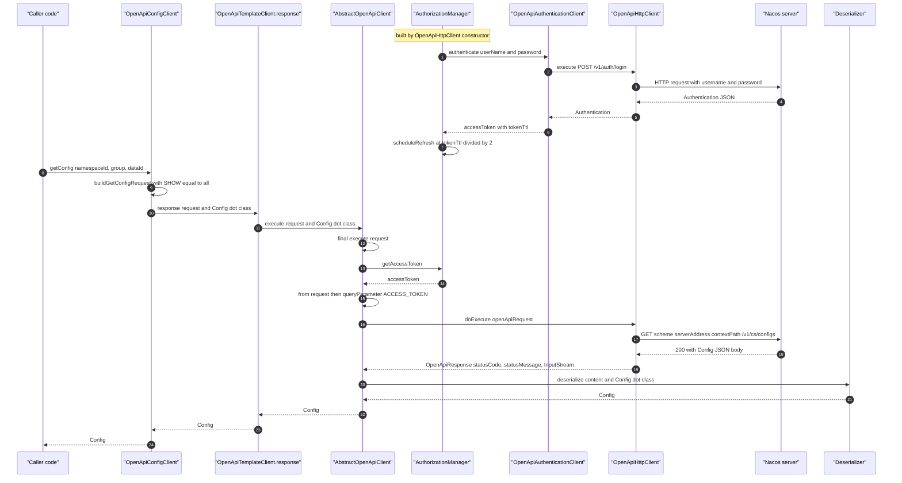
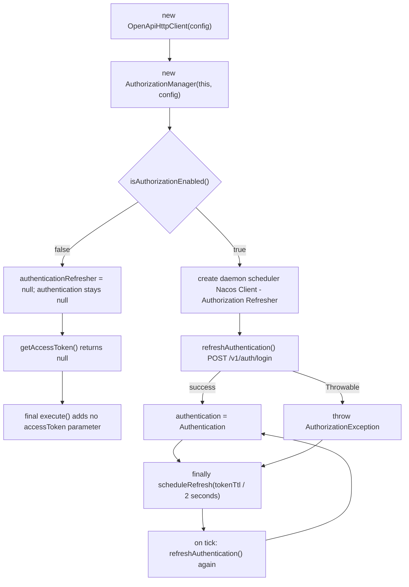
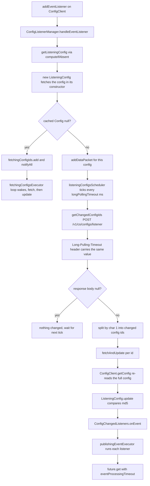
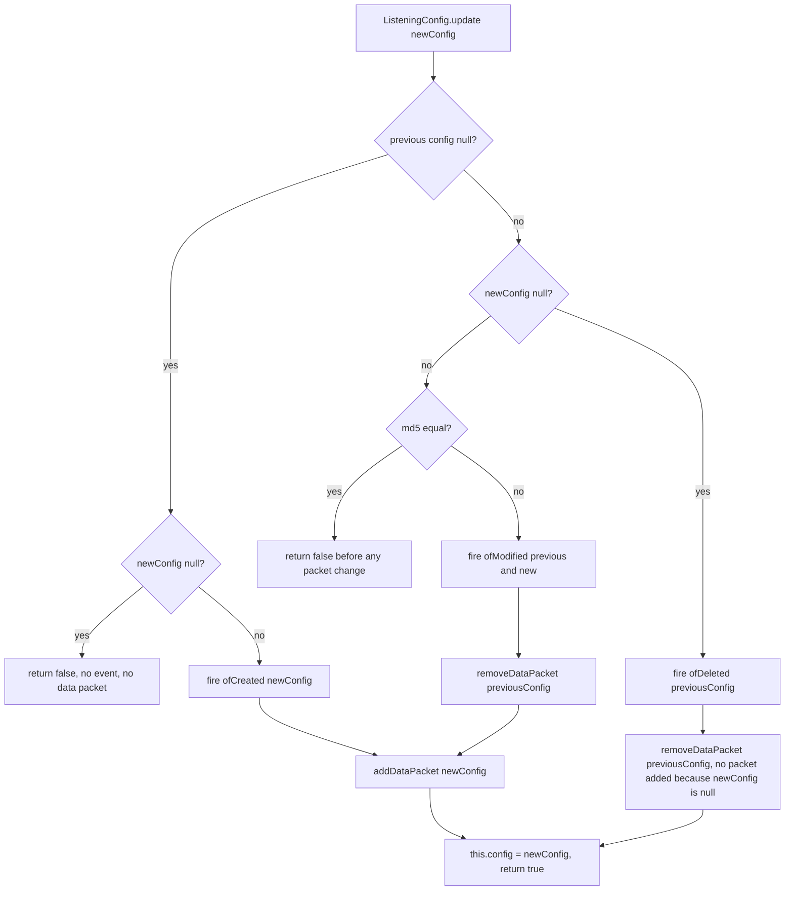
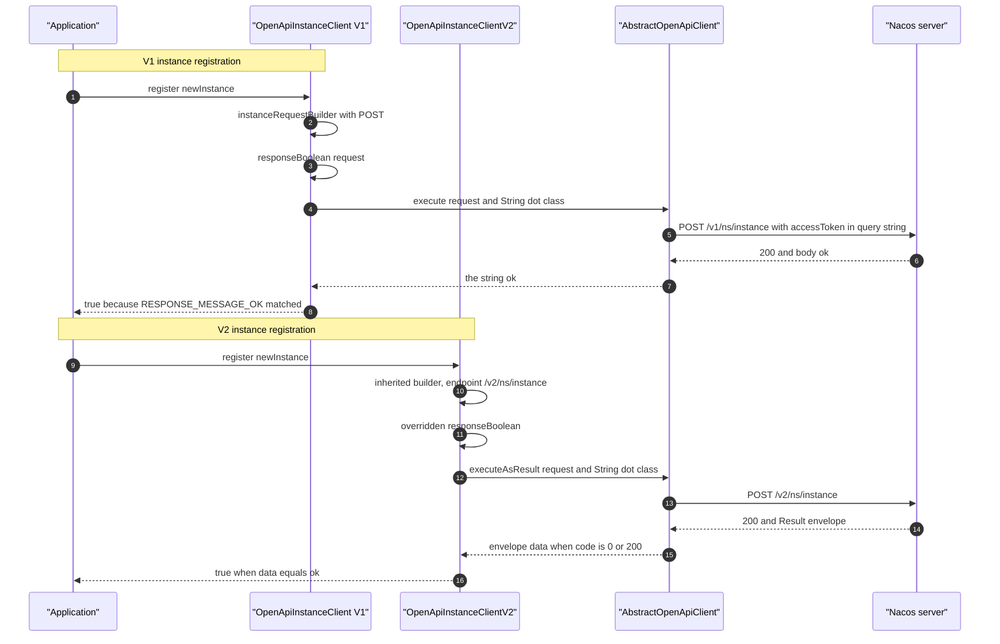
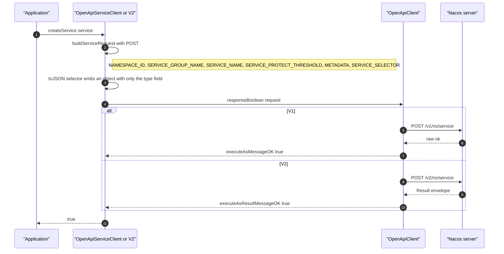
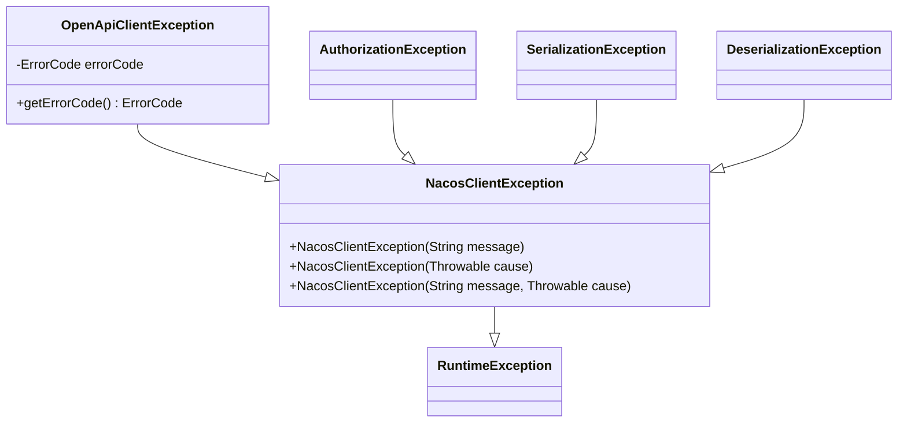

# `microsphere-nacos-openapi` — 开发者指南（`current`）

与框架无关的 Nacos Open-API 客户端。它**不**依赖 Spring：整个模块就是纯 Java 加上 Apache HttpClient 4.x 与 Gson。
调用方所需的一切 —— 配置、传输、序列化、带版本的端点、鉴权 token 生命周期、配置长轮询 —— 都在这里。

- 源码根目录：`microsphere-nacos-openapi/src/main/java/io/microsphere/nacos/client`
- 主 `.java` 文件：**118** 个；测试 `.java` 文件：**21** 个
- 资源文件：`src/main/resources/META-INF/error-code/*.properties`、
  `src/main/resources/META-INF/services/io.microsphere.nacos.client.io.GsonDeserializer`

本文件中每条论断的证据基础：位于 `.docs-work/release` 的 `release` 分支快照。这里没有任何内容被构建或被执行过。

---

## 1. 从模块 POM 读出的构建事实

`microsphere-nacos-openapi/pom.xml`：

| 元素 | 取值 |
| --- | --- |
| Maven 父 POM | `io.github.microsphere-projects:microsphere-nacos-parent:${revision}`（`relativePath ../microsphere-nacos-parent/pom.xml`） |
| 坐标 | `io.github.microsphere-projects:microsphere-nacos-openapi:${revision}` |
| 打包方式 | `jar` |
| compile 依赖 | `org.apache.httpcomponents:httpclient`、`com.google.code.gson:gson` |
| optional 依赖 | `io.github.microsphere-projects:microsphere-annotation-processor`、`io.github.microsphere-projects:microsphere-java-core` |
| 测试依赖 | `org.junit.jupiter:junit-jupiter`、`microsphere-java-test`、`microsphere-logging-test`、`ch.qos.logback:logback-classic` |
| POM 中写明的版本号 | 一个都没有 —— 每个依赖都继承 `dependencyManagement` |

`httpclient` 由 `microsphere-nacos-parent` 管理为 `4.5.14`；其余所有版本都由外部的
`microsphere-spring-cloud-parent:0.2.26` / `microsphere-spring-cloud-dependencies:0.2.26` 链条掌握，**在本快照中无法
核实**。见 [microsphere-nacos-parent.md](microsphere-nacos-parent.md)。

不存在任何 Spring 构件，这正是本模块的核心设计事实：它使得
[microsphere-nacos-discovery-spring-cloud.md](microsphere-nacos-discovery-spring-cloud.md) 能够保持为一个薄薄的适配器。

---

## 2. 包地图

| 包（位于 `io.microsphere.nacos.client` 之下） | 文件数 | 职责 | 章节 |
| --- | --- | --- | --- |
| `.`（根） | 6 | `Client` 根契约、`AbstractClient`、`NacosClientConfig`、`OpenApiVersion`、`ErrorCode`、`NacosClientException` | §3 |
| `transport` | 8 | 请求/响应模型、HTTP 传输、请求参数与请求头枚举、`OpenApiClientException` | §4 |
| `common` | 1 | `OpenApiTemplateClient` —— 领域客户端与传输层之间具备版本感知的接缝 | §5 |
| `common.auth`（外加 `model`） | 4 + 1 | token 获取、刷新调度、`Authentication` 模型、`AuthorizationException` | §6 |
| `io` | 7 | `Serializer` / `Deserializer` 策略、Gson 默认实现、`GsonDeserializer` 模板、序列化异常 | §7 |
| `common.model` | 3 | `Model`、`Result<T>`、`Page<E>` | §8 |
| `common.config`（外加 `event`、`io`、`model`） | 3 + 2 + 4 + 5 | 配置契约、变更事件、配置反序列化器、配置模型 | §9 |
| `common.discovery`（外加 `model`） | 3 + 17 | `InstanceClient`、`ServiceClient`、`ConsistencyType`、17 个服务发现模型 | §10 |
| `common.namespace`（外加 `io`、`model`） | 1 + 1 + 2 | `NamespaceClient`、`NamespaceDeserializer`、命名空间模型 | §11 |
| `v1.server`（外加 `io`、`model`） | 6 + 3 + 5 | 服务端状态 / 开关 / 指标 / 集群列表契约与 V1 实现 | §12 |
| `v1.raft`（外加 `io`、`model`） | 2 + 1 + 2 | `RaftClient`、`/v1/ns/raft/leader`、`RaftModel` | §12 |
| `v1`、`v2`（门面） | 2 + 2 | `NacosClient`/`OpenApiNacosClient`、`NacosClientV2`/`OpenApiNacosClientV2` | §13、§14 |
| `v1.config`、`v1.discovery`、`v1.namespace` | 2、2、1 | V1 实现（外加 `v1.config.util`） | §9、§10、§11 |
| `v2.config`、`v2.discovery`、`v2.namespace`、`v2.client.*` | 1、2、1、7 | V2 子类以及仅存在于 V2 的客户端自省面 | §14 |
| `constants` | 1 | `Constants`：属性名、默认值、分隔符、线程名 | §15 |
| `http` | 1 | `HttpMethod` 枚举（自有类型，既非 Spring 的也非 HttpClient 的） | §4 |
| `util` | 8 | `OpenApiUtils`、`ModelUtils`、`JsonUtils`、`IOUtils`、`StringUtils`、`TypeUtils`、`CollectionUtils`、`ErrorCodeControl` | §16 |

本模块共有 **118** 个文件；没有任何包包含 `package-info.java`，模块中也没有任何类使用 Lombok 或 Spring 注解。

---

## 3. 根包：所有实现都要落实的契约

| 类 | 种类 | 契约 |
| --- | --- | --- |
| `Client` | 接口 | 恰好一个方法：`NacosClientConfig getNacosClientConfig()` |
| `AbstractClient` | 抽象类 | 持有 `protected final NacosClientConfig nacosClientConfig`；`getNacosClientConfig()` 是 `final` |
| `OpenApiVersion` | 枚举 | `V1("/v1")`、`V2("/v2")`；`getEndpointPath()`、`getVersion(String endpoint)` |
| `NacosClientConfig` | POJO、`Serializable` | 全部连接/鉴权/超时/线程/编码设置；`isAuthorizationEnabled()` |
| `NacosClientException` | `RuntimeException` | 整个模块的根非受检异常 |
| `ErrorCode` | 枚举，39 个常量 | 带本地化消息的 Nacos 数字码 + 客户端错误码 |

`AbstractClient` 确立了本模块的 null 校验约定：

```java
public AbstractClient(NacosClientConfig nacosClientConfig) {
    Objects.requireNonNull(nacosClientConfig, "The 'nacosClientConfig' argument must not be null");
    this.nacosClientConfig = nacosClientConfig;
}
```

**`NacosClientConfig` 不携带版本。** 完整字段列表（每个字段都有 getter/setter）：

| 字段 | 默认值 | 说明 |
| --- | --- | --- |
| `name` | `null` | 客户端标识，被 Spring Cloud 子上下文工厂使用 |
| `applicationName` | `Constants.APPLICATION_NAME` | 可通过 `microsphere.nacos.client.app-name` 覆盖 |
| `serverAddress` | `null` | 必填；host[:port]，scheme 前缀可选 |
| `scheme` | `"http"` | |
| `contextPath` | `"/nacos"` | |
| `userName`、`password` | `null` | 二者均非 null ⇒ 开启鉴权 |
| `accessKey`、`secretKey` | `null` | 已声明，但**在本模块源码中从未被读取** |
| `maxConnections` | `Constants.MAX_CONNECTIONS`（1000） | |
| `maxPerRoute` | `Constants.MAX_PER_ROUTE_CONNECTIONS`（200） | |
| `connectionTimeout` | `Constants.CONNECTION_TIMEOUT`（60 000 ms） | |
| `readTimeout` | `Constants.READ_TIMEOUT`（180 000 ms） | |
| `longPollingTimeout` | `Constants.LONG_POLLING_TIMEOUT`（30 000 ms） | |
| `eventProcessingTimeout` | `Constants.EVENT_PROCESSING_TIMEOUT` | 见 §15 的反常之处 |
| `fetchingConfigThreadName` | `"Nacos Client - Fetching Config Executor"` | |
| `listenerConfigThreadName` | `"Nacos Client - Listening Config Scheduler"` | |
| `publishingConfigEventThreadName` | `"Nacos Client - Config Event Publisher"` | |
| `encoding` | `Constants.ENCODING`（`"UTF-8"`） | |

`isAuthorizationEnabled()` 就是 `userName != null && password != null`。由于该开关控制着整个鉴权子系统，只设置了
`accessKey`/`secretKey` 的配置永远不会执行认证。

---

## 4. `transport` —— 请求生命周期

### 4.1 类清单

| 类 | 种类 | 角色 |
| --- | --- | --- |
| `OpenApiClient` | 接口，`extends AutoCloseable` | `execute(request)`、`execute(request, Type)`、`default executeAsResult(request, dataType)`、`getSerializer()`、`getDeserializer()`、`getEncoding()` |
| `AbstractOpenApiClient` | 抽象类 | **final** 的 `execute(request)`；泛型的 `execute(request, Type)`；抽象的 `doExecute`、`getAccessToken` |
| `OpenApiHttpClient` | 具体类，唯一实现 | Apache HttpClient 4.x：连接池、URI 构建、响应映射，并持有 `AuthorizationManager` |
| `OpenApiRequest` | 不可变对象 + 内部 `Builder` | 端点、`HttpMethod`、查询参数、请求头 |
| `OpenApiResponse` | 值对象 | `statusCode`、`statusMessage`、`InputStream content` |
| `OpenApiRequestParam` | 枚举，53 个常量 | 带类型的参数名，`toValue(Object)` 可被覆写 |
| `OpenApiRequestHeader` | 枚举，14 个常量 | 请求头名（`Long-Pulling-Timeout`、`Client-Version` 等） |
| `OpenApiClientException` | `NacosClientException` | 携带一个非 null 的 `ErrorCode` |

`http.HttpMethod` 是模块自有的枚举（`OPTIONS`、`HEAD`、`GET`、`POST`、`PUT`、`DELETE`、`PATCH`、`TRACE`），
因此领域客户端永远不需要 import `org.apache.http` 或 Spring 的方法类型。

### 4.2 两步式 `execute`

`AbstractOpenApiClient.execute(OpenApiRequest)` 是 `final` 的 —— 任何东西都不能绕过 token 注入：

```java
@Override
public final OpenApiResponse execute(OpenApiRequest request) throws OpenApiClientException {
    String accessToken = getAccessToken();
    OpenApiRequest openApiRequest = accessToken == null ? request :
            from(request).queryParameter(ACCESS_TOKEN, accessToken).build();
    return doExecute(openApiRequest);
}
```

`AbstractOpenApiClient.execute(request, payloadType)` 是反序列化 + 错误的边界。它是解包 V2 `Result` 封装的
唯一位置，也是把每一种失败转换成 `OpenApiClientException` 的唯一位置：

```java
OpenApiResponse response = execute(request);
int statusCode = response.getStatusCode();
if (statusCode == 200) {
    if (payloadType instanceof ParameterizedType) {
        Type rawType = ((ParameterizedType) payloadType).getRawType();
        if (Result.class.equals(rawType)) {
            Result result = deserializer.deserialize(response.getContent(), payloadType);
            if (result.isSuccess()) {
                payload = (T) result.getData();
            }
        }
    }
    if (payload == null) {
        payload = deserializer.deserialize(response.getContent(), payloadType);
    }
    return payload;
}
code = statusCode;
errorMessge = isBlank(statusMessage) ? readAsString(response.getContent(), getEncoding()) : statusMessage;
```

当你扩展这个类时，有两个细节需要留意：

- 只有当*请求的*类型字面上是 `Result<...>` 时才会解包；仅仅**继承** `Result<T>` 的模型
  （例如 `NamespacesList`）会由原始路径按原样反序列化。
- 源码里 `errorMessge` 少写了第二个 `a`；它只是一个局部变量，因此重命名它是安全的。

### 4.3 URI 拼装与连接池

`OpenApiHttpClient` 的构造器只从 `NacosClientConfig` 装配一次连接池，并把鉴权管理器放在最后启动（这样管理器就能在
一个完全构建好的客户端上调用 `execute`）：

```java
PoolingHttpClientConnectionManager connectionManager = new PoolingHttpClientConnectionManager();
connectionManager.setMaxTotal(maxConnections);
connectionManager.setDefaultMaxPerRoute(maxPerRoute);

RequestConfig requestConfig = RequestConfig.custom()
        .setConnectTimeout(connectionTimeout)
        .setConnectionRequestTimeout(connectionTimeout)
        .setSocketTimeout(readTimeout)
        .build();

HttpClientBuilder httpClientBuilder = HttpClientBuilder.create()
        .setConnectionManager(connectionManager)
        .setDefaultRequestConfig(requestConfig)
        .useSystemProperties();
```

`buildURI` 先做字符串拼接再调用 `URI.create`，并对每个值单独做 URL 编码：

```java
urlBuilder.append(rootPath).append(request.getEndpoint());
Map<String, String> queryParameters = request.getQueryParameters();
if (!queryParameters.isEmpty()) {
    urlBuilder.append("?");
    for (Map.Entry<String, String> entry : queryParameters.entrySet()) {
        String name = entry.getKey();
        String value = entry.getValue();
        urlBuilder.append(name).append("=");
        if (value != null) {
            String encodedValue = encode(value, config.getEncoding());
            urlBuilder.append(encodedValue);
        }
        urlBuilder.append("&");
    }
}
```

新增 API 时必须尊重的若干后果：

- **没有请求体**。每个参数 —— 包括 `content`、`metadata`、`beat`、`instances` —— 都是查询参数。
  `buildHttpUriRequest` 会创建 `HttpPost`/`HttpPut`/`HttpDelete`/`HttpGet`，但从不设置 entity。因此很长的配置内容
  受限于服务端允许的最大 URI 长度，而不是任何客户端侧的上限。
- 最后一个参数之后会多输出一个 `&`。
- 只有当 `serverAddress` 本身不以 `scheme + "://"` 开头时，`buildRootPath` 才会加上该前缀。
- `readTimeout` 映射到 `setSocketTimeout`，所以配置长轮询必须小于 `DEFAULT_READ_TIMEOUT`（3 分钟）。
- 请求都是 GET 形态；服务端看不到 `Content-Type`。
- `close()` 会**先**关闭 `AuthorizationManager`**再**关闭 HTTP 客户端，因此刷新器不可能对着已关闭的客户端发起登录。

### 4.4 `OpenApiRequest.Builder`

```java
public static Builder from(OpenApiRequest request) {
    Builder builder = create(request.endpoint);
    builder.method = request.method;
    builder.queryParameters = request.queryParameters;
    builder.headers = request.headers;
    return builder;
}
```

`from(...)` 与源请求共享那几张可变 map；随后 `Builder` 会往这些 map 里 put。这正是 `final execute(request)`
的 token 注入如此廉价的原因，但同时也意味着：对你并不拥有的请求调用 `from()` 创建的 `Builder` 会改写那个请求的 map。
请把 `OpenApiRequest` 实例视为一次性写入：构建它、交给客户端，之后再也不要改动。

带类型的重载：`queryParameter(OpenApiRequestParam, Object)` 会经过 `param.toValue(value)`，这个钩子负责把
`Map` 转成 JSON、把 `Collection` 转成逗号分隔字符串、把 `ConsistencyType` 转成其线上取值。
`queryParameter(..., String)` 会绕过它，此外还有 `protected` 的按字符串名传入的重载，供枚举中没有的参数使用。

### 4.5 请求生命周期：带鉴权的配置读取



V2 走的是同一条链路，只是 `TPL->>ABS` 调用的是 `executeAsResult`，它在到达 `ABS` 之前把载荷类型包装成
`Result<Config>`；解包发生在 `ABS` 内部（§4.2）。

---

## 5. `common.OpenApiTemplateClient` —— 版本接缝

每个领域客户端都继承这一个类：

```java
public abstract class OpenApiTemplateClient extends AbstractClient {

    protected final OpenApiClient openApiClient;

    protected OpenApiTemplateClient(OpenApiClient openApiClient, NacosClientConfig nacosClientConfig) {
        super(nacosClientConfig);
        Objects.requireNonNull(openApiClient, "The 'openApiClient' argument must not be null!");
        this.openApiClient = openApiClient;
    }

    public final OpenApiClient getOpenApiClient() {
        return openApiClient;
    }

    public OpenApiVersion getOpenApiVersion() {
        return V1;
    }

    protected String getEndpointPath() {
        return getOpenApiVersion().getEndpointPath();
    }

    protected <T> T response(OpenApiRequest request, Type payloadType) {
        if (isOpenApiV1()) {
            return this.openApiClient.execute(request, payloadType);
        }
        return this.openApiClient.executeAsResult(request, payloadType);
    }
}
```

设计要点：

- `getOpenApiVersion()` 是以**可覆写的实例方法**返回 `V1`，而不是抽象方法。因此 V2 子类只需要三行覆写；
  新的领域类即使忘记声明版本也不会破坏任何东西。
- 端点的构造方式是 `getEndpointPath() + SUFFIX`（`OpenApiConfigClient.getConfigEndpoint()`、
  `OpenApiInstanceClient.getInstanceEndpoint()`、`OpenApiServiceClient.getServiceEndpoint()`），这正是这些端点的
  `/v1`→`/v2` 迁移几乎零成本的原因。
- `v1.namespace`、`v1.server`、`v1.raft` 与 `v1.config.ConfigListenerManager` 中的控制台和运维端点嵌入的是字面量
  `/v1`；它们**不**跟随子类的版本。见 §18。
- `response(...)` 是 protected 而不是 final：`OpenApiServiceClientV2` 覆写了它，从而在继承来的逻辑本会走原始路径的
  地方也强制使用 `executeAsResult`。

---

## 6. 鉴权（`common/auth`）

| 类 | 文件 | 角色 |
| --- | --- | --- |
| `AuthenticationClient` | `common/auth/AuthenticationClient.java` | 接口；`default authenticate()` 从 `NacosClientConfig` 读取 `userName`/`password` |
| `OpenApiAuthenticationClient` | `common/auth/OpenApiAuthenticationClient.java` | 携带 `username` + `password` 查询参数的 `POST /v1/auth/login` |
| `AuthorizationManager` | `common/auth/AuthorizationManager.java` | 缓存 token，并在守护线程调度器上刷新它 |
| `Authentication` | `common/auth/model/Authentication.java` | `accessToken`、`tokenTtl`、`globalAdmin` |
| `AuthorizationException` | `common/auth/AuthorizationException.java` | 刷新失败时抛出的 `NacosClientException` |

这个客户端刻意保持极简，并且通过字面路径**钉死在 V1**：

```java
@Override
public Authentication authenticate(String userName, String password) {
    OpenApiRequest request = OpenApiRequest.Builder.create("/v1/auth/login")
            .method(POST)
            .queryParameter(USER_NAME, userName)
            .queryParameter(PASSWORD, password)
            .build();
    return openApiClient.execute(request, Authentication.class);
}
```

`AuthorizationManager` 掌握着生命周期：

```java
public AuthorizationManager(OpenApiClient openApiClient, NacosClientConfig nacosClientConfig) {
    this.authenticationClient = new OpenApiAuthenticationClient(openApiClient, nacosClientConfig);
    this.nacosClientConfig = nacosClientConfig;
    this.authenticationRefresher = initAuthenticationRefresher();
    refreshAuthentication();
}

private void refreshAuthentication() throws AuthorizationException {
    if (isAuthorizationEnabled()) {
        try {
            this.authentication = this.authenticationClient.authenticate();
        } catch (Throwable e) {
            String errorMessage = "Failed to refresh Nacos Client Authentication";
            throw new AuthorizationException(errorMessage, e);
        } finally {
            scheduleRefresh();
        }
    }
}

private long getRefreshIntervalInSeconds(Authentication authentication) {
    long tokenTtlInSeconds = authentication == null ? 60 : authentication.getTokenTtl();
    return tokenTtlInSeconds / 2;
}
```

已核实的行为，以及随之而来的后果：

| 事实 | 后果 |
| --- | --- |
| 鉴权被禁用时 `initAuthenticationRefresher()` 返回 `null` | `scheduleRefresh()` 会 NPE —— 但它只能从 `refreshAuthentication()` 到达，而后者本身也被同一个开关拦住 |
| `OpenApiHttpClient` 的构造器调用 `new AuthorizationManager(this, config)` | 只要设置了 `userName`/`password`，构造任何客户端都会执行一次同步登录；密码错误会让构造器抛出 `AuthorizationException` |
| `refreshAuthentication()` 在构造器中最先执行 | 构造期失败会从 `new OpenApiHttpClient(...)` 中抛出；不存在懒加载路径 |
| `scheduleRefresh()` 位于 `finally` 中 | 即便登录失败仍会按 60 s / 2 = 30 s 重新排期，于是管理器会永远重试 |
| `authentication` 是 `volatile` | 请求线程上的读者无需加锁就能看到最新的 token |
| 禁用时 `getAccessToken()` 返回 `null` | `final execute(...)` 完全跳过 `accessToken` 参数 |
| token 以 `OpenApiRequestParam.ACCESS_TOKEN` = `accessToken` 传入 | 它是**查询参数**，不是请求头；它会出现在服务端的访问日志里 |
| 刷新间隔 = `tokenTtl / 2`，整数除法 | `tokenTtl == 1` 会被排期为每 0 秒一次，也就是一个忙轮询式登录循环 |
| `close()` 调用 `authenticationRefresher.shutdown()`（没有 `shutdownNow`，也没有 `awaitTermination`） | 一次正在执行中的刷新在 `close()` 返回之后仍可能跑完 |

### Token 生命周期



---

## 7. 序列化（`io`）

| 类型 | 种类 | 说明 |
| --- | --- | --- |
| `Serializer` | 接口 | `serialize(Object, OutputStream)`；`default serializeAsString(Object, String encoding)` |
| `DefaultSerializer` | Gson | `buildGson()` 就是 `new Gson()`，并带有 `// TODO support the more customized implementations` |
| `Deserializer` | 接口 | `deserialize(InputStream, Type)` 的默认实现用 `getEncoding()` 读取；抽象的 `deserialize(String, Type)`；`default getEncoding()` 返回 `Constants.ENCODING` |
| `DefaultDeserializer` | Gson | 在 `GsonBuilder` 上注册来自 SPI 的 `GsonDeserializer` |
| `GsonDeserializer<T>` | 抽象 `JsonDeserializer<T>` | 模板方法 + 容忍字段名差异的 getter |
| `SerializationException`、`DeserializationException` | `NacosClientException` | 由默认实现抛出 |

`OpenApiHttpClient` 通过 `ServiceLoader` 挑选实现，第一个匹配者胜出，否则使用默认实现：

```java
private <S> S loadService(Class<S> serviceClass) {
    ServiceLoader<S> serviceLoader = load(serviceClass);
    // Try to load the first SPI by ServiceLoader SPI
    S firstService = null;
    for (S spi : serviceLoader) {
        firstService = spi;
        break;
    }
    return firstService;
}
```

`DefaultDeserializer` 注册按类型的适配器，并且是**从子类的泛型父类**中发现类型的，因此除了 SPI 文件之外不需要
任何注册元数据：

```java
private Map<Type, GsonDeserializer> loadGsonDeserializers() {
    Map<Type, GsonDeserializer> gsonDeserializersMap = new HashMap<>();
    for (GsonDeserializer gsonDeserializer : ServiceLoader.load(GsonDeserializer.class)) {
        Class<?> gsonDeserializerClass = gsonDeserializer.getClass();
        Type genericSuperclass = gsonDeserializerClass.getGenericSuperclass();
        if (genericSuperclass instanceof ParameterizedType) {
            ParameterizedType parameterizedType = (ParameterizedType) genericSuperclass;
            Type[] typeArguments = parameterizedType.getActualTypeArguments();
            Type desirializedType = typeArguments[0];
            gsonDeserializersMap.put(desirializedType, gsonDeserializer);
        }
    }
    return gsonDeserializersMap;
}
```

由此得出两条规则，它们很容易被破坏：

1. `GsonDeserializer` **必须**把它的模型声明为直接的参数化父类
   （`class ConfigDeserializer extends BaseConfigDeserializer<Config>`）。再多套一层原始类型的继承会让类型
   变得不可见，从而悄悄回落到基于反射的 Gson。
2. `AbstractOpenApiClient` 与 `OpenApiHttpClient` 在反序列化器被使用之前就已构造完成，因此任何新增适配器的 jar
   都必须带上 SPI 文件 `META-INF/services/io.microsphere.nacos.client.io.GsonDeserializer`。

`GsonDeserializer<T>` 从可覆写的钩子返回 `null`，其含义是“我不处理，交给 Gson”：

```java
@Override
public T deserialize(JsonElement json, Type typeOfT, JsonDeserializationContext context) throws JsonParseException {
    T result = deserialize(json, typeOfT);
    return result == null ? context.deserialize(json, typeOfT) : result;
}

protected T deserialize(JsonElement json, Type typeOfT) throws JsonParseException {
    return null;
}
```

之所以存在 `getBoolean/getInteger/getLong/getFloat/getString(json, memberName, otherMemberNames...)` 这些辅助方法，
是因为 Nacos 1.x 与 2.x 对同一个字段使用不同的键名拼写；它们先尝试主名，再依次尝试备选名，并跳过 `JsonNull`。

本模块提供 **12** 个 `GsonDeserializer` 子类；其中 **11** 个注册在 SPI 文件中（除抽象基类外全部）：

| 适配器 | 是否注册 | 解析出的类型实参 | 处理内容 |
| --- | --- | --- | --- |
| `common.config.io.BaseConfigDeserializer<C>` | 否（抽象类） | — | 共享的 `BaseConfig` 映射，被下面两个配置适配器复用 |
| `common.config.io.ConfigDeserializer` | 是 | `BaseConfigDeserializer<Config>` | `configTags`、epoch 毫秒时间字段 |
| `common.config.io.HistoryConfigDeserializer` | 是 | `BaseConfigDeserializer<HistoryConfig>` | 历史记录行 |
| `common.config.io.HistoryConfigPageDeserializer` | 是 | 直接 | 分页历史信封 |
| `common.namespace.io.NamespaceDeserializer` | 是 | 直接 | `namespaceShowName` / `namespaceDesc` 拼写 |
| `v1.server.io.ServerStateDeserializer` | 是 | 直接 | 扁平的键/值状态 map |
| `v1.server.io.ServerMetricsDeserializer` | 是 | 直接 | 指标 |
| `v1.server.io.ServerDeserializer` | 是 | 直接 | 集群服务模型 |
| `v1.raft.io.RaftModelDeserializer` | 是 | 直接 | leader + peers |
| `v2.client.io.ClientInstanceDeserializer` | 是 | 直接 | V2 已发布实例 |
| `v2.client.io.ClientSubscriberDeserializer` | 是 | 直接 | V2 订阅者 |
| `v2.client.io.ClientInfoDeserializer` | 是 | 直接 | V2 客户端信息 |

“直接”意味着该类自己声明 `extends GsonDeserializer<TheModel>`；`ConfigDeserializer` 与
`HistoryConfigDeserializer` 是通过 `BaseConfigDeserializer` 继承这一参数化的，由于中间那层父类本身是参数化的，
`getGenericSuperclass()` 依然成立。

### 7.1 `BaseConfigDeserializer`：第二层嵌套的模板方法

`BaseConfigDeserializer<C extends BaseConfig>` 为每一种配置形态的载荷固定了算法。它的
`deserialize(JsonElement, Type)` 是 `protected final` 的 —— 子类无法破坏共享映射，只能提供钩子：

```java
@Override
protected final C deserialize(JsonElement json, Type typeOfT) throws JsonParseException {
    JsonObject jsonObject = json.getAsJsonObject();
    String namespaceId = getString(jsonObject, NAMESPACE_ID_MEMBER_NAME);
    ...
    String operator = getString(jsonObject, getOperatorMemberName());
    String operatorIp = getString(jsonObject, getOperatorIpMemberName());

    C config = newConfig();
    config.setNamespaceId(namespaceId);
    ...
    deserialize(jsonObject, config, typeOfT);
    return config;
}

protected abstract void deserialize(JsonObject jsonObject, C config, Type typeOfT) throws JsonParseException;

protected abstract C newConfig();

protected abstract String getOperatorMemberName();

protected abstract String getOperatorIpMemberName();
```

基类还承载着两个适配器共用的成员名常量 —— 请注意命名空间字段是从 JSON 键 **`tenant`**
（`NAMESPACE_ID_MEMBER_NAME = "tenant"`）读取的，这是 V1 的拼写，并被存放到 `BaseConfig.namespaceId` 上。
如果你绑定的是使用 `namespaceId` 的 V2 形态载荷，这段映射会悄无声息地产出 `null`。

`ConfigDeserializer` 与 `HistoryConfigDeserializer` 以不同方式实现这些钩子，而且 —— 这是一个真正的陷阱 ——
`ConfigDeserializer` 的常量**名**与其取值正好相反：

| 类 | `OPERATOR_MEMBER_NAME` | `OPERATOR_IP_MEMBER_NAME` | `getOperatorMemberName()` 返回 | 最终写入 `BaseConfig.operator` |
| --- | --- | --- | --- | --- |
| `ConfigDeserializer` | `"createIp"` | `"createUser"` | `OPERATOR_IP_MEMBER_NAME`（`"createUser"`） | `createUser` |
| `HistoryConfigDeserializer` | `"srcUser"` | `"srcIp"` | `OPERATOR_MEMBER_NAME`（`"srcUser"`） | `srcUser` |

交叉的常量加上交叉的钩子返回值互相抵消，所以**行为是正确的**；只有 `ConfigDeserializer` 里的命名有误导性。
修改它的源码之前请先读一遍，因为单独“修正”其中一半都会引入真正的 bug。

`HistoryConfigDeserializer` 是唯一自行解析日期的适配器。它每次调用都会新建一个 `SimpleDateFormat`，模式为
`"YYYY-MM-DD'T'HH:mm:ss.SSSXXX"`，其中 `YYYY` 是**基于周的年份**，`DD` 是**一年中的第几天**；解析失败会被包装成
`JsonParseException`，最终表现为 `ErrorCode.DESERIALIZATION_ERROR`。

---

## 8. 通用模型（`common/model`）

| 模型 | 字段 | 行为 |
| --- | --- | --- |
| `Model` | — | `extends Serializable`；每一种载荷类型的标记 |
| `Result<T>` | `code`、`message`、`data` | `isSuccess()` = `code == 0 \|\| code == 200` |
| `Page<E>` | `totalPages`、`totalElements`、`elements`、`pageNumber`、`pageSize` | `isFirst()` = `pageNumber == 1`；`isLast()` = `pageNumber == totalPages - 1`；`hasPrevious()` = `pageNumber > 0`；`hasNext()` = `pageNumber < totalPages - 1` |

```java
public boolean isSuccess() {
    return this.code == 0 || this.code == 200;
}
```

`Page` 把 1 起始的约定（`isFirst()` 与 `1` 比较）和 0 起始的约定（`isLast()`/`hasNext()` 与
`totalPages - 1` 比较）混在了一起，而 `Page(int totalElements, List<E>, int, int)` 用
`Math.ceil(totalElements / pageSize)` 推导 `totalPages` —— 元素列表为空时结果是 `1`。消费 `Page` 时，
请优先使用 `getElements()` 加上请求自身的 `pageNumber`/`pageSize`，而不是那些布尔判断方法。

---

## 9. 配置（`common/config` + `v1/config` + `v2/config`）

### 9.1 `ConfigClient` 契约

9 个抽象方法、22 个带默认实现的重载（`common/config/ConfigClient.java`）：

| 抽象方法 | 默认重载额外补齐的参数 |
| --- | --- |
| `getConfigContent(namespaceId, group, dataId, tag)` | `dataId` → `group, dataId` → `namespaceId, group, dataId` |
| `getConfig(namespaceId, group, dataId)` | `group, dataId` |
| `publishConfig(NewConfig)` | `publishConfigContent` 的 4 个参数个数版本（先读后写语义） |
| `deleteConfig(namespaceId, group, dataId, tag)` | `dataId`、`group, dataId`、`namespaceId, group, dataId` |
| `getHistoryConfigs(namespaceId, group, dataId, pageNumber, pageSize)` | 3 个参数个数版本，默认页大小 `100` |
| `getHistoryConfig(namespaceId, group, dataId, revision)` | `dataId, revision`、`group, dataId, revision` |
| `getPreviousHistoryConfig(namespaceId, group, dataId, id)` | `dataId, id`、`group, dataId, id` |
| `addEventListener(namespaceId, group, dataId, listener)` | `dataId, listener`、`group, dataId, listener` |
| `removeEventListener(namespaceId, group, dataId, listener)` | 同样的两种形态 |

常量：`DEFAULT_PAGE_SIZE = 100`、`MAX_PAGE_SIZE = 500`。默认值填充的是 `Constants.DEFAULT_NAMESPACE_ID`
（`"public"`）与 `Constants.DEFAULT_GROUP_NAME`（`"DEFAULT_GROUP"`）。

配套枚举：`ConfigType`（`TEXT, JSON, XML, YAML, HTML, PROPERTIES("Properties")`，另有 `of(String)`）、
`ConfigOperationType`（`INSERT("I")`、`UPDATE("U")`、`DELETE("D")`）。

### 9.2 `OpenApiConfigClient`（V1）

端点，全部带版本前缀：

| 端点常量 | 字面值 | 用到的方法 |
| --- | --- | --- |
| `CONFIG_ENDPOINT` | `/cs/configs` | GET / POST / DELETE |
| `CONFIG_HISTORY_ENDPOINT` | `/cs/history` | GET（单个 revision） |
| `CONFIG_HISTORY_PREVIOUS_ENDPOINT` | `/cs/history/previous` | GET |

参数拼装是集中化的：

```java
protected OpenApiRequest.Builder requestBuilder(String endpoint, String namespaceId, String group, String dataId, String tag, HttpMethod method) {
    return OpenApiRequest.Builder.create(endpoint).method(method)
            .queryParameter(CONFIG_TENANT, namespaceId)
            .queryParameter(CONFIG_GROUP, group)
            .queryParameter(CONFIG_DATA_ID, dataId)
            .queryParameter(CONFIG_TAG, tag);
}

protected String getConfigEndpoint() {
    return getEndpointPath() + CONFIG_ENDPOINT;
}
```

注意 V1 中 `CONFIG_TENANT` = `tenant`，以及 `getConfig(...)` 与 `getConfigContent(...)` 的差别：
明细请求会设置 `SHOW="all"` 并反序列化成 `Config`；内容请求要的则是原始字符串。

`getHistoryConfigs` 在触网之前会先在本地校验分页参数，然后把分页信息盖到结果上：

```java
if (pageNumber < 1) {
    throw new IllegalArgumentException("The argument 'pageNumber' must be greater than 0");
}
if (pageSize < 1) {
    throw new IllegalArgumentException("The argument 'pageSize' must be greater than 0");
}
if (pageSize > MAX_PAGE_SIZE) {
    throw new IllegalArgumentException("The argument 'pageSize' must less than or equal 1");
}
...
HistoryConfigPage page = response(request, HistoryConfigPage.class);
page.setPageNumber(pageNumber);
page.setPageSize(pageSize);
```

第三条消息写的是 "or equal 1"，而实际的判断阈值是 `MAX_PAGE_SIZE`（500）。检查本身是对的，错的只是文案。
请修正消息，而不是那个上界。

构造器还会启动监听子系统：

```java
public OpenApiConfigClient(OpenApiClient openApiClient, NacosClientConfig nacosClientConfig) {
    super(openApiClient, nacosClientConfig);
    this.configListenerManager = new ConfigListenerManager(this, openApiClient, nacosClientConfig);
}
```

因此**每一个** `OpenApiConfigClient`（包括继承它的 `OpenApiConfigClientV2`）都会创建三条守护线程和一个 JVM
关闭钩子，即使从来没有注册过监听器。请按地址实例化一个配置客户端，而不是每次调用都实例化一个。

### 9.3 `OpenApiConfigClientV2`

`v2/config/OpenApiConfigClientV2.java` 继承 V1 类，翻转版本，并改变了三处形态：

| 关注点 | V1 | V2 |
| --- | --- | --- |
| 配置端点 | `/v1/cs/configs` | `/v2/cs/config`（`V2_CONFIG_ENDPOINT`，单数） |
| 历史列表端点 | `/v1/cs/history` | `/v2/cs/history/list` |
| 命名空间参数 | `tenant`（`CONFIG_TENANT`） | `namespaceId`（`NAMESPACE_ID`），通过覆写 `requestBuilder` 实现 |
| 标签参数 | `config_tags` | `configTags`（`CONFIG_TAGS_V2`） |
| 操作者参数 | `src_user` | `srcUser`（`OPERATOR_V2`） |
| `type` 取值 | 原样使用 `ConfigType.getValue()` | `configType.getValue().toLowerCase()` |
| `getConfig(...)` | V1 明细请求 | 针对 `V1.getEndpointPath() + CONFIG_ENDPOINT` 重新实现，并使用原始 `execute` |

最后一行才是关键：

```java
@Override
public Config getConfig(String namespaceId, String group, String dataId) {
    // No getConfig endpoint is not found in Open API V2
    String configEndpoint = V1.getEndpointPath() + CONFIG_ENDPOINT;
    OpenApiRequest request = OpenApiRequest.Builder.create(configEndpoint)
            .method(GET)
            .queryParameter(CONFIG_TENANT, namespaceId)
            .queryParameter(CONFIG_GROUP, group)
            .queryParameter(CONFIG_DATA_ID, dataId)
            .queryParameter(SHOW, "all")
            .build();
    return this.openApiClient.execute(request, Config.class);
}
```

它使用 `tenant` 与 `execute` 是刻意为之，因为回落的目标就是 V1 端点。不要把这里“顺手清理”成
`response(...)` —— 那样 V2 封装就会被套用在一个 V1 的原始响应体上。

### 9.4 变更监听：`ConfigListenerManager`

`v1/config/ConfigListenerManager.java` 是**包私有**的（`class ConfigListenerManager`），383 行，是模块中状态最多的类。

状态：

| 字段 | 类型 | 用途 |
| --- | --- | --- |
| `listeningConfigsCache` | `ConcurrentHashMap<String, ListeningConfig>` | 每个 `dataId + group + namespaceId` 键对应一条记录 |
| `fetchingConfigIds` | `CopyOnWriteArraySet<String>` | 尚不存在、必须重试拉取的配置 |
| `listeningConfigDataPackets` | `CopyOnWriteArraySet<String>` | 作为 `Listening-Configs` 发送出去的线上报文 |
| `fetchingConfigsExecutor` | 单线程守护线程池 | 阻塞式拉取循环，立即启动 |
| `listeningConfigsScheduler` | 单线程守护调度器 | `scheduleAtFixedRate(this::listen, longPollingTimeout, longPollingTimeout, MILLISECONDS)` |
| `publishingEventExecutor` | 单线程守护线程池 | 带超时地执行用户监听器 |

`LISTENER_ENDPOINT` 是字面量 `/v1/cs/configs/listener`，因此无论客户端声明的版本是什么，监听都是 V1 特性。

注册监听器：

```java
private void handleEventListener(String namespaceId, String group, String dataId, ConfigChangedListener listener, boolean forRemoval) {
    ListeningConfig listeningConfig = getListeningConfig(namespaceId, group, dataId);
    listeningConfig.handleListener(listener, forRemoval);
    Config config = listeningConfig.config;
    if (config == null) {
        // The specified config is not existed now,
        // it will be fetched in next scheduled task
        fetchingConfigIds.add(listeningConfig.configId);
        synchronized (fetchingConfigIds) {
            fetchingConfigIds.notifyAll();
        }
    } else {
        listeningConfig.addDataPacket(config);
    }
}
```

长轮询调用：

```java
private String[] getChangedConfigIds() {
    String listeningConfigs = buildListeningConfigs();
    String[] changedConfigIds = null;
    if (listeningConfigs != null) {
        int longPollingTimeout = this.nacosClientConfig.getLongPollingTimeout();
        OpenApiRequest request = OpenApiRequest.Builder.create(LISTENER_ENDPOINT)
                .method(POST)
                .queryParameter(LISTENING_CONFIGS, listeningConfigs)
                .header(LONG_PULLING_TIMEOUT, longPollingTimeout)
                .build();
        String changedConfigIdsContent = this.openApiClient.execute(request, String.class);
        changedConfigIds = changedConfigIdsContent == null ? null : changedConfigIdsContent.split(LISTENING_CONFIG_SEPARATOR);
    }
    return changedConfigIds;
}
```

`buildListeningConfigs()` 直接把各个数据报文串起来，自身不添加任何分隔符；每个报文本来就以 `char(1)` 结尾
（`ConfigUtil.doBuildConfigId`），而这恰好就是切分响应时所使用的分隔符。

数据报文与缓存键的编码（`v1/config/util/ConfigUtil.java`）：

```java
public static String buildListeningConfigDataPacket(String namespaceId, String group, String dataId, String contentMD5) {
    if (namespaceId == null || namespaceId.isEmpty()) {
        return doBuildConfigId(dataId, group, contentMD5);
    }
    return doBuildConfigId(dataId, group, contentMD5, namespaceId);
}
```

`doBuildConfigId` 用 `LISTENING_CONFIG_FIELD_SEPARATOR_CHAR`（`char 2`）连接各字段，追加
`LISTENING_CONFIG_SEPARATOR_CHAR`（`char 1`），并用 `IOUtils.encode` 对整个字符串做 URL 编码。null 字段会被跳过，
而不是被打印成 `"null"`，这就是不带命名空间的那个变体需要独立参数个数版本的原因。

事件分发受 `eventProcessingTimeout` 约束：

```java
@Override
public void onEvent(ConfigChangedEvent event) {
    Future future = publishingEventExecutor.submit(() -> {
        listeners.forEach(listener -> listener.onEvent(event));
    });
    int eventProcessingTimeout = nacosClientConfig.getEventProcessingTimeout();
    try {
        future.get(eventProcessingTimeout, TimeUnit.MILLISECONDS);
    } catch (InterruptedException e) {
        Thread.currentThread().interrupt();
    } catch (ExecutionException e) {
        throw new RuntimeException(e);
    } catch (TimeoutException e) {
        future.cancel(true);
    }
}
```

由于同一个配置的所有监听器都跑在**同一个**任务里，第一个监听器抛出的异常会使该配置其余监听器得不到执行，而
`ExecutionException` 会被重新包装成一个裸 `RuntimeException` 抛到调度线程上 —— 否则 `listen()` 中覆盖整个轮询周期的
`catch (Throwable e)` 本会把它吞掉。

### 9.5 轮询与发布流程



### 9.6 变更分类



`ConfigChangedEvent` 是一个 `EventObject`，其 source 取的是“当前配置，取不到就用先前的配置”，并带有静态工厂
`ofCreated(current)`、`ofModified(previous, current)`、`ofDeleted(previous)` 以及一个内部 `Kind` 枚举
（`CREATED`、`MODIFIED`、`DELETED`）。`ConfigChangedListener` 是一个朴素的单方法 `EventListener`
（`void onEvent(ConfigChangedEvent)`）；它没有 `@FunctionalInterface` 注解，但测试里是以 lambda 形式注册它的，
因此新增第二个抽象方法会对所有调用方构成源码不兼容变更。

### 9.7 配置模型

五个模型都位于 `common.config.model`。继承关系是一条直链 —— `Config` 是读模型，`NewConfig` 是写模型，
而 `HistoryConfig` 从共享基类分出，并不是从 `Config` 分出：

```text
Model
 └── BaseConfig (abstract)
      ├── NewConfig ── Config
      └── HistoryConfig
Page<HistoryConfig> ── HistoryConfigPage
```

| 模型 | 声明的 `serialVersionUID` | **由本类声明**的字段（继承来的字段不再重复列出） |
| --- | --- | --- |
| `BaseConfig`（`abstract`、`implements Model`） | `-5328340486667782465L` | `String namespaceId`、`String group`、`String dataId`、`String appName`、`String md5`、`String content`、`String operator`、`String operatorIp`、`Long createdTime`、`Long lastModifiedTime` |
| `NewConfig` `extends BaseConfig` | `7120432352020094941L` | `String description`、`Set<String> tags`、`String use`、`String effect`、`ConfigType type`、`String schema` |
| `Config` `extends NewConfig` | `178417156057616475L` | `String id` —— 仅此一个字段；其余全部继承而来 |
| `HistoryConfig` `extends BaseConfig` | `-3283127326267383094L` | `Long revision`（javadoc：“a.k.a nid”）、`Long lastRevision`、`ConfigOperationType operationType` |
| `HistoryConfigPage` `extends Page<HistoryConfig>` | — | 无；它只是固定了 `Page` 的元素类型 |

三个值得内化的结论：

1. `BaseConfig` **没有** `encryptedDataKey` 字段，也**没有** `id`。你从 `getConfig` 读回的 `id` 是 V1 响应中的
   `id` 成员，由 `ConfigDeserializer` 填充到 `Config.id` 上，而且它是 `String` 类型。
2. `tags` 是 `Set<String>`（声明在 `NewConfig` 上），不是列表，它的 V1 线上格式是逗号分隔的 `configTags` 字符串，
   由 `ConfigDeserializer.parseTags` 解析 —— `null` 标签会变成 `Collections.emptySet()`，而不是 `null`。
3. `HistoryConfig.revision` 与 `lastRevision` 是 `Long`（可为 null），而反序列化器调用的是
   `Long.parseLong(getString(jsonObject, "id"))` —— 一条没有 `id` 成员的历史记录行会在 Gson 内部抛出
   `NumberFormatException`，`AbstractOpenApiClient` 会把它映射成 `DESERIALIZATION_ERROR`。

---

## 10. 服务发现（`common/discovery` + `v1/discovery` + `v2/discovery`）

### 10.1 契约

`InstanceClient` —— 9 个抽象方法、17 个默认重载：

| 抽象方法 | 说明 |
| --- | --- |
| `register(NewInstance)` | POST |
| `deregister(DeleteInstance)` | DELETE |
| `refresh(UpdateInstance)` | PUT |
| `getInstance(QueryInstance)` | GET 单个实例 |
| `getInstancesList(namespaceId, groupName, clusterName, serviceName, ip, port, healthyOnly, app)` | 所有默认重载最终都汇聚进来的最宽参数个数版本 |
| `sendHeartbeat(Instance)` | PUT 到 `/ns/instance/beat` |
| `updateHealth(UpdateHealthInstance)` | PUT 到 `/ns/health/instance` |
| `batchUpdateMetadata(Iterable<Instance>, Map, ConsistencyType)` | PUT 到 `/ns/instance/metadata/batch` |
| `batchDeleteMetadata(Iterable<Instance>, Map, ConsistencyType)` | DELETE 到同一个端点 |

`ServiceClient` —— 5 个抽象方法、7 个默认方法：`createService(Service)`、`deleteService(namespaceId, groupName, serviceName)`、
`updateService(Service)`、`getService(namespaceId, groupName, serviceName)`、
`getServiceNames(namespaceId, groupName, pageNumber, pageSize)`。

`ConsistencyType`：`EPHEMERAL("ephemeral")`、`PERSIST("persist")`；它就是 `CONSISTENCY_TYPE` 请求参数，
其 `toValue` 覆写返回 `getValue()`。

### 10.2 模型（`common.discovery.model` 中的 17 个）

| 模型 | 继承 / 实现 | 自有字段 |
| --- | --- | --- |
| `DiscoverableModel` | `Model` | protected `namespaceId`、`clusterName`、`groupName`、`serviceName` |
| `BaseInstance` | `DiscoverableModel`（抽象） | `ip`、`port`（`int`）、`ephemeral`（`Boolean`） |
| `GenericInstance` | `BaseInstance` | `enabled`、`weight`、`metadata` |
| `NewInstance` | `GenericInstance` | `healthy`；`from(NewInstance)` |
| `Instance` | `NewInstance` | `instanceId`、`service`、`valid`、`marked`、`instanceIdGenerator`、`instanceHeartBeatInterval`、`instanceHeartBeatTimeOut`、`ipDeleteTimeout`；`from(Instance)` |
| `DeleteInstance` | `BaseInstance` | 无；`from(BaseInstance)` 与静态 `build(BaseInstance)` |
| `QueryInstance` | `BaseInstance` | 无；`from(BaseInstance)` |
| `UpdateInstance` | `GenericInstance` | 无；`from(GenericInstance)` |
| `UpdateHealthInstance` | `BaseInstance` | `final boolean healthy`（由构造器注入）；`from(BaseInstance)` |
| `Heartbeat` | `Model` | `code`、`clientBeatInterval`、`lightBeatEnabled` —— 这是**响应**，不是请求 |
| `Cluster` | `Model` | `healthChecker`、`metadata`、`name` |
| `HealthChecker` | 普通类 | 只有 `type` |
| `Selector` | 普通类 | 只有 `type` |
| `Service` | `DiscoverableModel` | `metadata`、`name`、`selector`、`protectThreshold`（`float`）、`clusters`（`List<Cluster>`） |
| `ServiceList` | `Model` | `count`、`doms`、`services` |
| `InstancesList` | `Model` | `namespaceId`、`groupName`、`serviceName`、`cacheMillis`、`name`、`checksum`、`lastRefTime`、`clusters`、`allIPs`、`reachProtectionThreshold`、`valid`、`dom`、`useSpecifiedURL`、`env`、`hosts`（`List<Instance>`） |
| `BatchMetadataResult` | `Model` | `updated`（`List<String>`） |

每一个 `xxx.from(that)` 都是返回 `this` 的实例式拷贝器，这就是测试里写成
`new NewInstance().from(instance)` 的原因。`Heartbeat` 是*服务端响应*类型；心跳的*请求*侧由
`ModelUtils.getHeartbeatMap(...)` 构造，而不是由这个模型。`Selector` 与 `HealthChecker` 都不实现 `Model`，
并且除 `type` 之外都不携带任何字段。

`ModelUtils`（位于 `util/`）修补的是服务端没有返回的那些内容：

```java
public static String buildServiceName(String groupName, String serviceName) {
    return groupName == null ? serviceName : groupName + GROUP_SERVICE_NAME_SEPARATOR + serviceName;
}
```

`resolveInstanceProperties(...)` 使用 `Constants.GROUP_SERVICE_NAME_SEPARATOR` 把
`group@@service` 形态的名字拆回这两个字段（两个公开重载的差别在输入：`BaseInstance` 读取
`getServiceName()`，`Instance` 优先用 `getService()`，取不到再回落到 `getServiceName()`）；
`completeInstance`/`completeInstances` 会回填 `namespaceId`、`groupName` 与 `serviceName`，然后调用它；
`getHeartbeatMap(instance)` 构造 `beat` 的 JSON map，其中恰好包含 `ip`、`port`、`serviceName`、`cluster`、`weight`
与 `metadata`。

`setPropertyIfAbsent(newValue, getter, setter)` 的行为**并不**符合它的名字暗示：

```java
public static <V> boolean setPropertyIfAbsent(V newValue, Supplier<V> getter, Consumer<V> setter) {
    boolean set = false;
    V oldValue = getter.get();
    if (oldValue == null || !Objects.equals(oldValue, newValue)) {
        setter.accept(newValue);
        set = true;
    }
    return set;
}
```

它会覆盖“已存在但不同”的值，因此调用方的请求永远胜过服务端返回的任何内容。
这在回填路径上是有意为之（请求才是 `namespaceId`/`groupName`/`serviceName` 的事实来源），
但也意味着你不能把这个辅助方法当作“仅在未设置时填充”来使用 —— 请像
`OpenApiInstanceClient.getInstancesList` 处理 `clusters` 与 `dom` 那样，显式加上 `isBlank` 判断。

### 10.3 `OpenApiInstanceClient`（V1）

| 端点常量 | 字面值 |
| --- | --- |
| `INSTANCE_ENDPOINT` | `/ns/instance` |
| `INSTANCES_LIST_ENDPOINT` | `/ns/instance/list` |
| `INSTANCE_HEARTBEAT_ENDPOINT` | `/ns/instance/beat` |
| `INSTANCE_METADATA_BATCH_ENDPOINT` | `/ns/instance/metadata/batch` |
| `INSTANCE_HEALTH_ENDPOINT` | `/ns/health/instance` |

具备版本感知的参数选择：

```java
OpenApiRequestParam clusterParam = isOpenApiV1() ? CLUSTERS : CLUSTER_NAME;
...
InstancesList instancesList = response(request, InstancesList.class);
setPropertyIfAbsent(namespaceId, instancesList::getNamespaceId, instancesList::setNamespaceId);
setPropertyIfAbsent(groupName, instancesList::getGroupName, instancesList::setGroupName);
setPropertyIfAbsent(serviceName, instancesList::getServiceName, instancesList::setServiceName);
// the "clusters" is "" in the V1 Endpoint, but is "DEFAULT" in the V2 Endpoint
if (isBlank(instancesList.getClusters())) {
    instancesList.setClusters(clusterName);
}
// the "dom" is serviceName in the V1 Endpoint, but is null in the V2 Endpoint
if (isBlank(instancesList.getDom())) {
    instancesList.setDom(serviceName);
}
completeInstances(instancesList.getHosts(), namespaceId, groupName, serviceName);
```

写操作并不返回布尔载荷；V1 用纯字符串 `ok` 应答：

```java
protected boolean responseBoolean(OpenApiRequest request) {
    return executeAsMessageOK(this.openApiClient, request);
}
```

```java
public static boolean executeAsMessageOK(OpenApiClient openApiClient, OpenApiRequest request) {
    String message = openApiClient.execute(request, String.class);
    return RESPONSE_MESSAGE_OK.equals(message);
}

public static boolean executeAsResultMessageOK(OpenApiClient openApiClient, OpenApiRequest request) {
    String message = openApiClient.executeAsResult(request, String.class);
    return RESPONSE_MESSAGE_OK.equals(message);
}
```

`OpenApiUtils.RESPONSE_MESSAGE_OK` 是 `"ok"`。`executeAsResultMessageOK` 继承了 §4.2 的解包规则：如果封装
不成功，`payload` 会保持 `null`，于是比较返回 `false` —— 失败时的 `message` 被丢弃了。
因此 V2 写操作返回 `false` 既可能是“服务端说了不是 ok”，也可能是“服务端在一个失败的封装里说了 ok”；要区分二者，
请捕获传输层失败的 `OpenApiClientException`，并自行检查 `Result` 以理解 `code`/`message` 语义。

批量元数据是唯一进行跨实例校验的地方：

```java
boolean isV1Endpoint = endpoint.startsWith("/v1/");
consistencyType = consistencyType == null ? EPHEMERAL : consistencyType;
for (Instance instance : instances) {
    String namespaceId = instance.getNamespaceId();
    String groupName = instance.getGroupName();
    String serviceName = isV1Endpoint ? buildServiceName(groupName, instance.getServiceName()) : instance.getServiceName();
    validateDuplication(instance, namespaceIds, "namespaceId", namespaceId);
    validateDuplication(instance, groupNames, "groupName", groupName);
    validateDuplication(instance, serviceNames, "serviceName", serviceName);
    ...
}
```

同一个批次中的所有实例必须共享同一个命名空间、分组与服务，否则你会得到点名了具体
`ip`/`port` 的 `IllegalArgumentException`。请注意 V1 分支是靠端点字符串上的 `/v1/` 字面前缀识别的 ——
这也是控制台风格的硬编码路径（§18）不能被随意改版本的又一个理由。

### 10.4 `OpenApiInstanceClientV2`

`v2/discovery/OpenApiInstanceClientV2.java` **继承 V1 类**，并且恰好覆写了三处：

```java
@Override
public OpenApiVersion getOpenApiVersion() {
    return V2;
}

@Override
public Heartbeat sendHeartbeat(Instance instance) {
    OpenApiRequest request = createRequestBuilder(getInstanceHeartbeatEndpoint(), PUT, instance)
            .queryParameter(SERVICE_NAME, buildServiceName(instance.getGroupName(), instance.getServiceName()))
            .queryParameter(HEARTBEAT, getHeartbeatMap(instance))
            .build();
    return this.openApiClient.execute(request, Heartbeat.class);
}

protected boolean responseBoolean(OpenApiRequest request) {
    return executeAsResultMessageOK(this.openApiClient, request);
}
```

`sendHeartbeat` 调用的是原始 `execute`，而不是 `response(...)`，所以 V2 的心跳响应会被按裸 `Heartbeat`
解析，而不是 `Result<Heartbeat>`。`OpenApiServiceClientV2` 给出的是相反的选择 —— 它自己覆写了 `response(...)`：

```java
@Override
protected <T> T response(OpenApiRequest request, Type payloadType) {
    return this.openApiClient.executeAsResult(request, payloadType);
}

@Override
protected boolean responseBoolean(OpenApiRequest request) {
    return executeAsResultMessageOK(this.openApiClient, request);
}
```

`OpenApiConfigClientV2`、`OpenApiInstanceClientV2` 与 `OpenApiServiceClientV2` 都继承各自的 V1 同类；
`OpenApiNamespaceClientV2` **不**继承 `OpenApiNamespaceClient` —— 它从零重新实现 `NamespaceClient`，
因为 V1 类把 `/v1/console/namespaces` 写死了。

### 10.5 注册：V1 与 V2





`getServiceNames`（V1 实现，V2 除封装方式外原样继承）拿到的并不是服务端返回的 `Page`：

```java
ServiceList serviceList = response(request, ServiceList.class);
setPropertyIfAbsent(serviceList.getDoms(), serviceList::getServices, serviceList::setServices);
setPropertyIfAbsent(serviceList.getServices(), serviceList::getDoms, serviceList::setDoms);
return new Page<>(serviceList.getCount(), serviceList.getServices(), pageNumber, pageSize);
```

`doms` 与 `services` 是同一个列表的两种拼写；二者互相补位，而客户端用请求的分页值在本地构造出 `Page`。

---

## 11. 命名空间（`common/namespace`、`v1/namespace`、`v2/namespace`）

`NamespaceClient`：`getAllNamespaces()`、`getNamespace(String)`、`createNamespace(id, name, desc)`、
`updateNamespace(id, name, desc)`、`deleteNamespace(String)`（5 个抽象方法、2 个默认方法）。

| 类 | 端点 | 响应风格 |
| --- | --- | --- |
| `v1/namespace/OpenApiNamespaceClient` | `NAMESPACES_ENDPOINT = "/v1/console/namespaces"`（硬编码的字面量） | 原始 `execute` |
| `v2/namespace/OpenApiNamespaceClientV2` | `NAMESPACE_ENDPOINT_V2 = "/v2/console/namespace"`、`NAMESPACES_LIST_ENDPOINT_V2 = "/v2/console/namespace/list"` | 明细与变更操作用 `executeAsResult`；列表用原始 `execute`，因为 `NamespacesList extends Result<List<Namespace>>` |

两者对单个命名空间读取的“未找到”都会吞掉异常：

```java
Namespace namespace = null;
try {
    namespace = this.openApiClient.execute(request, Namespace.class);
} catch (OpenApiClientException e) {
    // TODO log
}
return namespace;
```

这个 catch 是无条件的，于是 `403 Forbidden`、`IO_ERROR` 与 `DESERIALIZATION_ERROR` 统统坍缩成
`null`。如果你要修它，请保留“未知命名空间返回 `null`”这一契约（调用方和 V2 孪生类都依赖它），
并把 catch 收窄到 `NOT_FOUND` / `RESOURCE_NOT_FOUND`。

参与的参数枚举：`NAMESPACE_ID`（`namespaceId`）、`NAMESPACE`（`namespace`）、`CUSTOM_NAMESPACE_ID`
（`customNamespaceId`）、`NAMESPACE_NAME`（`namespaceName`）、`NAMESPACE_SHOW_NAME`（`namespaceShowName`）、
`NAMESPACE_DESCRIPTION`（`namespaceDesc`）、`SHOW`（`show`）。V1 在 PUT 上使用
`namespace`/`namespaceShowName`，在 POST 上使用 `customNamespaceId`；V2 在三个方法上都使用
`namespaceId`/`namespaceName`/`namespaceDesc`。

---

## 12. 服务端与 Raft（`v1/server`、`v1/raft`）

| 契约 | 方法 | 实现端点（全部是字面量，仅 V1） |
| --- | --- | --- |
| `ServerClient extends ServerSwitchClient, ServerMetricsClient, ServersListClient, Client` | `getServerState()` | `/v1/console/server/state` |
| `ServerSwitchClient` | `getServerSwitch()`、`updateServerSwitch(name, value, debug)` | `/v1/ns/operator/switches`（GET 与 PUT） |
| `ServerMetricsClient` | `getServerMetrics()` | `/v1/ns/operator/metrics` |
| `ServersListClient` | `getServersList()` | `/v1/ns/operator/servers` |
| `RaftClient` | `getRaftModel()` | `/v1/ns/raft/leader` |

`OpenApiServerClient` 直接使用 `openApiClient.execute(...)`（原始载荷），只有
`updateServerSwitch(...)` 使用 `executeAsMessageOK`。`ServerSwitch` 是模块中最大的模型
（463 行：`namespace`、`group`、`dataId`、`disabledGroups`、`disabledNamespaces`、`adxNamespaceOnly`、
`authWhiteList`、`token`、各领域的限流配置，等等）。`ServerState` 是一个扁平的、以 `Map`
承载的状态模型（`version`、`state`、`starterMode` ……），`ServerMetrics` 与 `ServersList`
（`List<Server>`，含 `ip`、`port`、`address`、`failAccess`、`lastRefreshTime`、`lastRefreshTimeMs`、
`checkTime`）覆盖集群健康状况，而 `ServerStatus` 是 `Server` 使用的健康枚举。

由于这六个端点都字面嵌入了 `/v1`，`OpenApiNacosClientV2` 原样装配 V1 的 `OpenApiServerClient` 与
`OpenApiRaftClient` —— 而 `NacosClientV2` 刻意**不**继承 `ServerClient`/`RaftClient`，因此这两个领域
客户端只能通过 `getServerClient()` / `getRaftClient()` 访问（见 §18）。

---

## 13. V1 门面

`v1/NacosClient` 是一个纯粹的组合接口：

```java
public interface NacosClient extends AuthenticationClient, ConfigClient, ServiceClient, InstanceClient, NamespaceClient,
        ServerClient, RaftClient, Client {
}
```

`v1/OpenApiNacosClient`（555 行，94 个公开方法）只有委托 —— 没有 HTTP，没有请求构建：

```java
private final AuthenticationClient authenticationClient;
private final ConfigClient configClient;
private final ServiceClient serviceClient;
private final InstanceClient instanceClient;
private final NamespaceClient namespaceClient;
private final ServerClient serverClient;
private final RaftClient raftClient;

public OpenApiNacosClient(NacosClientConfig nacosClientConfig) {
    this(new OpenApiHttpClient(nacosClientConfig), nacosClientConfig);
}

public OpenApiNacosClient(OpenApiClient openApiClient, NacosClientConfig nacosClientConfig) {
    super(openApiClient, nacosClientConfig);
    this.authenticationClient = new OpenApiAuthenticationClient(openApiClient, nacosClientConfig);
    this.configClient = new OpenApiConfigClient(openApiClient, nacosClientConfig);
    this.serviceClient = new OpenApiServiceClient(openApiClient, nacosClientConfig);
    this.instanceClient = new OpenApiInstanceClient(openApiClient, nacosClientConfig);
    this.namespaceClient = new OpenApiNamespaceClient(openApiClient, nacosClientConfig);
    this.serverClient = new OpenApiServerClient(openApiClient, nacosClientConfig);
    this.raftClient = new OpenApiRaftClient(openApiClient, nacosClientConfig);
}
```

这两个构造器就是本模块的测试接缝：只收 `NacosClientConfig` 的那个构建真实的 HTTP 传输层，
两参数的那个接受任何 `OpenApiClient`（包括桩实现）—— `OpenApiNacosClientV2Test` 与
`OpenApiHttpClientTest` 正是这样写的。

每个领域客户端也都通过一个 `getXxxClient()` getter 暴露出来，因此调用方可以选择某个窄接口而不必面对整个门面。

---

## 14. V2 门面与客户端自省面

`v2/NacosClientV2 extends AuthenticationClient, ConfigClient, ServiceClient, InstanceClient, NamespaceClient, Client`，
并新增 **6 个抽象 + 7 个默认** 方法：`getAllClientIds()`、`getClientDetail(String)`、
`getRegisteredInstances(String)`、`getSubscribers(String)`、`getRegisteredClients(...)`（4 个默认方法）、
`getSubscribedClients(...)`（3 个默认方法）。

`v2/OpenApiNacosClientV2`（614 行，94 个公开方法）装配了：

| 协作者 | 实现 |
| --- | --- |
| `authenticationClient` | `OpenApiAuthenticationClient`（V1 登录端点） |
| `configClient` | `OpenApiConfigClientV2` |
| `serviceClient` | `OpenApiServiceClientV2` |
| `instanceClient` | `OpenApiInstanceClientV2` |
| `namespaceClient` | `OpenApiNamespaceClientV2` |
| `serverClient` | `OpenApiServerClient`（V1） |
| `raftClient` | `OpenApiRaftClient`（V1） |

自省端点是硬编码的 V2 字面量（它们**不**使用 `getEndpointPath()`）：

| 常量 | 字面值 |
| --- | --- |
| `CLIENT_ENDPOINT` | `/v2/ns/client` |
| `CLIENT_LIST_ENDPOINT` | `/v2/ns/client/list` |
| `CLIENT_REGISTERED_INSTANCES_ENDPOINT` | `/v2/ns/client/publish/list` |
| `CLIENT_SUBSCRIBERS_ENDPOINT` | `/v2/ns/client/subscribe/list` |
| `REGISTERED_CLIENTS_ENDPOINT` | `/v2/ns/client/service/publisher/list` |
| `SUBSCRIBED_CLIENTS_ENDPOINT` | `/v2/ns/client/service/subscriber/list` |

泛型列表结果需要显式的参数化类型，因为 `Class<List<ClientInstance>>` 并不存在：

```java
@Override
public List<ClientInstance> getRegisteredInstances(String clientId) {
    OpenApiRequest request = clientRequest(CLIENT_REGISTERED_INSTANCES_ENDPOINT, clientId);
    return response(request, ofParameterizedType(List.class, ClientInstance.class));
}

private OpenApiRequest clientRequest(String endpoint, String clientId) {
    return OpenApiRequest.Builder.create(endpoint)
            .method(GET)
            .queryParameter(CLIENT_ID, clientId)
            .build();
}
```

`ofParameterizedType` 来自 `util/TypeUtils`。`getAllClientIds()` 是这条纪律的例外：

```java
public List<String> getAllClientIds() {
    OpenApiRequest request = OpenApiRequest.Builder.create(CLIENT_LIST_ENDPOINT)
            .method(GET)
            .build();
    return response(request, LinkedList.class);
}
```

把 `LinkedList.class` 作为原始类型交给 Gson，得到的列表元素类型是不确定的；对字符串 JSON 数组而言它能工作，
但它并不是编译器可校验的 `List<String>`。如果你要改动这个方法，请优先使用
`ofParameterizedType(List.class, String.class)`。

`getClients(...)` 把 `ConsistencyType` 映射到 `ephemeral` 标志上，而不是发送 `consistencyType`：

```java
.queryParameter(INSTANCE_EPHEMERAL, EPHEMERAL.equals(consistencyType))
```

---

## 15. `constants.Constants`

`Constants` 是一个由 `static final` 成员构成的 `interface` —— 它是本模块唯一的设置注册处，
也是 `NacosClientConfig` 中每个默认值的来源。

| 属性名（`microsphere.nacos.client.` + …） | 常量 | 默认值 |
| --- | --- | --- |
| `app-name` | `APPLICATION_NAME` | `microsphere-nacos-client` |
| `max-connections` | `MAX_CONNECTIONS` | 1000 |
| `max-per-route-connections` | `MAX_PER_ROUTE_CONNECTIONS` | 200 |
| `connection-timeout` | `CONNECTION_TIMEOUT` | `MINUTES.toMillis(1)` = 60 000 |
| `read-timeout` | `READ_TIMEOUT` | `MINUTES.toMillis(3)` = 180 000 |
| `long-polling-timeout` | `LONG_POLLING_TIMEOUT` | `SECONDS.toMillis(30)` = 30 000 |
| `event-processing-timeout` | `EVENT_PROCESSING_TIMEOUT` | 见下文 |
| `encoding` | `ENCODING` | `UTF-8` |
| `page-number` | `PAGE_NUMBER` | 1 |
| `page-size` | `PAGE_SIZE` | 10 |

另外还有非属性常量：`PROPERTY_NAME_PREFIX`、`CLIENT_NAME_PREFIX`（`"Nacos Client - "`）、三个线程
名称、`DEFAULT_NAMESPACE_ID`（`"public"`）、`DEFAULT_GROUP_NAME`（`"DEFAULT_GROUP"`）、`DEFAULT_CLUSTER_NAME`
（`"DEFAULT"`）、`GROUP_SERVICE_NAME_SEPARATOR`（`"@@"`）、`LISTENING_CONFIG_SEPARATOR_CHAR`（`char 1`）、
`LISTENING_CONFIG_FIELD_SEPARATOR_CHAR`（`char 2`），以及 `SEARCH_PARAM_VALUE`（`"accurate"`）。

取值是在静态初始化器中**一次性**读取的（`getInteger(name, default)` / `getProperty(name, default)`），因此
`-Dmicrosphere.nacos.client.*` 必须在该类加载之前设置；Spring Boot 的属性到不了这里 —— 它们改为绑定到
`NacosClientConfig` 字段上（见
[microsphere-nacos-discovery-spring-cloud.md](microsphere-nacos-discovery-spring-cloud.md)）。

反常之处，已在源码中核实：

```java
/**
 * The default value of the event processing timeout for Nacos Client : 30 seconds
 */
int DEFAULT_EVENT_PROCESSING_TIMEOUT_PROPERTY_NAME = (int) SECONDS.toMicros(30);
```

`SECONDS.toMicros(30)` 是 30 000 000，而 `ConfigChangedListeners.onEvent` 是按
`future.get(eventProcessingTimeout, TimeUnit.MILLISECONDS)` 来消费这个值的。Javadoc 写的是“30 秒”；
实际等待时长是 30 000 秒。把它改成 `SECONDS.toMillis(30)` 会改变一个卡住的监听器阻塞轮询线程的时长，
因此请把它当作一次行为变更而不是一处错别字修正，并重新运行 `OpenApiConfigClientTest`。

还要注意这个常量名本身也是错的 —— 它是默认*值*，而不是属性*名*。真正的属性名是
`EVENT_PROCESSING_TIMEOUT_PROPERTY_NAME`。

---

## 16. `util`

| 类 | 起作用的成员 |
| --- | --- |
| `OpenApiUtils` | `RESPONSE_MESSAGE_OK = "ok"`；`executeAsMessageOK`、`executeAsResultMessageOK`、`createRequestBuilder(endpoint, method, BaseInstance)`、`createBatchMetadataRequest(...)` |
| `ModelUtils` | `setPropertyIfAbsent`、`completeInstance`、`completeInstances`、`resolveInstanceProperties`（两个重载）、`buildServiceName`、`getHeartbeatMap` |
| `JsonUtils` | `toJSON(Map)`、`toJSON(List<Map<String,String>>)` —— 手工拼装 JSON，不用 Gson，用于 `metadata` / `beat` / `instances` 的请求取值 |
| `IOUtils` | `DEFAULT_BUFFER_SIZE_PROPERTY_NAME = "microsphere.nacos.client.io.default-buffer-size"`、`DEFAULT_BUFFER_SIZE`（4 KB）、`readAsBytes`、`readAsString(InputStream, String/Charset)`、`encode(String)`、`encode(String, String)` |
| `StringUtils` | `EMPTY_STRING`、`isBlank`、`collectionToCommaDelimitedString`、`collectionToDelimitedString`（2 个重载） |
| `TypeUtils` | `ofParameterizedType(Class raw, Type... args)` |
| `CollectionUtils` | `size(Collection)`（null 安全） |
| `ErrorCodeControl` | `ResourceBundle.Control` 单例 `INSTANCE`；强制使用 `FORMAT_PROPERTIES`，并以 `Constants.DEFAULT_ENCODING` 读取 |

`StringUtils` 与 `CollectionUtils` 的存在是为了让 `microsphere-java-core` 成为名副其实的可选依赖 —— 没有它本模块
也能编译，这正是 POM 里把它写成 `<optional>true</optional>` 的原因。

`IOUtils.encode` 会把 `UnsupportedEncodingException` 包装成 `IllegalArgumentException`，而 `JsonUtils`
逐字符拼装 JSON 且不转义控制字符；今天这两点都可以接受，因为输入都是 id、端口和 metadata map，但它二者都不是
通用的 JSON 写入器。

---

## 17. 设计模式，附代码指引

只列出在代码中看得见的模式。每一条“证据”都是你可以直接打开确认的构造。

| 模式 | 位置 | 证据 |
| --- | --- | --- |
| 模板方法 | `transport/AbstractOpenApiClient` | `final execute(request)` + 抽象的 `doExecute(request)` 与抽象的 `getAccessToken()`；只有 `OpenApiHttpClient` 填补这些空缺 |
| 模板方法 | `AbstractClient`、`common/OpenApiTemplateClient` | `final getNacosClientConfig()`、`final getOpenApiClient()`，可覆写的 `getOpenApiVersion()` / `response(...)` |
| 模板方法 | `io/GsonDeserializer` | 形如 `public final` 的 `deserialize(JsonElement, Type, context)` 委派给可覆写的 `deserialize(json, typeOfT)`，后者返回 `null` 即表示不接管 |
| 外观 | `v1/OpenApiNacosClient`、`v2/OpenApiNacosClientV2` | 实现组合接口 `NacosClient` / `NacosClientV2`；各有 94 个公开方法，全部是转发 |
| 委托 | 同上两个文件 | 七个在构造器中建立的领域客户端字段；V2 门面里唯一构建请求的代码就是 `/v2/ns/client*` 那几个方法 |
| 策略 | `io/Serializer`、`io/Deserializer` | 通过 `ServiceLoader` 替换，默认实现为 `DefaultSerializer` / `DefaultDeserializer` |
| 策略 | `OpenApiVersion` | 枚举携带端点前缀；`OpenApiTemplateClient` 把版本映射到封装处理方式 |
| 建造者 | `transport/OpenApiRequest.Builder` | `create(endpoint)`、`from(request)`、链式的 `method`/`queryParameter`/`header`/`removeParameter(s)`、`build()` |
| 观察者 | `common/config/event/*`、`v1/config/ConfigListenerManager` | `ConfigChangedListener extends EventListener`、`ConfigChangedEvent extends EventObject`、带 add/remove/fire 的 `ConfigChangedListeners` 注册表 |
| 适配器 | `util/ModelUtils`、各领域客户端 | `setPropertyIfAbsent` + `completeInstance(s)` 把服务端响应适配到模型契约上 |
| 注册表 / 缓存 | `ConfigListenerManager` | `ConcurrentMap<String, ListeningConfig> listeningConfigsCache`，以 `ConfigUtil.buildConfigId(...)` 为键 |
| Service Loader（SPI） | `OpenApiHttpClient.loadService`、`DefaultDeserializer.loadGsonDeserializers` | 三处 `ServiceLoader.load(...)` 调用点；`src/main/resources/META-INF/services/` 下随包发布一个提供者文件 |
| 类空对象守卫 | `AbstractOpenApiClient.execute(request)` | `accessToken == null ? request : from(request)...` 让未鉴权的使用方式留在同一条代码路径上 |

有意保留的反模式（除非你打算改动，否则应予维持）：把 `Constants` 写成常量接口；把 `ConfigListenerManager`
写成包私有类并用两个内部类持有可变状态；用 `// TODO log` 注释静默吞掉异常。

---

## 18. 已核实的行为怪癖

这些是事实，不是观点。每一条都可追溯，每一条都是下一次改动时的陷阱。

1. **控制台/运维端点不会迁移。** `/v1/console/namespaces`、`/v1/console/server/state`、
   `/v1/ns/operator/switches`、`/v1/ns/operator/metrics`、`/v1/ns/operator/servers`、`/v1/ns/raft/leader`、
   `/v1/cs/configs/listener`、`/v1/auth/login` 以及六个 `/v2/ns/client*` 路径都是字面量。`getOpenApiVersion()`
   对它们毫无影响。
2. **V2 门面没有把 server 或 raft 调用暴露成门面方法。** `NacosClientV2` 省掉了这两个接口，因此
   `OpenApiNacosClientV2` 有 `getServerClient()` / `getRaftClient()`，却没有 `getServerState()`/`getRaftModel()` ——
   这一点可由 `v2/OpenApiNacosClientV2.java` 中不存在这些名字得到确认。
3. **配置变更监听是 V1 独有**，因为 `LISTENER_ENDPOINT` 是字面量；`OpenApiConfigClientV2` 仍在轮询
   `/v1/cs/configs/listener`（继承来的 `configListenerManager`）。
4. **`HttpMethod.DELETE` 把自己的值声明为 `"GET"`**（`http/HttpMethod.java` 中的 `DELETE("GET")`）。今天它是
   无害的，因为 `buildHttpUriRequest` 按枚举常量做分支，而 `getValue()` 在本模块没有任何调用方 ——
   但任何开始使用 `getValue()` 的代码都会发出错误的动词。
5. **`DEFAULT_EVENT_PROCESSING_TIMEOUT_PROPERTY_NAME = (int) SECONDS.toMicros(30)`**，而消费方把它当作毫秒来用（§15）。
6. **每个配置客户端都会启动三条守护线程外加一个关闭钩子**，与是否使用监听器无关（§9.2）。
7. **命名空间的“取单个”会吞掉所有 `OpenApiClientException`**，V1 与 V2 都是如此（§11）。
8. **`getHistoryConfigs` 对 `pageSize > 500` 报错，消息里说的却是 1**（§9.2）。
9. **`Page` 把 0 起始与 1 起始的分页判断混在了一起**（§8）；`OpenApiServiceClient.getServiceNames`
   在客户端侧构造 `Page`，因此 `totalPages` 由 `count / pageSize` 推导，可能与服务端自己的分页观念不一致。
10. **`AuthorizationManager` 即便失败也会重新排期**（`finally { scheduleRefresh(); }`），因此错误的凭据会让
    守护线程每 30 秒发起一次登录尝试，永不停歇。
11. **`tokenTtl / 2` 用的是整数除法**；`tokenTtl == 1` 会以零延迟排期。
12. **测试里带有 `// FIXME: V1 and V2 compatibility`**，位于 `v1/config/OpenApiConfigClientTest.java:150` 与 `:200`；
    `v1/server/ServersListClientTest.java:54` 质疑了 `getLastRefreshTime() == null`。
13. **`accessKey` / `secretKey` 在本模块中是死配置**：在 `NacosClientConfig` 中声明，却没有任何传输层或客户端类读取它们。
14. **`ModelUtils.setPropertyIfAbsent` 会覆盖不同的值**，而不只是缺失的值（见 §10.2）。它的名字与 Javadoc
    说的是“if absent”，而实际条件是 `oldValue == null || !Objects.equals(oldValue, newValue)`。
15. **`OpenApiVersion.getVersion(String endpoint)` 返回 `null`**（它不抛异常），只要端点既不以 `/v1`
    也不以 `/v2` 开头，因此传入无前缀路径的调用方会拿到一个 `null` 版本。

---

## 19. 错误处理模型



```java
public NacosClientException(String message, Throwable cause) {
    super(message, cause, true, false);
}
```

`super(message, cause, true, false)` 的含义是：启用抑制、**禁用可写栈轨迹**。零栈轨迹的异常在热点路径上开销极低，
但这也意味着你无法从异常自身恢复出失败位置 —— 消息与 `ErrorCode` 是仅有的诊断信息，这正是
`AbstractOpenApiClient` 构造如此显式消息的原因：

```java
ErrorCode errorCode = ErrorCode.valueOf(code);
errorMessge = isBlank(errorMessge) ? errorCode.getMessage() : errorMessge;
String errorMessage = format("The Open API request[%s] is invalid , response status[code : %d , message : %s]",
        request, code, errorMessge);
throw new OpenApiClientException(errorCode, errorMessage);
```

`ErrorCode` 把一个 HTTP/Nacos 数字码映射到枚举常量，并对文本做本地化：

```java
public static ErrorCode valueOf(int value) {
    for (ErrorCode errorCode : values()) {
        if (errorCode.value == value) {
            return errorCode;
        }
    }
    throw new IllegalArgumentException("Invalid ErrorCode value : " + value);
}

public String getMessage(Locale locale) {
    ResourceBundle resourceBundle = getBundle(ERROR_CODE_MESSAGES_BASE_NAME, locale, ErrorCodeControl.INSTANCE);
    String key = getMessageKey();
    return resourceBundle.getString(key);
}
```

由此产生的后果：

- `ErrorCode.valueOf(int)` 抛出 `IllegalArgumentException`，从不返回 `null`。这个调用位于
  `AbstractOpenApiClient.execute(request, Type)` 中 `try`/`catch` 的**之后**，因此枚举没有声明的 HTTP 状态（例如
  `401`、`429` 或 `502`）会以裸 `IllegalArgumentException` 逃逸出来，而不是 `OpenApiClientException`。
  只捕获 `OpenApiClientException` 的调用方将看不到这些响应。
- `ERROR_CODE_MESSAGES_BASE_NAME = "META-INF/error-code/messages"`；借助 `ErrorCodeControl`，bundle 以
  `.properties` 形式按 `Constants.DEFAULT_ENCODING` 读取，因此非 ASCII 的中文消息无需注册 `Control`
  提供者也能正确加载。
- 如果某个语言环境的 bundle 缺失，`ResourceBundle.getBundle` 会抛出 `MissingResourceException` ——
  而在 bundle 链条只部分存在、资源 URL 缺失时，`ErrorCodeControl.newBundle` 会先抛出 `NullPointerException`。

取值区间（下面 8 行覆盖了全部 39 个常量）：

| 区间 | 含义 | 示例 |
| --- | --- | --- |
| `400`、`403`、`404`、`500` | Nacos 1.x 的 HTTP 状态 | `BAD_REQUEST`、`FORBIDDEN`、`NOT_FOUND`、`INTERNAL_SERVER_ERROR` |
| `10000`–`10002` | 2.x 的通用错误 | `PARAMETER_MISSING`、`ACCESS_DENIED`、`DATA_ACCESS_ERROR` |
| `20001`–`20009` | 配置 | `TENANT_PARAMETER_ERROR`、`INVALID_DATA_ID`、`CONFIG_LISTENER_ERROR` |
| `21000`–`21011` | 命名/服务/实例/健康 | `SERVICE_NAME_ERROR`、`INSTANCE_NOT_FOUND`、`HEALTH_CHECK_STILL_RUNNING` |
| `22000`–`22002` | 命名空间 | `ILLEGAL_NAMESPACE`、`NAMESPACE_NOT_EXIST`、`NAMESPACE_ALREADY_EXIST` |
| `23000`–`23002` | 集群/状态 | `ILLEGAL_STATE`、`NODE_INFO_ERROR`、`NODE_DOWN_FAILURE` |
| `30000` | 服务端 | `SERVER_ERROR` |
| `40000`–`40003` | **客户端侧**，本模块 | `CLIENT_ERROR`、`IO_ERROR`、`SERIALIZATION_ERROR`、`DESERIALIZATION_ERROR` |

消息包：`src/main/resources/META-INF/error-code/messages.properties`（英文，键就是数字，例如
`400 = Bad Request`、`40003 = Deserialization Error`）与 `messages_zh_CN.properties`（`400 = 非法请求`、
`40003 = 反序列化错误`）。`ErrorCodeTest` 断言每个常量的英文与 `zh_CN` 消息都不同，正是这条断言让两个文件
不至于退化成彼此的副本。

按失败类型划分，你会拿到哪个异常：

| 失败 | 异常 | `ErrorCode` | 抛出位置 |
| --- | --- | --- | --- |
| 非 200 的 HTTP 状态 | `OpenApiClientException` | `ErrorCode.valueOf(status)` | `AbstractOpenApiClient.execute(request, Type)` |
| 未知的非 200 状态 | `IllegalArgumentException` | — | `ErrorCode.valueOf(int)` |
| 响应体无法按请求的类型读取 | `OpenApiClientException` | `DESERIALIZATION_ERROR` | `AbstractOpenApiClient.execute(request, Type)` |
| 执行期间的任何其他 throwable | `OpenApiClientException` | `CLIENT_ERROR` | `AbstractOpenApiClient.execute(request, Type)` |
| HTTP 层的 `IOException` | `OpenApiClientException` | `IO_ERROR` | `OpenApiHttpClient.doExecute` |
| `Deserializer` 内部的 Gson 失败 | `DeserializationException` | — | `DefaultDeserializer.deserialize` |
| `Serializer` 内部的 Gson 失败 | `SerializationException` | — | `DefaultSerializer.serialize` |
| 登录/刷新失败 | `AuthorizationException` | — | `AuthorizationManager.refreshAuthentication` |
| null 协作者 | `NullPointerException` | — | `AbstractClient`、`OpenApiTemplateClient`、`OpenApiClientException`、`OpenApiRequest` |
| 分页 / 批量校验 | `IllegalArgumentException` | — | `OpenApiConfigClient.getHistoryConfigs`、`OpenApiUtils.createBatchMetadataRequest` |

`OpenApiClientException` 要求一个非 null 的错误码：

```java
public OpenApiClientException(ErrorCode errorCode, String message, Throwable cause) {
    super(message, cause);
    requireNonNull(errorCode, "The 'errorCode' argument must not be null!");
    this.errorCode = errorCode;
}
```

---

## 20. 扩展点与新增 API 面

### 20.1 无需改动本模块即可插拔的内容

| 扩展点 | 机制 | 注册方式 |
| --- | --- | --- |
| 整体替换序列化 | `io.Serializer` / `io.Deserializer` | `META-INF/services/io.microsphere.nacos.client.io.Serializer`（以及 `...client.io.Deserializer`）；**第一个**提供者胜出 |
| 为某个模型增加 Gson 适配器 | 继承 `io.GsonDeserializer<T>` | 在 `META-INF/services/io.microsphere.nacos.client.io.GsonDeserializer` 中加一行 |
| 替换传输层 | 实现 `transport.OpenApiClient`（继承 `AbstractOpenApiClient`） | 把它传给 `new OpenApiNacosClient(OpenApiClient, NacosClientConfig)` |
| 调整某个请求参数的编码方式 | 覆写 `OpenApiRequestParam.toValue(Object)` | 枚举常量体，例如 `METADATA`、`HEARTBEAT`、`INSTANCES`、`CLUSTERS`、`CONSISTENCY_TYPE` |
| 更进一步地本地化错误文本 | `messages_<locale>.properties` | 在 `META-INF/error-code/` 旁新增一个文件 |
| 新的超时/连接池默认值 | `-Dmicrosphere.nacos.client.*` | 在 `Constants` 的静态初始化器中一次性读取 |

这里没有拦截器、事件总线或生命周期钩子：扩展的方式是继承某个领域客户端，再把子类传给门面的两参数构造器。

### 20.2 配方：给 V1 与 V2 门面加上 `getServerOverview()`

依据上文模式推演而来；每一步都点名需要修改的文件。

1. **模型。** 新增 `common/server/model/ServerOverview.java`（或复用 `v1/server/model/`），实现已有的
   `Model`；手写 getter/setter、`equals`、`hashCode`、`toString`，并给出 `serialVersionUID`。
2. **请求参数 / 请求头。** 如果端点需要新的查询参数，请在
   `transport/OpenApiRequestParam` 中新增一个常量（名字 + `Type`，若取值无法用 `toString` 得到，再加 `toValue`
   覆写）。**不要**在客户端里临时发明字符串名。
3. **反序列化器（仅当 JSON 无法干净映射时）。** 继承 `GsonDeserializer<ServerOverview>`，用
   `getLong(getString(...) , altNames...)` 获得键名拼写上的容错，在你不打算接管 Gson 时返回 `null`，
   并把类名追加到 `src/main/resources/META-INF/services/io.microsphere.nacos.client.io.GsonDeserializer`。
4. **契约。** 在 `v1/server/ServerOverviewClient`（新增的 `extends Client` 接口）中加入
   `ServerOverview getServerOverview();`，并让 `ServerClient` 继承它，仿照 `ServerSwitchClient`、
   `ServerMetricsClient` 与 `ServersListClient` 的组合方式。
5. **实现。** 在 `v1/server/OpenApiServerClient` 中：

   ```java
   @Override
   public ServerOverview getServerOverview() {
       OpenApiRequest request = OpenApiRequest.Builder.create(getServerOverviewEndpoint())
               .build();
       return response(request, ServerOverview.class);
   }

   protected String getServerOverviewEndpoint() {
       return getEndpointPath() + SERVER_OVERVIEW_ENDPOINT;
   }
   ```

   请使用 `response(...)`（绝不直接调用 `openApiClient.execute(...)`），这样子类的版本就能决定封装；
   并由 `getEndpointPath()` 构造端点，让 V2 迁移自动完成。如果这是一个返回 `ok` 的写操作，
   请使用 `responseBoolean(request)`，并让 V2 子类继续覆写 `executeAsResultMessageOK`。
6. **V2 行为。** 如果 V2 只在封装上不同，那就无事可做 —— `OpenApiNacosClientV2` 已经装配了 V1 的
   `OpenApiServerClient`。如果 V2 需要不同的实现，请创建 `v2/server/OpenApiServerClientV2`，让它继承 V1 类并覆写
   `getOpenApiVersion()`。
7. **门面。** 把委托方法加到 `v1/OpenApiNacosClient` 与 `v2/OpenApiNacosClientV2`；如果 V2 门面也应当暴露它，
   同时加到 `NacosClient` / `NacosClientV2`；沿用现有一行式转发
   `return serverClient.getServerOverview();`，另外如果你想让它在 `null` 友好的契约下可达，请知情地模仿
   `getNamespace` 的写法（§11 说明了为什么吞异常是个糟糕的默认选择）。
8. **测试。** 新增 `v1/server/ServerOverviewClientTest extends OpenApiTest` 并实现该接口的测试；记住整个套件需要
   一个运行中的 Nacos 外加 `-DSERVER_ADDRESS`（§21）。请对解析后的模型断言，而不是对原始 JSON 断言。
9. **文档。** 更新 [../../../user-guide/zh/current/microsphere-nacos-openapi.md](../../../user-guide/zh/current/microsphere-nacos-openapi.md)
   中的调用方视角示例。

需要恪守的规则：新的协作者一律 `Objects.requireNonNull`；不允许被绕过的方法一律 `final`；
用静态导入引用本模块常量而不是重复字面量；把传输层关注点（`URI`、`InputStream`）挡在领域客户端之外。

### 20.3 新增一整块 API 领域

步骤同上，另外再加三点：(a) 创建作为契约的 `common/<area>/<Area>Client`，它继承 `Client`；(b) 创建
`v1/<area>/OpenApi<Area>Client extends OpenApiTemplateClient implements <Area>Client`；(c) 给两个门面各加一个字段、
一处构造器赋值、一个 `get<Area>Client()` getter 以及若干委托方法。如果需要带状态的后台工作（缓存、调度器），
请仿照 `ConfigListenerManager`：包私有类、线程名取自 `NacosClientConfig` 的守护线程、由 `close()` 或关闭钩子完成清理，
并且每个 catch 块都记录日志而不是静默吞掉。

---

## 21. 测试

`microsphere-nacos-openapi/src/test/java/io/microsphere/nacos/client` 下有 21 个测试类，全部是 JUnit 5。

| 分组 | 文件 | 是否需要运行中的服务端 |
| --- | --- | --- |
| 基类 | `OpenApiTest` | 是 |
| 根包 | `ErrorCodeTest` | 否（纯逻辑，校验 bundle 键与各语言之间的差异） |
| 传输层 | `transport/OpenApiHttpClientTest` | 是 |
| 工具 | `util/IOUtilsTest`、`util/JsonUtilsTest`、`util/StringUtilsTest` | 否 |
| V1 各领域 | `v1/auth/OpenApiAuthenticationClientTest`、`v1/config/OpenApiConfigClientTest`、`v1/discovery/OpenApiInstanceClientTest`、`v1/discovery/OpenApiServiceClientTest`、`v1/namespace/OpenApiNamespaceClientTest`、`v1/raft/RaftClientTest`、`v1/server/{ServerClientTest, ServerMetricsClientTest, ServerSwitchClientTest, ServersListClientTest}` | 是 |
| V2 各领域 | `v2/OpenApiNacosClientV2Test`、`v2/config/OpenApiConfigClientV2Test`、`v2/discovery/OpenApiInstanceClientV2Test`、`v2/discovery/OpenApiServiceClientV2Test`、`v2/namespace/OpenApiNamespaceClientV2Test` | 是 |

基类就是整个测试脚手架：

```java
static String getServerAddress() {
    String key = SERVER_ADDRESS_PROPERTY_NAME;
    return System.getProperty(key, System.getenv(key));
}

@BeforeEach
public void init() {
    String serverAddress = getServerAddress();
    if (serverAddress == null) {
        String errorMessage = format("The Java System Property[ name : '%s' ] for Nacos Server must be set!", SERVER_ADDRESS_PROPERTY_NAME);
        throw new IllegalArgumentException(errorMessage);
    }
    NacosClientConfig config = new NacosClientConfig();
    config.setServerAddress(serverAddress);
    customize(config);
    this.openApiClient = new OpenApiHttpClient(config);
    this.nacosClientConfig = config;

    setup();
}
```

`customize(NacosClientConfig)` 与 `setup()` 是两个 protected 钩子 —— `OpenApiConfigClientTest` 用 `customize`
把 `longPollingTimeout` 降到 5 000 ms，好让长轮询测试在几秒内完成。`await(long seconds)` 是休眠辅助方法，
`destroy()` 在每个测试之后关闭客户端。
`SERVER_ADDRESS_PROPERTY_NAME = "SERVER_ADDRESS"`，`USER_NAME`/`PASSWORD` 都是 `nacos`，
`TEST_NAMESPACE_ID = "test"`，`TEST_GROUP_NAME = "test-group"`。

监听器测试是如何断言异步行为的范例：

```java
public static final int LONG_POLLING_TIMEOUT = 5000;

@Override
protected void customize(NacosClientConfig nacosClientConfig) {
    nacosClientConfig.setLongPollingTimeout(LONG_POLLING_TIMEOUT);
}
...
AtomicReference<ConfigChangedEvent> eventRef = new AtomicReference<>();
client.addEventListener(TEST_NAMESPACE_ID, TEST_GROUP_NAME, TEST_DATA_ID, e -> {
    eventRef.set(e);
});
```

随后它驱动完整的 CRUD 生命周期，依次断言 `Kind.CREATED`、`Kind.MODIFIED` 以及删除场景。

`OpenApiInstanceClientTest` 演示了调用方应当依赖的错误模型契约：当服务端拒绝时，`updateHealth(...)` 会表现为
携带非 null `ErrorCode` 的 `OpenApiClientException`（该测试先注册实例，再调用 `updateHealth`，断言的是异常本身
而不是某个具体错误码）：

```java
OpenApiClientException exception = null;
try {
    UpdateHealthInstance updateHealthInstance = new UpdateHealthInstance(true).from(instance);
    client.updateHealth(updateHealthInstance);
} catch (OpenApiClientException e) {
    exception = e;
}
assertNotNull(exception);
assertNotNull(exception.getErrorCode());
```

如何运行它们：CI 先启动 `docker compose -f "docker/test-services.yml" up -d`，然后执行
`mvn ... test --activate-profiles test,coverage,<spring-cloud-profile>`
（profile 的出处见 [microsphere-nacos-parent.md](microsphere-nacos-parent.md)）。该 compose 文件**不属于本快照**，
因此 Nacos 的镜像、标签与暴露端口无法核实；能够核实的只有 `SERVER_ADDRESS` 契约。

关于测试 setup 的两条已核实观察：

- 本模块确实自给自足。`src/main/java` 只 import `io.microsphere.nacos.*`、Gson、`org.apache.http.*`
  与 JDK；`src/test/java` 只 import `io.microsphere.nacos.*`、JDK 与 JUnit 5。因此 `microsphere-java-core`、
  `microsphere-java-test` 与 `microsphere-logging-test` 虽有声明，却从未被本模块的源码 import。
- `src/test/resources/logback-test.xml` 为 `org.testcontainers`、`tc` 与 `com.github.dockerjava` 配置了 logger，
  但 Testcontainers 并不是 `microsphere-nacos-openapi/pom.xml` 的依赖。这个文件是从模板沿用下来的：
  CI 文件所显示的工作流用的是 docker compose，而不是 Testcontainers。不要把它当成本模块构建中接入了
  Testcontainers 的证据。

---

## 22. 下一步

- 架构索引、模块流程图与阅读顺序：[README.md](README.md)
- 共享构建父 POM、`dependencyManagement` 与 `httpclient` 锁定：[microsphere-nacos-parent.md](microsphere-nacos-parent.md)
- 项目 BOM 与 `${revision}` CI 友好版本方案：[microsphere-nacos-dependencies.md](microsphere-nacos-dependencies.md)
- 本仓库中该客户端的唯一使用者：[microsphere-nacos-discovery-spring-cloud.md](microsphere-nacos-discovery-spring-cloud.md)
- 在应用中如何使用该客户端：[用户指南 —— microsphere-nacos-openapi](../../../user-guide/zh/current/microsphere-nacos-openapi.md)
- [文档主页](../../../README.md) · [仓库 README](../../../../README.md)

## English

[English](../../current/microsphere-nacos-openapi.md)
