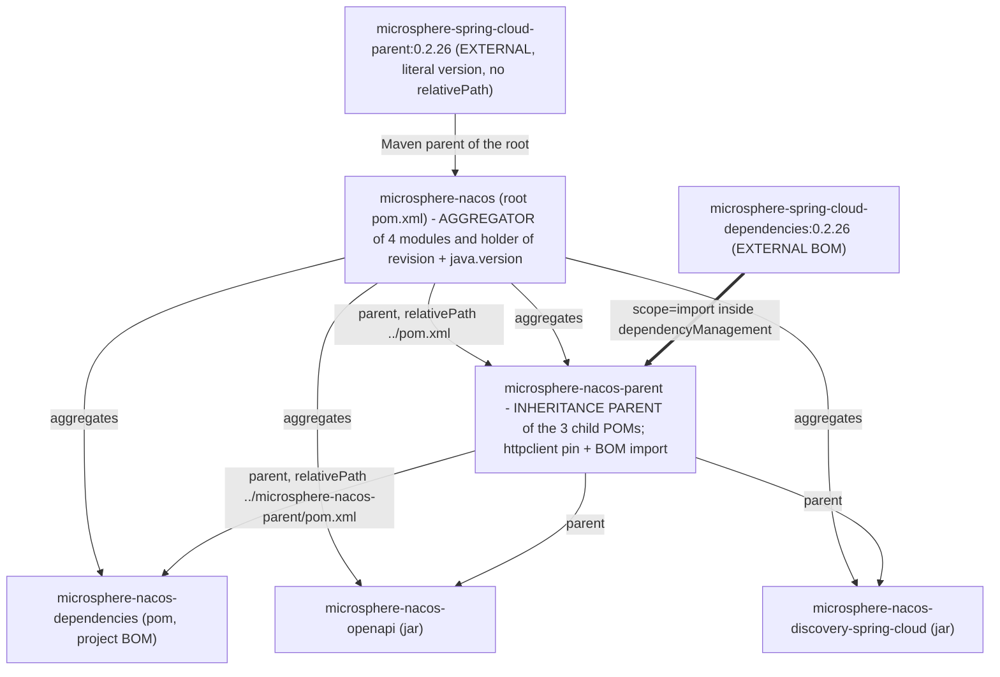

# `microsphere-nacos-parent` — 开发者指南（`current`）

一个 48 行的 POM，它的全部目的就是承载本仓库直接拥有的那几条第三方版本事实：一处显式锁定
（`httpclient 4.5.14`）和一次 BOM 导入（`microsphere-spring-cloud-dependencies:0.2.26`）。它不是聚合器，没有源码，
也没有配置任何构建插件。本文档梳理了继承链，并精确标出可核实的知识在哪里止步。

## 1. 事实

| 属性 | 取值 | 证据 |
| --- | --- | --- |
| 坐标 | `io.github.microsphere-projects:microsphere-nacos-parent:${revision}` | `microsphere-nacos-parent/pom.xml:13-15` |
| 打包方式 | `pom` | `microsphere-nacos-parent/pom.xml:16` |
| Maven 父 POM | `microsphere-nacos:${revision}`、`relativePath ../pom.xml` | `microsphere-nacos-parent/pom.xml:5-10` |
| 被根 POM 聚合 | 是 —— `<module>microsphere-nacos-parent</module>` 是第一个条目 | `pom.xml:60` |
| 长度 | 48 个带编号的行；`wc -l` 报告 47，因为文件结尾没有换行 | `microsphere-nacos-parent/pom.xml` |
| `<properties>` | 2 个条目 | `microsphere-nacos-parent/pom.xml:21-25` |
| `<dependencyManagement>` | 2 个条目：一处直接版本，一次 BOM 导入 | `microsphere-nacos-parent/pom.xml:27-47` |
| `<dependencies>` / `<build>` / `<profiles>` / `<modules>` / `<pluginManagement>` / `<distributionManagement>` | **一个都没有** | 整个文件 |
| 由本仓库拥有的受管版本字面量 | `httpclient 4.5.14`、`microsphere-spring-cloud 0.2.26` | `microsphere-nacos-parent/pom.xml:22,24` |

## 2. 父 POM 与聚合器的区别

这两个词都适用于本仓库里的 POM，而把它们混为一谈是本版本线上最常见的 POM 错误。



三套彼此独立的机制：

1. **聚合** —— 只有 `pom.xml:59-66` 里的 `<modules>` 才创建多模块构建。反应堆顺序遵循声明的列表：
   `microsphere-nacos-parent`、`microsphere-nacos-dependencies`、`microsphere-nacos-openapi`、
   `microsphere-nacos-discovery-spring-cloud`。
2. **继承** —— 每个子 POM 的 `<parent>` 元素。对一个 jar 模块而言，链条深达四层：
   `microsphere-nacos-openapi` → `microsphere-nacos-parent` → `microsphere-nacos` → `microsphere-spring-cloud-parent`。
   反应堆里没有任何东西能跳过其中一层。
3. **依赖管理导入** —— `<scope>import</scope>`，在整个仓库中恰好用了一次，位于
   `microsphere-nacos-parent/pom.xml:38-44`。

`microsphere-nacos-parent` *同时*被聚合、被继承。这是合法的，而且是被要求的：每个子 POM 的 `relativePath` 指向的
那个文件，也必须位于反应堆之内，一次干净检出的构建才能成立。

## 3. 该 POM 实际包含的内容

属性（`microsphere-nacos-parent/pom.xml:21-25`）：

```xml
<properties>
    <httpclient.version>4.5.14</httpclient.version>
    <!-- BOM versions -->
    <microsphere-spring-cloud.version>0.2.26</microsphere-spring-cloud.version>
</properties>
```

依赖管理（`:27-47`）：

```xml
<dependencyManagement>
    <dependencies>

        <!-- Apache HttpClient -->
        <dependency>
            <groupId>org.apache.httpcomponents</groupId>
            <artifactId>httpclient</artifactId>
            <version>${httpclient.version}</version>
        </dependency>

        <!-- Microsphere Spring Cloud Dependencies -->
        <dependency>
            <groupId>io.github.microsphere-projects</groupId>
            <artifactId>microsphere-spring-cloud-dependencies</artifactId>
            <version>${microsphere-spring-cloud.version}</version>
            <type>pom</type>
            <scope>import</scope>
        </dependency>

    </dependencies>
</dependencyManagement>
```

两个条目，两种不同机制 —— 而这个差别就是整个文件的设计。`httpclient` 是**按值**锁定的，就在本仓库之内。
其余一切 —— `gson`、每一个 `org.springframework.*`、JUnit、logback，以及
`io.github.microsphere-projects:microsphere-*` 各库 —— 都是**按引用**锁定到一个并不存在于本快照中的构件上。

这个块里的顺序是有意义的：直接的 `httpclient` 条目声明在导入*之前*，所以即使被导入的 BOM 也管理
`httpclient`，胜出的仍是本地的 `4.5.14`。Maven 在有效模型中对 `dependencyManagement` 采用先声明者优先，
而导入方 POM 里的显式条目优先于被导入的条目。

### 3.1 这些条目的消费者

| 模块 | 通过本 POM 解析出来的、不写版本的依赖 | 证据 |
| --- | --- | --- |
| `microsphere-nacos-openapi` | `org.apache.httpcomponents:httpclient`、`com.google.code.gson:gson` | `microsphere-nacos-openapi/pom.xml:38-47` |
| `microsphere-nacos-openapi`（test） | `junit-jupiter`、`microsphere-java-test`、`microsphere-logging-test`、`logback-classic` | `microsphere-nacos-openapi/pom.xml:50-75` |
| `microsphere-nacos-discovery-spring-cloud` | 全部 11 条 Spring / microsphere 声明，`optional` 与 `test` 都一样 | `microsphere-nacos-discovery-spring-cloud/pom.xml:23-111` |
| `microsphere-nacos-discovery-spring-cloud` | `microsphere-nacos-openapi` —— 在这里**不**由本 POM 解析：它带有显式的 `${revision}` | `microsphere-nacos-discovery-spring-cloud/pom.xml:40-44` |

本仓库里没有任何 POM 为 `httpclient` 或 `gson` 写 `<version>`。用这些数字去 grep 本仓库，只会找到 `4.5.14`
和那个 `0.2.26` 的 BOM 坐标；你读到的任何关于 Spring Boot 或 Spring Cloud 版本的其他说法，都来自这条分支之外。

## 4. 出处：此处能核实与不能核实的

| 条目 | 取值 | 定义位置 | 本快照中可核实吗？ |
| --- | --- | --- | --- |
| `org.apache.httpcomponents:httpclient` | `4.5.14` | `microsphere-nacos-parent/pom.xml:22,34` | **能** |
| `microsphere-spring-cloud-dependencies`（被导入的 BOM） | `0.2.26` | `microsphere-nacos-parent/pom.xml:24,41` | **能**，但仅限作为坐标 —— 其内容不能 |
| `microsphere-spring-cloud-parent`（外部 Maven 父 POM） | `0.2.26` | `pom.xml:6-10` | **能**，仅限作为坐标 |
| 本仓库自有构件的 `${revision}` | `0.2.0-SNAPSHOT` | `pom.xml:55` | **能** |
| `java.version` | `17` | `pom.xml:56` | **能**，作为属性；消费它的插件是外部的 |
| Maven wrapper / Maven 发行版 | wrapper `3.3.4`、`distributionType=only-script`、Maven `3.9.16` | `.mvn/wrapper/maven-wrapper.properties:1-3` | **能** |
| CI JDK 矩阵 | `17`、`21`、`25` | `.github/workflows/maven-build.yml:25` | **能**，作为 workflow 输入 |
| CI Spring Cloud profile 名 | `spring-cloud-2022`、`2023`、`2024`、`2025` | `.github/workflows/maven-build.yml:26-27` | **能**，仅限名称；它们激活的那些版本集合**不能** |
| Spring Boot / Spring Cloud / `gson` / JUnit / logback / `microsphere-*` 的版本 | — | 外部 `microsphere-spring-cloud-dependencies:0.2.26` | **不能** |
| 编译插件、source/javadoc 附加、GPG 签名、`install`/`deploy` 仓库，以及 profile `test`、`coverage`、`ci`、`publish` | — | 外部 `microsphere-spring-cloud-parent:0.2.26` | **不能** |

**出处规则，针对本文件重述。** 在记录或升级一个归被导入 BOM 所有的版本时，请说明它来自哪里，而不要引用具体数字。
无论是 Spring Boot、Spring Cloud 还是任何 JDK 发布线，都无法从本快照锁定到某个具体版本，而 CI 的
`spring-cloud-2022` … `spring-cloud-2025` profile 名是*选择器*，不是某个 Boot 或 Cloud 版本的证据。

## 5. 为什么 `httpclient` 锁定在这里，而 `gson` 不是

`microsphere-nacos-openapi/pom.xml` 声明了这两者且都不带版本，两者都通过本 POM 解析 —— `httpclient` 靠那个直接条目，
`gson` 靠导入。这种不对称恰好由源码树的一条可度量性质来证明：

- `org.apache.http.*` —— 即 HttpClient **4.x** 的包布局 —— 只被一个类 import，
  `microsphere-nacos-openapi/src/main/java/io/microsphere/nacos/client/transport/OpenApiHttpClient.java:26-39`
  （`HttpEntity`、`StatusLine`、`client.HttpClient`、`client.config.RequestConfig`、`client.methods.*`、
  `impl.client.CloseableHttpClient`、`impl.client.HttpClientBuilder`、`impl.conn.PoolingHttpClientConnectionManager`）。
- `org.apache.hc`（5.x 的布局）在快照中出现 **零次**。

因此，一个把 `httpclient` 挪到 5.x 线的上游 BOM 会破坏这一个文件的编译，而这个破坏要等到下游消费者拉到新 BOM 时
才看得见。本地覆盖就是一段护栏，围住代码唯一敏感的那个坐标。`gson` 被 15 个主源码文件 import，但只在 openapi
模块的序列化包里（`client/io`、`client/common/config/io`、`client/common/namespace/io`、
`client/v1/{server,raft}/io`、`client/v2/client/io`），而且通过的是那些跨版本仍保持包布局的 `com.google.gson.*`
类型，所以它在这里不需要本地覆盖。

给贡献者的规则：**只有当本仓库的源码对某个数字敏感时，版本覆盖才属于本 POM。**
凡是 microsphere 组织共享的东西都留在外部 BOM 里，这样整个组织可以在一处升级。

## 6. 该 POM 刻意不做什么

- **没有 `<dependencies>`。** `dependencyManagement` 不会往任何 classpath 上加东西。一个不带版本声明
  `httpclient` 的模块会得到 `4.5.14`；一个从不声明它的模块什么也得不到。这就是 discovery 模块那些 `optional` 的
  Spring 声明（§3.1）在运行时不花费它任何东西的原因。
- **没有 `<build>`，没有 `<pluginManagement>`，没有 `<distributionManagement>`。** 编译 release、编码、
  source/javadoc 附加、GPG 签名、`mvn deploy` 用到的 server id，以及在发布 POM 时解析 `${revision}` 的机制，
  全都来自 `microsphere-spring-cloud-parent:0.2.26`。在本快照里对每个 POM 和每个 workflow 文件 grep `flatten`
  返回 **无匹配**，所以这条分支上没有声明任何 POM 展平步骤 —— 无论是什么在 install/deploy 时替换
  `${revision}`，都由那个外部父 POM 贡献，在此读不到。消费者侧的后果见
  [microsphere-nacos-dependencies.md](microsphere-nacos-dependencies.md)。
- **没有 `<profiles>`。** CI 激活的那些 profile —— `test`、`coverage`、`ci`、`publish` 以及四个 `spring-cloud-*`
  选择器（`.github/workflows/maven-build.yml:54`、`.github/workflows/maven-publish.yml:63`）—— 定义在外部父 POM 里。
  它们的存在是从 workflow 得到的证据；它们的内容不是。
- **它不拥有 `${revision}`。** 第 8 行把它用作父版本，第 15 行把它用作自己的版本；该属性只声明一次，
  在 `pom.xml:55`，靠继承抵达这里。发版意味着编辑那一行 —— 而这正是发布 workflow 用 `sed` 做的事
  （`.github/workflows/maven-publish.yml:201`）。
- **它不声明任何模块。** 被禁用的 `microsphere-nacos-spring` 和 `microsphere-nacos-spring-boot` 条目以注释形式
  位于根 `pom.xml:63-64`，而这两个目录在本快照中都不存在。

## 7. 外部父 POM 的解析：离线约束

根 POM 声明它的父 POM 时，没有提供任何能起到作用的 `<relativePath>` 覆盖（`pom.xml:6-10`）：

```xml
<parent>
    <groupId>io.github.microsphere-projects</groupId>
    <artifactId>microsphere-spring-cloud-parent</artifactId>
    <version>0.2.26</version>
</parent>
```

因此 Maven 需要本地或某个远程仓库里存在 `microsphere-spring-cloud-parent-0.2.26.pom` —— 并通过它需要
`microsphere-spring-cloud-dependencies-0.2.26.pom` —— 否则它什么都构建不了。

- 在一台本地仓库为空、又没有网络的机器上做一次干净检出，会在 POM 解析阶段就失败，连一个源码文件都还没编译。
  本文档快照正是在这种状态下产出的：Maven 无法运行，所以
  **本指南中没有任何论断来自一次完成的构建或一个 effective POM**。
- wrapper 锁定了一个 Maven 发行版（`.mvn/wrapper/maven-wrapper.properties:3`，`3.9.16`），
  但它无法替代一个缺失的父 POM。`.mvn/` 里只有 `wrapper/maven-wrapper.properties`：没有 `maven.config`，
  没有 `jvm.config`，没有 `extensions.xml`，没有任何改变解析或添加仓库的东西。
- CI 里的 `-Drevision=0.0.1-SNAPSHOT`（`.github/workflows/maven-build.yml:52`）覆盖的是 *本仓库自己的* 坐标，
  因为它们是由属性驱动的；它对外部父 POM 没有影响，后者的 `0.2.26` 是字面量。

## 8. 修改本 POM 的检查清单

1. **给本仓库内的代码新增一处锁定** → 添加一个属性，外加一条直接的 `dependencyManagement` 条目，沿用
   `httpclient` 那个块的写法（第 21-22、31-35 行）。如果你打算覆盖被导入的 BOM，请把它放在导入*之前*。
2. **给本仓库某个已发布构件新增一处锁定** → 那属于
   [microsphere-nacos-dependencies.md](microsphere-nacos-dependencies.md)，不属于这里。
3. **升级 `microsphere-spring-cloud.version`** → `gson`、Spring、JUnit、logback 和 `microsphere-*` 各库会一起移动；
   重跑整个 CI 矩阵，因为四个 `spring-cloud-*` profile 会与这个数字相互作用。预期
   `microsphere-nacos-discovery-spring-cloud` 的编译 classpath 会改变，即使它的 POM 没变。
4. **把 Apache HttpClient 升到 5.x** → 本 POM 不是拦路者，`transport/OpenApiHttpClient.java` 才是，因为它的那些
   4.x import（§5）。把它当作一次源码迁移来做，然后删掉本地覆盖。
5. **在这里新增一个构建插件或 profile** → 先确认外部父 POM 是否已经提供；这条分支上目前什么都没有，
   而在本 POM 里重复声明一个插件会一次性改变三个子 POM 的行为。
6. **编辑 `<modules>` 或 `${revision}`** → 那是根 `pom.xml`（第 55-66 行），不是这个文件。

## 9. 相关文档

- [开发者指南索引](README.md) —— 反应堆概览与构建流程
- [microsphere-nacos-dependencies.md](microsphere-nacos-dependencies.md) —— 把本 POM 作为父 POM 的那个 BOM
- [microsphere-nacos-openapi.md](microsphere-nacos-openapi.md) —— 它的 `httpclient` 与 `gson` 版本在此决定的那个模块
- [microsphere-nacos-discovery-spring-cloud.md](microsphere-nacos-discovery-spring-cloud.md) —— 它的 Spring
  版本在此决定却不在此处写出的那个模块
- [用户指南：microsphere-nacos-parent](../../../user-guide/zh/current/microsphere-nacos-parent.md)
- [文档主页](../../../README.md)
- [仓库 README](../../../../README.md)

## English

[English](../../current/microsphere-nacos-parent.md)
