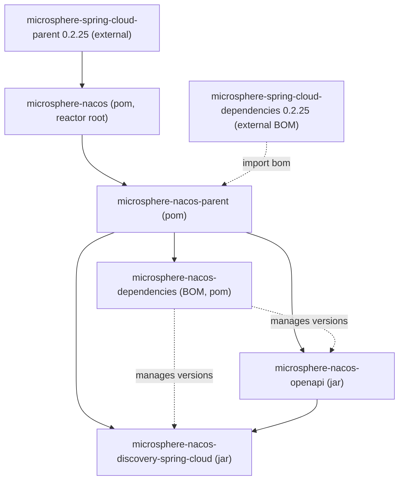

# Microsphere Nacos 1.x — User Guide

This section is the user guide for the **`1.x`** version line of `microsphere-nacos`, sourced from the
`release-1.x` branch snapshot. The Maven revision of this line is **`0.2.0-SNAPSHOT`**.

The repository does not publish Git tags. The `1.x` directory exists because the project maintains a
`release-1.x` line alongside its default line. As of the snapshot described here, the `1.x` content sits at
the build-migration commit ("Migrate project build from Gradle to Maven") and is otherwise source-identical to
the default line, except that this line inherits **Microsphere Spring Cloud `0.2.25`** while the default line
uses `0.2.26`. See [Version information](#version-information) for the exact provenance of every version.

## What this project is

`microsphere-nacos` is a from-scratch Java client for the **Nacos Open API** plus a Spring Cloud discovery
adapter built on top of it. It talks to Nacos over plain HTTP (Apache HttpClient) and models the Open API
surface as typed Java interfaces. Two Open API revisions are covered:

- **Open API V1** — configuration, naming (service/instance), namespace, server operations, and RAFT.
- **Open API V2** — the `/v2` endpoints, including the client-information (`/v2/ns/client`) sub-API.

## Reactor at a glance

The root reactor `io.github.microsphere-projects:microsphere-nacos` (`pom`) declares these modules:

| Module | Artifact ID | Packaging | Role |
| --- | --- | --- | --- |
| Parent | `microsphere-nacos-parent` | `pom` | Shared dependency management and BOM imports for the project's modules |
| Dependencies (BOM) | `microsphere-nacos-dependencies` | `pom` | Bill of Materials that pins this project's own artifacts |
| OpenAPI | `microsphere-nacos-openapi` | `jar` | The typed Nacos Open API client (V1 + V2) |
| Discovery Spring Cloud | `microsphere-nacos-discovery-spring-cloud` | `jar` | Spring Cloud `DiscoveryClient` adapter over the OpenAPI client |

Two further modules, `microsphere-nacos-spring` and `microsphere-nacos-spring-boot`, are present in the reactor
but **commented out** in the root POM, so they are not built and must not be depended upon in this line.

Detailed guides:

- [microsphere-nacos-openapi](microsphere-nacos-openapi.md)
- [microsphere-nacos-discovery-spring-cloud](microsphere-nacos-discovery-spring-cloud.md)
- [microsphere-nacos-parent](microsphere-nacos-parent.md)
- [microsphere-nacos-dependencies](microsphere-nacos-dependencies.md)

## Module dependencies



Reading the graph:

- The root POM **inherits** the external `microsphere-spring-cloud-parent:0.2.25` (that parent is where Spring
  Boot / Spring Cloud / JDK-compile versions ultimately come from — see the provenance note below).
- `microsphere-nacos-parent` is the direct parent of every other module and **imports** the external
  `microsphere-spring-cloud-dependencies:0.2.25` BOM, then adds `httpclient:4.5.14`.
- `microsphere-nacos-dependencies` is the project BOM that pins the two jar artifacts.
- `microsphere-nacos-discovery-spring-cloud` **depends on** `microsphere-nacos-openapi`.

## Maven coordinates and the BOM

All artifacts use group `io.github.microsphere-projects`. Add the BOM once, then depend on the modules without
versions:

```xml
<dependencyManagement>
    <dependencies>
        <!-- Microsphere Nacos Dependencies (BOM) -->
        <dependency>
            <groupId>io.github.microsphere-projects</groupId>
            <artifactId>microsphere-nacos-dependencies</artifactId>
            <version>${microsphere-nacos.version}</version>
            <type>pom</type>
            <scope>import</scope>
        </dependency>
    </dependencies>
</dependencyManagement>

<dependencies>
    <dependency>
        <groupId>io.github.microsphere-projects</groupId>
        <artifactId>microsphere-nacos-openapi</artifactId>
    </dependency>

    <dependency>
        <groupId>io.github.microsphere-projects</groupId>
        <artifactId>microsphere-nacos-discovery-spring-cloud</artifactId>
    </dependency>
</dependencies>
```

For the snapshot described here, `${microsphere-nacos.version}` is `0.2.0-SNAPSHOT`. Because the project publishes
no tags and this line is pre-release, consume it from your local build or snapshot repository as appropriate.

## Version information

| Item | Value | Source (provenance) |
| --- | --- | --- |
| Branch / line | `release-1.x` | Repository branch this snapshot represents |
| Root reactor version | `0.2.0-SNAPSHOT` | `revision` property in the root `pom.xml` |
| Module versions | `${revision}` (`0.2.0-SNAPSHOT`) | Each module POM |
| Reactor `java.version` property | `17` | `<java.version>` in the root `pom.xml` |
| External parent | `microsphere-spring-cloud-parent:0.2.25` | `<parent>` in the root `pom.xml` |
| Imported BOM | `microsphere-spring-cloud-dependencies:0.2.25` | `microsphere-nacos-parent/pom.xml` |
| Apache HttpClient | `4.5.14` | `httpclient.version` in `microsphere-nacos-parent/pom.xml` |
| Published Git tags | none | The project does not tag releases |

**Provenance caveat.** The concrete Spring Boot version, Spring Cloud version, and the Java language level used to
compile are **not** declared inside this repository; they are supplied transitively by the external
`microsphere-spring-cloud-parent` / `microsphere-spring-cloud-dependencies` POMs. Those external POMs are not part
of this snapshot, so their exact resolved versions cannot be verified from source here and are intentionally not
stated as fixed numbers.

## Compatibility range

The supported range is expressed by the CI matrix in `.github/workflows/maven-build.yml`, which builds and runs the
test suite on:

| Axis | Values tested in CI |
| --- | --- |
| Java | `17`, `21`, `25` |
| Spring Cloud profile | `spring-cloud-2022`, `spring-cloud-2023`, `spring-cloud-2024`, `spring-cloud-2025` |

The CI also runs `mvn test` with an override of `-Drevision=0.0.1-SNAPSHOT` and activates `test` and `coverage`
profiles; this is a build-time override and does not change the `0.2.0-SNAPSHOT` version declared in the POMs.

Notes on interpretation:

- The matrix above is the **verified** coverage for this snapshot. The root `README.md` in this branch describes the
  `1.x` line as targeting older Spring Cloud generations, but that narrative is not exercised by the CI in this
  snapshot; treat the matrix as the authoritative statement of what is built and tested.
- The effective Spring Boot / Spring Cloud releases behind each `spring-cloud-*` profile are defined in the external
  Microsphere Spring Cloud POMs and are therefore subject to the same provenance caveat above.

### Nacos Open API endpoint coverage

- **V1** (`/v1`): configuration (`/v1/cs/configs`, history under `/v1/cs/history`), naming
  (`/v1/ns/service`, `/v1/ns/instance`, heartbeats, batch metadata, health), namespace console
  (`/v1/console/namespaces`), server operations (`/v1/console/server/state`, `/v1/ns/operator/switches`,
  `/v1/ns/operator/metrics`, `/v1/ns/operator/servers`), RAFT (`/v1/ns/raft/leader`), and auth
  (`/v1/auth/login`).
- **V2** (`/v2`): configuration (`/v2/cs/config`, `/v2/cs/history/list`), naming and namespace through the V2
  sub-clients, and the client-information API (`/v2/ns/client` with `/list`, `/publish/list`, `/subscribe/list`,
  `/service/publisher/list`, `/service/subscriber/list`). The V2 config client still borrows the V1 detail endpoint
  where the V2 API provides no equivalent.

See the module guides for method-level detail: [microsphere-nacos-openapi](microsphere-nacos-openapi.md).

## Documentation map

- Developer guide counterpart for this line: [developer-guide/1.x](../../developer-guide/1.x/README.md)
- Other version line: [current user guide](README.md)
- [Docs home](../../README.md)
- [Repository README](../../../README.md)

## 中文

[中文](../zh/1.x/README.md)
