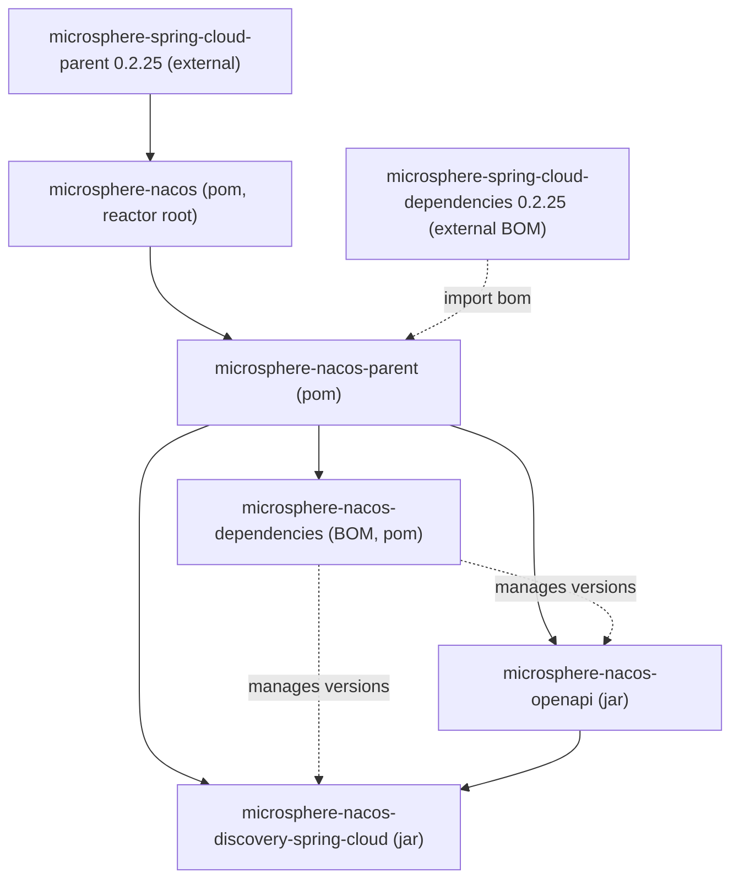

# microsphere-nacos-dependencies

`microsphere-nacos-dependencies` is the **Bill of Materials** (BOM, `packaging: pom`) for this project. Importing it
in a consumer's `<dependencyManagement>` pins the versions of the `microsphere-nacos` artifacts so you can depend on
them without repeating versions.

## Maven coordinates and the BOM snippet

```xml
<dependencyManagement>
    <dependencies>
        <dependency>
            <groupId>io.github.microsphere-projects</groupId>
            <artifactId>microsphere-nacos-dependencies</artifactId>
            <version>${microsphere-nacos.version}</version>
            <type>pom</type>
            <scope>import</scope>
        </dependency>
    </dependencies>
</dependencyManagement>
```

Then depend on the modules without versions:

```xml
<dependencies>
    <dependency>
        <groupId>io.github.microsphere-projects</groupId>
        <artifactId>microsphere-nacos-openapi</artifactId>
    </dependency>
    <dependency>
        <groupId>io.github.microsphere-projects</groupId>
        <artifactId>microsphere-nacos-discovery-spring-cloud</artifactId>
    </dependency>
</dependencies>
```

In this line `${microsphere-nacos.version}` is `0.2.0-SNAPSHOT`.

## What it manages

The BOM declares its own `<dependencyManagement>` for this project's artifacts:

| Managed artifact | Group | Version |
| --- | --- | --- |
| `microsphere-nacos-openapi` | `io.github.microsphere-projects` | `${revision}` = `0.2.0-SNAPSHOT` |
| `microsphere-nacos-discovery-spring-cloud` | `io.github.microsphere-projects` | `${revision}` = `0.2.0-SNAPSHOT` |

Both entries are versioned through `${revision}` so they always track the reactor build.

## Inheritance and effect on third-party versions

This POM declares `microsphere-nacos-parent` as its parent:



Because `microsphere-nacos-dependencies` inherits from `microsphere-nacos-parent` — which manages
`httpclient:4.5.14` and imports the external `microsphere-spring-cloud-dependencies:0.2.25` BOM — those
third-party managed entries are also in the BOM's effective scope. If your application needs consistent versions for
the Nacos client's transitive dependencies (HttpClient, GSON, the Microsphere core libraries), importing this BOM is
the intended entry point. If you only need the two project artifacts, the snippet above is sufficient.

## Version information and compatibility

| Item | Value | Provenance |
| --- | --- | --- |
| Own version | `${revision}` = `0.2.0-SNAPSHOT` | This POM |
| Parent | `microsphere-nacos-parent` (`0.2.0-SNAPSHOT`) | This POM, `<parent>` |
| Managed project artifacts | both jar modules at `${revision}` | This POM, `dependencyManagement` |
| Transitive third-party versions | governed via the inherited parent (`0.2.25`, `4.5.14`) | `microsphere-nacos-parent` |

As a BOM, it contributes no runtime code, so it has no compatibility range of its own. The compatibility of the
artifacts it pins is described in the [index](README.md): CI builds on Java `17`/`21`/`25` and the
`spring-cloud-2022` through `spring-cloud-2025` profiles. The concrete Spring Boot / Spring Cloud versions reached
through the inherited external BOM are **not verifiable from this repository** and are deliberately not stated as
fixed numbers.

## Related documents

- [Index](README.md)
- [microsphere-nacos-parent](microsphere-nacos-parent.md)
- [microsphere-nacos-openapi](microsphere-nacos-openapi.md)
- [microsphere-nacos-discovery-spring-cloud](microsphere-nacos-discovery-spring-cloud.md)
- Developer guide counterpart: [../../developer-guide/1.x/microsphere-nacos-dependencies.md](microsphere-nacos-dependencies.md)

## 中文

[中文](../zh/1.x/README.md)
