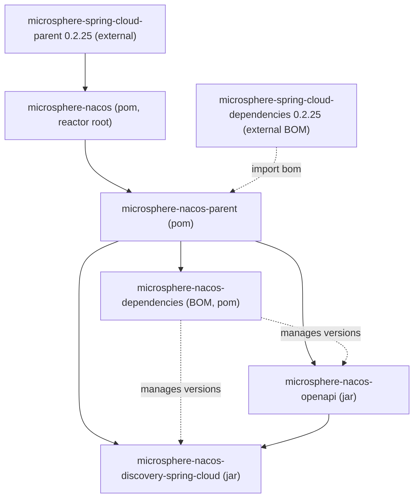

# microsphere-nacos-discovery-spring-cloud

The `microsphere-nacos-discovery-spring-cloud` module adapts the typed Nacos Open API client to the
**Spring Cloud** discovery abstraction. It provides a `DiscoveryClient` implementation, a `ServiceInstance`
adapter, and Spring Boot auto-configuration so the Nacos discovery client can be wired from externalized
properties. It depends on [microsphere-nacos-openapi](microsphere-nacos-openapi.md).

## Maven coordinates

```xml
<dependency>
    <groupId>io.github.microsphere-projects</groupId>
    <artifactId>microsphere-nacos-discovery-spring-cloud</artifactId>
</dependency>
```

The version is managed by the [microsphere-nacos-dependencies](microsphere-nacos-dependencies.md) BOM (
`0.2.0-SNAPSHOT` in this line). This module depends directly on `microsphere-nacos-openapi`, and treats the
Spring Cloud / Spring Boot artifacts (`spring-cloud-commons`, `microsphere-spring-cloud-commons`,
`spring-boot-starter`, `spring-boot-starter-actuator`, and the configuration-/autoconfigure- processors) as
`optional`, so the consuming application brings them.

## Module position



## Classes at a glance

| Class | Package | Role |
| --- | --- | --- |
| `NacosDiscoveryClient` | `io.microsphere.nacos.client.discovery.spring.cloud` | Spring Cloud `DiscoveryClient` for Nacos |
| `NacosServiceInstance` | `io.microsphere.nacos.client.discovery.spring.cloud` | `ServiceInstance` backed by a Nacos `Instance` |
| `NacosDiscoveryConfiguration` | `io.microsphere.nacos.client.discovery.spring.cloud` | Declares the `nacosDiscoveryClient` bean |
| `NacosDiscoveryContextFactory` | `io.microsphere.nacos.client.discovery.spring.cloud` | `NamedContextFactory` for per-named-client contexts |
| `NacosDiscoverySpecification` | `io.microsphere.nacos.client.discovery.spring.cloud` | `NamedContextFactory.Specification` value object |
| `NacosDiscoveryAutoConfiguration` | `...discovery.spring.cloud.autoconfigure` | Registers discovery beans and the multi-client factory |
| `NacosClientAutoConfiguration` | `io.microsphere.nacos.client.spring.boot.autoconfigure` | Enables `NacosClientProperties` and imports `NacosClientConfiguration` |
| `NacosClientConfiguration` | `io.microsphere.nacos.client.spring` | Declares the `OpenApiHttpClient` bean |
| `NacosClientProperties` | `io.microsphere.nacos.client.spring.boot` | `@ConfigurationProperties` binding for the client |
| `NacosClientUtils` | `io.microsphere.nacos.client.spring.util` | Property-prefix helpers for named clients |

## Spring Boot auto-configuration

`META-INF/spring/org.springframework.boot.autoconfigure.AutoConfiguration.imports` registers two auto-configurations:

```
io.microsphere.nacos.client.spring.boot.autoconfigure.NacosClientAutoConfiguration
io.microsphere.nacos.client.discovery.spring.cloud.autoconfigure.NacosDiscoveryAutoConfiguration
```

- `NacosClientAutoConfiguration` is guarded by `@ConditionalOnPropertyPrefix(NacosClientProperties.PREFIX)`
  (`microsphere.nacos.client.`), enables `NacosClientProperties`, and imports `NacosClientConfiguration`, which
  builds an `OpenApiHttpClient` bean (`destroyMethod = "close"`).
- `NacosDiscoveryAutoConfiguration` imports `NacosDiscoveryConfiguration` (which creates the `NacosDiscoveryClient`
  bean) and a nested `Multiple` configuration. `Multiple` is activated by
  `@ConditionalOnProperty(prefix = NacosClientUtils.NACOS_CLIENTS_PROPERTY_NAME_PREFIX)`
  (`microsphere.nacos.clients.`) and registers a `NacosDiscoveryContextFactory` for applications that need several
  independently-configured Nacos clients.

## Configuration properties

`NacosClientProperties` is bound with prefix `microsphere.nacos.client.` (the value of
`Constants.PROPERTY_NAME_PREFIX`) and extends `NacosClientConfig`, so all the client settings described in the
[OpenAPI guide](microsphere-nacos-openapi.md) are externalized here. The
module adds one nested element:

| Property | Type | Purpose |
| --- | --- | --- |
| `microsphere.nacos.client.server-address` | `String` | Nacos server host:port |
| `microsphere.nacos.client.scheme` | `String` | URL scheme (default `http`) |
| `microsphere.nacos.client.context-path` | `String` | Context path (default `/nacos`) |
| `microsphere.nacos.client.user-name` / `...password` | `String` | Authorization (both must be set to enable) |
| `microsphere.nacos.client.discovery.namespace-id` | `String` | Namespace used by `NacosDiscoveryClient` |

For multiple clients, `NacosClientUtils` defines the prefix `microsphere.nacos.clients.` and helpers
`buildNacosClientPropertyNamePrefix(name)` (`microsphere.nacos.clients.<name>.`),
`getNacosClientProperties(environment, name)`, and `getNacosCilentPropertySource(environment, name)` — note the
method name `getNacosCilentPropertySource` is spelled as declared in the source. `NacosDiscoveryContextFactory`
uses these to graft a named client's properties into a child Spring context.

## The discovery client

`NacosDiscoveryClient` implements `org.springframework.cloud.client.discovery.DiscoveryClient` and is constructed
from an `OpenApiHttpClient` and `NacosClientProperties`. Internally it builds an `OpenApiServiceClient` and an
`OpenApiInstanceClient` (V1) and reads the namespace from `nacosClientProperties.getDiscovery().getNamespaceId()`.

| Method | Behavior |
| --- | --- |
| `String description()` | Returns `"DiscoveryClient - Nacos"` |
| `List<ServiceInstance> getInstances(String serviceId)` | Calls `instanceClient.getInstancesList(namespaceId, serviceId)` and maps each `Instance` to a `NacosServiceInstance` |
| `List<String> getServices()` | Pages through `serviceClient.getServiceNames(namespaceId, ...)` until no further pages remain |

`NacosServiceInstance` implements `ServiceInstance` over a Nacos `Instance`:

| Method | Delegates to / value |
| --- | --- |
| `getInstanceId()` | `instance.getInstanceId()` |
| `getServiceId()` | `instance.getService()` |
| `getHost()` | `instance.getIp()` |
| `getPort()` | `instance.getPort()` |
| `isSecure()` | `false` |
| `getUri()` | `DefaultServiceInstance.getUri(this)` |
| `getMetadata()` | `instance.getMetadata()` |
| `getScheme()` | `"http"` |

## Usage example

No unit tests are shipped for this module in the `release-1.x` snapshot, so the snippet below is assembled from the
auto-configuration source rather than adapted from a test.

```yaml
# application.yaml
microsphere:
  nacos:
    client:
      server-address: 127.0.0.1:8848
      user-name: nacos
      password: nacos
      discovery:
        namespace-id: public
```

```java
// The auto-configured bean is a standard Spring Cloud DiscoveryClient
@Autowired
private DiscoveryClient discoveryClient;

public void inspect() {
    List<String> services = discoveryClient.getServices();
    List<ServiceInstance> instances = discoveryClient.getInstances("test-service");
    for (ServiceInstance instance : instances) {
        System.out.println(instance.getHost() + ":" + instance.getPort());
    }
}
```

To register several clients, set properties under `microsphere.nacos.clients.<name>.*`; this activates the nested
`Multiple` configuration and exposes a `NacosDiscoveryContextFactory` that builds a named child context per client.

## Version information and compatibility

This module is built as `0.2.0-SNAPSHOT` from `release-1.x` and inherits `microsphere-spring-cloud-parent:0.2.25`.
The Spring Cloud `DiscoveryClient` / `ServiceInstance` / `NamedContextFactory` types it compiles against come from
`spring-cloud-commons` and `spring-cloud-context` whose versions are supplied by the external Microsphere Spring
Cloud POMs and are therefore not fixed by this repository. CI exercises this module on Java `17`, `21`, `25` across
the `spring-cloud-2022` / `-2023` / `-2024` / `-2025` profiles. See the [index](README.md) for full provenance
caveats.

## Related documents

- [Index](README.md)
- [microsphere-nacos-openapi](microsphere-nacos-openapi.md)
- [microsphere-nacos-parent](microsphere-nacos-parent.md)
- [microsphere-nacos-dependencies](microsphere-nacos-dependencies.md)
- Developer guide counterpart: [../../developer-guide/1.x/microsphere-nacos-discovery-spring-cloud.md](microsphere-nacos-discovery-spring-cloud.md)

## 中文

[中文](../zh/1.x/README.md)
