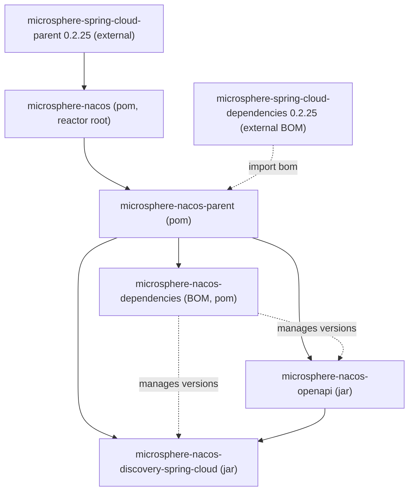

# microsphere-nacos-openapi

The `microsphere-nacos-openapi` module is a typed Java client for the **Nacos Open API**. It exposes the Open API
surface as Java interfaces, sends requests over Apache HttpClient, and maps JSON payloads to model classes. Both
Open API revisions are supported through parallel `v1` and `v2` packages with a shared `common` contract layer.

## Maven coordinates

```xml
<dependency>
    <groupId>io.github.microsphere-projects</groupId>
    <artifactId>microsphere-nacos-openapi</artifactId>
</dependency>
```

The version is managed by the [microsphere-nacos-dependencies](microsphere-nacos-dependencies.md) BOM (
`0.2.0-SNAPSHOT` in this line). The module's own runtime dependencies are `org.apache.httpcomponents:httpclient`
(`4.5.14`, pinned by `microsphere-nacos-parent`) and `com.google.code.gson:gson`; `microsphere-java-core` and
`microsphere-annotation-processor` are declared `optional`.

## Module position

This jar is the dependency foundation for the discovery adapter and is built under the shared parent:



## Package layout

| Package | Contents |
| --- | --- |
| `io.microsphere.nacos.client` | `Client`, `NacosClientConfig`, `OpenApiVersion`, `ErrorCode`, `NacosClientException` |
| `io.microsphere.nacos.client.v1` | `NacosClient` facade, `OpenApiNacosClient` implementation |
| `io.microsphere.nacos.client.v1.config` | `OpenApiConfigClient`, `ConfigListenerManager`, `ConfigUtil` |
| `io.microsphere.nacos.client.v1.discovery` | `OpenApiServiceClient`, `OpenApiInstanceClient` |
| `io.microsphere.nacos.client.v1.namespace` | `OpenApiNamespaceClient` |
| `io.microsphere.nacos.client.v1.server` | `OpenApiServerClient`, `ServerClient` and the switch/metrics/servers sub-interfaces |
| `io.microsphere.nacos.client.v1.raft` | `RaftClient` (deprecated), `OpenApiRaftClient` |
| `io.microsphere.nacos.client.v2` | `NacosClientV2` facade, `OpenApiNacosClientV2` implementation |
| `io.microsphere.nacos.client.v2.config` | `OpenApiConfigClientV2` |
| `io.microsphere.nacos.client.v2.discovery` | `OpenApiServiceClientV2`, `OpenApiInstanceClientV2` |
| `io.microsphere.nacos.client.v2.namespace` | `OpenApiNamespaceClientV2` |
| `io.microsphere.nacos.client.v2.client` | `ClientDetail`, `ClientInfo`, `ClientInstance`, `ClientSubscriber` and their deserializers |
| `io.microsphere.nacos.client.common` | Shared contracts: `config`, `discovery`, `namespace`, `auth`, `model` |
| `io.microsphere.nacos.client.transport` | `OpenApiHttpClient`, `OpenApiClient`, `OpenApiRequest`, `OpenApiResponse` |
| `io.microsphere.nacos.client.io` | `Serializer`, `Deserializer`, `DefaultSerializer`, `DefaultDeserializer`, Gson-based impls |
| `io.microsphere.nacos.client.util` | `OpenApiUtils`, `ModelUtils`, `JsonUtils`, `IOUtils`, `StringUtils`, `TypeUtils` |

## Choosing an Open API version

`OpenApiVersion` is an enum with two constants and their path prefix:

| Constant | `getEndpointPath()` |
| --- | --- |
| `V1` | `/v1` |
| `V2` | `/v2` |

`OpenApiNacosClient` reports `V1` (the default in `OpenApiTemplateClient`); `OpenApiNacosClientV2` overrides
`getOpenApiVersion()` to return `V2`. The version controls both the endpoint prefix and the response unwrapping
strategy (see [Transport](#transport)).

## Configuring the client: `NacosClientConfig`

`NacosClientConfig` is the single object every client is built from. Defaults come from the `Constants` interface
and can also be seeded from JVM system properties prefixed with `microsphere.nacos.client.`.

| Property (getter/setter) | Default | Notes |
| --- | --- | --- |
| `serverAddress` / `setServerAddress` | none | Host:port of the Nacos server; required to reach the Open API |
| `scheme` / `setScheme` | `http` | URL scheme |
| `contextPath` / `setContextPath` | `/nacos` | Server context path |
| `applicationName` / `setApplicationName` | `microsphere-nacos-client` | Overridable via `microsphere.nacos.client.app-name` |
| `name` / `setName` | none | Logical client name |
| `userName` / `setUserName` | none | Auth username |
| `password` / `setPassword` | none | Auth password |
| `accessKey` / `setAccessKey` | none | Namespace access key |
| `secretKey` / `setSecretKey` | none | Namespace secret key |
| `maxConnections` / `setMaxConnections` | `1000` | Pool total connections |
| `maxPerRoute` / `setMaxPerRoute` | `200` | Pool connections per route |
| `connectionTimeout` / `setConnectionTimeout` | `60000` (1 min) | Milliseconds |
| `readTimeout` / `setReadTimeout` | `180000` (3 min) | Milliseconds |
| `longPollingTimeout` / `setLongPollingTimeout` | `30000` (30 s) | Milliseconds |
| `eventProcessingTimeout` / `setEventProcessingTimeout` | `30000000` | Value taken from `Constants` default (`SECONDS.toMicros(30)`) |
| `encoding` / `setEncoding` | `UTF-8` | Query-string encoding |
| `fetchingConfigThreadName` | `Nacos Client - Fetching Config Executor` | Thread naming |
| `listenerConfigThreadName` | `Nacos Client - Listening Config Scheduler` | Thread naming |
| `publishingConfigEventThreadName` | `Nacos Client - Config Event Publisher` | Thread naming |

`isAuthorizationEnabled()` returns `true` only when both `userName` and `password` are set.

## The V1 facade: `NacosClient` / `OpenApiNacosClient`

`NacosClient` composes every V1 capability into one interface:

```
NacosClient extends AuthenticationClient, ConfigClient, ServiceClient, InstanceClient,
              NamespaceClient, ServerClient, RaftClient, Client
```

`OpenApiNacosClient` implements it by delegating to dedicated sub-clients. Two constructors are available:

```java
// Builds its own OpenApiHttpClient from the config
NacosClient client = new OpenApiNacosClient(nacosClientConfig);

// Reuses an existing transport
NacosClient client = new OpenApiNacosClient(openApiClient, nacosClientConfig);
```

Accessors `getAuthenticationClient()`, `getConfigClient()`, `getServiceClient()`, `getInstanceClient()`,
`getNamespaceClient()`, `getServerClient()`, and `getRaftClient()` expose the underlying sub-clients.

## Authentication

`AuthenticationClient` offers `authenticate()` (uses the configured user/password) and
`authenticate(String userName, String password)`. `OpenApiAuthenticationClient` posts to `/v1/auth/login` and
returns an `Authentication` model exposing `getAccessToken()`, `getTokenTtl()`, and `isGlobalAdmin()`.

```java
// Adapted from OpenApiAuthenticationClientTest
nacosClientConfig.setUserName("nacos");
nacosClientConfig.setPassword("nacos");
OpenApiAuthenticationClient client =
        new OpenApiAuthenticationClient(openApiClient, nacosClientConfig);

Authentication authentication = client.authenticate();
assert authentication.getAccessToken() != null;
assert authentication.getTokenTtl() > 0;
assert authentication.isGlobalAdmin();
```

When authorization is enabled, `OpenApiHttpClient` creates an `AuthorizationManager` that authenticates eagerly and
refreshes the token on a daemon scheduler at half the token TTL; the access token is then attached to every request
as the `accessToken` query parameter.

## Configuration API: `ConfigClient`

`ConfigClient` is the contract for Nacos configuration management. The methods that are not `default` are the ones
implemented against the wire; the `default` overloads fill in the `public` namespace and `DEFAULT_GROUP` conventions
from `Constants`.

Core methods:

| Method | Purpose |
| --- | --- |
| `String getConfigContent(String namespaceId, String group, String dataId, String tag)` | Raw content only |
| `Config getConfig(String namespaceId, String group, String dataId)` | Full config detail |
| `boolean publishConfig(NewConfig newConfig)` | Create or update |
| `boolean publishConfigContent(...)` | Convenience publish overloads (group/namespace/tag/`ConfigType`) |
| `boolean deleteConfig(String namespaceId, String group, String dataId, String tag)` | Delete |
| `Page<HistoryConfig> getHistoryConfigs(String namespaceId, String group, String dataId, int pageNumber, int pageSize)` | Paged history |
| `HistoryConfig getHistoryConfig(String namespaceId, String group, String dataId, long revision)` | One history entry by revision |
| `HistoryConfig getPreviousHistoryConfig(String namespaceId, String group, String dataId, String id)` | Previous history entry |
| `void addEventListener(...)` / `void removeEventListener(...)` | Long-polling change listeners |

`ConfigClient` declares `DEFAULT_PAGE_SIZE = 100` and `MAX_PAGE_SIZE = 500`; `getHistoryConfigs` rejects
`pageSize` above the maximum. `ConfigType` is an enum of `TEXT`, `JSON`, `XML`, `YAML`, `HTML`, `PROPERTIES`.

Change listening is backed by `ConfigListenerManager` inside `OpenApiConfigClient`; callbacks receive a
`ConfigChangedEvent` whose `getKind()` is one of `CREATED`, `MODIFIED`, or `DELETED`.

```java
// Adapted from OpenApiConfigClientTest
ConfigClient client = new OpenApiConfigClient(openApiClient, nacosClientConfig);

client.addEventListener("test", "test-group", "test-config",
        event -> System.out.println(event.getKind() + " -> " + event.getContent()));

NewConfig newConfig = new NewConfig();
newConfig.setNamespaceId("test");
newConfig.setGroup("test-group");
newConfig.setDataId("test-config");
newConfig.setContent("Test Config Content...");
newConfig.setType(ConfigType.TEXT);
client.publishConfig(newConfig);

Config config = client.getConfig("test", "test-group", "test-config");
Page<HistoryConfig> history = client.getHistoryConfigs("test", "test-group", "test-config");
client.deleteConfig("test", "test-group", "test-config");
```

## Service API: `ServiceClient`

| Method | Purpose |
| --- | --- |
| `boolean createService(Service service)` | Register a service definition |
| `boolean updateService(Service service)` | Update (protect threshold, selector, metadata) |
| `boolean deleteService(String namespaceId, String groupName, String serviceName)` | Delete |
| `Service getService(String namespaceId, String groupName, String serviceName)` | Read one |
| `Page<String> getServiceNames(String namespaceId, String groupName, int pageNumber, int pageSize)` | Paged names |

```java
// Adapted from OpenApiServiceClientTest
ServiceClient client = new OpenApiServiceClient(openApiClient, nacosClientConfig);

Service service = new Service();
service.setNamespaceId("test");
service.setGroupName("test-group");
service.setName("test-service");
service.setProtectThreshold(0.0f);
Selector selector = new Selector();
selector.setType("none");
service.setSelector(selector);
client.createService(service);

Service found = client.getService("test", "test-group", "test-service");
service.setProtectThreshold(0.5f);
client.updateService(service);
client.deleteService("test", "test-group", "test-service");
```

## Instance API: `InstanceClient`

| Method | Purpose |
| --- | --- |
| `boolean register(NewInstance newInstance)` | Register an instance |
| `boolean deregister(DeleteInstance deleteInstance)` | Deregister |
| `boolean refresh(UpdateInstance updateInstance)` | Update weight/metadata of a registered instance |
| `Instance getInstance(QueryInstance queryInstance)` | Single instance lookup |
| `InstancesList getInstancesList(...)` | Cluster list (many overloads) |
| `Heartbeat sendHeartbeat(Instance instance)` | Beat for ephemeral instances |
| `boolean updateHealth(UpdateHealthInstance updateHealthInstance)` | Admin health update |
| `BatchMetadataResult batchUpdateMetadata(Iterable<Instance>, Map<String,String>, ConsistencyType)` | Batch metadata write |
| `BatchMetadataResult batchDeleteMetadata(Iterable<Instance>, Map<String,String>, ConsistencyType)` | Batch metadata delete |

`ConsistencyType` is `EPHEMERAL` or `PERSIST`. The `from(...)` methods on the instance models (e.g.
`NewInstance.from(instance)`, `DeleteInstance.from(instance)`) copy coordinates between model classes.

```java
// Adapted from OpenApiInstanceClientTest
InstanceClient client = new OpenApiInstanceClient(openApiClient, nacosClientConfig);

Instance instance = new Instance();
instance.setNamespaceId("test");
instance.setGroupName("test-group");
instance.setServiceName("test-service");
instance.setClusterName("DEFAULT");
instance.setIp("127.0.0.1");
instance.setPort(8080);
instance.setWeight(100.00);
instance.setEnabled(true);
instance.setHealthy(true);
instance.setEphemeral(true);

client.register(new NewInstance().from(instance));
Heartbeat heartbeat = client.sendHeartbeat(instance);
InstancesList list = client.getInstancesList("test", "test-group", "test-service");
client.deregister(new DeleteInstance().from(instance));
```

## Namespace API: `NamespaceClient`

`getAllNamespaces()`, `getNamespace(String namespaceId)`, `createNamespace(id, name, desc)`,
`updateNamespace(id, name, desc)`, and `deleteNamespace(id)`. `OpenApiNamespaceClient` targets
`/v1/console/namespaces`.

```java
// Adapted from OpenApiNamespaceClientTest
NamespaceClient client = new OpenApiNamespaceClient(openApiClient, nacosClientConfig);

List<Namespace> namespaces = client.getAllNamespaces();
client.createNamespace("test-001", "test-001", "test-001-desc");
client.updateNamespace("test-001", "test-001(modified)", "test-001 DESC ...");
client.deleteNamespace("test-001");
```

## Server API: `ServerClient`

`ServerClient` aggregates `ServerSwitchClient`, `ServerMetricsClient`, and `ServersListClient`.

| Method | Endpoint |
| --- | --- |
| `ServerState getServerState()` | `/v1/console/server/state` |
| `ServerSwitch getServerSwitch()` | `/v1/ns/operator/switches` |
| `boolean updateServerSwitch(String switchName, String switchValue, boolean debug)` | `/v1/ns/operator/switches` (PUT) |
| `ServerMetrics getServerMetrics()` | `/v1/ns/operator/metrics` |
| `ServersList getServersList()` | `/v1/ns/operator/servers` |

```java
// Adapted from ServerClientTest
ServerClient serverClient = new OpenApiServerClient(openApiClient, nacosClientConfig);
ServerState state = serverClient.getServerState();
assert state.getVersion() != null;
```

## RAFT API: `RaftClient` (deprecated)

`RaftClient.getRaftModel()` hits `/v1/ns/raft/leader` and returns a `RaftModel` with the current leader. The
interface is marked `@Deprecated` ("will remove in 1.4.x"); prefer the server/state and operator endpoints.

```java
// Adapted from RaftClientTest
RaftClient raftClient = new OpenApiRaftClient(openApiClient, nacosClientConfig);
RaftModel raftModel = raftClient.getRaftModel();
RaftPeer leader = raftModel.getLeader();
```

## The V2 facade: `NacosClientV2` / `OpenApiNacosClientV2`

`NacosClientV2` reuses the same shared contracts (`AuthenticationClient`, `ConfigClient`, `ServiceClient`,
`InstanceClient`, `NamespaceClient`) and adds the client-information sub-API:

| Method | Purpose |
| --- | --- |
| `List<String> getAllClientIds()` | All subscriber/publisher client ids |
| `ClientDetail getClientDetail(String clientId)` | Detail of one client |
| `List<ClientInstance> getRegisteredInstances(String clientId)` | Instances published by a client |
| `List<ClientSubscriber> getSubscribers(String clientId)` | Subscriptions of a client |
| `List<ClientInfo> getRegisteredClients(...)` | Publishers for a service (overloads add `ConsistencyType`, `ip`, `port`) |
| `List<ClientInfo> getSubscribedClients(...)` | Subscribers for a service |

`OpenApiNacosClientV2` wires `OpenApiConfigClientV2`, `OpenApiServiceClientV2`, `OpenApiInstanceClientV2`, and
`OpenApiNamespaceClientV2` for the domain APIs, while reusing the V1 server and raft clients. Its client-info
endpoints are under `/v2/ns/client`.

```java
// Adapted from OpenApiNacosClientV2Test
NacosClientV2 client = new OpenApiNacosClientV2(openApiClient, nacosClientConfig);

client.register(new NewInstance().from(instance));

List<String> clientIds = client.getAllClientIds();
String clientId = clientIds.get(0);
ClientDetail detail = client.getClientDetail(clientId);
List<ClientInstance> published = client.getRegisteredInstances(clientId);
List<ClientInfo> registered = client.getRegisteredClients(
        "test", "test-group", "test-service", ConsistencyType.EPHEMERAL, "127.0.0.1", 8080);

client.deregister(DeleteInstance.build(instance));
```

The V2 config test (`OpenApiConfigClientV2Test`) reuses the V1 config test body and only swaps in
`new OpenApiConfigClientV2(...)`, confirming the V1/V2 contract parity for configuration.

## Transport

`OpenApiHttpClient` implements `OpenApiClient` over Apache HttpClient 4.5.14, with a `PoolingHttpClientConnectionManager`
driven by `maxConnections`/`maxPerRoute` and `RequestConfig` timeouts driven by `connectionTimeout`/`readTimeout`.
The final URL is built as `scheme://serverAddress` + `contextPath` + request endpoint, and the configured `encoding`
is applied when URL-encoding query parameters. Serializers/deserializers are resolved via `ServiceLoader` SPI,
falling back to the Gson-based `DefaultSerializer`/`DefaultDeserializer`.

`OpenApiRequest` carries the endpoint, `HttpMethod` (`GET`/`POST`/`PUT`/`DELETE`), query parameters, and headers and
is built with `OpenApiRequest.Builder.create(endpoint)`. `OpenApiResponse` carries the status code, reason phrase,
and content stream.

`AbstractOpenApiClient` attaches the `accessToken` query parameter when authenticated. Note the version-aware
dispatch in `OpenApiTemplateClient.response(...)`: V1 calls `execute(...)` (raw payload), while V2 calls
`executeAsResult(...)` which understands the `Result` envelope Nacos V2 returns.

## Models

Models are plain JavaBeans implementing `Model`. The configuration family is `BaseConfig` → `NewConfig` → `Config`,
with `HistoryConfig` / `HistoryConfigPage` for history and `ConfigChangedEvent` for listener callbacks. The
discovery family is `DiscoverableModel` → `BaseInstance` → `NewInstance` → `Instance`, plus `Service`,
`InstancesList`, `Cluster`, `Heartbeat`, `QueryInstance`, `UpdateInstance`, `UpdateHealthInstance`, `DeleteInstance`,
`BatchMetadataResult`, and `Selector`. Paged reads return `Page<T>`; namespaces use `Namespace`/`NamespacesList`;
server and RAFT reads use `ServerState`/`ServerSwitch`/`ServerMetrics`/`ServersList` and `RaftModel`/`RaftPeer`.

## Version information and compatibility

This line builds as `0.2.0-SNAPSHOT` and inherits `microsphere-spring-cloud-parent:0.2.25`; the `httpclient`
version `4.5.14` is pinned by `microsphere-nacos-parent`. Spring Boot / Spring Cloud / compile-JDK versions are
supplied transitively by the external Microsphere Spring Cloud POMs and are not fixed by this repository. The CI
matrix (`.github/workflows/maven-build.yml`) runs this module's tests on Java `17`, `21`, `25` across the
`spring-cloud-2022` / `-2023` / `-2024` / `-2025` profiles. See the [index](README.md) for the full compatibility
notes and provenance caveats.

## Related documents

- [Index](README.md)
- [microsphere-nacos-discovery-spring-cloud](microsphere-nacos-discovery-spring-cloud.md)
- [microsphere-nacos-parent](microsphere-nacos-parent.md)
- [microsphere-nacos-dependencies](microsphere-nacos-dependencies.md)
- Developer guide counterpart: [../../developer-guide/1.x/microsphere-nacos-openapi.md](microsphere-nacos-openapi.md)

## 中文

[中文](../zh/1.x/README.md)
