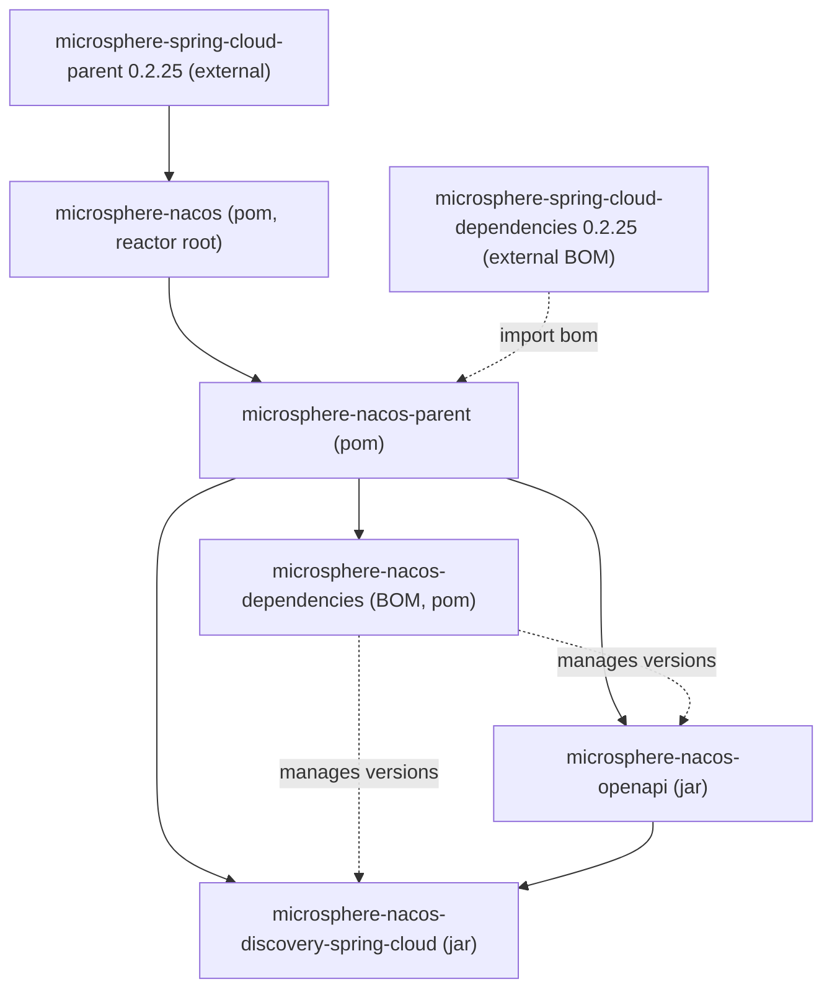

# microsphere-nacos-parent

`microsphere-nacos-parent` is the shared build parent (`packaging: pom`) for every other module in the
`microsphere-nacos` reactor. It is not a library you run; it centralizes dependency management so the jar modules
and the BOM agree on versions. It sits between the root aggregator POM and all built modules.

## Maven coordinates

```xml
<parent>
    <groupId>io.github.microsphere-projects</groupId>
    <artifactId>microsphere-nacos-parent</artifactId>
    <version>${revision}</version>
</parent>
```

In this line `${revision}` resolves to `0.2.0-SNAPSHOT`. The `microsphere-nacos-openapi`,
`microsphere-nacos-discovery-spring-cloud`, and `microsphere-nacos-dependencies` modules all declare this POM as
their parent.

## What it provides

### Version properties

| Property | Value |
| --- | --- |
| `httpclient.version` | `4.5.14` |
| `microsphere-spring-cloud.version` | `0.2.25` |

### Dependency management

The POM's `<dependencyManagement>` pins and imports exactly two entries:

| Managed item | Kind | Version |
| --- | --- | --- |
| `org.apache.httpcomponents:httpclient` | explicit entry | `${httpclient.version}` = `4.5.14` |
| `io.github.microsphere-projects:microsphere-spring-cloud-dependencies` | BOM (`pom`, `import` scope) | `${microsphere-spring-cloud.version}` = `0.2.25` |

The imported `microsphere-spring-cloud-dependencies` BOM is where the versions of Spring Boot, Spring Cloud, and the
other Microsphere modules (for example `microsphere-java-core`, `microsphere-annotation-processor`,
`microsphere-spring-cloud-commons`) come from. Those artifacts are referenced **without** versions in the child
POMs because they are governed by this import.

## Inheritance chain



Following the arrows: the root POM inherits the external `microsphere-spring-cloud-parent:0.2.25`; the reactor
declares `microsphere-nacos-parent`; that parent imports the external `microsphere-spring-cloud-dependencies:0.2.25`
BOM and adds `httpclient:4.5.14`; the BOM module and both jar modules inherit from `microsphere-nacos-parent`.

## Provenance note on `0.2.25`

The external Microsphere Spring Cloud version used by this line is **`0.2.25`**. The repository's default line uses
`0.2.26`; that single-line difference is the principal build-level distinction between this `release-1.x` snapshot
and the default line. Because `0.2.25` is an external artifact not vendored in this snapshot, the concrete Spring
Boot / Spring Cloud / compile-JDK versions it ultimately pins are **not verifiable from this repository** and are
not restated here.

## Version information and compatibility

| Item | Value | Provenance |
| --- | --- | --- |
| Own version | `${revision}` = `0.2.0-SNAPSHOT` | This POM |
| Parent aggregator | `microsphere-nacos` (`0.2.0-SNAPSHOT`) | `../pom.xml` |
| Imports | `microsphere-spring-cloud-dependencies:0.2.25` | This POM, `dependencyManagement` |
| Pins | `httpclient:4.5.14` | This POM, `dependencyManagement` |

As a build-time POM, `microsphere-nacos-parent` contributes no runtime code and therefore has no direct
compatibility range of its own; the compatibility of the jar modules it manages is described in the
[index](README.md) (CI matrix: Java `17`/`21`/`25`; `spring-cloud-2022` through `spring-cloud-2025` profiles).

## Related documents

- [Index](README.md)
- [microsphere-nacos-dependencies](microsphere-nacos-dependencies.md)
- [microsphere-nacos-openapi](microsphere-nacos-openapi.md)
- [microsphere-nacos-discovery-spring-cloud](microsphere-nacos-discovery-spring-cloud.md)
- Developer guide counterpart: [../../developer-guide/1.x/microsphere-nacos-parent.md](microsphere-nacos-parent.md)

## 中文

[中文](../zh/1.x/README.md)
