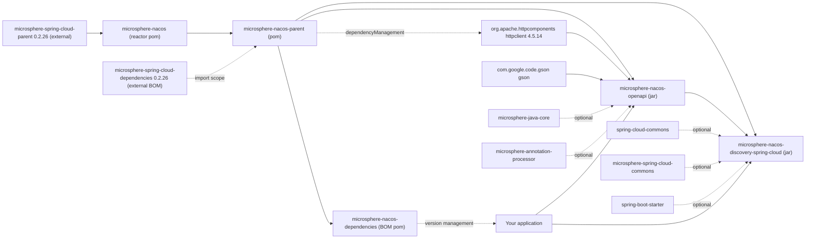

# Microsphere Nacos — User Guide (current)

This is the user guide for the **`release`** branch version line of `microsphere-nacos`, whose Maven revision is
**`0.2.0-SNAPSHOT`** and whose group identifier is `io.github.microsphere-projects`. Everything stated here was read
from a snapshot of that branch; where a fact cannot be established from the repository, its provenance is labelled
inline.

## What this library is

`microsphere-nacos` is a Java client for the **Nacos Open API** together with a Spring Cloud discovery adapter built
on top of it. It speaks plain HTTP through Apache HttpClient, serialises payloads with Gson, and models the Nacos
Open API surface as typed Java interfaces instead of exposing raw JSON.

Two Open API revisions are covered:

- **Open API V1** (`/v1`) — authentication, configuration management, naming (services and instances), namespaces,
  server operations, and RAFT.
- **Open API V2** (`/v2`) — the `/v2` endpoint family for configuration, naming and namespaces, plus the
  client-information sub-API (`/v2/ns/client`).

## Module index

The root reactor `io.github.microsphere-projects:microsphere-nacos` (`packaging: pom`) declares four modules:

| Guide | Artifact ID | Packaging | Use it when |
| --- | --- | --- | --- |
| [microsphere-nacos-openapi](microsphere-nacos-openapi.md) | `microsphere-nacos-openapi` | `jar` | You want a typed Nacos Open API client (V1 or V2) with no Spring dependency |
| [microsphere-nacos-discovery-spring-cloud](microsphere-nacos-discovery-spring-cloud.md) | `microsphere-nacos-discovery-spring-cloud` | `jar` | You want the Open API client exposed as a Spring Cloud `DiscoveryClient` |
| [microsphere-nacos-parent](microsphere-nacos-parent.md) | `microsphere-nacos-parent` | `pom` | You are building against this repository and want its managed dependency versions |
| [microsphere-nacos-dependencies](microsphere-nacos-dependencies.md) | `microsphere-nacos-dependencies` | `pom` | You are an application that imports this project as a BOM |

The root POM also lists `microsphere-nacos-spring` and `microsphere-nacos-spring-boot`, but both entries are
**commented out** in `<modules>`. They are not built and are not published from this branch; do not depend on them.

## Module and dependency graph



Reading the graph:

- The root POM **inherits** the external `microsphere-spring-cloud-parent:0.2.26`.
- `microsphere-nacos-parent` is the direct parent POM of `microsphere-nacos-dependencies`,
  `microsphere-nacos-openapi` and `microsphere-nacos-discovery-spring-cloud`. It pins
  `org.apache.httpcomponents:httpclient:4.5.14` and imports the external
  `microsphere-spring-cloud-dependencies:0.2.26` BOM.
- `microsphere-nacos-discovery-spring-cloud` depends on `microsphere-nacos-openapi` at `${revision}`.
- Dependencies marked `optional` in the module POMs are **not** transitive: Spring Boot, Spring Cloud and
  `microsphere-java-core` must be supplied by your application.

## Getting started

Add the BOM once, then depend on the modules without versions.

```xml
<dependencyManagement>
    <dependencies>
        <!-- Microsphere Nacos Dependencies (BOM) -->
        <dependency>
            <groupId>io.github.microsphere-projects</groupId>
            <artifactId>microsphere-nacos-dependencies</artifactId>
            <version>${microsphere-nacos.version}</version>
            <type>pom</type>
            <scope>import</scope>
        </dependency>
    </dependencies>
</dependencyManagement>

<dependencies>
    <!-- The typed Nacos Open API client -->
    <dependency>
        <groupId>io.github.microsphere-projects</groupId>
        <artifactId>microsphere-nacos-openapi</artifactId>
    </dependency>

    <!-- Only if you want the Spring Cloud DiscoveryClient adapter -->
    <dependency>
        <groupId>io.github.microsphere-projects</groupId>
        <artifactId>microsphere-nacos-discovery-spring-cloud</artifactId>
    </dependency>
</dependencies>
```

`${microsphere-nacos.version}` is `0.2.0-SNAPSHOT` on this version line. The repository's own `README.md` lists `0.2.0`
as the latest version of the `main` branch line, compatible with Spring Cloud 2022.0.x – 2025.0.x; that number is
quoted from the README and is not declared in any POM of this snapshot.

Because `httpclient` and `gson` are compile-scope dependencies of `microsphere-nacos-openapi`, they arrive
transitively. Everything else the optional flags hide has to be added yourself.

## Version information

| Item | Value | Provenance |
| --- | --- | --- |
| Branch documented here | `release` | Snapshot analysed for this guide |
| Directory version line | `current` | This directory |
| Group ID | `io.github.microsphere-projects` | Root and module POMs |
| Reactor artifact | `microsphere-nacos` (`pom`) | Root `pom.xml` |
| Reactor version | `${revision}` = `0.2.0-SNAPSHOT` | `<revision>` property in the root `pom.xml` |
| Module versions | `${revision}` (`0.2.0-SNAPSHOT`) | `microsphere-nacos-parent`, `-dependencies`, `-openapi`, `-discovery-spring-cloud` |
| External parent | `microsphere-spring-cloud-parent:0.2.26` | `<parent>` in the root `pom.xml` |
| Imported BOM | `microsphere-spring-cloud-dependencies:0.2.26` | `microsphere-nacos-parent/pom.xml` |
| Apache HttpClient | `4.5.14` | `<httpclient.version>` in `microsphere-nacos-parent/pom.xml` |
| Reactor `java.version` property | `17` | `<java.version>` in the root `pom.xml` |
| Maven wrapper | Apache Maven `3.9.16` | `.mvn/wrapper/maven-wrapper.properties` |
| Javadoc `@since` tags | `1.0.0` on most types | Module sources; a baseline marker, not the Maven revision |

**Provenance caveat.** The concrete Spring Boot version, the Spring Cloud version, the Gson version and the Java
language level used to compile are **inherited from the external parent/BOM, not declared in this repository**.
`microsphere-spring-cloud-parent` and `microsphere-spring-cloud-dependencies` are outside this snapshot and cannot be
read here, so no fixed number is stated for them anywhere in this guide.

## Compatibility range

`.github/workflows/maven-build.yml` defines the matrix the test suite actually runs on:

| Axis | Values tested in CI |
| --- | --- |
| Java | `17`, `21`, `25` |
| Spring Cloud profile | `spring-cloud-2022`, `spring-cloud-2023`, `spring-cloud-2024`, `spring-cloud-2025` |

The build step runs `mvn test --activate-profiles test,coverage,<spring-cloud profile>` with `-Drevision=0.0.1-SNAPSHOT`.
That revision override is CI-only and does not change the `0.2.0-SNAPSHOT` version declared in the POMs.

Publishing is handled by `.github/workflows/maven-publish.yml`, which triggers on pushes to `release` and on a manual
`workflow_dispatch` input validated against the `major.minor.patch` pattern, then deploys with the `publish,ci`
profiles and tags the released revision.

**Test environment caveat.** Both workflows create the Nacos server with
`docker compose -f "docker/test-services.yml" up -d`. The referenced `docker/test-services.yml` file is **not present
in this snapshot**, so the Nacos server image, version and seed configuration used by the tests could not be verified
and are deliberately not stated. The tests themselves read the server address from the Java system property or
environment variable `SERVER_ADDRESS` and fail fast when it is unset.

### Nacos Open API endpoint coverage

- **V1** — `/v1/auth/login`; configuration `/v1/cs/configs`, `/v1/cs/configs/listener`, `/v1/cs/history`,
  `/v1/cs/history/previous`; naming `/v1/ns/service`, `/v1/ns/service/list`, `/v1/ns/instance`,
  `/v1/ns/instance/list`, `/v1/ns/instance/beat`, `/v1/ns/instance/metadata/batch`, `/v1/ns/health/instance`;
  namespace `/v1/console/namespaces`; server `/v1/console/server/state`, `/v1/ns/operator/switches`,
  `/v1/ns/operator/metrics`, `/v1/ns/operator/servers`; RAFT `/v1/ns/raft/leader`.
- **V2** — configuration `/v2/cs/config`, `/v2/cs/history/list`; naming `/v2/ns/service`, `/v2/ns/instance` and their
  sub-paths; namespace `/v2/console/namespace`, `/v2/console/namespace/list`; client API `/v2/ns/client` with `/list`,
  `/publish/list`, `/subscribe/list`, `/service/publisher/list` and `/service/subscriber/list`. The V2 config client
  still borrows the V1 `/v1/cs/configs` detail endpoint because the V2 API offers no equivalent, and the V2
  authentication and server/RAFT operations remain V1-only.

Method-level detail lives in the module guide: [microsphere-nacos-openapi](microsphere-nacos-openapi.md).

## Documentation map

- Developer guide counterpart for this line: [developer-guide/current](../../developer-guide/current/README.md)
- [Docs home](../../README.md)
- [Repository README](../../../README.md)

## 中文

[中文](../zh/current/README.md)
