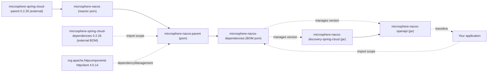

# microsphere-nacos-dependencies

## Overview

`microsphere-nacos-dependencies` is this project's **Bill of Materials** — a `<packaging>pom</packaging>` module with
no sources, whose only content is a `<dependencyManagement>` block pinning the two published artifacts of the
repository. It exists so that applications depend on Nacos modules **without writing versions**.

Use it as the single place where `microsphere-nacos-openapi` and `microsphere-nacos-discovery-spring-cloud` get their
version. This is the artifact the repository's own `README.md` points new users at as "the easiest way to get started",
and it is the only module here that an application should reference directly.

If you are a *library* author who wants this project's third-party version pinning (`httpclient`, the Microsphere
Spring Cloud BOM) rather than just its own artifact coordinates, use
[microsphere-nacos-parent](microsphere-nacos-parent.md) as a parent POM — an import-scope BOM does not give you
parenting.

## Maven coordinates and import

```xml
<dependencyManagement>
    <dependencies>
        <dependency>
            <groupId>io.github.microsphere-projects</groupId>
            <artifactId>microsphere-nacos-dependencies</artifactId>
            <version>${microsphere-nacos.version}</version>
            <type>pom</type>
            <scope>import</scope>
        </dependency>
    </dependencies>
</dependencyManagement>
```

Then declare the modules with no `<version>`:

```xml
<dependencies>
    <dependency>
        <groupId>io.github.microsphere-projects</groupId>
        <artifactId>microsphere-nacos-openapi</artifactId>
    </dependency>

    <dependency>
        <groupId>io.github.microsphere-projects</groupId>
        <artifactId>microsphere-nacos-discovery-spring-cloud</artifactId>
    </dependency>
</dependencies>
```

Set the property in your root POM:

```xml
<properties>
    <microsphere-nacos.version>0.2.0-SNAPSHOT</microsphere-nacos.version>
</properties>
```

`${microsphere-nacos.version}` is not a property defined anywhere in this repository — it is the conventional name used
by the project's own README, which you define on your side. On this version line it should be `0.2.0-SNAPSHOT`.

## Managed artifacts

The BOM's own `<dependencyManagement>` contains exactly two entries:

| Group ID | Artifact ID | Managed version | Packaging |
| --- | --- | --- | --- |
| `io.github.microsphere-projects` | `microsphere-nacos-openapi` | `${revision}` → `0.2.0-SNAPSHOT` | `jar` |
| `io.github.microsphere-projects` | `microsphere-nacos-discovery-spring-cloud` | `${revision}` → `0.2.0-SNAPSHOT` | `jar` |

`microsphere-nacos-spring` and `microsphere-nacos-spring-boot` are **not** managed, because those reactor entries are
commented out in the root POM and the artifacts are not produced.

### What else the import brings

The BOM's parent is `microsphere-nacos-parent`, and Maven computes an imported BOM's managed set from its
**effective** POM. In practice that means importing `microsphere-nacos-dependencies` also surfaces, in your
`dependencyManagement`:

| Origin in the effective POM | Artifacts it contributes |
| --- | --- |
| `microsphere-nacos-dependencies` itself | `microsphere-nacos-openapi`, `microsphere-nacos-discovery-spring-cloud` |
| `microsphere-nacos-parent` (its parent) | `org.apache.httpcomponents:httpclient:4.5.14` |
| `microsphere-spring-cloud-dependencies:0.2.26` (imported by that parent) | the Spring Boot / Spring Cloud / Microsphere Spring Cloud artifacts and their versions |

Treat the third row as a **provenance caveat**: the concrete versions inside
`microsphere-spring-cloud-dependencies` are **inherited from the external parent/BOM, not declared in this
repository**, and that external BOM is not part of the analysed snapshot, so no member of it can be listed here with a
verified number. Only the import coordinate `0.2.26` is verifiable, from `microsphere-nacos-parent/pom.xml`.

## Using it alongside other BOMs

Import order matters in Maven: for a duplicate managed coordinate, the **first** imported BOM wins. If your
application already imports `spring-boot-dependencies` or `spring-cloud-dependencies`, put this BOM before or after
them deliberately, and note that `microsphere-nacos-dependencies` transitively contributes Microsphere's own Spring
version management as described above.

## Version information

| Item | Value | Provenance |
| --- | --- | --- |
| Module artifact | `io.github.microsphere-projects:microsphere-nacos-dependencies` | Module `pom.xml` |
| Module version | `${revision}` → `0.2.0-SNAPSHOT` | Root `pom.xml` `<revision>` property |
| Packaging | `pom` | Module `pom.xml` |
| Parent | `microsphere-nacos-parent` `${revision}` via `../microsphere-nacos-parent/pom.xml` | Module `pom.xml` |
| `<name>` | `Microsphere :: Nacos :: Dependencies` | Module `pom.xml` |
| Managed artifacts | the two jar modules at `${revision}` | Module `pom.xml` |
| Publishing | released by `.github/workflows/maven-publish.yml`, which deploys from `release` with a `major.minor.patch` revision and profiles `publish,ci` | Workflow file; the snapshot itself carries only `0.2.0-SNAPSHOT` |

## Compatibility

The BOM is a version-pinning artifact, so it is not itself compiled against a JDK. Its practical compatibility is the
union of what it pins, which CI exercises on Java `17`, `21`, `25` across the `spring-cloud-2022`,
`spring-cloud-2023`, `spring-cloud-2024` and `spring-cloud-2025` profiles
(`.github/workflows/maven-build.yml`). The Spring releases behind those profiles come from the external
`microsphere-spring-cloud-dependencies:0.2.26` import and are not verifiable from this snapshot.

## Module dependency diagram



## Related documents

- [Index](README.md)
- [microsphere-nacos-openapi](microsphere-nacos-openapi.md)
- [microsphere-nacos-discovery-spring-cloud](microsphere-nacos-discovery-spring-cloud.md)
- [microsphere-nacos-parent](microsphere-nacos-parent.md)
- Developer guide counterpart: [../../developer-guide/current/microsphere-nacos-dependencies.md](microsphere-nacos-dependencies.md)

## 中文

[中文](../zh/current/README.md)
