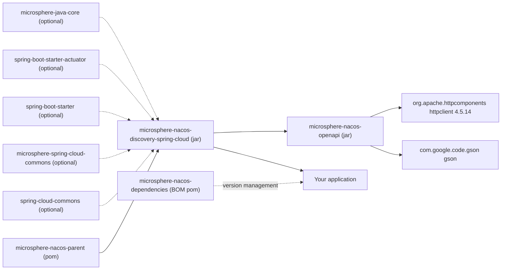

# microsphere-nacos-discovery-spring-cloud

## Overview

`microsphere-nacos-discovery-spring-cloud` adapts the typed Nacos Open API client to the Spring Cloud service
discovery abstraction. Its centre of gravity is one class, `NacosDiscoveryClient`, which implements
`org.springframework.cloud.client.discovery.DiscoveryClient`, and one properties class, `NacosClientProperties`,
which turns `microsphere.nacos.client.*` configuration into a `NacosClientConfig`.

Choose this module when you:

- want Nacos-backed discovery inside a Spring Cloud application using the standard `DiscoveryClient` contract
  (`getServices()`, `getInstances(serviceId)`), without pulling in a vendor starter;
- need a `ServiceInstance` view of Nacos instances that `LoadBalancer`-style client code can consume;
- want several Nacos clusters in one JVM, addressed by name under `microsphere.nacos.clients.<name>.*`;
- are happy with **read-side discovery only**. The module contains no `ServiceRegistry` implementation, so it does not
  register or deregister the application itself — instances must already exist in Nacos, for example registered
  through [microsphere-nacos-openapi](microsphere-nacos-openapi.md) `InstanceClient` calls.

If you do not need Spring at all, depend on `microsphere-nacos-openapi` directly.

## Maven coordinates

```xml
<dependencyManagement>
    <dependencies>
        <dependency>
            <groupId>io.github.microsphere-projects</groupId>
            <artifactId>microsphere-nacos-dependencies</artifactId>
            <version>${microsphere-nacos.version}</version>
            <type>pom</type>
            <scope>import</scope>
        </dependency>
    </dependencies>
</dependencyManagement>

<dependencies>
    <dependency>
        <groupId>io.github.microsphere-projects</groupId>
        <artifactId>microsphere-nacos-discovery-spring-cloud</artifactId>
    </dependency>
</dependencies>
```

The artifact is `io.github.microsphere-projects:microsphere-nacos-discovery-spring-cloud:${revision}` —
`0.2.0-SNAPSHOT` on this version line.

**You must supply the Spring side yourself.** In this module's POM, Spring Boot, Spring Cloud and
`microsphere-spring-cloud-commons` are declared `<optional>`, so they do not travel to your application. Only
`microsphere-nacos-openapi` (at `${revision}`) is a real transitive dependency, and through it `httpclient` and `gson`.

| Dependency | Scope in this POM | Effect for you |
| --- | --- | --- |
| `io.github.microsphere-projects:microsphere-nacos-openapi` | compile | transitive; brings the Open API client, `httpclient`, `gson` |
| `org.springframework.cloud:spring-cloud-commons` | optional | **add explicitly** — provides `DiscoveryClient` and `ServiceInstance` |
| `org.springframework.boot:spring-boot-starter` | optional | **add explicitly** — required for auto-configuration |
| `org.springframework.boot:spring-boot-starter-actuator` | optional | add if you want the discovery health indicator / endpoints |
| `io.github.microsphere-projects:microsphere-spring-cloud-commons` | optional | the only Microsphere Spring artifact declared here; the `@ConditionalOnPropertyPrefix` annotation used by the auto-configuration is imported from `io.microsphere.spring.boot.condition`, and the POM does not identify which artifact supplies it |
| `io.github.microsphere-projects:microsphere-java-core` | optional | utility layer |
| `io.github.microsphere-projects:microsphere-annotation-processor` | optional | build-time only |
| `spring-boot-configuration-processor`, `spring-boot-autoconfigure-processor` | optional | build-time metadata generation |
| `junit-jupiter`, `spring-boot-starter-test`, `microsphere-spring-boot-test`, `logback-classic` | test | not published to consumers |

Versions for every Spring and Microsphere artifact above are **inherited from the external parent/BOM, not declared in
this repository** — see [microsphere-nacos-parent](microsphere-nacos-parent.md).

## Auto-configuration

`src/main/resources/META-INF/spring/org.springframework.boot.autoconfigure.AutoConfiguration.imports` registers two
classes:

```
io.microsphere.nacos.client.spring.boot.autoconfigure.NacosClientAutoConfiguration
io.microsphere.nacos.client.discovery.spring.cloud.autoconfigure.NacosDiscoveryAutoConfiguration
```

| Class | Conditional | Imports / declares |
| --- | --- | --- |
| `NacosClientAutoConfiguration` | `@ConditionalOnPropertyPrefix(NacosClientProperties.PREFIX)` — activates only when at least one `microsphere.nacos.client.*` property exists | `@EnableConfigurationProperties(NacosClientProperties.class)` and `@Import(NacosClientConfiguration.class)` |
| `NacosClientConfiguration` | plain `@Configuration(proxyBeanMethods = false)` | `@Bean(destroyMethod = "close") OpenApiHttpClient openApiHttpClient(NacosClientConfig)` |
| `NacosDiscoveryConfiguration` | plain `@Configuration(proxyBeanMethods = false)` | `@EnableConfigurationProperties(NacosClientProperties.class)`, imports `NacosClientConfiguration`, declares `@Bean NacosDiscoveryClient nacosDiscoveryClient(OpenApiHttpClient, NacosClientProperties)` |
| `NacosDiscoveryAutoConfiguration` | unconditional | imports `NacosDiscoveryConfiguration` and the nested `Multiple` class |
| `NacosDiscoveryAutoConfiguration.Multiple` | `@ConditionalOnProperty(prefix = "microsphere.nacos.clients.")` | `@Bean NacosDiscoveryContextFactory nacosDiscoveryContextFactory(ConfigurableApplicationContext)` |

Because the whole stack is gated on `microsphere.nacos.client.*` being present, an application that defines none of
those keys gets no Nacos beans at all.

## Configuration properties

`NacosClientProperties` is annotated `@ConfigurationProperties(prefix = NacosClientProperties.PREFIX)` where
`PREFIX = Constants.PROPERTY_NAME_PREFIX = "microsphere.nacos.client."`. It **extends `NacosClientConfig`**, so every
client setting is bindable, and it adds one nested `Discovery` group. Keys below are the canonical kebab-case forms
derived from the JavaBean accessors; the defaults are the `NacosClientConfig` field defaults.

| Property key | Type | Default | Purpose |
| --- | --- | --- | --- |
| `microsphere.nacos.client.name` | `String` | `null` | Client identifier; also the property name read by `NacosDiscoveryContextFactory` |
| `microsphere.nacos.client.application-name` | `String` | `microsphere-nacos-client` (overridable via the `microsphere.nacos.client.app-name` system property) | Application name sent with requests |
| `microsphere.nacos.client.server-address` | `String` | `null` — **must be set** | `host:port` of the Nacos server |
| `microsphere.nacos.client.scheme` | `String` | `http` | URL scheme prefix |
| `microsphere.nacos.client.context-path` | `String` | `/nacos` | Context path prefix |
| `microsphere.nacos.client.user-name` | `String` | `null` | With `password`, enables authorization |
| `microsphere.nacos.client.password` | `String` | `null` | With `user-name`, enables authorization |
| `microsphere.nacos.client.access-key` | `String` | `null` | Namespace access key |
| `microsphere.nacos.client.secret-key` | `String` | `null` | Namespace secret key |
| `microsphere.nacos.client.max-connections` | `int` | `1000` | HttpClient pool total |
| `microsphere.nacos.client.max-per-route` | `int` | `200` | HttpClient pool per route |
| `microsphere.nacos.client.connection-timeout` | `int` | `60000` | Milliseconds |
| `microsphere.nacos.client.read-timeout` | `int` | `180000` | Milliseconds |
| `microsphere.nacos.client.long-polling-timeout` | `int` | `30000` | Milliseconds |
| `microsphere.nacos.client.event-processing-timeout` | `int` | `30000000` | Raw int from `Constants`; see the caveat in the Open API guide |
| `microsphere.nacos.client.fetching-config-thread-name` | `String` | `Nacos Client - Fetching Config Executor` | |
| `microsphere.nacos.client.listener-config-thread-name` | `String` | `Nacos Client - Listening Config Scheduler` | |
| `microsphere.nacos.client.publishing-config-event-thread-name` | `String` | `Nacos Client - Config Event Publisher` | |
| `microsphere.nacos.client.encoding` | `String` | `UTF-8` | |
| `microsphere.nacos.client.discovery.namespace-id` | `String` | `null` | The namespace `NacosDiscoveryClient` queries; when unset it is passed through to the Open API client as-is |

Two naming cautions, both verified from source:

- The configuration-property names differ slightly from the JVM **system**-property names used by
  `io.microsphere.nacos.client.constants.Constants` (for example `max-per-route` as a bean property versus
  `microsphere.nacos.client.max-per-route-connections` as a system property).
- `Constants.PROPERTY_NAME_PREFIX` ends with a dot and is reused verbatim as the `@ConfigurationProperties` prefix.

## API reference

### NacosDiscoveryClient

`io.microsphere.nacos.client.discovery.spring.cloud.NacosDiscoveryClient implements DiscoveryClient`.

```java
public NacosDiscoveryClient(OpenApiHttpClient openApiHttpClient, NacosClientProperties nacosClientProperties)
```

Internally it builds `OpenApiServiceClient` and `OpenApiInstanceClient` — that is, the **Open API V1** naming clients —
over the shared transport, and caches `nacosClientProperties.getDiscovery().getNamespaceId()`.

| Method | Behaviour |
| --- | --- |
| `String description()` | Returns the literal `"DiscoveryClient - Nacos"` |
| `List<ServiceInstance> getInstances(String serviceId)` | `instanceClient.getInstancesList(namespaceId, serviceId)`, then maps `InstancesList#getHosts()` to `NacosServiceInstance` |
| `List<String> getServices()` | Pages through `serviceClient.getServiceNames(namespaceId, pageNumber)` while `hasNext()` is true and concatenates `Page#getElements()` |

`getServices()` walks the pages by calling `getServiceNames(namespaceId, pageNumber)`; the page index it advances with
is read from `getPageSize()` in the loop, so very large registries are worth validating against your own data set.

### NacosServiceInstance

`io.microsphere.nacos.client.discovery.spring.cloud.NacosServiceInstance implements ServiceInstance`, wrapping a Nacos
`Instance` (expose it with `getInstance()`).

| `ServiceInstance` method | Source |
| --- | --- |
| `getInstanceId()` | `Instance#getInstanceId()` |
| `getServiceId()` | `Instance#getService()` |
| `getHost()` | `Instance#getIp()` |
| `getPort()` | `Instance#getPort()` |
| `isSecure()` | hard-coded `false` |
| `getScheme()` | hard-coded `"http"` |
| `getUri()` | `DefaultServiceInstance.getUri(this)` |
| `getMetadata()` | `Instance#getMetadata()` |

### Multiple named clients

`NacosDiscoveryContextFactory extends NamedContextFactory<NacosDiscoverySpecification>` is constructed with
`super(NacosDiscoveryConfiguration.class, "nacos-discovery", NacosClientProperties.PREFIX + "name")` and the parent
`ConfigurableApplicationContext`. For each client name it builds a child context and inserts a `MapPropertySource`
holding the sub-properties of `microsphere.nacos.clients.<name>.`, added after the `nacos-discovery` source.

`NacosClientUtils` supplies the plumbing:

| Member | Value / behaviour |
| --- | --- |
| `NACOS_CLIENTS_PROPERTY_NAME_PREFIX` | `"microsphere.nacos.clients."` |
| `buildNacosClientPropertyNamePrefix(String nacosClientName)` | prefix + name + `"."` |
| `getNacosClientProperties(ConfigurableEnvironment, String nacosClientName)` | strips the prefix via `PropertySourcesUtils.getSubProperties` |
| `getNacosCilentPropertySource(ConfigurableEnvironment, String nacosClientName)` | wraps the above in a `MapPropertySource` named after the client (method name is spelled `getNacosCilentPropertySource` in source) |

`NacosDiscoverySpecification` is the ordinary `NamedContextFactory.Specification` pair of `name` and `Class<?>[]
configuration`, usable with `NacosDiscoverySpecification(String name, Class<?>... configuration)`.

Note the two distinct prefixes: the **singular** `microsphere.nacos.client.` drives the default client, and the
**plural** `microsphere.nacos.clients.` drives named child contexts.

## Code examples

This module ships no `src/test` sources in the analysed snapshot, so the examples below are minimal usages assembled
strictly from the real class signatures and the auto-configuration metadata listed above rather than copied from
tests.

### Spring Boot application using discovery

```yaml
spring:
  application:
    name: demo-service

microsphere:
  nacos:
    client:
      server-address: 127.0.0.1:8848
      user-name: nacos
      password: nacos
      discovery:
        namespace-id: public
```

```java
@SpringBootApplication
@RestController
public class DemoApplication {

    private final DiscoveryClient discoveryClient;

    public DemoApplication(DiscoveryClient discoveryClient) {
        this.discoveryClient = discoveryClient;
    }

    @GetMapping("/services")
    public List<String> services() {
        return discoveryClient.getServices();
    }

    @GetMapping("/instances/{serviceId}")
    public List<ServiceInstance> instances(@PathVariable String serviceId) {
        return discoveryClient.getInstances(serviceId);
    }

    public static void main(String[] args) {
        SpringApplication.run(DemoApplication.class, args);
    }
}
```

`discoveryClient` resolves to the `nacosDiscoveryClient` bean whenever only one `DiscoveryClient` is on the classpath;
if you also register another implementation, inject it by name.

### Wiring the beans without auto-configuration

The same object graph, built explicitly with the constructors as they are declared:

```java
@Configuration(proxyBeanMethods = false)
public class NacosDiscoveryConfig {

    @Bean
    public NacosClientProperties nacosClientProperties() {
        NacosClientProperties properties = new NacosClientProperties();
        properties.setServerAddress("127.0.0.1:8848");
        properties.setUserName("nacos");
        properties.setPassword("nacos");
        properties.getDiscovery().setNamespaceId("public");
        return properties;
    }

    @Bean(destroyMethod = "close")
    public OpenApiHttpClient openApiHttpClient(NacosClientProperties properties) {
        return new OpenApiHttpClient(properties);
    }

    @Bean
    public NacosDiscoveryClient nacosDiscoveryClient(OpenApiHttpClient openApiHttpClient,
                                                     NacosClientProperties properties) {
        return new NacosDiscoveryClient(openApiHttpClient, properties);
    }
}
```

`NacosClientProperties extends NacosClientConfig`, which is why one object satisfies both the properties and the
client-config parameters.

### Per-client Nacos clusters

```yaml
microsphere:
  nacos:
    client:
      server-address: 127.0.0.1:8848
    clients:
      berlin:
        server-address: 10.0.0.1:8848
      tokyo:
        server-address: 10.0.0.2:8848
```

```java
@Bean
public NacosDiscoveryContextFactory nacosDiscoveryContextFactory(ConfigurableApplicationContext parentContext) {
    return new NacosDiscoveryContextFactory(parentContext);
}

// later
NacosDiscoveryClient berlin = contextFactory.getContext("berlin").getBean(NacosDiscoveryClient.class);
```

Defining any `microsphere.nacos.clients.*` key is what activates `NacosDiscoveryAutoConfiguration.Multiple` and hence
the `nacosDiscoveryContextFactory` bean.

## Version information

| Item | Value | Provenance |
| --- | --- | --- |
| Module artifact | `io.github.microsphere-projects:microsphere-nacos-discovery-spring-cloud` | Module `pom.xml` |
| Module version | `${revision}` → `0.2.0-SNAPSHOT` | `<revision>` in the root `pom.xml` |
| Packaging | `jar` | Module `pom.xml` |
| Parent | `microsphere-nacos-parent` via `../microsphere-nacos-parent/pom.xml` | Module `pom.xml` |
| `microsphere-nacos-openapi` dependency | `${revision}` (`0.2.0-SNAPSHOT`) | Declared with an explicit version in the module POM |
| Spring Boot / Spring Cloud / microsphere-spring-cloud-commons versions | not stated | Inherited from the external parent/BOM, not declared in this repository |
| Javadoc `@since` | `1.0.0` | Source comments; a baseline marker, not the Maven revision |

## Compatibility

`.github/workflows/maven-build.yml` builds this module on Java `17`, `21`, `25` against the `spring-cloud-2022`,
`spring-cloud-2023`, `spring-cloud-2024` and `spring-cloud-2025` profiles. Those profile names are verified from the
workflow matrix; the concrete Spring Boot and Spring Cloud releases behind each profile are **inherited from the
external parent/BOM, not declared in this repository**, so no version numbers are asserted here.

Spring Cloud `DiscoveryClient` and `ServiceInstance` are stable abstractions across the profiled generations, which is
why the module compiles against `spring-cloud-commons` only as an optional dependency.

On the server side, `NacosDiscoveryClient` uses the **Open API V1** naming endpoints
(`/v1/ns/service/list` for `getServices()` and `/v1/ns/instance/list` for `getInstances()`), independent of the V2
support available in the Open API module. The module has no tests of its own in this snapshot, and CI provides the
Nacos server through `docker/test-services.yml`, a file that is **not present in the analysed snapshot**, so the
server version exercised against this module cannot be verified.

## Module dependency diagram



## Related documents

- [Index](README.md)
- [microsphere-nacos-openapi](microsphere-nacos-openapi.md)
- [microsphere-nacos-parent](microsphere-nacos-parent.md)
- [microsphere-nacos-dependencies](microsphere-nacos-dependencies.md)
- Developer guide counterpart: [../../developer-guide/current/microsphere-nacos-discovery-spring-cloud.md](microsphere-nacos-discovery-spring-cloud.md)

## 中文

[中文](../zh/current/README.md)
