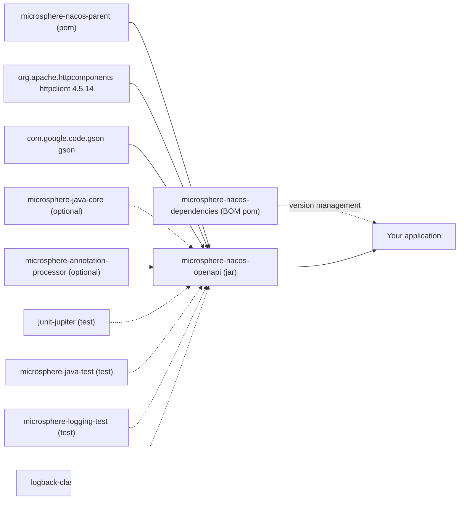

# microsphere-nacos-openapi

## Overview

`microsphere-nacos-openapi` is a typed Java client for the **Nacos Open API**. It has no Spring dependency at
runtime: it is a plain HTTP client (Apache HttpClient) plus a Gson-based mapping layer, and it models every Open API
capability as a small Java interface (`ConfigClient`, `InstanceClient`, `ServiceClient`, `NamespaceClient`,
`AuthenticationClient`, `ServerClient`, `RaftClient`) with one implementation family per Open API revision.

Choose this module when you:

- need to read or publish Nacos configuration, or register and query services/instances, from ordinary Java code, a
  batch job, or a framework other than Spring Cloud;
- want the V1 **and** V2 Open API surfaces behind one consistent, checked exception-free API (`NacosClientException`
  and `OpenApiClientException` are unchecked);
- want to drive Nacos admin operations (namespaces, server state, switches, metrics, RAFT leader) rather than only
  the data plane;
- want an integration point for your own transport or serializer — `OpenApiClient`, `Serializer` and `Deserializer`
  are extension interfaces, and deserializers are located through `ServiceLoader`.

If instead you want Nacos to appear as a Spring Cloud `DiscoveryClient`, add
[microsphere-nacos-discovery-spring-cloud](microsphere-nacos-discovery-spring-cloud.md), which depends on this module.

## Maven coordinates

```xml
<dependencyManagement>
    <dependencies>
        <dependency>
            <groupId>io.github.microsphere-projects</groupId>
            <artifactId>microsphere-nacos-dependencies</artifactId>
            <version>${microsphere-nacos.version}</version>
            <type>pom</type>
            <scope>import</scope>
        </dependency>
    </dependencies>
</dependencyManagement>

<dependencies>
    <dependency>
        <groupId>io.github.microsphere-projects</groupId>
        <artifactId>microsphere-nacos-openapi</artifactId>
    </dependency>
</dependencies>
```

The artifact is `io.github.microsphere-projects:microsphere-nacos-openapi:${revision}` — `0.2.0-SNAPSHOT` on this
version line. Its POM declares no version literals: every version comes from `microsphere-nacos-parent`.

Compile-scope dependencies that reach your application transitively:

| Dependency | Scope | Version provenance |
| --- | --- | --- |
| `org.apache.httpcomponents:httpclient` | compile | `4.5.14`, managed by `microsphere-nacos-parent/pom.xml` |
| `com.google.code.gson:gson` | compile | inherited from the external parent/BOM, not declared in this repository |

Marked `optional` in the POM, therefore **not** transitive:

| Dependency | Why it is optional |
| --- | --- |
| `io.github.microsphere-projects:microsphere-java-core` | utility layer; the client compiles against it but you may already provide it |
| `io.github.microsphere-projects:microsphere-annotation-processor` | build-time annotation processor only |

Test-scope dependencies: `org.junit.jupiter:junit-jupiter`, `io.github.microsphere-projects:microsphere-java-test`,
`io.github.microsphere-projects:microsphere-logging-test`, `ch.qos.logback:logback-classic`.

## Package layout

```
io.microsphere.nacos.client
├── Client / AbstractClient / NacosClientConfig / OpenApiVersion / ErrorCode / NacosClientException
├── common          shared capability interfaces: auth, config, discovery, namespace, model
├── http            HttpMethod
├── io              Serializer / Deserializer / GsonDeserializer and exceptions
├── transport       OpenApiClient / AbstractOpenApiClient / OpenApiHttpClient / request, response, params, headers
├── util            internal helpers (JsonUtils, StringUtils, IOUtils, OpenApiUtils, ErrorCodeControl, ...)
├── constants       Constants
├── v1              NacosClient / OpenApiNacosClient + v1 config, discovery, namespace, server, raft
└── v2              NacosClientV2 / OpenApiNacosClientV2 + v2 client, config, discovery, namespace
```

## API reference

### NacosClientConfig

`NacosClientConfig` (`io.microsphere.nacos.client.NacosClientConfig`) is the single mutable configuration object
passed to every client. It implements `Serializable` and defines `equals`/`hashCode`/`toString`.

| Property | Setter | Type | Default | Notes |
| --- | --- | --- | --- | --- |
| `name` | `setName` | `String` | `null` | Identifies the client; used by the Spring Cloud module for multi-client contexts |
| `applicationName` | `setApplicationName` | `String` | `APPLICATION_NAME` | Resolved from system property `microsphere.nacos.client.app-name`, else `microsphere-nacos-client` |
| `serverAddress` | `setServerAddress` | `String` | `null` | `host:port`; may already contain a scheme, which is detected before prepending |
| `scheme` | `setScheme` | `String` | `http` | Prepended as `scheme://` when `serverAddress` lacks it |
| `contextPath` | `setContextPath` | `String` | `/nacos` | Appended to the root path before every endpoint |
| `userName` | `setUserName` | `String` | `null` | Authorization is enabled only when both user name and password are set |
| `password` | `setPassword` | `String` | `null` | Same as above |
| `accessKey` | `setAccessKey` | `String` | `null` | Namespace-level access key; carried by the config model |
| `secretKey` | `setSecretKey` | `String` | `null` | Namespace-level secret key |
| `maxConnections` | `setMaxConnections` | `int` | `1000` | Total connections in the Apache HttpClient pool |
| `maxPerRoute` | `setMaxPerRoute` | `int` | `200` | Max connections per route |
| `connectionTimeout` | `setConnectionTimeout` | `int` | `60000` | Milliseconds; also used as the connection-request timeout |
| `readTimeout` | `setReadTimeout` | `int` | `180000` | Milliseconds; maps to the socket timeout |
| `longPollingTimeout` | `setLongPollingTimeout` | `int` | `30000` | Milliseconds; sent as the `Long-Pulling-Timeout` header on config listens |
| `eventProcessingTimeout` | `setEventProcessingTimeout` | `int` | `30000000` | Constant is built with `SECONDS.toMicros(30)`, so the default is 30 000 000; read it as a raw int, not as milliseconds |
| `fetchingConfigThreadName` | `setFetchingConfigThreadName` | `String` | `Nacos Client - Fetching Config Executor` | |
| `listenerConfigThreadName` | `setListenerConfigThreadName` | `String` | `Nacos Client - Listening Config Scheduler` | |
| `publishingConfigEventThreadName` | `setPublishingConfigEventThreadName` | `String` | `Nacos Client - Config Event Publisher` | |
| `encoding` | `setEncoding` | `String` | `UTF-8` | Used for query-parameter encoding and response reading |
| — | — | — | — | `isAuthorizationEnabled()` returns `true` only when `userName` and `password` are both non-null |

Every default above is read from a JVM system property first. The property names come from
`io.microsphere.nacos.client.constants.Constants`, all under the prefix `microsphere.nacos.client.`:

| System property | Constant | Fallback |
| --- | --- | --- |
| `microsphere.nacos.client.app-name` | `APPLICATION_NAME` | `microsphere-nacos-client` |
| `microsphere.nacos.client.max-connections` | `MAX_CONNECTIONS` | `1000` |
| `microsphere.nacos.client.max-per-route-connections` | `MAX_PER_ROUTE_CONNECTIONS` | `200` |
| `microsphere.nacos.client.connection-timeout` | `CONNECTION_TIMEOUT` | `60000` |
| `microsphere.nacos.client.read-timeout` | `READ_TIMEOUT` | `180000` |
| `microsphere.nacos.client.long-polling-timeout` | `LONG_POLLING_TIMEOUT` | `30000` |
| `microsphere.nacos.client.event-processing-timeout` | `EVENT_PROCESSING_TIMEOUT` | `30000000` |
| `microsphere.nacos.client.encoding` | `ENCODING` | `UTF-8` |
| `microsphere.nacos.client.page-number` | `PAGE_NUMBER` | `1` |
| `microsphere.nacos.client.page-size` | `PAGE_SIZE` | `10` |

Other constants worth knowing: `DEFAULT_NAMESPACE_ID = "public"`, `DEFAULT_GROUP_NAME = "DEFAULT_GROUP"`,
`DEFAULT_CLUSTER_NAME = "DEFAULT"`, `DEFAULT_HEALTHY_ONLY = false`, `GROUP_SERVICE_NAME_SEPARATOR = "@@"`,
and `ConfigClient.DEFAULT_PAGE_SIZE = 100` / `ConfigClient.MAX_PAGE_SIZE = 500`.

### OpenApiVersion

`OpenApiVersion` is an enum of `V1` (`"/v1"`) and `V2` (`"/v2"`), with `getEndpointPath()` and the reverse lookup
`getVersion(String endpoint)`. Domain clients build their URLs as `getEndpointPath() + RESOURCE_PATH`, so overriding
`getOpenApiVersion()` in a subclass is what moves a client from one API revision to the other.

### Transport layer

| Type | Role |
| --- | --- |
| `OpenApiClient` | `AutoCloseable` SPI: `execute(OpenApiRequest)`, `execute(OpenApiRequest, Type)`, `executeAsResult(OpenApiRequest, Type)`, `getSerializer()`, `getDeserializer()`, `getEncoding()` |
| `AbstractOpenApiClient` | Implements `execute`/`executeAsResult`, injects the `accessToken` query parameter from `getAccessToken()`, unwraps `Result<T>` envelopes, and converts non-200 responses into `OpenApiClientException` with an `ErrorCode`. Subclasses implement `doExecute` and `getAccessToken` |
| `OpenApiHttpClient` | The concrete transport: a pooled `CloseableHttpClient` (`PoolingHttpClientConnectionManager` with `maxConnections`/`maxPerRoute`, `RequestConfig` with the configured timeouts, `useSystemProperties()`), URL assembly from `scheme://serverAddress + contextPath + endpoint`, header application, and `ServiceLoader` lookup of `Serializer`/`Deserializer`. `close()` shuts the client down |
| `OpenApiRequest` | Immutable value object: `getEndpoint()`, `getMethod()`, `getQueryParameters()`, `getHeaders()` |
| `OpenApiRequest.Builder` | `Builder.create(String endpoint)`, `Builder.from(OpenApiRequest)`, `method(HttpMethod)`, `queryParameter(OpenApiRequestParam, …)`, `removeParameter(s)`, `header(OpenApiRequestHeader, …)`, `build()` |
| `OpenApiRequestParam` / `OpenApiRequestHeader` | Enumerated wire names, e.g. `USER_NAME("username")`, `PASSWORD("password")`, `ACCESS_TOKEN("accessToken")`, `CONFIG_TENANT("tenant")`, `CONFIG_GROUP("group")`, `CONFIG_DATA_ID("dataId")`, `CONFIG_REVISION("nid")`, `NAMESPACE_ID("namespaceId")`, `LISTENING_CONFIGS("Listening-Configs")`; headers include `LONG_PULLING_TIMEOUT("Long-Pulling-Timeout")`, `CLIENT_VERSION_HEADER("Client-Version")`, `REQUESTER("Requester")` |
| `OpenApiResponse` | `getStatusCode()`, `getStatusMessage()`, `getContent()` as an `InputStream` |
| `HttpMethod` | GET / POST / PUT / DELETE mapping onto Apache request types |
| `OpenApiClientException` | Raised for non-200 responses, I/O failures and deserialization problems; exposes `getErrorCode()` |

### Authentication

| Type | Role |
| --- | --- |
| `AuthenticationClient` | `authenticate()` (uses the configured user name and password) and `authenticate(String userName, String password)` |
| `OpenApiAuthenticationClient` | POSTs `/v1/auth/login` with `username` and `password` query parameters and maps the response to `Authentication` |
| `AuthorizationManager` | Owns the token lifecycle. Built inside `OpenApiHttpClient`. When authorization is enabled it authenticates eagerly, then re-authenticates on a daemon scheduler thread named `Nacos Client - Authorization Refresher` at **half the returned `tokenTtl`** (30 seconds when no token is available, since the fallback TTL of 60 is itself halved). `getAccessToken()` returns `null` when authorization is disabled |
| `Authentication` | Model with `accessToken`, `tokenTtl`, `globalAdmin` |
| `AuthorizationException` | Thrown when a scheduled token refresh fails |

The obtained token is appended to every subsequent request as the `accessToken` query parameter by
`AbstractOpenApiClient`, so no per-call auth handling is required in application code.

### Serialization

`Serializer` and `Deserializer` are the mapping SPIs, with `DefaultSerializer`/`DefaultDeserializer` and the Gson
variants `GsonDeserializer`, `SerializationException` and `DeserializationException`. Concrete payload readers are
registered in `META-INF/services/io.microsphere.nacos.client.io.GsonDeserializer` and discovered at runtime:
`ConfigDeserializer`, `HistoryConfigDeserializer`, `HistoryConfigPageDeserializer`, `NamespaceDeserializer`,
`ServerStateDeserializer`, `ServerMetricsDeserializer`, `ServerDeserializer`, `RaftModelDeserializer`,
`ClientInstanceDeserializer`, `ClientSubscriberDeserializer`, `ClientInfoDeserializer`.

### Facade clients

`OpenApiNacosClient` and `OpenApiNacosClientV2` aggregate all domain clients behind one object, so a single instance
covers an entire Nacos server.

| Facade | Implements | Open API version | Domain clients composed |
| --- | --- | --- | --- |
| `v1.NacosClient` (interface) / `v1.OpenApiNacosClient` (class) | `AuthenticationClient`, `ConfigClient`, `ServiceClient`, `InstanceClient`, `NamespaceClient`, `ServerClient`, `RaftClient`, `Client` | `V1` | `OpenApiAuthenticationClient`, `OpenApiConfigClient`, `OpenApiServiceClient`, `OpenApiInstanceClient`, `OpenApiNamespaceClient`, `OpenApiServerClient`, `OpenApiRaftClient` |
| `v2.NacosClientV2` (interface) / `v2.OpenApiNacosClientV2` (class) | `AuthenticationClient`, `ConfigClient`, `ServiceClient`, `InstanceClient`, `NamespaceClient`, `Client` | `V2` | `OpenApiAuthenticationClient`, `OpenApiConfigClientV2`, `OpenApiServiceClientV2`, `OpenApiInstanceClientV2`, `OpenApiNamespaceClientV2` |

Both facades expose the delegates through getters — `getAuthenticationClient()`, `getConfigClient()`,
`getServiceClient()`, `getInstanceClient()`, `getNamespaceClient()` — and `OpenApiNacosClient` additionally
`getServerClient()` and `getRaftClient()`. Each offers two constructors: `(...)(NacosClientConfig)` which creates its
own `OpenApiHttpClient`, and `(...)(OpenApiClient, NacosClientConfig)` which shares a transport you manage. Note that
`NacosClientV2` also keeps `getServerClient()`/`getRaftClient()` on the implementation, because server and RAFT
endpoints exist only under `/v1`.

### ConfigClient

Implemented by `v1.config.OpenApiConfigClient` (`/v1/cs/...`) and `v2.config.OpenApiConfigClientV2` (`/v2/cs/...`,
extending the V1 class).

| Method | Notes |
| --- | --- |
| `String getConfigContent(String dataId)` | Convenience overloads add `group`, `namespaceId`, `tag`; defaults are `DEFAULT_GROUP` / `public` |
| `String getConfigContent(String namespaceId, String group, String dataId, String tag)` | Terminal method of the family |
| `Config getConfig(String group, String dataId)` / `getConfig(String namespaceId, String group, String dataId)` | Full `Config` model; not present as a V2 endpoint, so the V2 client delegates to the V1 detail query |
| `boolean publishConfigContent(String group, String dataId, String content)` | Overloads add `namespaceId`, `ConfigType`, `tag` |
| `boolean publishConfigContent(String namespaceId, String group, String dataId, String content, String tag, ConfigType configType)` | Reads the existing config, then publishes a `NewConfig` |
| `boolean publishConfig(NewConfig newConfig)` | Carries tags, app name, operator, description, use, effect, schema, type |
| `boolean deleteConfig(String dataId)` | Overloads add `group`, `namespaceId`, `tag` |
| `Page<HistoryConfig> getHistoryConfigs(String namespaceId, String group, String dataId, int pageNumber, int pageSize)` | Shorter overloads default to `PAGE_NUMBER` and `ConfigClient.DEFAULT_PAGE_SIZE` (100) |
| `HistoryConfig getHistoryConfig(String namespaceId, String group, String dataId, long revision)` | Single history entry |
| `HistoryConfig getPreviousHistoryConfig(String namespaceId, String group, String dataId, String id)` | Predecessor of a live config id |
| `void addEventListener(String namespaceId, String group, String dataId, ConfigChangedListener listener)` | Registers a long-polling listener; `removeEventListener` unregisters |

Config listening is provided by the package-private `ConfigListenerManager`, which POSTs `/v1/cs/configs/listener`
with a `Long-Pulling-Timeout` header, runs a fetching executor, a listening scheduler and an event publisher on the
thread names configured in `NacosClientConfig`, and cancels its executor when the JVM shuts down.
`ConfigChangedListener` has one method, `void onEvent(ConfigChangedEvent event)`; `ConfigChangedEvent` exposes
`getPrevious()`, `getCurrent()`, `getKind()` (`CREATED` / `MODIFIED` / `DELETED`), `isCreated()`, `isModified()`,
`isDeleted()`, plus the namespace, group, dataId and content accessors, and is created through the static factories
`ofCreated`, `ofModified`, `ofDeleted`.

`ConfigType` enumerates `TEXT`, `JSON`, `XML`, `YAML`, `HTML`, `PROPERTIES` (wire value `Properties`) and provides
`getValue()` and `of(String)`.

### InstanceClient

Implemented by `v1.discovery.OpenApiInstanceClient` and `v2.discovery.OpenApiInstanceClientV2`.

| Method | Notes |
| --- | --- |
| `boolean register(NewInstance newInstance)` | Instance registration |
| `boolean deregister(DeleteInstance deleteInstance)` | `DeleteInstance.build(baseInstance)` or `deleteInstance.from(instance)` |
| `boolean refresh(UpdateInstance updateInstance)` | Updates weight/metadata |
| `Instance getInstance(QueryInstance queryInstance)` | Terminal query; overloads build it from `serviceName`/`ip`/`port`, then add `clusterName`, `groupName`, `namespaceId` |
| `InstancesList getInstancesList(...)` | Twelve overloads, from `getInstancesList(String serviceName)` up to `getInstancesList(namespaceId, groupName, clusterName, serviceName, ip, port, healthyOnly, app)` |
| `Heartbeat sendHeartbeat(Instance instance)` | Returns `code`, `clientBeatInterval`, `lightBeatEnabled` |
| `boolean updateHealth(UpdateHealthInstance updateHealthInstance)` | `new UpdateHealthInstance(healthy).from(instance)` |
| `BatchMetadataResult batchUpdateMetadata(Iterable<Instance> instances, Map<String, String> metadata)` | `ConsistencyType` overload defaults to `EPHEMERAL` |
| `BatchMetadataResult batchDeleteMetadata(Iterable<Instance> instances, Map<String, String> metadata)` | Same defaulting |

The instance model hierarchy is `DiscoverableModel` (`namespaceId`, `clusterName`, `groupName`, `serviceName`) →
`BaseInstance` (`ip`, `port`, `ephemeral`) → `GenericInstance` (`enabled`, `weight`, `metadata`) → `NewInstance`
(`healthy`) → `Instance` (`instanceId`, `service`, `valid`, `marked`, `instanceIdGenerator`,
`instanceHeartBeatInterval`, `instanceHeartBeatTimeOut`, `ipDeleteTimeout`). `InstancesList` carries `name`, `dom`,
`clusters`, `hosts`, `checksum`, `cacheMillis`, `lastRefTime`, `namespaceId`, `groupName`, `serviceName`.

### ServiceClient

Implemented by `v1.discovery.OpenApiServiceClient` and `v2.discovery.OpenApiServiceClientV2`.

| Method | Notes |
| --- | --- |
| `boolean createService(Service service)` | |
| `boolean updateService(Service service)` | |
| `boolean deleteService(String namespaceId, String groupName, String serviceName)` | `deleteService(namespaceId, serviceName)` omits the group |
| `Service getService(String namespaceId, String groupName, String serviceName)` | Throws `OpenApiClientException` when the service is absent |
| `Page<String> getServiceNames(String namespaceId, String groupName, int pageNumber, int pageSize)` | Five shorter overloads default `groupName` to `null` and paging to `Constants.PAGE_NUMBER` / `PAGE_SIZE` |

`Service` extends `DiscoverableModel` and adds `name`, `metadata`, `selector` (`Selector#getType()`),
`protectThreshold`, `clusters`.

### NamespaceClient

Implemented by `v1.namespace.OpenApiNamespaceClient` (`/v1/console/namespaces`) and
`v2.namespace.OpenApiNamespaceClientV2` (`/v2/console/namespace`, `/v2/console/namespace/list`).

| Method | Notes |
| --- | --- |
| `List<Namespace> getAllNamespaces()` | |
| `Namespace getNamespace(String namespaceId)` | `null` when not found |
| `boolean createNamespace(String namespaceId, String namespaceName, String namespaceDesc)` | Two-argument overload passes a `null` description |
| `boolean updateNamespace(String namespaceId, String namespaceName, String namespaceDesc)` | |
| `boolean deleteNamespace(String namespaceId)` | |

`Namespace` exposes `namespaceId`, `namespaceName`, `namespaceDesc`, `quota`, `configCount`, `type`.

### ServerClient and RaftClient (V1 only)

`v1.server.ServerClient` composes `ServerSwitchClient`, `ServerMetricsClient` and `ServersListClient`, and adds
`getServerState()`.

| Method | Endpoint | Returns |
| --- | --- | --- |
| `ServerState getServerState()` | `/v1/console/server/state` | `mode`, `functionMode`, `version` |
| `ServerSwitch getServerSwitch()` | `/v1/ns/operator/switches` | switch model |
| `boolean updateServerSwitch(String switchName, String switchValue, boolean debug)` | `/v1/ns/operator/switches` | two-argument overload defaults `debug` to `true` |
| `ServerMetrics getServerMetrics()` | `/v1/ns/operator/metrics` | metrics model |
| `ServersList getServersList()` | `/v1/ns/operator/servers` | server list |
| `RaftModel getRaftModel()` | `/v1/ns/raft/leader` | `RaftClient`, **`@Deprecated`**; `RaftModel.getLeader()` yields a `RaftPeer` with `ip`, `term`, `state`, `leaderDueMs`, `heartbeatDueMs` |

### V2 client-information API

`NacosClientV2` adds the operations that exist only under `/v2/ns/client`:

| Method | Notes |
| --- | --- |
| `List<String> getAllClientIds()` | `/v2/ns/client/list` |
| `ClientDetail getClientDetail(String clientId)` | `clientId`, `clientType`, `clientIp`, `clientPort`, `connectType`, `appName`, `version`, `ephemeral`, `lastUpdatedTime` |
| `List<ClientInstance> getRegisteredInstances(String clientId)` | `/v2/ns/client/publish/list` |
| `List<ClientSubscriber> getSubscribers(String clientId)` | `/v2/ns/client/subscribe/list` |
| `List<ClientInfo> getRegisteredClients(...)` | Five overloads down to `(namespaceId, groupName, serviceName, ConsistencyType, ip, port)`; defaults are `public`, `DEFAULT_GROUP`, `EPHEMERAL` |
| `List<ClientInfo> getSubscribedClients(...)` | Four overloads down to `(namespaceId, groupName, serviceName, ConsistencyType, ip, port)` |

`ClientInfo` exposes `clientId`, `clientIp`, `clientPort`. `ConsistencyType` enumerates `EPHEMERAL` (`"ephemeral"`)
and `PERSIST` (`"persist"`).

### Error handling

`ErrorCode` is a numbered enum covering three ranges — Nacos 1.x HTTP statuses (`BAD_REQUEST` 400, `FORBIDDEN` 403,
`NOT_FOUND` 404, `INTERNAL_SERVER_ERROR` 500), Nacos 2.x business codes 10000–30000 (`PARAMETER_MISSING` 10000,
`ACCESS_DENIED` 10001, `DATA_ACCESS_ERROR` 10002, `TENANT_PARAMETER_ERROR` 20001 … `SERVER_ERROR` 30000), and client
codes 40000–49999 (`CLIENT_ERROR`, `IO_ERROR`, `SERIALIZATION_ERROR`, `DESERIALIZATION_ERROR`). Each provides
`getValue()`, `getReason()`, `getMessage()`, `getMessage(Locale)` and `valueOf(int)`; localized messages live in
`META-INF/error-code/messages.properties` and `messages_zh_CN.properties` and are loaded through the custom
`ErrorCodeControl` resource-bundle control.

Unchecked exceptions: `NacosClientException`, `OpenApiClientException`, `AuthorizationException`,
`SerializationException`, `DeserializationException`.

## Code examples

The examples below are taken from the module's own JUnit 5 tests under
`microsphere-nacos-openapi/src/test/java`, which are the canonical usage reference. Those tests require a reachable
Nacos server supplied through the `SERVER_ADDRESS` system property or environment variable.

### Bootstrapping a client

From `io.microsphere.nacos.client.OpenApiTest`, the shared test base:

```java
static String getServerAddress() {
    String key = SERVER_ADDRESS_PROPERTY_NAME;
    return System.getProperty(key, System.getenv(key));
}

@BeforeEach
public void init() {
    String serverAddress = getServerAddress();
    if (serverAddress == null) {
        String errorMessage = format("The Java System Property[ name : '%s' ] for Nacos Server must be set!", SERVER_ADDRESS_PROPERTY_NAME);
        throw new IllegalArgumentException(errorMessage);
    }
    NacosClientConfig config = new NacosClientConfig();
    config.setServerAddress(serverAddress);
    customize(config);
    this.openApiClient = new OpenApiHttpClient(config);
    this.nacosClientConfig = config;

    setup();
}
```

and its teardown, which closes the transport:

```java
@AfterEach
public void destroy() throws Exception {
    if (openApiClient != null) {
        openApiClient.close();
    }
}
```

### Authentication

From `v1.auth.OpenApiAuthenticationClientTest`:

```java
@Test
public void testAuthenticate() {
    NacosClientConfig nacosClientConfig = this.nacosClientConfig;
    nacosClientConfig.setUserName("nacos");
    nacosClientConfig.setPassword("nacos");
    OpenApiAuthenticationClient client = new OpenApiAuthenticationClient(openApiClient, nacosClientConfig);
    Authentication authentication = client.authenticate();
    assertNotNull(authentication);
    assertNotNull(authentication.getAccessToken());
    assertTrue(authentication.getTokenTtl() > 0);
    assertTrue(authentication.isGlobalAdmin());
}
```

### Configuration management

From `v1.config.OpenApiConfigClientTest`; the same test body also runs against `OpenApiConfigClientV2` through
`v2.config.OpenApiConfigClientV2Test`, which only swaps the factory method.

```java
protected ConfigClient createConfigClient() {
    return new OpenApiConfigClient(this.openApiClient, this.nacosClientConfig);
}

@Test
public void test() throws Exception {
    ConfigClient client = createConfigClient();

    AtomicReference<ConfigChangedEvent> eventRef = new AtomicReference<>();
    client.addEventListener(TEST_NAMESPACE_ID, TEST_GROUP_NAME, TEST_DATA_ID, e -> {
        eventRef.set(e);
    });

    assertTrue(client.deleteConfig(TEST_NAMESPACE_ID, TEST_GROUP_NAME, TEST_DATA_ID));

    Config config = client.getConfig(TEST_NAMESPACE_ID, TEST_GROUP_NAME, TEST_DATA_ID);
    assertNull(config);

    NewConfig newConfig = createNewConfig();
    assertTrue(client.publishConfig(newConfig));

    String newContent = "New Content for testing...";
    assertTrue(client.publishConfigContent(TEST_NAMESPACE_ID, TEST_GROUP_NAME, TEST_DATA_ID, newContent));

    Page<HistoryConfig> page = client.getHistoryConfigs(TEST_NAMESPACE_ID, TEST_GROUP_NAME, TEST_DATA_ID);
    assertTrue(page.isFirst());
    List<HistoryConfig> historyConfigs = page.getElements();
    HistoryConfig historyConfig = historyConfigs.get(0);
    HistoryConfig historyConfig1 = client.getHistoryConfig(TEST_NAMESPACE_ID, TEST_GROUP_NAME, TEST_DATA_ID, historyConfig.getRevision());
}
```

Building the payload, verbatim from the same test:

```java
private NewConfig createNewConfig() {
    NewConfig newConfig = new NewConfig();
    newConfig.setNamespaceId(TEST_NAMESPACE_ID);
    newConfig.setGroup(TEST_GROUP_NAME);
    newConfig.setDataId(TEST_DATA_ID);
    newConfig.setContent(TEST_CONFIG_CONTENT);
    newConfig.setTags(TEST_CONFIG_TAGS);
    newConfig.setAppName(TEST_CONFIG_APP_NAME);
    newConfig.setDescription(TEST_CONFIG_DESCRIPTION);
    newConfig.setOperator(TEST_CONFIG_OPERATOR);
    newConfig.setUse(TEST_CONFIG_USE);
    newConfig.setEffect(TEST_CONFIG_EFFECT);
    newConfig.setSchema(TEST_CONFIG_SCHEMA);
    newConfig.setType(CONFIG_TYPE);
    return newConfig;
}
```

### Naming: services and instances

`v1.discovery.OpenApiServiceClientTest`:

```java
protected ServiceClient createServiceClient() {
    return new OpenApiServiceClient(this.openApiClient, this.nacosClientConfig);
}

private Service createService() {
    Service service = new Service();
    service.setNamespaceId(TEST_NAMESPACE_ID);
    service.setGroupName(TEST_GROUP_NAME);
    service.setName(TEST_SERVICE_NAME);
    service.setProtectThreshold(0.0f);
    Selector selector = new Selector();
    selector.setType("none");
    service.setSelector(selector);
    Map<String, String> metadata = singletonMap("servce.name", TEST_SERVICE_NAME);
    service.setMetadata(metadata);
    return service;
}
```

with the lifecycle calls `createService(service)`, `getService(namespaceId, groupName, serviceName)`,
`updateService(service)`, `deleteService(namespaceId, groupName, serviceName)` and
`getServiceNames(namespaceId, groupName)`.

`v1.discovery.OpenApiInstanceClientTest`:

```java
public static Instance createInstance() {
    Instance instance = new Instance();
    instance.setNamespaceId(TEST_NAMESPACE_ID);
    instance.setGroupName(TEST_GROUP_NAME);
    instance.setServiceName(TEST_SERVICE_NAME);
    instance.setClusterName(TEST_CLUSTER);
    instance.setIp(TEST_INSTANCE_IP);
    instance.setPort(TEST_INSTANCE_PORT);
    instance.setWeight(TEST_INSTANCE_WEIGHT);
    instance.setEnabled(TEST_INSTANCE_ENABLED);
    instance.setHealthy(TEST_INSTANCE_HEALTHY);
    instance.setEphemeral(TEST_INSTANCE_EPHEMERAL);
    instance.setMetadata(TEST_INSTANCE_METADATA);
    return instance;
}

@Test
public void test() {
    NewInstance newInstance = new NewInstance().from(instance);
    assertTrue(client.register(newInstance));

    Heartbeat heartbeat = client.sendHeartbeat(instance);
    assertTrue(heartbeat.getCode() > 0);

    await(1);
    QueryInstance queryInstance = new QueryInstance().from(instance);
    Instance exsitedInstance = client.getInstance(queryInstance);

    instance.setWeight(50.0);
    UpdateInstance updateInstance = new UpdateInstance().from(instance);
    assertTrue(client.refresh(updateInstance));

    InstancesList instancesList = client.getInstancesList(TEST_NAMESPACE_ID, TEST_GROUP_NAME, TEST_SERVICE_NAME);
    List<Instance> instances = instancesList.getHosts();

    Map<String, String> metadata = singletonMap("test-key-2", "test-value-2");
    BatchMetadataResult result = client.batchUpdateMetadata(asList(exsitedInstance), metadata);
    assertFalse(result.getUpdated().isEmpty());
}
```

and the deregistration pattern used by the test fixture:

```java
DeleteInstance deleteInstance = new DeleteInstance();
deleteInstance.from(instance);
this.client.deregister(deleteInstance);
```

### Namespaces

`v1.namespace.OpenApiNamespaceClientTest`:

```java
List<Namespace> namespaces = namespaceClient.getAllNamespaces();
Namespace namespace = namespaces.get(0);
assertEquals("public", namespace.getNamespaceName());

namespace = namespaceClient.getNamespace(NAMESPACE_ID);
assertNull(namespace);

assertTrue(namespaceClient.createNamespace(NAMESPACE_ID, NAMESPACE_NAME, NAMESPACE_DESC));
assertTrue(namespaceClient.updateNamespace(NAMESPACE_ID, MODIFIED_NAMESPACE_NAME, MODIFIED_NAMESPACE_DESC));
assertTrue(namespaceClient.deleteNamespace(NAMESPACE_ID));
```

### Open API V2 client information

`v2.OpenApiNacosClientV2Test`, which drives the whole facade:

```java
this.client = new OpenApiNacosClientV2(this.openApiClient, this.nacosClientConfig);
this.instance = createInstance();
this.client.deregister(DeleteInstance.build(this.instance));

NewInstance newInstance = new NewInstance().from(instance);
assertTrue(client.register(newInstance));

List<String> allClientIds = client.getAllClientIds();
String clientId = allClientIds.get(0);
ClientDetail clientDetail = client.getClientDetail(clientId);

List<ClientInstance> registeredInstances = client.getRegisteredInstances(clientId);
List<ClientSubscriber> clientSubscribers = client.getSubscribers(clientId);

List<ClientInfo> registeredClients = client.getRegisteredClients(
        newInstance.getNamespaceId(),
        newInstance.getGroupName(),
        newInstance.getServiceName(),
        EPHEMERAL,
        newInstance.getIp(),
        newInstance.getPort()
);

List<ClientInfo> subscribedClients = client.getSubscribedClients(
        newInstance.getNamespaceId(),
        newInstance.getGroupName(),
        newInstance.getServiceName(),
        EPHEMERAL,
        newInstance.getIp(),
        newInstance.getPort()
);

assertTrue(client.deregister(DeleteInstance.build(instance)));
```

### Raw transport requests

`transport.OpenApiHttpClientTest`, for endpoints the typed clients do not cover:

```java
@Test
public void testExecute() throws IOException {
    OpenApiRequest.Builder builder = OpenApiRequest.Builder.create("/v1/console/server/state");
    OpenApiRequest request = builder.build();

    OpenApiResponse response = openApiClient.execute(request);

    assertEquals(200, response.getStatusCode());
    assertNotNull(response.getContent());
}

@Test
public void testExecuteForPayload() throws IOException {
    OpenApiRequest.Builder builder = OpenApiRequest.Builder.create("/v1/console/server/state");
    OpenApiRequest request = builder.build();

    ServerState serverState = openApiClient.execute(request, ServerState.class);
    assertNotNull(serverState.getVersion());
}
```

### Server state and RAFT leader

```java
ServerClient serverClient = new OpenApiServerClient(this.openApiClient, this.nacosClientConfig);
ServerState serverState = serverClient.getServerState();
assertNotNull(serverState.getVersion());

RaftClient raftClient = new OpenApiRaftClient(this.openApiClient, this.nacosClientConfig);
RaftModel raftModel = raftClient.getRaftModel();
RaftPeer leader = raftModel.getLeader();
```

### One-object facade

`OpenApiNacosClient` implements `NacosClient`, so a single instance is assignable to every capability interface:

```java
NacosClientConfig config = new NacosClientConfig();
config.setServerAddress("127.0.0.1:8848");
config.setUserName("nacos");
config.setPassword("nacos");

NacosClient nacosClient = new OpenApiNacosClient(config);
String content = nacosClient.getConfigContent("public", "DEFAULT_GROUP", "application.properties");
```

## Version information

| Item | Value | Provenance |
| --- | --- | --- |
| Module artifact | `io.github.microsphere-projects:microsphere-nacos-openapi` | Module `pom.xml` |
| Module version | `${revision}` → `0.2.0-SNAPSHOT` | `<revision>` in the root `pom.xml` |
| Packaging | `jar` | Module `pom.xml` |
| Parent | `microsphere-nacos-parent` via `../microsphere-nacos-parent/pom.xml` | Module `pom.xml` |
| `httpclient` | `4.5.14` | Managed by `microsphere-nacos-parent/pom.xml` |
| `gson`, `microsphere-java-core`, `microsphere-annotation-processor`, test libraries | no version in this POM | Inherited from the external parent/BOM, not declared in this repository |
| Javadoc `@since` | `1.0.0` on the public types | Source comments; a baseline marker, not the Maven revision |

## Compatibility

`.github/workflows/maven-build.yml` runs this module's tests on Java `17`, `21`, `25` across the
`spring-cloud-2022`, `spring-cloud-2023`, `spring-cloud-2024` and `spring-cloud-2025` profiles. The module itself has
no Spring dependency, so those profiles affect the reactor's dependency resolution rather than this module's code; the
resolved Spring Boot and Spring Cloud versions are inherited from the external parent/BOM, not declared in this
repository, and are therefore not stated as numbers here.

On the server side, the client covers the Nacos Open API V1 and V2 endpoint families listed above. The tests need a
live Nacos server addressed by `SERVER_ADDRESS`. CI starts it with
`docker compose -f "docker/test-services.yml" up -d`, but that compose file is **not present in the analysed
snapshot**, so the Nacos server version under test cannot be verified and is not claimed here. Two source comments
(`// FIXME: V1 and V2 compatibility` in `OpenApiConfigClientTest`) record that some fields, notably `appName`, are not
returned consistently by both API revisions.

## Module dependency diagram



## Related documents

- [Index](README.md)
- [microsphere-nacos-discovery-spring-cloud](microsphere-nacos-discovery-spring-cloud.md)
- [microsphere-nacos-parent](microsphere-nacos-parent.md)
- [microsphere-nacos-dependencies](microsphere-nacos-dependencies.md)
- Developer guide counterpart: [../../developer-guide/current/microsphere-nacos-openapi.md](microsphere-nacos-openapi.md)

## 中文

[中文](../zh/current/README.md)
