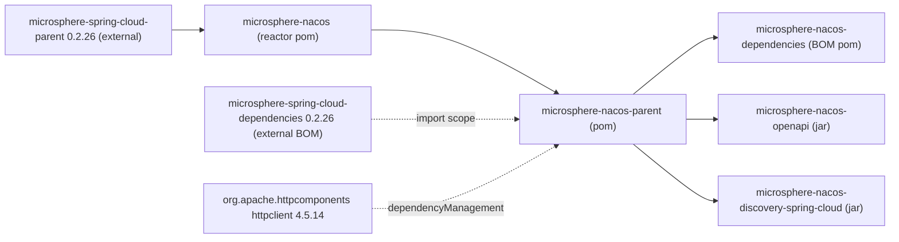

# microsphere-nacos-parent

## Overview

`microsphere-nacos-parent` is a **POM-only module** — `<packaging>pom</packaging>` with no `src` directory of any
kind. It carries no classes, publishes no jar, and contributes nothing to an application's runtime classpath.

Its job is build-time: it is the shared parent POM for every other module in this repository, and it centralises two
things —

1. a `dependencyManagement` entry for the Apache HttpClient version this project builds against;
2. an `import`-scope inclusion of the external `microsphere-spring-cloud-dependencies` BOM, which is where the Spring
   Boot / Spring Cloud / JDK-compile versions ultimately come from.

Interact with this module when you:

- are **building or extending the repository** and need a new module to inherit consistent versions (add it as your
  `<parent>` rather than repeating version literals);
- want to reuse the project's dependency pinning inside your own multi-module build without importing the Nacos BOM;
- are troubleshooting a version conflict and need to know which POM is responsible for the number.

Application developers who only consume `microsphere-nacos-openapi` or
`microsphere-nacos-discovery-spring-cloud` should use [microsphere-nacos-dependencies](microsphere-nacos-dependencies.md)
instead; they will never reference this artifact directly.

## Maven coordinates

```xml
<dependency>
    <groupId>io.github.microsphere-projects</groupId>
    <artifactId>microsphere-nacos-parent</artifactId>
    <version>${microsphere-nacos.version}</version>
    <type>pom</type>
</dependency>
```

`${microsphere-nacos.version}` is `0.2.0-SNAPSHOT` on this version line. Note that you normally use it as a **parent**,
not as a dependency:

```xml
<parent>
    <groupId>io.github.microsphere-projects</groupId>
    <artifactId>microsphere-nacos-parent</artifactId>
    <version>0.2.0-SNAPSHOT</version>
    <relativePath>../microsphere-nacos-parent/pom.xml</relativePath>
</parent>
```

The `<relativePath>` above is exactly what the three child modules declare, which lets a reactor build resolve the
parent from disk instead of the repository.

## What it manages

### Declared properties

| Property | Value | Role |
| --- | --- | --- |
| `httpclient.version` | `4.5.14` | Version of the Apache HttpClient entry below |
| `microsphere-spring-cloud.version` | `0.2.26` | Version of the imported BOM below; the POM groups it under a `BOM versions` comment |

### dependencyManagement

| Group ID | Artifact ID | Version | Type / scope |
| --- | --- | --- | --- |
| `org.apache.httpcomponents` | `httpclient` | `${httpclient.version}` → `4.5.14` | — |
| `io.github.microsphere-projects` | `microsphere-spring-cloud-dependencies` | `${microsphere-spring-cloud.version}` → `0.2.26` | `pom` / `import` |

### Parent chain

`microsphere-nacos-parent` itself has `io.github.microsphere-projects:microsphere-nacos:${revision}` as its parent
(with `<relativePath>../pom.xml</relativePath>`), and that reactor root inherits
`io.github.microsphere-projects:microsphere-spring-cloud-parent:0.2.26`. So the full chain your build sees is:

```
microsphere-spring-cloud-parent : 0.2.26      (external)
  └── microsphere-nacos                       (reactor root, pom)
        └── microsphere-nacos-parent          (this module, pom)
              ├── microsphere-nacos-dependencies
              ├── microsphere-nacos-openapi
              └── microsphere-nacos-discovery-spring-cloud
```

## How it is used at build time

- **Version inheritance.** None of the four modules under it declares a version literal for `httpclient`, `gson`,
  JUnit, or any Spring artifact. They omit `<version>` and inherit it through this POM — from its own
  `dependencyManagement` for `httpclient`, and from the imported `microsphere-spring-cloud-dependencies` BOM for
  everything else.
- **BOM composition.** Because the external BOM is imported *here*, every child module — including
  `microsphere-nacos-dependencies` — sees it in its effective POM.
- **Reactor ordering.** It is listed first in the root `<modules>`, so Maven builds it before the modules that resolve
  it as a parent.
- **Coordinates only.** It does not declare `<name>`-driven artifacts, plugins, or build extensions of its own; its
  POM body consists solely of `<parent>`, coordinates, `<packaging>pom</packaging>`, `<name>`
  (`Microsphere :: Nacos :: Parent`), `<description>`, `<properties>` and `<dependencyManagement>`.

## Version information

| Item | Value | Provenance |
| --- | --- | --- |
| Module artifact | `io.github.microsphere-projects:microsphere-nacos-parent` | Module `pom.xml` |
| Module version | `${revision}` → `0.2.0-SNAPSHOT` | Root `pom.xml` `<revision>` property |
| Packaging | `pom` | Module `pom.xml` |
| Parent | `microsphere-nacos` `${revision}` via `../pom.xml` | Module `pom.xml` |
| Managed `httpclient` | `4.5.14` | `httpclient.version` here |
| Imported BOM | `microsphere-spring-cloud-dependencies:0.2.26` | `microsphere-spring-cloud.version` here |
| Ancestral external parent | `microsphere-spring-cloud-parent:0.2.26` | Root `pom.xml`, outside this module |

**Provenance caveat.** Spring Boot, Spring Cloud and the compile JDK level are **inherited from the external
parent/BOM, not declared in this repository**. Neither `microsphere-spring-cloud-parent` nor
`microsphere-spring-cloud-dependencies` is part of the analysed snapshot, so this guide states no concrete version for
them beyond the `0.2.26` coordinate that this POM imports by number. The root POM does set `<java.version>17</java.version>`,
but the compiler plugin configuration that consumes it also lives in the external parent.

## Compatibility

This POM pins `httpclient:4.5.14` and imports the `0.2.26` Microsphere Spring Cloud BOM. The CI matrix in
`.github/workflows/maven-build.yml` proves the combination on Java `17`, `21`, `25` with the `spring-cloud-2022`,
`spring-cloud-2023`, `spring-cloud-2024` and `spring-cloud-2025` profiles; the Spring releases behind those profile
names are resolved by the external POMs and are not verifiable from this snapshot.

`org.apache.httpcomponents:httpclient` is the classic 4.x coordinates, distinct from the `org.apache.httpcomponents.client5`
group used by HttpClient 5; the Open API client is written against the 4.x `CloseableHttpClient` API.

## Module dependency diagram



## Related documents

- [Index](README.md)
- [microsphere-nacos-dependencies](microsphere-nacos-dependencies.md)
- [microsphere-nacos-openapi](microsphere-nacos-openapi.md)
- [microsphere-nacos-discovery-spring-cloud](microsphere-nacos-discovery-spring-cloud.md)
- Developer guide counterpart: [../../developer-guide/current/microsphere-nacos-parent.md](microsphere-nacos-parent.md)

## 中文

[中文](../zh/current/README.md)
