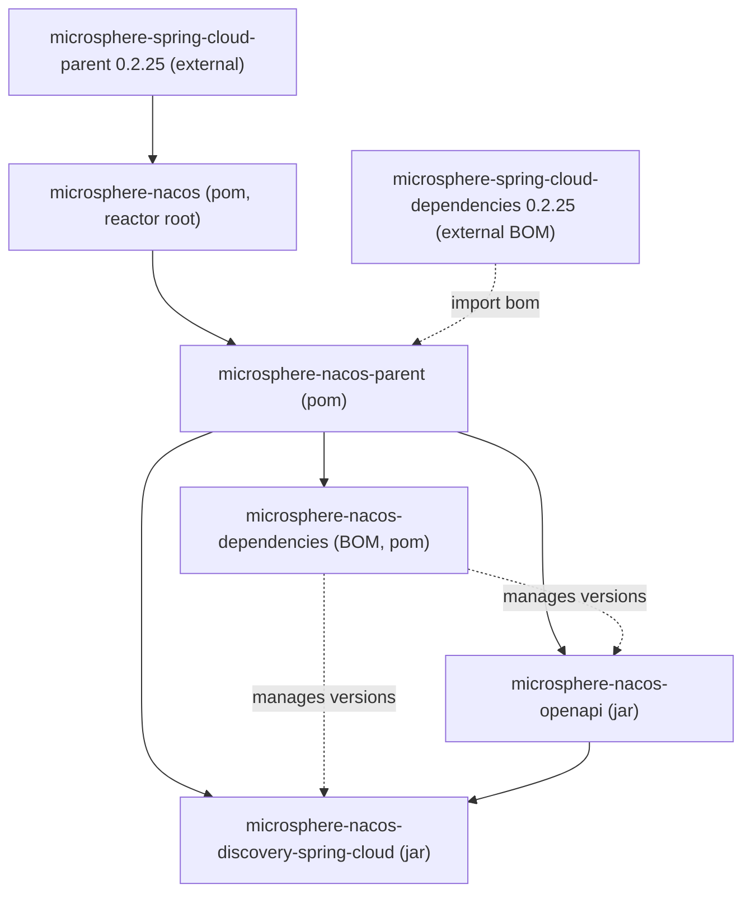

# Microsphere Nacos 1.x — 用户指南

本节是 `microsphere-nacos` 项目 **`1.x`** 版本线的用户指南，内容取自 `release-1.x` 分支快照。
该版本线的 Maven 修订版本（revision）为 **`0.2.0-SNAPSHOT`**。

本仓库不发布 Git 标签。`1.x` 目录之所以存在，是因为该项目在默认版本线之外额外维护了一条
`release-1.x` 版本线。就此处所描述的快照而言，`1.x` 的内容位于构建迁移提交（"Migrate project build from
Gradle to Maven"），除外部依赖差异外——本线继承 **Microsphere Spring Cloud `0.2.25`**，而默认线使用
`0.2.26`——其余源码与默认线一致。所有版本的准确来源见「版本信息」一节。

## 本项目是什么

`microsphere-nacos` 是一个从零实现的 **Nacos Open API** Java 客户端，并附带一个基于它构建的 Spring Cloud
服务发现适配器。它通过普通 HTTP（Apache HttpClient）与 Nacos 通信，并把 Open API 的能力面建模为带类型的
Java 接口。共覆盖两个 Open API 修订版本：

- **Open API V1** —— 配置（config）、命名（naming，服务/实例）、命名空间（namespace）、服务器操作以及 RAFT。
- **Open API V2** —— `/v2` 端点，包含客户端信息（`/v2/ns/client`）子 API。

## 反应堆一览

根反应堆 `io.github.microsphere-projects:microsphere-nacos`（`pom`）声明了以下模块：

| 模块 | Artifact ID | 打包 | 作用 |
| --- | --- | --- | --- |
| Parent | `microsphere-nacos-parent` | `pom` | 为本项目各模块集中管理依赖并导入 BOM |
| Dependencies (BOM) | `microsphere-nacos-dependencies` | `pom` | 固定本项目自身 artifact 版本的物料清单 |
| OpenAPI | `microsphere-nacos-openapi` | `jar` | 带类型的 Nacos Open API 客户端（V1 + V2） |
| Discovery Spring Cloud | `microsphere-nacos-discovery-spring-cloud` | `jar` | 基于 Open API 客户端的 Spring Cloud `DiscoveryClient` 适配器 |

此外还有两个模块 `microsphere-nacos-spring` 与 `microsphere-nacos-spring-boot` 出现在反应堆中，但在根 POM 里
**被注释掉**，因此不会被构建，在本版本线中也绝不能对其产生依赖。

详细指南：

- [microsphere-nacos-openapi](microsphere-nacos-openapi.md)
- [microsphere-nacos-discovery-spring-cloud](microsphere-nacos-discovery-spring-cloud.md)
- [microsphere-nacos-parent](microsphere-nacos-parent.md)
- [microsphere-nacos-dependencies](microsphere-nacos-dependencies.md)

## 模块依赖



解读这张图：

- 根 POM **继承**了外部的 `microsphere-spring-cloud-parent:0.2.25`（Spring Boot / Spring Cloud / 编译 JDK 版本
  最终正是来自那个外部 parent——见下文关于来源的说明）。
- `microsphere-nacos-parent` 是其他所有模块的直接 parent，它**导入**了外部
  `microsphere-spring-cloud-dependencies:0.2.25` BOM，并额外加入 `httpclient:4.5.14`。
- `microsphere-nacos-dependencies` 是本项目的 BOM，用于固定两个 jar artifact 的版本。
- `microsphere-nacos-discovery-spring-cloud` **依赖** `microsphere-nacos-openapi`。

## Maven 坐标与 BOM

所有 artifact 都使用 group `io.github.microsphere-projects`。只需引入一次 BOM，随后依赖各模块时无需写版本：

```xml
<dependencyManagement>
    <dependencies>
        <!-- Microsphere Nacos Dependencies (BOM) -->
        <dependency>
            <groupId>io.github.microsphere-projects</groupId>
            <artifactId>microsphere-nacos-dependencies</artifactId>
            <version>${microsphere-nacos.version}</version>
            <type>pom</type>
            <scope>import</scope>
        </dependency>
    </dependencies>
</dependencyManagement>

<dependencies>
    <dependency>
        <groupId>io.github.microsphere-projects</groupId>
        <artifactId>microsphere-nacos-openapi</artifactId>
    </dependency>

    <dependency>
        <groupId>io.github.microsphere-projects</groupId>
        <artifactId>microsphere-nacos-discovery-spring-cloud</artifactId>
    </dependency>
</dependencies>
```

对于此处描述的快照，`${microsphere-nacos.version}` 即 `0.2.0-SNAPSHOT`。由于本项目不打标签且本版本线处于
预发布状态，请按需要从本地构建或快照仓库中获取。

## 版本信息

| 项目 | 值 | 来源（provenance） |
| --- | --- | --- |
| 分支 / 版本线 | `release-1.x` | 本快照所代表的仓库分支 |
| 根反应堆版本 | `0.2.0-SNAPSHOT` | 根 `pom.xml` 中的 `revision` 属性 |
| 各模块版本 | `${revision}`（`0.2.0-SNAPSHOT`） | 每个模块的 POM |
| 反应堆 `java.version` 属性 | `17` | 根 `pom.xml` 中的 `<java.version>` |
| 外部 parent | `microsphere-spring-cloud-parent:0.2.25` | 根 `pom.xml` 中的 `<parent>` |
| 导入的 BOM | `microsphere-spring-cloud-dependencies:0.2.25` | `microsphere-nacos-parent/pom.xml` |
| Apache HttpClient | `4.5.14` | `microsphere-nacos-parent/pom.xml` 中的 `httpclient.version` |
| 已发布的 Git 标签 | 无 | 该项目不发布版本标签 |

**来源说明。** 具体的 Spring Boot 版本、Spring Cloud 版本以及用于编译的 Java 语言级别**并未**在本仓库内声明；
它们由外部的 `microsphere-spring-cloud-parent` / `microsphere-spring-cloud-dependencies` POM 传递提供。这些外部
POM 并不属于本快照，因此无法从源码处核对其确切解析版本，这里也刻意不把它们写成固定数字。

## 兼容范围

受支持的版本范围由 `.github/workflows/maven-build.yml` 中的 CI 矩阵体现，它会构建并运行测试套件于：

| 维度 | CI 中测试的值 |
| --- | --- |
| Java | `17`、`21`、`25` |
| Spring Cloud profile | `spring-cloud-2022`、`spring-cloud-2023`、`spring-cloud-2024`、`spring-cloud-2025` |

CI 还会以 `-Drevision=0.0.1-SNAPSHOT` 覆盖运行 `mvn test`，并激活 `test` 与 `coverage` profile；这只是构建期覆盖，
不会改变 POM 中声明的 `0.2.0-SNAPSHOT` 版本。

关于如何解读：

- 上述矩阵是本快照**经过验证**的覆盖范围。本分支中的根 `README.md` 把 `1.x` 线描述为面向更老的 Spring Cloud
  代际，但本快照的 CI 并未据此构建；应将矩阵视为对"实际构建与测试内容"的权威说明。
- 每个 `spring-cloud-*` profile 背后生效的 Spring Boot / Spring Cloud 发布版由外部 Microsphere Spring Cloud POM
  定义，因此同样受上述来源说明约束。

### Nacos Open API 端点覆盖

- **V1**（`/v1`）：配置（`/v1/cs/configs`，历史位于 `/v1/cs/history`）、命名（`/v1/ns/service`、
  `/v1/ns/instance`、心跳、批量 metadata、健康）、命名空间控制台（`/v1/console/namespaces`）、服务器操作
  （`/v1/console/server/state`、`/v1/ns/operator/switches`、`/v1/ns/operator/metrics`、`/v1/ns/operator/servers`）、
  RAFT（`/v1/ns/raft/leader`）以及认证（`/v1/auth/login`）。
- **V2**（`/v2`）：配置（`/v2/cs/config`、`/v2/cs/history/list`），通过 V2 子客户端进行命名与命名空间操作，
  以及客户端信息 API（`/v2/ns/client` 及其 `/list`、`/publish/list`、`/subscribe/list`、`/service/publisher/list`、
  `/service/subscriber/list`）。在 V2 API 无对应端点之处，V2 配置客户端仍借用 V1 的详情端点。

方法级细节见模块指南：[microsphere-nacos-openapi](microsphere-nacos-openapi.md)。

## 文档地图

- 本版本线的开发者指南对应文档：[developer-guide/zh/1.x](../../../developer-guide/zh/1.x/README.md)
- 另一条版本线：[current 用户指南](../../current/README.md)
- [文档主页](../../../README.md)
- [仓库 README](../../../../README.md)

## English

[English](../../1.x/README.md)
