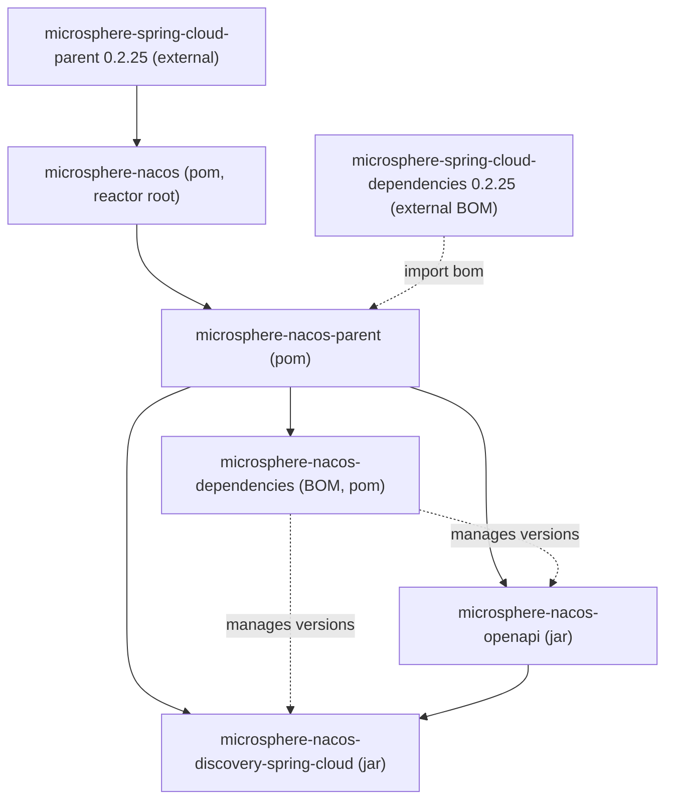

# microsphere-nacos-dependencies

`microsphere-nacos-dependencies` 是本项目的**物料清单**（BOM，`packaging: pom`）。在消费方的
`<dependencyManagement>` 中导入它，即可固定 `microsphere-nacos` artifact 的版本，从而依赖它们时无需重复书写版本。

## Maven 坐标与 BOM 片段

```xml
<dependencyManagement>
    <dependencies>
        <dependency>
            <groupId>io.github.microsphere-projects</groupId>
            <artifactId>microsphere-nacos-dependencies</artifactId>
            <version>${microsphere-nacos.version}</version>
            <type>pom</type>
            <scope>import</scope>
        </dependency>
    </dependencies>
</dependencyManagement>
```

随后依赖各模块时无需写版本：

```xml
<dependencies>
    <dependency>
        <groupId>io.github.microsphere-projects</groupId>
        <artifactId>microsphere-nacos-openapi</artifactId>
    </dependency>
    <dependency>
        <groupId>io.github.microsphere-projects</groupId>
        <artifactId>microsphere-nacos-discovery-spring-cloud</artifactId>
    </dependency>
</dependencies>
```

在本版本线中 `${microsphere-nacos.version}` 为 `0.2.0-SNAPSHOT`。

## 它管理什么

该 BOM 在自己的 `<dependencyManagement>` 中声明了本项目 artifact：

| 受管 artifact | Group | 版本 |
| --- | --- | --- |
| `microsphere-nacos-openapi` | `io.github.microsphere-projects` | `${revision}` = `0.2.0-SNAPSHOT` |
| `microsphere-nacos-discovery-spring-cloud` | `io.github.microsphere-projects` | `${revision}` = `0.2.0-SNAPSHOT` |

两项条目都通过 `${revision}` 设置版本，从而始终跟随反应堆构建。

## 继承及其对第三方版本的影响

该 POM 声明 `microsphere-nacos-parent` 为其 parent：



由于 `microsphere-nacos-dependencies` 继承自 `microsphere-nacos-parent`——后者管理了 `httpclient:4.5.14` 并导入了
外部的 `microsphere-spring-cloud-dependencies:0.2.25` BOM——这些第三方受管条目也在该 BOM 的有效作用域内。如果你的
应用需要为 Nacos 客户端的传递依赖（HttpClient、GSON、Microsphere 核心库）保持一致的版本，导入本 BOM 便是预期的入口。
若你只需要本项目的两个 artifact，上面的片段即已足够。

## 版本信息与兼容性

| 项目 | 值 | 来源 |
| --- | --- | --- |
| 自身版本 | `${revision}` = `0.2.0-SNAPSHOT` | 本 POM |
| Parent | `microsphere-nacos-parent`（`0.2.0-SNAPSHOT`） | 本 POM，`<parent>` |
| 受管的本项目 artifact | 两个 jar 模块均为 `${revision}` | 本 POM，`dependencyManagement` |
| 传递的第三方版本 | 经由继承的 parent 管辖（`0.2.25`、`4.5.14`） | `microsphere-nacos-parent` |

作为 BOM，它不贡献任何运行时代码，因此没有属于自身的兼容范围。它所固定 artifact 的兼容性在[索引](README.md)中描述：
CI 在 Java `17`/`21`/`25` 与 `spring-cloud-2022` 至 `spring-cloud-2025` profile 上构建。经由继承的外部 BOM 所触达的
具体 Spring Boot / Spring Cloud 版本**无法从本仓库核对**，因此刻意不写成固定数字。

## 相关文档

- [索引](README.md)
- [microsphere-nacos-parent](microsphere-nacos-parent.md)
- [microsphere-nacos-openapi](microsphere-nacos-openapi.md)
- [microsphere-nacos-discovery-spring-cloud](microsphere-nacos-discovery-spring-cloud.md)
- 开发者指南对应文档：[../../../developer-guide/zh/1.x/microsphere-nacos-dependencies.md](../../../developer-guide/zh/1.x/microsphere-nacos-dependencies.md)

## English

[English](../../1.x/microsphere-nacos-dependencies.md)
