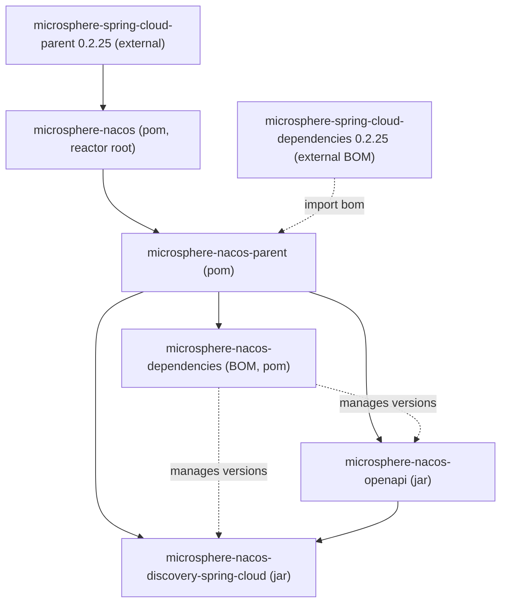

# microsphere-nacos-discovery-spring-cloud

`microsphere-nacos-discovery-spring-cloud` 模块把带类型的 Nacos Open API 客户端适配到 **Spring Cloud** 的服务发现
抽象上。它提供一个 `DiscoveryClient` 实现、一个 `ServiceInstance` 适配器，以及 Spring Boot 自动配置，使得 Nacos 的
服务发现客户端可由外部化属性装配。它依赖 [microsphere-nacos-openapi](microsphere-nacos-openapi.md)。

## Maven 坐标

```xml
<dependency>
    <groupId>io.github.microsphere-projects</groupId>
    <artifactId>microsphere-nacos-discovery-spring-cloud</artifactId>
</dependency>
```

其版本由 [microsphere-nacos-dependencies](microsphere-nacos-dependencies.md) BOM 管理（本版本线为
`0.2.0-SNAPSHOT`）。该模块直接依赖 `microsphere-nacos-openapi`，并把 Spring Cloud / Spring Boot 相关 artifact
（`spring-cloud-commons`、`microsphere-spring-cloud-commons`、`spring-boot-starter`、
`spring-boot-starter-actuator` 以及 configuration-/autoconfigure- 处理器）视为 `optional`，由消费方自行引入。

## 模块位置



## 类一览

| 类 | 包 | 作用 |
| --- | --- | --- |
| `NacosDiscoveryClient` | `io.microsphere.nacos.client.discovery.spring.cloud` | Nacos 的 Spring Cloud `DiscoveryClient` |
| `NacosServiceInstance` | `io.microsphere.nacos.client.discovery.spring.cloud` | 以 Nacos `Instance` 为底层的 `ServiceInstance` |
| `NacosDiscoveryConfiguration` | `io.microsphere.nacos.client.discovery.spring.cloud` | 声明 `nacosDiscoveryClient` bean |
| `NacosDiscoveryContextFactory` | `io.microsphere.nacos.client.discovery.spring.cloud` | 用于按名隔离上下文的 `NamedContextFactory` |
| `NacosDiscoverySpecification` | `io.microsphere.nacos.client.discovery.spring.cloud` | `NamedContextFactory.Specification` 值对象 |
| `NacosDiscoveryAutoConfiguration` | `...discovery.spring.cloud.autoconfigure` | 注册发现 bean 与多客户端工厂 |
| `NacosClientAutoConfiguration` | `io.microsphere.nacos.client.spring.boot.autoconfigure` | 启用 `NacosClientProperties` 并导入 `NacosClientConfiguration` |
| `NacosClientConfiguration` | `io.microsphere.nacos.client.spring` | 声明 `OpenApiHttpClient` bean |
| `NacosClientProperties` | `io.microsphere.nacos.client.spring.boot` | 客户端的 `@ConfigurationProperties` 绑定 |
| `NacosClientUtils` | `io.microsphere.nacos.client.spring.util` | 面向按名客户端的属性前缀工具 |

## Spring Boot 自动配置

`META-INF/spring/org.springframework.boot.autoconfigure.AutoConfiguration.imports` 注册了两个自动配置：

```
io.microsphere.nacos.client.spring.boot.autoconfigure.NacosClientAutoConfiguration
io.microsphere.nacos.client.discovery.spring.cloud.autoconfigure.NacosDiscoveryAutoConfiguration
```

- `NacosClientAutoConfiguration` 由 `@ConditionalOnPropertyPrefix(NacosClientProperties.PREFIX)`
  （`microsphere.nacos.client.`）保护，启用 `NacosClientProperties`，并导入 `NacosClientConfiguration`，后者构建一个
  `OpenApiHttpClient` bean（`destroyMethod = "close"`）。
- `NacosDiscoveryAutoConfiguration` 导入 `NacosDiscoveryConfiguration`（创建 `NacosDiscoveryClient` bean）以及一个
  嵌套的 `Multiple` 配置。`Multiple` 由
  `@ConditionalOnProperty(prefix = NacosClientUtils.NACOS_CLIENTS_PROPERTY_NAME_PREFIX)`
  （`microsphere.nacos.clients.`）激活，为需要多个独立配置 Nacos 客户端的应用注册一个 `NacosDiscoveryContextFactory`。

## 配置属性

`NacosClientProperties` 以前缀 `microsphere.nacos.client.` 绑定（即 `Constants.PROPERTY_NAME_PREFIX` 的值），并
继承 `NacosClientConfig`，因此 [OpenAPI 指南](microsphere-nacos-openapi.md)中所描述的客户端设置都能在此外部化。本
模块额外新增一个嵌套元素：

| 属性 | 类型 | 用途 |
| --- | --- | --- |
| `microsphere.nacos.client.server-address` | `String` | Nacos 服务器 host:port |
| `microsphere.nacos.client.scheme` | `String` | URL 协议（默认 `http`） |
| `microsphere.nacos.client.context-path` | `String` | 上下文路径（默认 `/nacos`） |
| `microsphere.nacos.client.user-name` / `...password` | `String` | 鉴权（须同时设置才启用） |
| `microsphere.nacos.client.discovery.namespace-id` | `String` | `NacosDiscoveryClient` 使用的命名空间 |

对于多客户端场景，`NacosClientUtils` 定义了前缀 `microsphere.nacos.clients.` 及辅助方法
`buildNacosClientPropertyNamePrefix(name)`（`microsphere.nacos.clients.<name>.`）、
`getNacosClientProperties(environment, name)` 与 `getNacosCilentPropertySource(environment, name)`——注意源码中
方法名 `getNacosCilentPropertySource` 的拼写如此。`NacosDiscoveryContextFactory` 使用这些方法把按名客户端的属性
嫁接进子 Spring 上下文。

## 发现客户端

`NacosDiscoveryClient` 实现 `org.springframework.cloud.client.discovery.DiscoveryClient`，由一个
`OpenApiHttpClient` 与 `NacosClientProperties` 构造。其内部构建一个 `OpenApiServiceClient` 与一个
`OpenApiInstanceClient`（V1），并从 `nacosClientProperties.getDiscovery().getNamespaceId()` 读取命名空间。

| 方法 | 行为 |
| --- | --- |
| `String description()` | 返回 `"DiscoveryClient - Nacos"` |
| `List<ServiceInstance> getInstances(String serviceId)` | 调用 `instanceClient.getInstancesList(namespaceId, serviceId)`，并把每个 `Instance` 映射为 `NacosServiceInstance` |
| `List<String> getServices()` | 逐页调用 `serviceClient.getServiceNames(namespaceId, ...)`，直到没有后续页为止 |

`NacosServiceInstance` 基于一个 Nacos `Instance` 实现 `ServiceInstance`：

| 方法 | 委托到 / 值 |
| --- | --- |
| `getInstanceId()` | `instance.getInstanceId()` |
| `getServiceId()` | `instance.getService()` |
| `getHost()` | `instance.getIp()` |
| `getPort()` | `instance.getPort()` |
| `isSecure()` | `false` |
| `getUri()` | `DefaultServiceInstance.getUri(this)` |
| `getMetadata()` | `instance.getMetadata()` |
| `getScheme()` | `"http"` |

## 使用示例

在 `release-1.x` 快照中本模块并未附带单元测试，因此下面的片段是根据自动配置源码组装而成的，而非改编自某个测试。

```yaml
# application.yaml
microsphere:
  nacos:
    client:
      server-address: 127.0.0.1:8848
      user-name: nacos
      password: nacos
      discovery:
        namespace-id: public
```

```java
// The auto-configured bean is a standard Spring Cloud DiscoveryClient
@Autowired
private DiscoveryClient discoveryClient;

public void inspect() {
    List<String> services = discoveryClient.getServices();
    List<ServiceInstance> instances = discoveryClient.getInstances("test-service");
    for (ServiceInstance instance : instances) {
        System.out.println(instance.getHost() + ":" + instance.getPort());
    }
}
```

要注册多个客户端，请在 `microsphere.nacos.clients.<name>.*` 下设置属性；这会激活嵌套的 `Multiple` 配置，并暴露一个
`NacosDiscoveryContextFactory`，为每个客户端构建一个按名命名的子上下文。

## 版本信息与兼容性

本模块以 `0.2.0-SNAPSHOT` 从 `release-1.x` 构建，并继承 `microsphere-spring-cloud-parent:0.2.25`。它所编译依赖的
Spring Cloud `DiscoveryClient` / `ServiceInstance` / `NamedContextFactory` 类型来自 `spring-cloud-commons` 与
`spring-cloud-context`，其版本由外部 Microsphere Spring Cloud POM 传递提供，因此并非由本仓库固定。CI 在 Java
`17`、`21`、`25` 上跨 `spring-cloud-2022` / `-2023` / `-2024` / `-2025` profile 运行本模块。完整来源提示见[索引](README.md)。

## 相关文档

- [索引](README.md)
- [microsphere-nacos-openapi](microsphere-nacos-openapi.md)
- [microsphere-nacos-parent](microsphere-nacos-parent.md)
- [microsphere-nacos-dependencies](microsphere-nacos-dependencies.md)
- 开发者指南对应文档：[../../../developer-guide/zh/1.x/microsphere-nacos-discovery-spring-cloud.md](../../../developer-guide/zh/1.x/microsphere-nacos-discovery-spring-cloud.md)

## English

[English](../../1.x/microsphere-nacos-discovery-spring-cloud.md)
