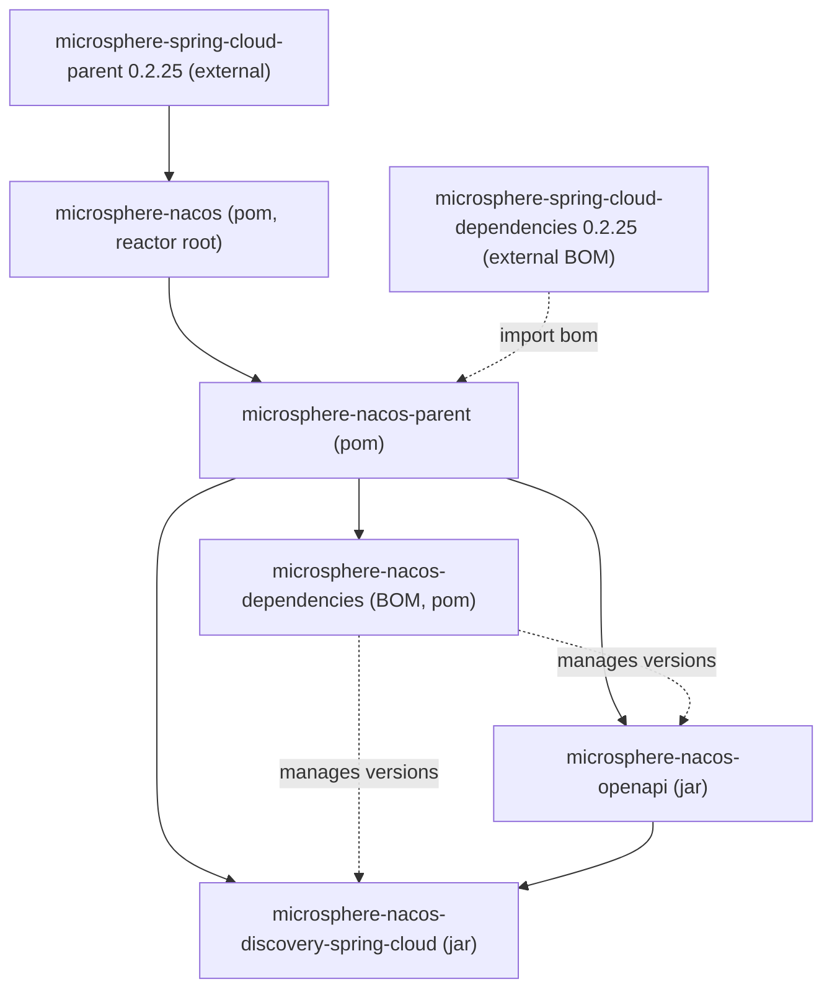

# microsphere-nacos-openapi

`microsphere-nacos-openapi` 模块是 **Nacos Open API** 的带类型 Java 客户端。它把 Open API 的能力面以 Java 接口
暴露出来，通过 Apache HttpClient 发送请求，并将 JSON 载荷映射为模型类。两个 Open API 修订版本均受支持，分别位于
平行的 `v1` 与 `v2` 包中，并共享 `common` 契约层。

## Maven 坐标

```xml
<dependency>
    <groupId>io.github.microsphere-projects</groupId>
    <artifactId>microsphere-nacos-openapi</artifactId>
</dependency>
```

其版本由 [microsphere-nacos-dependencies](microsphere-nacos-dependencies.md) BOM 管理（本版本线为
`0.2.0-SNAPSHOT`）。该模块自身的运行时依赖为 `org.apache.httpcomponents:httpclient`（`4.5.14`，由
`microsphere-nacos-parent` 固定）与 `com.google.code.gson:gson`；`microsphere-java-core` 与
`microsphere-annotation-processor` 被声明为 `optional`。

## 模块位置

本 jar 是服务发现适配器的依赖底座，构建于共享 parent 之下：



## 包结构

| 包 | 内容 |
| --- | --- |
| `io.microsphere.nacos.client` | `Client`、`NacosClientConfig`、`OpenApiVersion`、`ErrorCode`、`NacosClientException` |
| `io.microsphere.nacos.client.v1` | `NacosClient` 门面、`OpenApiNacosClient` 实现 |
| `io.microsphere.nacos.client.v1.config` | `OpenApiConfigClient`、`ConfigListenerManager`、`ConfigUtil` |
| `io.microsphere.nacos.client.v1.discovery` | `OpenApiServiceClient`、`OpenApiInstanceClient` |
| `io.microsphere.nacos.client.v1.namespace` | `OpenApiNamespaceClient` |
| `io.microsphere.nacos.client.v1.server` | `OpenApiServerClient`、`ServerClient` 及 switch/metrics/servers 子接口 |
| `io.microsphere.nacos.client.v1.raft` | `RaftClient`（已废弃）、`OpenApiRaftClient` |
| `io.microsphere.nacos.client.v2` | `NacosClientV2` 门面、`OpenApiNacosClientV2` 实现 |
| `io.microsphere.nacos.client.v2.config` | `OpenApiConfigClientV2` |
| `io.microsphere.nacos.client.v2.discovery` | `OpenApiServiceClientV2`、`OpenApiInstanceClientV2` |
| `io.microsphere.nacos.client.v2.namespace` | `OpenApiNamespaceClientV2` |
| `io.microsphere.nacos.client.v2.client` | `ClientDetail`、`ClientInfo`、`ClientInstance`、`ClientSubscriber` 及其反序列化器 |
| `io.microsphere.nacos.client.common` | 共享契约：`config`、`discovery`、`namespace`、`auth`、`model` |
| `io.microsphere.nacos.client.transport` | `OpenApiHttpClient`、`OpenApiClient`、`OpenApiRequest`、`OpenApiResponse` |
| `io.microsphere.nacos.client.io` | `Serializer`、`Deserializer`、`DefaultSerializer`、`DefaultDeserializer`、基于 Gson 的实现 |
| `io.microsphere.nacos.client.util` | `OpenApiUtils`、`ModelUtils`、`JsonUtils`、`IOUtils`、`StringUtils`、`TypeUtils` |

## 选择 Open API 版本

`OpenApiVersion` 是一个枚举，含两个常量及其路径前缀：

| 常量 | `getEndpointPath()` |
| --- | --- |
| `V1` | `/v1` |
| `V2` | `/v2` |

`OpenApiNacosClient` 报告 `V1`（这是 `OpenApiTemplateClient` 的默认值）；`OpenApiNacosClientV2` 覆写
`getOpenApiVersion()` 返回 `V2`。该版本同时控制端点前缀与响应解包策略（见下文的传输层一节）。

## 配置客户端：`NacosClientConfig`

`NacosClientConfig` 是构建每个客户端的唯一对象。默认值来自 `Constants` 接口，并且也可以通过以
`microsphere.nacos.client.` 为前缀的 JVM 系统属性进行注入。

| 属性（getter/setter） | 默认值 | 说明 |
| --- | --- | --- |
| `serverAddress` / `setServerAddress` | 无 | Nacos 服务器的 Host:port；访问 Open API 所必需 |
| `scheme` / `setScheme` | `http` | URL 协议 |
| `contextPath` / `setContextPath` | `/nacos` | 服务器上下文路径 |
| `applicationName` / `setApplicationName` | `microsphere-nacos-client` | 可通过 `microsphere.nacos.client.app-name` 覆盖 |
| `name` / `setName` | 无 | 逻辑客户端名称 |
| `userName` / `setUserName` | 无 | 认证用户名 |
| `password` / `setPassword` | 无 | 认证密码 |
| `accessKey` / `setAccessKey` | 无 | 命名空间 access key |
| `secretKey` / `setSecretKey` | 无 | 命名空间 secret key |
| `maxConnections` / `setMaxConnections` | `1000` | 连接池总连接数 |
| `maxPerRoute` / `setMaxPerRoute` | `200` | 每路由连接数 |
| `connectionTimeout` / `setConnectionTimeout` | `60000`（1 分钟） | 毫秒 |
| `readTimeout` / `setReadTimeout` | `180000`（3 分钟） | 毫秒 |
| `longPollingTimeout` / `setLongPollingTimeout` | `30000`（30 秒） | 毫秒 |
| `eventProcessingTimeout` / `setEventProcessingTimeout` | `30000000` | 取自 `Constants` 默认值（`SECONDS.toMicros(30)`） |
| `encoding` / `setEncoding` | `UTF-8` | 查询串编码 |
| `fetchingConfigThreadName` | `Nacos Client - Fetching Config Executor` | 线程命名 |
| `listenerConfigThreadName` | `Nacos Client - Listening Config Scheduler` | 线程命名 |
| `publishingConfigEventThreadName` | `Nacos Client - Config Event Publisher` | 线程命名 |

仅当 `userName` 与 `password` 同时被设置时，`isAuthorizationEnabled()` 才返回 `true`。

## V1 门面：`NacosClient` / `OpenApiNacosClient`

`NacosClient` 把所有 V1 能力组合为一个接口：

```
NacosClient extends AuthenticationClient, ConfigClient, ServiceClient, InstanceClient,
              NamespaceClient, ServerClient, RaftClient, Client
```

`OpenApiNacosClient` 通过委派给专用子客户端来实现该接口。可用构造器有两个：

```java
// Builds its own OpenApiHttpClient from the config
NacosClient client = new OpenApiNacosClient(nacosClientConfig);

// Reuses an existing transport
NacosClient client = new OpenApiNacosClient(openApiClient, nacosClientConfig);
```

访问器 `getAuthenticationClient()`、`getConfigClient()`、`getServiceClient()`、`getInstanceClient()`、
`getNamespaceClient()`、`getServerClient()` 与 `getRaftClient()` 暴露底层子客户端。

## 认证

`AuthenticationClient` 提供 `authenticate()`（使用已配置的用户名/密码）与
`authenticate(String userName, String password)`。`OpenApiAuthenticationClient` 向 `/v1/auth/login` 发起 POST，
并返回暴露 `getAccessToken()`、`getTokenTtl()` 与 `isGlobalAdmin()` 的 `Authentication` 模型。

```java
// Adapted from OpenApiAuthenticationClientTest
nacosClientConfig.setUserName("nacos");
nacosClientConfig.setPassword("nacos");
OpenApiAuthenticationClient client =
        new OpenApiAuthenticationClient(openApiClient, nacosClientConfig);

Authentication authentication = client.authenticate();
assert authentication.getAccessToken() != null;
assert authentication.getTokenTtl() > 0;
assert authentication.isGlobalAdmin();
```

当启用鉴权时，`OpenApiHttpClient` 会创建一个 `AuthorizationManager`，它会立即完成认证并在后台守护调度器上以
token TTL 的一半周期刷新 token；随后 access token 会作为 `accessToken` 查询参数附加到每个请求上。

## 配置 API：`ConfigClient`

`ConfigClient` 是 Nacos 配置管理的契约。非 `default` 的方法是针对网络层实现的那些；`default` 重载会用 `Constants`
中的 `public` 命名空间与 `DEFAULT_GROUP` 约定补齐参数。

核心方法：

| 方法 | 用途 |
| --- | --- |
| `String getConfigContent(String namespaceId, String group, String dataId, String tag)` | 仅取原始内容 |
| `Config getConfig(String namespaceId, String group, String dataId)` | 完整配置详情 |
| `boolean publishConfig(NewConfig newConfig)` | 创建或更新 |
| `boolean publishConfigContent(...)` | 便捷发布重载（group/namespace/tag/`ConfigType`） |
| `boolean deleteConfig(String namespaceId, String group, String dataId, String tag)` | 删除 |
| `Page<HistoryConfig> getHistoryConfigs(String namespaceId, String group, String dataId, int pageNumber, int pageSize)` | 分页历史 |
| `HistoryConfig getHistoryConfig(String namespaceId, String group, String dataId, long revision)` | 按 revision 取一条历史 |
| `HistoryConfig getPreviousHistoryConfig(String namespaceId, String group, String dataId, String id)` | 上一条历史记录 |
| `void addEventListener(...)` / `void removeEventListener(...)` | 长轮询变更监听器 |

`ConfigClient` 声明了 `DEFAULT_PAGE_SIZE = 100` 与 `MAX_PAGE_SIZE = 500`；`getHistoryConfigs` 会拒绝超过上限的
`pageSize`。`ConfigType` 是包含 `TEXT`、`JSON`、`XML`、`YAML`、`HTML`、`PROPERTIES` 的枚举。

变更监听由 `OpenApiConfigClient` 内部的 `ConfigListenerManager` 支撑；回调会收到一个 `ConfigChangedEvent`，其
`getKind()` 为 `CREATED`、`MODIFIED` 或 `DELETED` 之一。

```java
// Adapted from OpenApiConfigClientTest
ConfigClient client = new OpenApiConfigClient(openApiClient, nacosClientConfig);

client.addEventListener("test", "test-group", "test-config",
        event -> System.out.println(event.getKind() + " -> " + event.getContent()));

NewConfig newConfig = new NewConfig();
newConfig.setNamespaceId("test");
newConfig.setGroup("test-group");
newConfig.setDataId("test-config");
newConfig.setContent("Test Config Content...");
newConfig.setType(ConfigType.TEXT);
client.publishConfig(newConfig);

Config config = client.getConfig("test", "test-group", "test-config");
Page<HistoryConfig> history = client.getHistoryConfigs("test", "test-group", "test-config");
client.deleteConfig("test", "test-group", "test-config");
```

## 服务 API：`ServiceClient`

| 方法 | 用途 |
| --- | --- |
| `boolean createService(Service service)` | 注册服务定义 |
| `boolean updateService(Service service)` | 更新（protect threshold、selector、metadata） |
| `boolean deleteService(String namespaceId, String groupName, String serviceName)` | 删除 |
| `Service getService(String namespaceId, String groupName, String serviceName)` | 读取单个 |
| `Page<String> getServiceNames(String namespaceId, String groupName, int pageNumber, int pageSize)` | 分页名称 |

```java
// Adapted from OpenApiServiceClientTest
ServiceClient client = new OpenApiServiceClient(openApiClient, nacosClientConfig);

Service service = new Service();
service.setNamespaceId("test");
service.setGroupName("test-group");
service.setName("test-service");
service.setProtectThreshold(0.0f);
Selector selector = new Selector();
selector.setType("none");
service.setSelector(selector);
client.createService(service);

Service found = client.getService("test", "test-group", "test-service");
service.setProtectThreshold(0.5f);
client.updateService(service);
client.deleteService("test", "test-group", "test-service");
```

## 实例 API：`InstanceClient`

| 方法 | 用途 |
| --- | --- |
| `boolean register(NewInstance newInstance)` | 注册实例 |
| `boolean deregister(DeleteInstance deleteInstance)` | 注销 |
| `boolean refresh(UpdateInstance updateInstance)` | 更新已注册实例的 weight/metadata |
| `Instance getInstance(QueryInstance queryInstance)` | 单实例查询 |
| `InstancesList getInstancesList(...)` | 集群列表（多个重载） |
| `Heartbeat sendHeartbeat(Instance instance)` | 为 ephemeral 实例发送心跳 |
| `boolean updateHealth(UpdateHealthInstance updateHealthInstance)` | 管理员健康状态更新 |
| `BatchMetadataResult batchUpdateMetadata(Iterable<Instance>, Map<String,String>, ConsistencyType)` | 批量 metadata 写入 |
| `BatchMetadataResult batchDeleteMetadata(Iterable<Instance>, Map<String,String>, ConsistencyType)` | 批量 metadata 删除 |

`ConsistencyType` 为 `EPHEMERAL` 或 `PERSIST`。实例模型上的 `from(...)` 方法（例如
`NewInstance.from(instance)`、`DeleteInstance.from(instance)`）用于在各模型类之间复制定位坐标。

```java
// Adapted from OpenApiInstanceClientTest
InstanceClient client = new OpenApiInstanceClient(openApiClient, nacosClientConfig);

Instance instance = new Instance();
instance.setNamespaceId("test");
instance.setGroupName("test-group");
instance.setServiceName("test-service");
instance.setClusterName("DEFAULT");
instance.setIp("127.0.0.1");
instance.setPort(8080);
instance.setWeight(100.00);
instance.setEnabled(true);
instance.setHealthy(true);
instance.setEphemeral(true);

client.register(new NewInstance().from(instance));
Heartbeat heartbeat = client.sendHeartbeat(instance);
InstancesList list = client.getInstancesList("test", "test-group", "test-service");
client.deregister(new DeleteInstance().from(instance));
```

## 命名空间 API：`NamespaceClient`

`getAllNamespaces()`、`getNamespace(String namespaceId)`、`createNamespace(id, name, desc)`、
`updateNamespace(id, name, desc)` 与 `deleteNamespace(id)`。`OpenApiNamespaceClient` 面向
`/v1/console/namespaces`。

```java
// Adapted from OpenApiNamespaceClientTest
NamespaceClient client = new OpenApiNamespaceClient(openApiClient, nacosClientConfig);

List<Namespace> namespaces = client.getAllNamespaces();
client.createNamespace("test-001", "test-001", "test-001-desc");
client.updateNamespace("test-001", "test-001(modified)", "test-001 DESC ...");
client.deleteNamespace("test-001");
```

## 服务器 API：`ServerClient`

`ServerClient` 聚合了 `ServerSwitchClient`、`ServerMetricsClient` 与 `ServersListClient`。

| 方法 | 端点 |
| --- | --- |
| `ServerState getServerState()` | `/v1/console/server/state` |
| `ServerSwitch getServerSwitch()` | `/v1/ns/operator/switches` |
| `boolean updateServerSwitch(String switchName, String switchValue, boolean debug)` | `/v1/ns/operator/switches`（PUT） |
| `ServerMetrics getServerMetrics()` | `/v1/ns/operator/metrics` |
| `ServersList getServersList()` | `/v1/ns/operator/servers` |

```java
// Adapted from ServerClientTest
ServerClient serverClient = new OpenApiServerClient(openApiClient, nacosClientConfig);
ServerState state = serverClient.getServerState();
assert state.getVersion() != null;
```

## RAFT API：`RaftClient`（已废弃）

`RaftClient.getRaftModel()` 请求 `/v1/ns/raft/leader`，返回带有当前 leader 的 `RaftModel`。该接口被标注为
`@Deprecated`（"will remove in 1.4.x"）；建议优先使用 server/state 与 operator 端点。

```java
// Adapted from RaftClientTest
RaftClient raftClient = new OpenApiRaftClient(openApiClient, nacosClientConfig);
RaftModel raftModel = raftClient.getRaftModel();
RaftPeer leader = raftModel.getLeader();
```

## V2 门面：`NacosClientV2` / `OpenApiNacosClientV2`

`NacosClientV2` 复用相同的共享契约（`AuthenticationClient`、`ConfigClient`、`ServiceClient`、`InstanceClient`、
`NamespaceClient`），并新增了客户端信息子 API：

| 方法 | 用途 |
| --- | --- |
| `List<String> getAllClientIds()` | 全部订阅/发布方客户端 id |
| `ClientDetail getClientDetail(String clientId)` | 单个客户端详情 |
| `List<ClientInstance> getRegisteredInstances(String clientId)` | 某客户端发布的实例 |
| `List<ClientSubscriber> getSubscribers(String clientId)` | 某客户端的订阅关系 |
| `List<ClientInfo> getRegisteredClients(...)` | 某服务的发布方（重载可加 `ConsistencyType`、`ip`、`port`） |
| `List<ClientInfo> getSubscribedClients(...)` | 某服务的订阅方 |

`OpenApiNacosClientV2` 为各领域 API 装配了 `OpenApiConfigClientV2`、`OpenApiServiceClientV2`、
`OpenApiInstanceClientV2` 与 `OpenApiNamespaceClientV2`，同时复用 V1 的 server 与 raft 客户端。其客户端信息端点
位于 `/v2/ns/client` 之下。

```java
// Adapted from OpenApiNacosClientV2Test
NacosClientV2 client = new OpenApiNacosClientV2(openApiClient, nacosClientConfig);

client.register(new NewInstance().from(instance));

List<String> clientIds = client.getAllClientIds();
String clientId = clientIds.get(0);
ClientDetail detail = client.getClientDetail(clientId);
List<ClientInstance> published = client.getRegisteredInstances(clientId);
List<ClientInfo> registered = client.getRegisteredClients(
        "test", "test-group", "test-service", ConsistencyType.EPHEMERAL, "127.0.0.1", 8080);

client.deregister(DeleteInstance.build(instance));
```

V2 配置测试（`OpenApiConfigClientV2Test`）复用了 V1 配置测试的主体逻辑，只把实现替换为
`new OpenApiConfigClientV2(...)`，以此印证配置在 V1/V2 契约上的一致性。

## 传输层

`OpenApiHttpClient` 基于 Apache HttpClient 4.5.14 实现 `OpenApiClient`，使用由 `maxConnections`/`maxPerRoute`
驱动的 `PoolingHttpClientConnectionManager`，以及由 `connectionTimeout`/`readTimeout` 驱动的 `RequestConfig` 超时。
最终 URL 构造为 `scheme://serverAddress` + `contextPath` + 请求端点，在对查询参数做 URL 编码时应用所配置的
`encoding`。序列化/反序列化器通过 `ServiceLoader` SPI 解析，找不到时回退到基于 Gson 的
`DefaultSerializer`/`DefaultDeserializer`。

`OpenApiRequest` 携带端点、`HttpMethod`（`GET`/`POST`/`PUT`/`DELETE`）、查询参数与请求头，并用
`OpenApiRequest.Builder.create(endpoint)` 构建。`OpenApiResponse` 携带状态码、原因短语与内容流。

`AbstractOpenApiClient` 在已认证时附加 `accessToken` 查询参数。请注意 `OpenApiTemplateClient.response(...)` 中
基于版本的派发：V1 调用 `execute(...)`（原始载荷），而 V2 调用 `executeAsResult(...)`，后者能理解 Nacos V2 返回的
`Result` 信封。

## 模型

模型是实现 `Model` 的普通 JavaBean。配置族为 `BaseConfig` → `NewConfig` → `Config`，历史相关为
`HistoryConfig` / `HistoryConfigPage`，监听回调为 `ConfigChangedEvent`。发现族为 `DiscoverableModel` →
`BaseInstance` → `NewInstance` → `Instance`，此外还有 `Service`、`InstancesList`、`Cluster`、`Heartbeat`、
`QueryInstance`、`UpdateInstance`、`UpdateHealthInstance`、`DeleteInstance`、`BatchMetadataResult` 与 `Selector`。
分页读取返回 `Page<T>`；命名空间使用 `Namespace`/`NamespacesList`；服务器与 RAFT 读取使用
`ServerState`/`ServerSwitch`/`ServerMetrics`/`ServersList` 与 `RaftModel`/`RaftPeer`。

## 版本信息与兼容性

本版本线构建产物为 `0.2.0-SNAPSHOT`，来自 `release-1.x`，并继承 `microsphere-spring-cloud-parent:0.2.25`；
`httpclient` 版本 `4.5.14` 由 `microsphere-nacos-parent` 固定。Spring Boot / Spring Cloud / 编译 JDK 版本由外部
Microsphere Spring Cloud POM 传递提供，并非由本仓库固定。CI 矩阵（`.github/workflows/maven-build.yml`）在 Java
`17`、`21`、`25` 上跨 `spring-cloud-2022` / `-2023` / `-2024` / `-2025` profile 运行本模块的测试。完整的兼容性说明
与来源提示见[索引](README.md)。

## 相关文档

- [索引](README.md)
- [microsphere-nacos-discovery-spring-cloud](microsphere-nacos-discovery-spring-cloud.md)
- [microsphere-nacos-parent](microsphere-nacos-parent.md)
- [microsphere-nacos-dependencies](microsphere-nacos-dependencies.md)
- 开发者指南对应文档：[../../../developer-guide/zh/1.x/microsphere-nacos-openapi.md](../../../developer-guide/zh/1.x/microsphere-nacos-openapi.md)

## English

[English](../../1.x/microsphere-nacos-openapi.md)
