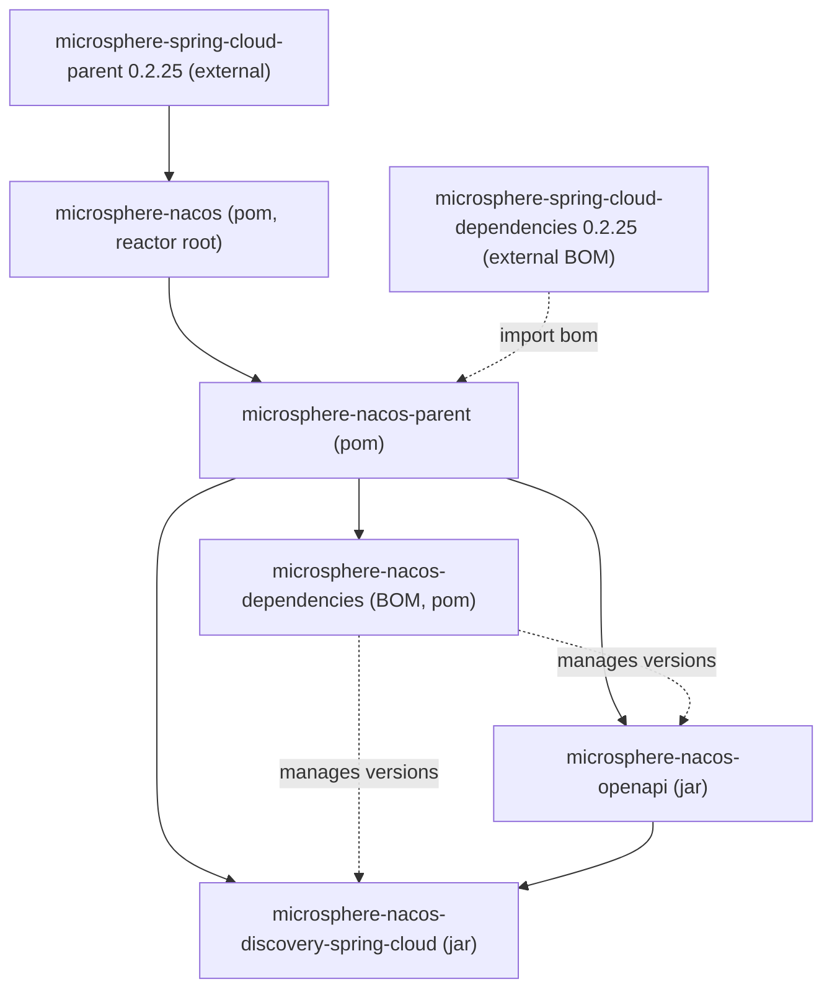

# microsphere-nacos-parent

`microsphere-nacos-parent` 是 `microsphere-nacos` 反应堆中每个其他模块共享的构建 parent（`packaging: pom`）。
它不是你要运行的库；它集中管理依赖，使各 jar 模块与 BOM 在版本上保持一致。它位于根聚合 POM 与所有被构建模块之间。

## Maven 坐标

```xml
<parent>
    <groupId>io.github.microsphere-projects</groupId>
    <artifactId>microsphere-nacos-parent</artifactId>
    <version>${revision}</version>
</parent>
```

在本版本线中 `${revision}` 解析为 `0.2.0-SNAPSHOT`。`microsphere-nacos-openapi`、
`microsphere-nacos-discovery-spring-cloud` 与 `microsphere-nacos-dependencies` 模块都把该 POM 声明为 parent。

## 它提供什么

### 版本属性

| 属性 | 值 |
| --- | --- |
| `httpclient.version` | `4.5.14` |
| `microsphere-spring-cloud.version` | `0.2.25` |

### 依赖管理

该 POM 的 `<dependencyManagement>` 恰好固定并导入两项：

| 受管项 | 类型 | 版本 |
| --- | --- | --- |
| `org.apache.httpcomponents:httpclient` | 显式条目 | `${httpclient.version}` = `4.5.14` |
| `io.github.microsphere-projects:microsphere-spring-cloud-dependencies` | BOM（`pom`，`import` 作用域） | `${microsphere-spring-cloud.version}` = `0.2.25` |

被导入的 `microsphere-spring-cloud-dependencies` BOM 正是 Spring Boot、Spring Cloud 以及其他 Microsphere 模块
（例如 `microsphere-java-core`、`microsphere-annotation-processor`、`microsphere-spring-cloud-commons`）版本的来源。
子 POM 中引用这些 artifact 时**不带**版本，因为它们受此导入管辖。

## 继承链



顺着箭头看：根 POM 继承外部的 `microsphere-spring-cloud-parent:0.2.25`；反应堆声明了 `microsphere-nacos-parent`；
该 parent 导入外部的 `microsphere-spring-cloud-dependencies:0.2.25` BOM 并加入 `httpclient:4.5.14`；BOM 模块与两个
jar 模块都继承自 `microsphere-nacos-parent`。

## 关于 `0.2.25` 的来源说明

本版本线使用的外部 Microsphere Spring Cloud 版本为 **`0.2.25`**。仓库的默认版本线使用 `0.2.26`；这一处单点差异
正是本 `release-1.x` 快照与默认版本线在构建层面的主要区别。由于 `0.2.25` 是未在本快照中原样收录的外部 artifact，
它最终所固定的具体 Spring Boot / Spring Cloud / 编译 JDK 版本**无法从本仓库核对**，因此此处不予重述。

## 版本信息与兼容性

| 项目 | 值 | 来源 |
| --- | --- | --- |
| 自身版本 | `${revision}` = `0.2.0-SNAPSHOT` | 本 POM |
| 父聚合 | `microsphere-nacos`（`0.2.0-SNAPSHOT`） | `../pom.xml` |
| 导入 | `microsphere-spring-cloud-dependencies:0.2.25` | 本 POM，`dependencyManagement` |
| 固定 | `httpclient:4.5.14` | 本 POM，`dependencyManagement` |

作为构建期 POM，`microsphere-nacos-parent` 不贡献任何运行时代码，因此没有属于自身的兼容范围；它所管理的各 jar
模块的兼容性在[索引](README.md)中描述（CI 矩阵：Java `17`/`21`/`25`；`spring-cloud-2022` 至 `spring-cloud-2025`
profile）。

## 相关文档

- [索引](README.md)
- [microsphere-nacos-dependencies](microsphere-nacos-dependencies.md)
- [microsphere-nacos-openapi](microsphere-nacos-openapi.md)
- [microsphere-nacos-discovery-spring-cloud](microsphere-nacos-discovery-spring-cloud.md)
- 开发者指南对应文档：[../../../developer-guide/zh/1.x/microsphere-nacos-parent.md](../../../developer-guide/zh/1.x/microsphere-nacos-parent.md)

## English

[English](../../1.x/microsphere-nacos-parent.md)
