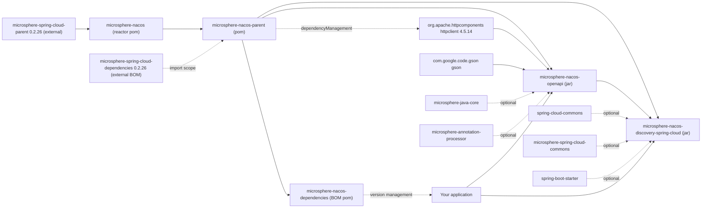

# Microsphere Nacos — 用户指南（current）

本指南对应 `microsphere-nacos` 的 **`release`** 分支版本线，其 Maven revision 为 **`0.2.0-SNAPSHOT`**，
group identifier 为 `io.github.microsphere-projects`。此处所有结论均来自该分支的快照读取；凡是无法从仓库本身确立的
事实，都在正文中标注了其来源。

## 这个项目是什么

`microsphere-nacos` 是一个从零实现的 **Nacos Open API** Java 客户端，以及构建在其之上的 Spring Cloud 服务发现适配器。
它通过纯 HTTP（Apache HttpClient）与 Nacos 通信，并把 Open API 的能力面建模为强类型的 Java 接口。

覆盖两个 Open API 版本：

- **Open API V1**（`/v1`）—— 配置、命名（服务/实例）、命名空间、服务端运维与 RAFT。
- **Open API V2**（`/v2`）—— `/v2` 端点族，包含客户端信息（`/v2/ns/client`）子 API。

## 模块索引

根 reactor `io.github.microsphere-projects:microsphere-nacos`（`packaging: pom`）声明了四个模块：

| 指南 | Artifact ID | 打包方式 | 适用场景 |
| --- | --- | --- | --- |
| [microsphere-nacos-openapi](microsphere-nacos-openapi.md) | `microsphere-nacos-openapi` | `jar` | 你需要一个强类型的 Nacos Open API 客户端（V1 或 V2），且不依赖 Spring |
| [microsphere-nacos-discovery-spring-cloud](microsphere-nacos-discovery-spring-cloud.md) | `microsphere-nacos-discovery-spring-cloud` | `jar` | 你需要把 Open API 客户端以 Spring Cloud `DiscoveryClient` 形式暴露出来 |
| [microsphere-nacos-parent](microsphere-nacos-parent.md) | `microsphere-nacos-parent` | `pom` | 你在本仓库内构建，希望复用其依赖版本管理 |
| [microsphere-nacos-dependencies](microsphere-nacos-dependencies.md) | `microsphere-nacos-dependencies` | `pom` | 你是把本项目作为 BOM 引入的应用程序 |

根 POM 中还列有 `microsphere-nacos-spring` 与 `microsphere-nacos-spring-boot`，但这两个条目在 `<modules>` 中被
**注释掉**，因此不会被构建，也不会从本分支发布，不要依赖它们。

## 模块与依赖关系图



对图的解读：

- 根 POM **继承**外部的 `microsphere-spring-cloud-parent:0.2.26`。
- `microsphere-nacos-parent` 是 `microsphere-nacos-dependencies`、`microsphere-nacos-openapi` 与
  `microsphere-nacos-discovery-spring-cloud` 的直接父 POM，它固定
  `org.apache.httpcomponents:httpclient:4.5.14`，并 import 外部的
  `microsphere-spring-cloud-dependencies:0.2.26` BOM。
- `microsphere-nacos-discovery-spring-cloud` 以 `${revision}` 依赖 `microsphere-nacos-openapi`。
- 模块 POM 中标记为 `optional` 的依赖**不会**传递：Spring Boot、Spring Cloud 与 `microsphere-java-core`
  必须由你的应用自行提供。

## 快速开始

先引入一次 BOM，随后依赖各模块时无需写版本号。

```xml
<dependencyManagement>
    <dependencies>
        <!-- Microsphere Nacos Dependencies (BOM) -->
        <dependency>
            <groupId>io.github.microsphere-projects</groupId>
            <artifactId>microsphere-nacos-dependencies</artifactId>
            <version>${microsphere-nacos.version}</version>
            <type>pom</type>
            <scope>import</scope>
        </dependency>
    </dependencies>
</dependencyManagement>

<dependencies>
    <!-- The typed Nacos Open API client -->
    <dependency>
        <groupId>io.github.microsphere-projects</groupId>
        <artifactId>microsphere-nacos-openapi</artifactId>
    </dependency>

    <!-- Only if you want the Spring Cloud DiscoveryClient adapter -->
    <dependency>
        <groupId>io.github.microsphere-projects</groupId>
        <artifactId>microsphere-nacos-discovery-spring-cloud</artifactId>
    </dependency>
</dependencies>
```

`${microsphere-nacos.version}` 在这一版本线中应设置为 `0.2.0-SNAPSHOT`。仓库自身的 `README.md` 将 `0.2.0` 列为
`main` 分支线的最新版本（兼容 Spring Cloud 2022.0.x – 2025.0.x）；该数字引自 README，在本快照的任何 POM 中都未被声明。

由于 `httpclient` 与 `gson` 是 `microsphere-nacos-openapi` 的 compile 作用域依赖，它们会传递到你的工程中。
被 optional 标记隐藏的其余依赖则需要你自行补充。

## 版本信息

| 项目 | 值 | 来源 |
| --- | --- | --- |
| 本文所描述的分支 | `release` | 本指南分析所用的快照 |
| 目录版本线 | `current` | 本目录 |
| Group ID | `io.github.microsphere-projects` | 根 POM 与各模块 POM |
| Reactor 构件 | `microsphere-nacos`（`pom`） | 根 `pom.xml` |
| Reactor 版本 | `${revision}` = `0.2.0-SNAPSHOT` | 根 `pom.xml` 中的 `<revision>` 属性 |
| 各模块版本 | `${revision}`（`0.2.0-SNAPSHOT`） | `microsphere-nacos-parent`、`-dependencies`、`-openapi`、`-discovery-spring-cloud` |
| 外部父 POM | `microsphere-spring-cloud-parent:0.2.26` | 根 `pom.xml` 中的 `<parent>` |
| 被 import 的 BOM | `microsphere-spring-cloud-dependencies:0.2.26` | `microsphere-nacos-parent/pom.xml` |
| Apache HttpClient | `4.5.14` | `microsphere-nacos-parent/pom.xml` 中的 `<httpclient.version>` |
| Reactor `java.version` 属性 | `17` | 根 `pom.xml` 中的 `<java.version>` |
| Maven wrapper | Apache Maven `3.9.16` | `.mvn/wrapper/maven-wrapper.properties` |
| Javadoc `@since` 标签 | 多数类型为 `1.0.0` | 模块源码；这是基线标记，并非 Maven revision |

**来源说明。** 具体的 Spring Boot 版本、Spring Cloud 版本、Gson 版本以及编译所用 Java 语言级别，均为
**继承自外部父 POM/BOM，本仓库中并未声明**。`microsphere-spring-cloud-parent` 与
`microsphere-spring-cloud-dependencies` 不在本快照内，无法在此核对它们的确切解析版本，因此本指南通篇不为它们给出
任何臆测的固定数字。

## 兼容性范围

`.github/workflows/maven-build.yml` 定义了测试套件实际运行于其上的矩阵：

| 维度 | CI 中验证的取值 |
| --- | --- |
| Java | `17`、`21`、`25` |
| Spring Cloud profile | `spring-cloud-2022`、`spring-cloud-2023`、`spring-cloud-2024`、`spring-cloud-2025` |

构建步骤执行 `mvn test --activate-profiles test,coverage,<spring-cloud profile>`，并带上
`-Drevision=0.0.1-SNAPSHOT`。该 revision 覆盖仅用于 CI，并不改变 POM 中声明的 `0.2.0-SNAPSHOT`。

发布由 `.github/workflows/maven-publish.yml` 负责：它在推送到 `release` 时触发，也可通过手动
`workflow_dispatch` 输入触发（输入值需匹配 `major.minor.patch` 格式校验），随后以 `publish,ci` profile 执行 deploy，
并为所发布的 revision 打 tag。

**测试环境说明。** 两个工作流都通过
`docker compose -f "docker/test-services.yml" up -d` 创建 Nacos 服务。而被引用的 `docker/test-services.yml`
文件**在本快照中并不存在**，因此测试所用 Nacos 服务端的镜像、版本与初始化配置均无法核实，此处刻意不作陈述。
测试自身从 Java 系统属性或环境变量 `SERVER_ADDRESS` 读取服务地址，未设置时会立即失败。

### Nacos Open API 端点覆盖范围

- **V1** —— `/v1/auth/login`；配置 `/v1/cs/configs`、`/v1/cs/configs/listener`、`/v1/cs/history`、
  `/v1/cs/history/previous`；命名 `/v1/ns/service`、`/v1/ns/service/list`、`/v1/ns/instance`、
  `/v1/ns/instance/list`、`/v1/ns/instance/beat`、`/v1/ns/instance/metadata/batch`、
  `/v1/ns/health/instance`；命名空间 `/v1/console/namespaces`；服务端 `/v1/console/server/state`、
  `/v1/ns/operator/switches`、`/v1/ns/operator/metrics`、`/v1/ns/operator/servers`；RAFT
  `/v1/ns/raft/leader`。
- **V2** —— 配置 `/v2/cs/config`、`/v2/cs/history/list`；命名 `/v2/ns/service`、`/v2/ns/instance` 及其子路径；
  命名空间 `/v2/console/namespace`、`/v2/console/namespace/list`；客户端 API `/v2/ns/client`，其下有 `/list`、
  `/publish/list`、`/subscribe/list`、`/service/publisher/list`、`/service/subscriber/list`。V2 配置客户端仍会借用
  V1 的 `/v1/cs/configs` 明细端点，因为 V2 API 未提供等价能力；V2 的认证与服务端/RAFT 操作仍只存在于 V1。

方法级细节请见模块指南：[microsphere-nacos-openapi](microsphere-nacos-openapi.md)。

## 文档地图

- 本版本线对应的开发指南：[developer-guide/zh/current](../../../developer-guide/zh/current/README.md)
- [文档主页](../../../README.md)
- [仓库 README](../../../../README.md)

## English

[English](../../current/README.md)
