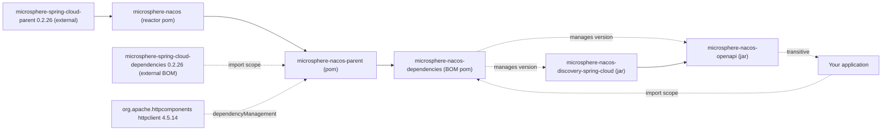

# microsphere-nacos-dependencies

## 概述

`microsphere-nacos-dependencies` 是本项目的 **Bill of Materials（BOM）** —— 一个 `<packaging>pom</packaging>` 模块，
没有源码，其唯一内容就是一条 `<dependencyManagement>`，用于固定本仓库两个发布构件的版本。它存在的意义，是让应用程序
依赖 Nacos 模块时**无需书写版本号**。

请把这里当作 `microsphere-nacos-openapi` 与 `microsphere-nacos-discovery-spring-cloud` 获取版本的唯一场所。它是仓库
自身 `README.md` 推荐给新用户"最简单的上手方式"的入口，也是本仓库中应用程序唯一应当直接引用的模块。

如果你是 *库* 的作者，想要的是本项目的第三方版本固定策略（`httpclient`、Microsphere Spring Cloud BOM）而非仅仅它的
构件坐标，请把 [microsphere-nacos-parent](microsphere-nacos-parent.md) 作为父 POM 使用 —— 以 import 作用域引入 BOM
并不能带来父级继承。

## Maven 坐标与引入

```xml
<dependencyManagement>
    <dependencies>
        <dependency>
            <groupId>io.github.microsphere-projects</groupId>
            <artifactId>microsphere-nacos-dependencies</artifactId>
            <version>${microsphere-nacos.version}</version>
            <type>pom</type>
            <scope>import</scope>
        </dependency>
    </dependencies>
</dependencyManagement>
```

随后声明模块时不带 `<version>`：

```xml
<dependencies>
    <dependency>
        <groupId>io.github.microsphere-projects</groupId>
        <artifactId>microsphere-nacos-openapi</artifactId>
    </dependency>

    <dependency>
        <groupId>io.github.microsphere-projects</groupId>
        <artifactId>microsphere-nacos-discovery-spring-cloud</artifactId>
    </dependency>
</dependencies>
```

在你的根 POM 中设置该属性：

```xml
<properties>
    <microsphere-nacos.version>0.2.0-SNAPSHOT</microsphere-nacos.version>
</properties>
```

`${microsphere-nacos.version}` 并非本仓库任何位置定义的属性 —— 它是仓库 README 沿用的习惯命名，需要你在自己一侧定义。
在这一版本线上应设为 `0.2.0-SNAPSHOT`。

## 被管理的构件

BOM 自身的 `<dependencyManagement>` 恰好包含两条记录：

| Group ID | Artifact ID | 管理版本 | 打包方式 |
| --- | --- | --- | --- |
| `io.github.microsphere-projects` | `microsphere-nacos-openapi` | `${revision}` → `0.2.0-SNAPSHOT` | `jar` |
| `io.github.microsphere-projects` | `microsphere-nacos-discovery-spring-cloud` | `${revision}` → `0.2.0-SNAPSHOT` | `jar` |

`microsphere-nacos-spring` 与 `microsphere-nacos-spring-boot` **不在管理之列**，因为这两个 reactor 条目在根 POM 中被
注释掉，相应构件也不会产出。

### 引入 BOM 还会带来什么

该 BOM 的父级是 `microsphere-nacos-parent`，而 Maven 计算被 import BOM 的管理集合时依据的是其**effective** POM。
实际效果是：引入 `microsphere-nacos-dependencies` 后，你的 `dependencyManagement` 中还会同时出现：

| 在 effective POM 中的来源 | 它贡献的构件 |
| --- | --- |
| `microsphere-nacos-dependencies` 本身 | `microsphere-nacos-openapi`、`microsphere-nacos-discovery-spring-cloud` |
| `microsphere-nacos-parent`（其父 POM） | `org.apache.httpcomponents:httpclient:4.5.14` |
| `microsphere-spring-cloud-dependencies:0.2.26`（由该父 POM import） | Spring Boot / Spring Cloud / Microsphere Spring Cloud 相关构件及其版本 |

请把第三行视为一条**来源说明**：`microsphere-spring-cloud-dependencies` 内部的具体版本是
**继承自外部父 POM/BOM，本仓库中并未声明**，而该外部 BOM 不在 analysed 快照内，因此其中任何成员都无法在此给出可核实
的数字。唯一可核实的是 import 坐标 `0.2.26`，出自 `microsphere-nacos-parent/pom.xml`。

## 与其他 BOM 并存

在 Maven 中，引入顺序会影响结果：对于重复管理的同一坐标，**最先**引入的 BOM 生效。如果你的应用已经引入了
`spring-boot-dependencies` 或 `spring-cloud-dependencies`，请有意识地决定本 BOM 的先后位置，并注意如上所述
`microsphere-nacos-dependencies` 会间接带入 Microsphere 自己的 Spring 版本管理。

## 版本信息

| 项目 | 值 | 来源 |
| --- | --- | --- |
| 模块构件 | `io.github.microsphere-projects:microsphere-nacos-dependencies` | 模块 `pom.xml` |
| 模块版本 | `${revision}` → `0.2.0-SNAPSHOT` | 根 `pom.xml` 的 `<revision>` 属性 |
| 打包方式 | `pom` | 模块 `pom.xml` |
| 父 POM | `microsphere-nacos-parent` `${revision}`，路径 `../microsphere-nacos-parent/pom.xml` | 模块 `pom.xml` |
| `<name>` | `Microsphere :: Nacos :: Dependencies` | 模块 `pom.xml` |
| 被管理的构件 | 两个 jar 模块，均为 `${revision}` | 模块 `pom.xml` |
| 发布方式 | 由 `.github/workflows/maven-publish.yml` 完成：从 `release` 分支以 `major.minor.patch` revision 与 `publish,ci` profile 执行 deploy | 工作流文件；快照本身只携带 `0.2.0-SNAPSHOT` |

## 兼容性

BOM 是一个纯版本固定构件，本身不参与 JDK 编译。它的实际兼容性范围就是它所固定构件的范围，CI 已在 Java `17`、`21`、
`25` 上、配合 `spring-cloud-2022`、`spring-cloud-2023`、`spring-cloud-2024`、`spring-cloud-2025` profile 对其做了
验证（`.github/workflows/maven-build.yml`）。这些 profile 名称背后的 Spring 发布版本来自外部
`microsphere-spring-cloud-dependencies:0.2.26` 的 import，无法从本快照核实。

## 模块依赖关系图



## 相关文档

- [索引](README.md)
- [microsphere-nacos-openapi](microsphere-nacos-openapi.md)
- [microsphere-nacos-discovery-spring-cloud](microsphere-nacos-discovery-spring-cloud.md)
- [microsphere-nacos-parent](microsphere-nacos-parent.md)
- 开发指南对应文档：[../../../developer-guide/zh/current/microsphere-nacos-dependencies.md](../../current/microsphere-nacos-dependencies.md)

## English

[English](../../current/microsphere-nacos-dependencies.md)
