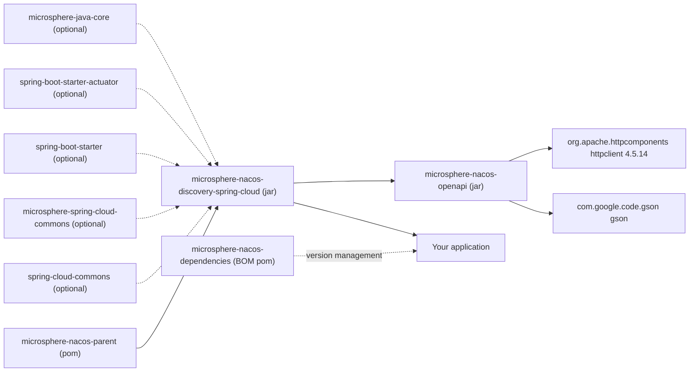

# microsphere-nacos-discovery-spring-cloud

## 概述

`microsphere-nacos-discovery-spring-cloud` 把强类型的 Nacos Open API 客户端适配到 Spring Cloud 的服务发现抽象上。
它的核心是一个类 `NacosDiscoveryClient`（实现
`org.springframework.cloud.client.discovery.DiscoveryClient`）与一个属性类 `NacosClientProperties`（把
`microsphere.nacos.client.*` 配置转换为 `NacosClientConfig`）。

在下列情况下选择本模块：

- 你希望在 Spring Cloud 应用内使用标准的 `DiscoveryClient` 契约（`getServices()`、`getInstances(serviceId)`）来完成
  Nacos 服务发现，而不要引入厂商 starter；
- 你需要以 `ServiceInstance` 视角看待 Nacos 实例，供 `LoadBalancer` 一类的客户端代码消费；
- 你需要在一个 JVM 中访问多个 Nacos 集群，并按名称通过 `microsphere.nacos.clients.<name>.*` 寻址；
- 你只需要**读侧的发现能力**。本模块不含任何 `ServiceRegistry` 实现，因此它不会注册或注销应用自身 —— 实例必须已存在
  于 Nacos 中，例如通过 [microsphere-nacos-openapi](microsphere-nacos-openapi.md) 的 `InstanceClient` 注册。

如果你完全不需要 Spring，请直接依赖 `microsphere-nacos-openapi`。

## Maven 坐标

```xml
<dependencyManagement>
    <dependencies>
        <dependency>
            <groupId>io.github.microsphere-projects</groupId>
            <artifactId>microsphere-nacos-dependencies</artifactId>
            <version>${microsphere-nacos.version}</version>
            <type>pom</type>
            <scope>import</scope>
        </dependency>
    </dependencies>
</dependencyManagement>

<dependencies>
    <dependency>
        <groupId>io.github.microsphere-projects</groupId>
        <artifactId>microsphere-nacos-discovery-spring-cloud</artifactId>
    </dependency>
</dependencies>
```

构件坐标为 `io.github.microsphere-projects:microsphere-nacos-discovery-spring-cloud:${revision}` ——
在这一版本线上即 `0.2.0-SNAPSHOT`。

**Spring 一侧需要你自行补齐。** 在本模块的 POM 中，Spring Boot、Spring Cloud 与
`microsphere-spring-cloud-commons` 均声明为 `<optional>`，因此它们不会传递到你的应用。真正传递的依赖只有
`microsphere-nacos-openapi`（`${revision}`），并由它带出 `httpclient` 与 `gson`。

| 依赖 | 在本 POM 中的作用域 | 对你的影响 |
| --- | --- | --- |
| `io.github.microsphere-projects:microsphere-nacos-openapi` | compile | 传递依赖；带来 Open API 客户端、`httpclient`、`gson` |
| `org.springframework.cloud:spring-cloud-commons` | optional | **需显式添加** —— 提供 `DiscoveryClient` 与 `ServiceInstance` |
| `org.springframework.boot:spring-boot-starter` | optional | **需显式添加** —— 自动配置的前提 |
| `org.springframework.boot:spring-boot-starter-actuator` | optional | 需要发现相关的健康指示器/端点时添加 |
| `io.github.microsphere-projects:microsphere-spring-cloud-commons` | optional | 本 POM 中唯一声明的 Microsphere Spring 构件；自动配置使用的 `@ConditionalOnPropertyPrefix` 注解导入自 `io.microsphere.spring.boot.condition` 包，而 POM 并未指明由哪个构件提供 |
| `io.github.microsphere-projects:microsphere-java-core` | optional | 工具层 |
| `io.github.microsphere-projects:microsphere-annotation-processor` | optional | 仅构建期 |
| `spring-boot-configuration-processor`、`spring-boot-autoconfigure-processor` | optional | 构建期元数据生成 |
| `junit-jupiter`、`spring-boot-starter-test`、`microsphere-spring-boot-test`、`logback-classic` | test | 不会传递给使用者 |

上述所有 Spring 与 Microsphere 构件的版本均为**继承自外部父 POM/BOM，本仓库中并未声明** ——
参见 [microsphere-nacos-parent](microsphere-nacos-parent.md)。

## 自动配置

`src/main/resources/META-INF/spring/org.springframework.boot.autoconfigure.AutoConfiguration.imports` 注册了两个类：

```
io.microsphere.nacos.client.spring.boot.autoconfigure.NacosClientAutoConfiguration
io.microsphere.nacos.client.discovery.spring.cloud.autoconfigure.NacosDiscoveryAutoConfiguration
```

| 类 | 条件 | 导入 / 声明 |
| --- | --- | --- |
| `NacosClientAutoConfiguration` | `@ConditionalOnPropertyPrefix(NacosClientProperties.PREFIX)` —— 仅当存在至少一个 `microsphere.nacos.client.*` 属性时才激活 | `@EnableConfigurationProperties(NacosClientProperties.class)` 与 `@Import(NacosClientConfiguration.class)` |
| `NacosClientConfiguration` | 普通 `@Configuration(proxyBeanMethods = false)` | `@Bean(destroyMethod = "close") OpenApiHttpClient openApiHttpClient(NacosClientConfig)` |
| `NacosDiscoveryConfiguration` | 普通 `@Configuration(proxyBeanMethods = false)` | `@EnableConfigurationProperties(NacosClientProperties.class)`，导入 `NacosClientConfiguration`，并声明 `@Bean NacosDiscoveryClient nacosDiscoveryClient(OpenApiHttpClient, NacosClientProperties)` |
| `NacosDiscoveryAutoConfiguration` | 无条件 | 导入 `NacosDiscoveryConfiguration` 与嵌套类 `Multiple` |
| `NacosDiscoveryAutoConfiguration.Multiple` | `@ConditionalOnProperty(prefix = "microsphere.nacos.clients.")` | `@Bean NacosDiscoveryContextFactory nacosDiscoveryContextFactory(ConfigurableApplicationContext)` |

整套装配都以 `microsphere.nacos.client.*` 是否存在为前提，因此未定义任何这些键的应用不会得到任何 Nacos bean。

## 配置属性

`NacosClientProperties` 标注了 `@ConfigurationProperties(prefix = NacosClientProperties.PREFIX)`，其中
`PREFIX = Constants.PROPERTY_NAME_PREFIX = "microsphere.nacos.client."`。它**继承 `NacosClientConfig`**，因此每一项
客户端设置都可绑定，并额外提供一个嵌套的 `Discovery` 分组。下表键名为依据 JavaBean 访问器推导出的规范 kebab-case
形式；默认值取自 `NacosClientConfig` 的字段默认值。

| 属性键 | 类型 | 默认值 | 用途 |
| --- | --- | --- | --- |
| `microsphere.nacos.client.name` | `String` | `null` | 客户端标识；同时也是 `NacosDiscoveryContextFactory` 读取的属性名 |
| `microsphere.nacos.client.application-name` | `String` | `microsphere-nacos-client`（可通过系统属性 `microsphere.nacos.client.app-name` 覆盖） | 随请求发送的应用名 |
| `microsphere.nacos.client.server-address` | `String` | `null` —— **必须设置** | Nacos 服务的 `host:port` |
| `microsphere.nacos.client.scheme` | `String` | `http` | URL scheme 前缀 |
| `microsphere.nacos.client.context-path` | `String` | `/nacos` | 上下文路径前缀 |
| `microsphere.nacos.client.user-name` | `String` | `null` | 与 `password` 一起启用鉴权 |
| `microsphere.nacos.client.password` | `String` | `null` | 与 `user-name` 一起启用鉴权 |
| `microsphere.nacos.client.access-key` | `String` | `null` | 命名空间 access key |
| `microsphere.nacos.client.secret-key` | `String` | `null` | 命名空间 secret key |
| `microsphere.nacos.client.max-connections` | `int` | `1000` | HttpClient 连接池总数 |
| `microsphere.nacos.client.max-per-route` | `int` | `200` | HttpClient 每路由连接数 |
| `microsphere.nacos.client.connection-timeout` | `int` | `60000` | 毫秒 |
| `microsphere.nacos.client.read-timeout` | `int` | `180000` | 毫秒 |
| `microsphere.nacos.client.long-polling-timeout` | `int` | `30000` | 毫秒 |
| `microsphere.nacos.client.event-processing-timeout` | `int` | `30000000` | 来自 `Constants` 的原始 int；参见 Open API 指南中的说明 |
| `microsphere.nacos.client.fetching-config-thread-name` | `String` | `Nacos Client - Fetching Config Executor` | |
| `microsphere.nacos.client.listener-config-thread-name` | `String` | `Nacos Client - Listening Config Scheduler` | |
| `microsphere.nacos.client.publishing-config-event-thread-name` | `String` | `Nacos Client - Config Event Publisher` | |
| `microsphere.nacos.client.encoding` | `String` | `UTF-8` | |
| `microsphere.nacos.client.discovery.namespace-id` | `String` | `null` | `NacosDiscoveryClient` 查询的命名空间；未设置时按原样传给 Open API 客户端 |

两处命名注意事项，均已从源码核实：

- 配置属性的命名与 `io.microsphere.nacos.client.constants.Constants` 所使用的 **JVM 系统属性**名存在细微差别
  （例如 bean 属性为 `max-per-route`，而系统属性为 `microsphere.nacos.client.max-per-route-connections`）。
- `Constants.PROPERTY_NAME_PREFIX` 以点号结尾，并被原样复用为 `@ConfigurationProperties` 的 prefix。

## API 参考

### NacosDiscoveryClient

`io.microsphere.nacos.client.discovery.spring.cloud.NacosDiscoveryClient implements DiscoveryClient`。

```java
public NacosDiscoveryClient(OpenApiHttpClient openApiHttpClient, NacosClientProperties nacosClientProperties)
```

内部它基于共享传输层构建 `OpenApiServiceClient` 与 `OpenApiInstanceClient` —— 也就是 **Open API V1** 的命名客户端 ——
并缓存 `nacosClientProperties.getDiscovery().getNamespaceId()`。

| 方法 | 行为 |
| --- | --- |
| `String description()` | 返回字面量 `"DiscoveryClient - Nacos"` |
| `List<ServiceInstance> getInstances(String serviceId)` | 调用 `instanceClient.getInstancesList(namespaceId, serviceId)`，再把 `InstancesList#getHosts()` 映射为 `NacosServiceInstance` |
| `List<String> getServices()` | 在 `hasNext()` 为真期间循环调用 `serviceClient.getServiceNames(namespaceId, pageNumber)`，并拼接 `Page#getElements()` |

`getServices()` 通过 `getServiceNames(namespaceId, pageNumber)` 逐页遍历；循环中推进页码所用的取值来自
`getPageSize()`，因此对于规模很大的注册表，建议结合你自己的数据集合进行验证。

### NacosServiceInstance

`io.microsphere.nacos.client.discovery.spring.cloud.NacosServiceInstance implements ServiceInstance`，包装一个 Nacos
`Instance`（可通过 `getInstance()` 取出）。

| `ServiceInstance` 方法 | 取值来源 |
| --- | --- |
| `getInstanceId()` | `Instance#getInstanceId()` |
| `getServiceId()` | `Instance#getService()` |
| `getHost()` | `Instance#getIp()` |
| `getPort()` | `Instance#getPort()` |
| `isSecure()` | 固定为 `false` |
| `getScheme()` | 固定为 `"http"` |
| `getUri()` | `DefaultServiceInstance.getUri(this)` |
| `getMetadata()` | `Instance#getMetadata()` |

### 多命名客户端

`NacosDiscoveryContextFactory extends NamedContextFactory<NacosDiscoverySpecification>`，构造方式为
`super(NacosDiscoveryConfiguration.class, "nacos-discovery", NacosClientProperties.PREFIX + "name")`，并传入父
`ConfigurableApplicationContext`。它为每个客户端名称构建一个子上下文，并插入一个
`MapPropertySource`，其中承载 `microsphere.nacos.clients.<name>.` 下的子属性，位置在 `nacos-discovery` 源之后。

`NacosClientUtils` 提供这些底层能力：

| 成员 | 值 / 行为 |
| --- | --- |
| `NACOS_CLIENTS_PROPERTY_NAME_PREFIX` | `"microsphere.nacos.clients."` |
| `buildNacosClientPropertyNamePrefix(String nacosClientName)` | 前缀 + 名称 + `"."` |
| `getNacosClientProperties(ConfigurableEnvironment, String nacosClientName)` | 通过 `PropertySourcesUtils.getSubProperties` 去掉前缀 |
| `getNacosCilentPropertySource(ConfigurableEnvironment, String nacosClientName)` | 把上述结果包装为以客户端名称命名的 `MapPropertySource`（源码中方法名拼写为 `getNacosCilentPropertySource`） |

`NacosDiscoverySpecification` 是常规的 `NamedContextFactory.Specification`，由 `name` 与 `Class<?>[] configuration`
组成，可通过 `NacosDiscoverySpecification(String name, Class<?>... configuration)` 构造。

请注意两个前缀的区别：**单数**的 `microsphere.nacos.client.` 驱动默认客户端，**复数**的
`microsphere.nacos.clients.` 驱动具名的子上下文。

## 代码示例

本模块在所分析的快照中没有 `src/test` 源码，因此下列示例是严格依据上文列出的真实类签名与自动配置元数据拼装出的最小
用法，而非从测试中摘录。

### 使用发现能力的 Spring Boot 应用

```yaml
spring:
  application:
    name: demo-service

microsphere:
  nacos:
    client:
      server-address: 127.0.0.1:8848
      user-name: nacos
      password: nacos
      discovery:
        namespace-id: public
```

```java
@SpringBootApplication
@RestController
public class DemoApplication {

    private final DiscoveryClient discoveryClient;

    public DemoApplication(DiscoveryClient discoveryClient) {
        this.discoveryClient = discoveryClient;
    }

    @GetMapping("/services")
    public List<String> services() {
        return discoveryClient.getServices();
    }

    @GetMapping("/instances/{serviceId}")
    public List<ServiceInstance> instances(@PathVariable String serviceId) {
        return discoveryClient.getInstances(serviceId);
    }

    public static void main(String[] args) {
        SpringApplication.run(DemoApplication.class, args);
    }
}
```

当 classpath 上只有一个 `DiscoveryClient` 实现时，`discoveryClient` 即解析为 `nacosDiscoveryClient` bean；如果你还注册了
其他实现，请按名称注入。

### 不依赖自动配置地手工装配

同一个对象图，使用源码中声明的构造器显式构建：

```java
@Configuration(proxyBeanMethods = false)
public class NacosDiscoveryConfig {

    @Bean
    public NacosClientProperties nacosClientProperties() {
        NacosClientProperties properties = new NacosClientProperties();
        properties.setServerAddress("127.0.0.1:8848");
        properties.setUserName("nacos");
        properties.setPassword("nacos");
        properties.getDiscovery().setNamespaceId("public");
        return properties;
    }

    @Bean(destroyMethod = "close")
    public OpenApiHttpClient openApiHttpClient(NacosClientProperties properties) {
        return new OpenApiHttpClient(properties);
    }

    @Bean
    public NacosDiscoveryClient nacosDiscoveryClient(OpenApiHttpClient openApiHttpClient,
                                                     NacosClientProperties properties) {
        return new NacosDiscoveryClient(openApiHttpClient, properties);
    }
}
```

由于 `NacosClientProperties extends NacosClientConfig`，同一个对象即可同时满足属性类与客户端配置参数。

### 按客户端划分的 Nacos 集群

```yaml
microsphere:
  nacos:
    client:
      server-address: 127.0.0.1:8848
    clients:
      berlin:
        server-address: 10.0.0.1:8848
      tokyo:
        server-address: 10.0.0.2:8848
```

```java
@Bean
public NacosDiscoveryContextFactory nacosDiscoveryContextFactory(ConfigurableApplicationContext parentContext) {
    return new NacosDiscoveryContextFactory(parentContext);
}

// later
NacosDiscoveryClient berlin = contextFactory.getContext("berlin").getBean(NacosDiscoveryClient.class);
```

定义任意 `microsphere.nacos.clients.*` 键，正是激活
`NacosDiscoveryAutoConfiguration.Multiple` 从而得到 `nacosDiscoveryContextFactory` bean 的条件。

## 版本信息

| 项目 | 值 | 来源 |
| --- | --- | --- |
| 模块构件 | `io.github.microsphere-projects:microsphere-nacos-discovery-spring-cloud` | 模块 `pom.xml` |
| 模块版本 | `${revision}` → `0.2.0-SNAPSHOT` | 根 `pom.xml` 的 `<revision>` 属性 |
| 打包方式 | `jar` | 模块 `pom.xml` |
| 父 POM | `microsphere-nacos-parent`，路径 `../microsphere-nacos-parent/pom.xml` | 模块 `pom.xml` |
| `microsphere-nacos-openapi` 依赖 | `${revision}`（`0.2.0-SNAPSHOT`） | 在模块 POM 中以显式版本声明 |
| Spring Boot / Spring Cloud / microsphere-spring-cloud-commons 版本 | 未给出 | 继承自外部父 POM/BOM，本仓库中并未声明 |
| Javadoc `@since` | `1.0.0` | 源码注释；是基线标记，并非 Maven revision |

## 兼容性

`.github/workflows/maven-build.yml` 在 Java `17`、`21`、`25` 上，针对 `spring-cloud-2022`、`spring-cloud-2023`、
`spring-cloud-2024`、`spring-cloud-2025` profile 构建本模块。这些 profile 名称已从工作流的矩阵中核实；而每个 profile
背后的具体 Spring Boot 与 Spring Cloud 发布版本，**继承自外部父 POM/BOM，本仓库中并未声明**，因此此处不断言任何
版本号。

Spring Cloud 的 `DiscoveryClient` 与 `ServiceInstance` 在这些代际之间是稳定的抽象，这也正是本模块只以 optional
依赖方式对接 `spring-cloud-commons` 的原因。

在服务端一侧，`NacosDiscoveryClient` 使用的是 **Open API V1** 命名端点（`getServices()` 走
`/v1/ns/service/list`，`getInstances()` 走 `/v1/ns/instance/list`），与本模块可用的 V2 支持无关。本模块在快照中没有
自己的测试，且 CI 通过 `docker/test-services.yml` 提供 Nacos 服务，该文件**不在所分析的快照中**，因此无法核实针对本
模块测试过的服务端版本。

## 模块依赖关系图



## 相关文档

- [索引](README.md)
- [microsphere-nacos-openapi](microsphere-nacos-openapi.md)
- [microsphere-nacos-parent](microsphere-nacos-parent.md)
- [microsphere-nacos-dependencies](microsphere-nacos-dependencies.md)
- 开发指南对应文档：[../../../developer-guide/zh/current/microsphere-nacos-discovery-spring-cloud.md](../../current/microsphere-nacos-discovery-spring-cloud.md)

## English

[English](../../current/microsphere-nacos-discovery-spring-cloud.md)
