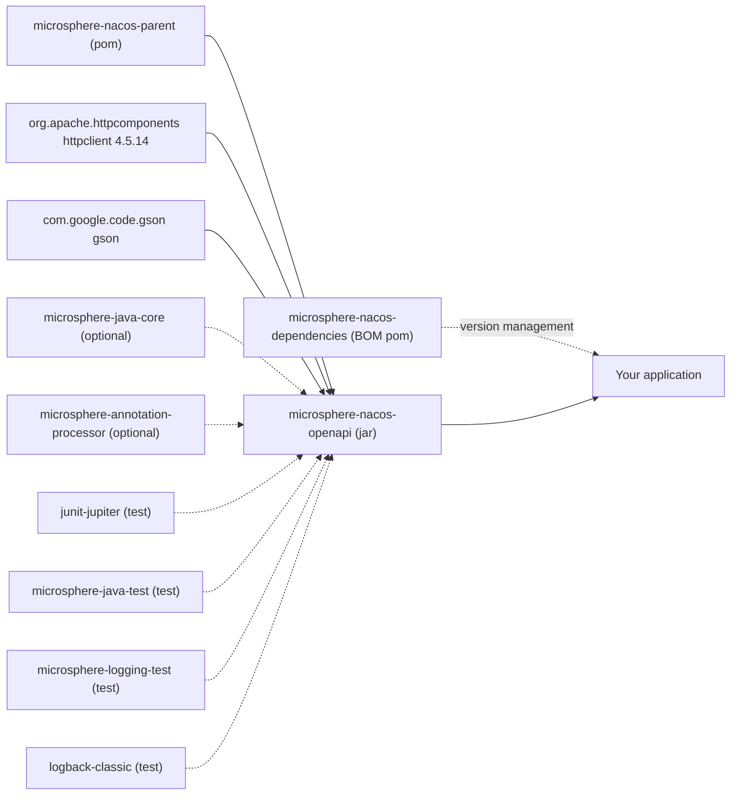

# microsphere-nacos-openapi

## 概述

`microsphere-nacos-openapi` 是一个强类型的 **Nacos Open API** Java 客户端。它在运行时不依赖 Spring：本质是一个纯 HTTP
客户端（Apache HttpClient）加上基于 Gson 的映射层，并把每一项 Open API 能力建模为一个小而聚焦的 Java 接口
（`ConfigClient`、`InstanceClient`、`ServiceClient`、`NamespaceClient`、`AuthenticationClient`、`ServerClient`、
`RaftClient`），每个 Open API 版本各有一套实现族。

在下列情况下选择本模块：

- 你需要在普通 Java 代码、批处理任务或 Spring Cloud 之外的框架中读写 Nacos 配置、注册与查询服务/实例；
- 你希望 V1 **与** V2 两套 Open API 能力收敛到同一套一致的、无受检异常的 API 之下（`NacosClientException` 与
  `OpenApiClientException` 均为非受检异常）；
- 你需要驱动 Nacos 运维操作（命名空间、服务端状态、开关、指标、RAFT leader），而不仅是数据面；
- 你希望为自己接入自定义传输层或序列化器留出入口 —— `OpenApiClient`、`Serializer`、`Deserializer` 都是可扩展接口，
  且反序列化器通过 `ServiceLoader` 定位。

如果你需要的是让 Nacos 以 Spring Cloud `DiscoveryClient` 的形式出现，请额外引入
[microsphere-nacos-discovery-spring-cloud](microsphere-nacos-discovery-spring-cloud.md)，它依赖本模块。

## Maven 坐标

```xml
<dependencyManagement>
    <dependencies>
        <dependency>
            <groupId>io.github.microsphere-projects</groupId>
            <artifactId>microsphere-nacos-dependencies</artifactId>
            <version>${microsphere-nacos.version}</version>
            <type>pom</type>
            <scope>import</scope>
        </dependency>
    </dependencies>
</dependencyManagement>

<dependencies>
    <dependency>
        <groupId>io.github.microsphere-projects</groupId>
        <artifactId>microsphere-nacos-openapi</artifactId>
    </dependency>
</dependencies>
```

构件坐标为 `io.github.microsphere-projects:microsphere-nacos-openapi:${revision}` —— 在这一版本线上即
`0.2.0-SNAPSHOT`。其 POM 中不含任何版本字面量：所有版本均来自 `microsphere-nacos-parent`。

会以传递依赖形式进入你应用的 compile 作用域依赖：

| 依赖 | 作用域 | 版本来源 |
| --- | --- | --- |
| `org.apache.httpcomponents:httpclient` | compile | `4.5.14`，由 `microsphere-nacos-parent/pom.xml` 管理 |
| `com.google.code.gson:gson` | compile | 继承自外部父 POM/BOM，本仓库中并未声明 |

在 POM 中被标记为 `optional`，因此**不会**传递：

| 依赖 | 为什么是 optional |
| --- | --- |
| `io.github.microsphere-projects:microsphere-java-core` | 工具层；客户端编译时依赖它，但你可能已经提供 |
| `io.github.microsphere-projects:microsphere-annotation-processor` | 仅构建期使用的注解处理器 |

test 作用域依赖：`org.junit.jupiter:junit-jupiter`、`io.github.microsphere-projects:microsphere-java-test`、
`io.github.microsphere-projects:microsphere-logging-test`、`ch.qos.logback:logback-classic`。

## 包结构

```
io.microsphere.nacos.client
├── Client / AbstractClient / NacosClientConfig / OpenApiVersion / ErrorCode / NacosClientException
├── common          shared capability interfaces: auth, config, discovery, namespace, model
├── http            HttpMethod
├── io              Serializer / Deserializer / GsonDeserializer and exceptions
├── transport       OpenApiClient / AbstractOpenApiClient / OpenApiHttpClient / request, response, params, headers
├── util            internal helpers (JsonUtils, StringUtils, IOUtils, OpenApiUtils, ErrorCodeControl, ...)
├── constants       Constants
├── v1              NacosClient / OpenApiNacosClient + v1 config, discovery, namespace, server, raft
└── v2              NacosClientV2 / OpenApiNacosClientV2 + v2 client, config, discovery, namespace
```

## API 参考

### NacosClientConfig

`NacosClientConfig`（`io.microsphere.nacos.client.NacosClientConfig`）是传入每个客户端的唯一可变配置对象。它实现了
`Serializable`，并定义了 `equals`/`hashCode`/`toString`。

| 属性 | setter | 类型 | 默认值 | 说明 |
| --- | --- | --- | --- | --- |
| `name` | `setName` | `String` | `null` | 客户端标识；Spring Cloud 模块用它支撑多客户端上下文 |
| `applicationName` | `setApplicationName` | `String` | `APPLICATION_NAME` | 取自系统属性 `microsphere.nacos.client.app-name`，否则为 `microsphere-nacos-client` |
| `serverAddress` | `setServerAddress` | `String` | `null` | `host:port`；若已含 scheme，会被识别而不再重复前缀 |
| `scheme` | `setScheme` | `String` | `http` | 当 `serverAddress` 缺少 scheme 时以 `scheme://` 形式前置 |
| `contextPath` | `setContextPath` | `String` | `/nacos` | 在每个端点之前追加到根路径 |
| `userName` | `setUserName` | `String` | `null` | 仅当用户名与密码同时设置时才会启用鉴权 |
| `password` | `setPassword` | `String` | `null` | 同上 |
| `accessKey` | `setAccessKey` | `String` | `null` | 命名空间级 access key；由配置模型承载 |
| `secretKey` | `setSecretKey` | `String` | `null` | 命名空间级 secret key |
| `maxConnections` | `setMaxConnections` | `int` | `1000` | Apache HttpClient 连接池总连接数 |
| `maxPerRoute` | `setMaxPerRoute` | `int` | `200` | 每路由最大连接数 |
| `connectionTimeout` | `setConnectionTimeout` | `int` | `60000` | 毫秒；同时用作连接请求超时 |
| `readTimeout` | `setReadTimeout` | `int` | `180000` | 毫秒；映射到 socket 超时 |
| `longPollingTimeout` | `setLongPollingTimeout` | `int` | `30000` | 毫秒；在配置监听时作为 `Long-Pulling-Timeout` 请求头发送 |
| `eventProcessingTimeout` | `setEventProcessingTimeout` | `int` | `30000000` | 该常量由 `SECONDS.toMicros(30)` 构造，故默认值为 30 000 000；应按原始 int 理解，而非毫秒 |
| `fetchingConfigThreadName` | `setFetchingConfigThreadName` | `String` | `Nacos Client - Fetching Config Executor` | |
| `listenerConfigThreadName` | `setListenerConfigThreadName` | `String` | `Nacos Client - Listening Config Scheduler` | |
| `publishingConfigEventThreadName` | `setPublishingConfigEventThreadName` | `String` | `Nacos Client - Config Event Publisher` | |
| `encoding` | `setEncoding` | `String` | `UTF-8` | 用于查询参数编码与响应读取 |
| — | — | — | — | `isAuthorizationEnabled()` 仅当 `userName` 与 `password` 均非 null 时返回 `true` |

上述每个默认值都会先尝试从 JVM 系统属性读取。属性名来自
`io.microsphere.nacos.client.constants.Constants`，统一使用前缀 `microsphere.nacos.client.`：

| 系统属性 | 常量 | 回退值 |
| --- | --- | --- |
| `microsphere.nacos.client.app-name` | `APPLICATION_NAME` | `microsphere-nacos-client` |
| `microsphere.nacos.client.max-connections` | `MAX_CONNECTIONS` | `1000` |
| `microsphere.nacos.client.max-per-route-connections` | `MAX_PER_ROUTE_CONNECTIONS` | `200` |
| `microsphere.nacos.client.connection-timeout` | `CONNECTION_TIMEOUT` | `60000` |
| `microsphere.nacos.client.read-timeout` | `READ_TIMEOUT` | `180000` |
| `microsphere.nacos.client.long-polling-timeout` | `LONG_POLLING_TIMEOUT` | `30000` |
| `microsphere.nacos.client.event-processing-timeout` | `EVENT_PROCESSING_TIMEOUT` | `30000000` |
| `microsphere.nacos.client.encoding` | `ENCODING` | `UTF-8` |
| `microsphere.nacos.client.page-number` | `PAGE_NUMBER` | `1` |
| `microsphere.nacos.client.page-size` | `PAGE_SIZE` | `10` |

其他值得了解的常量：`DEFAULT_NAMESPACE_ID = "public"`、`DEFAULT_GROUP_NAME = "DEFAULT_GROUP"`、
`DEFAULT_CLUSTER_NAME = "DEFAULT"`、`DEFAULT_HEALTHY_ONLY = false`、`GROUP_SERVICE_NAME_SEPARATOR = "@@"`，
以及 `ConfigClient.DEFAULT_PAGE_SIZE = 100` / `ConfigClient.MAX_PAGE_SIZE = 500`。

### OpenApiVersion

`OpenApiVersion` 是包含 `V1`（`"/v1"`）与 `V2`（`"/v2"`）的枚举，提供 `getEndpointPath()` 与反向查找
`getVersion(String endpoint)`。各领域客户端以 `getEndpointPath() + RESOURCE_PATH` 构造 URL，因此在子类中覆盖
`getOpenApiVersion()` 就是把一个客户端在两个 API 版本之间切换的关键。

### 传输层

| 类型 | 职责 |
| --- | --- |
| `OpenApiClient` | `AutoCloseable` SPI：`execute(OpenApiRequest)`、`execute(OpenApiRequest, Type)`、`executeAsResult(OpenApiRequest, Type)`、`getSerializer()`、`getDeserializer()`、`getEncoding()` |
| `AbstractOpenApiClient` | 实现 `execute`/`executeAsResult`，用 `getAccessToken()` 注入 `accessToken` 查询参数，拆包 `Result<T>` 信封，并把非 200 响应转换为携带 `ErrorCode` 的 `OpenApiClientException`。子类需实现 `doExecute` 与 `getAccessToken` |
| `OpenApiHttpClient` | 具体传输实现：池化 `CloseableHttpClient`（以 `maxConnections`/`maxPerRoute` 配置的 `PoolingHttpClientConnectionManager`、携带相应超时与 `useSystemProperties()` 的 `RequestConfig`），按 `scheme://serverAddress + contextPath + endpoint` 组装 URL，应用请求头，并通过 `ServiceLoader` 查找 `Serializer`/`Deserializer`；`close()` 负责关停 |
| `OpenApiRequest` | 不可变值对象：`getEndpoint()`、`getMethod()`、`getQueryParameters()`、`getHeaders()` |
| `OpenApiRequest.Builder` | `Builder.create(String endpoint)`、`Builder.from(OpenApiRequest)`、`method(HttpMethod)`、`queryParameter(OpenApiRequestParam, …)`、`removeParameter(s)`、`header(OpenApiRequestHeader, …)`、`build()` |
| `OpenApiRequestParam` / `OpenApiRequestHeader` | 枚举化的线上名称，例如 `USER_NAME("username")`、`PASSWORD("password")`、`ACCESS_TOKEN("accessToken")`、`CONFIG_TENANT("tenant")`、`CONFIG_GROUP("group")`、`CONFIG_DATA_ID("dataId")`、`CONFIG_REVISION("nid")`、`NAMESPACE_ID("namespaceId")`、`LISTENING_CONFIGS("Listening-Configs")`；请求头包含 `LONG_PULLING_TIMEOUT("Long-Pulling-Timeout")`、`CLIENT_VERSION_HEADER("Client-Version")`、`REQUESTER("Requester")` |
| `OpenApiResponse` | `getStatusCode()`、`getStatusMessage()`、以 `InputStream` 形式提供的 `getContent()` |
| `HttpMethod` | GET / POST / PUT / DELETE 到 Apache 请求类型的映射 |
| `OpenApiClientException` | 针对非 200 响应、I/O 失败与反序列化问题抛出；暴露 `getErrorCode()` |

### 鉴权

| 类型 | 职责 |
| --- | --- |
| `AuthenticationClient` | `authenticate()`（使用配置的用户名与密码）与 `authenticate(String userName, String password)` |
| `OpenApiAuthenticationClient` | 向 `/v1/auth/login` 发起 POST，携带 `username` 与 `password` 查询参数，并把响应映射为 `Authentication` |
| `AuthorizationManager` | 负责令牌生命周期，在 `OpenApiHttpClient` 内部构建。启用鉴权时会立即认证一次，随后由名为 `Nacos Client - Authorization Refresher` 的守护线程调度器按**所返回 `tokenTtl` 的一半**重新认证（无可用令牌时为 30 秒，因为回退 TTL 60 本身也会被折半）。未启用鉴权时 `getAccessToken()` 返回 `null` |
| `Authentication` | 含 `accessToken`、`tokenTtl`、`globalAdmin` 的模型 |
| `AuthorizationException` | 周期性令牌刷新失败时抛出 |

所获得的令牌由 `AbstractOpenApiClient` 以 `accessToken` 查询参数附加到之后每一个请求上，因此应用代码无需逐个调用
处理鉴权。

### 序列化

`Serializer` 与 `Deserializer` 是映射 SPI，配套 `DefaultSerializer`/`DefaultDeserializer` 以及 Gson 变体
`GsonDeserializer`、`SerializationException`、`DeserializationException`。具体的载荷读取器注册于
`META-INF/services/io.microsphere.nacos.client.io.GsonDeserializer`，在运行时被发现：
`ConfigDeserializer`、`HistoryConfigDeserializer`、`HistoryConfigPageDeserializer`、`NamespaceDeserializer`、
`ServerStateDeserializer`、`ServerMetricsDeserializer`、`ServerDeserializer`、`RaftModelDeserializer`、
`ClientInstanceDeserializer`、`ClientSubscriberDeserializer`、`ClientInfoDeserializer`。

### 门面客户端

`OpenApiNacosClient` 与 `OpenApiNacosClientV2` 把所有领域客户端聚合到一个对象之后，因此单个实例即可覆盖整台
Nacos 服务。

| 门面 | 实现的接口 | Open API 版本 | 组合的领域客户端 |
| --- | --- | --- | --- |
| `v1.NacosClient`（接口）/ `v1.OpenApiNacosClient`（类） | `AuthenticationClient`、`ConfigClient`、`ServiceClient`、`InstanceClient`、`NamespaceClient`、`ServerClient`、`RaftClient`、`Client` | `V1` | `OpenApiAuthenticationClient`、`OpenApiConfigClient`、`OpenApiServiceClient`、`OpenApiInstanceClient`、`OpenApiNamespaceClient`、`OpenApiServerClient`、`OpenApiRaftClient` |
| `v2.NacosClientV2`（接口）/ `v2.OpenApiNacosClientV2`（类） | `AuthenticationClient`、`ConfigClient`、`ServiceClient`、`InstanceClient`、`NamespaceClient`、`Client` | `V2` | `OpenApiAuthenticationClient`、`OpenApiConfigClientV2`、`OpenApiServiceClientV2`、`OpenApiInstanceClientV2`、`OpenApiNamespaceClientV2` |

两个门面都通过 getter 暴露其委托对象 —— `getAuthenticationClient()`、`getConfigClient()`、`getServiceClient()`、
`getInstanceClient()`、`getNamespaceClient()` —— 而 `OpenApiNacosClient` 另有 `getServerClient()` 与
`getRaftClient()`。两者都提供两个构造器：`(...)(NacosClientConfig)` 会自建 `OpenApiHttpClient`；
`(...)(OpenApiClient, NacosClientConfig)` 则复用由你管理的传输层。注意 `NacosClientV2` 的实现类上仍保留了
`getServerClient()`/`getRaftClient()`，因为服务端与 RAFT 端点只存在于 `/v1` 之下。

### ConfigClient

由 `v1.config.OpenApiConfigClient`（`/v1/cs/...`）与 `v2.config.OpenApiConfigClientV2`（`/v2/cs/...`，继承 V1 类）实现。

| 方法 | 说明 |
| --- | --- |
| `String getConfigContent(String dataId)` | 便捷重载依次补充 `group`、`namespaceId`、`tag`；默认取 `DEFAULT_GROUP` / `public` |
| `String getConfigContent(String namespaceId, String group, String dataId, String tag)` | 该族的终结方法 |
| `Config getConfig(String group, String dataId)` / `getConfig(String namespaceId, String group, String dataId)` | 返回完整 `Config` 模型；V2 无对应端点，故 V2 客户端委托到 V1 明细查询 |
| `boolean publishConfigContent(String group, String dataId, String content)` | 重载依次补充 `namespaceId`、`ConfigType`、`tag` |
| `boolean publishConfigContent(String namespaceId, String group, String dataId, String content, String tag, ConfigType configType)` | 先读取现有配置，再发布一个 `NewConfig` |
| `boolean publishConfig(NewConfig newConfig)` | 承载 tags、app name、operator、description、use、effect、schema、type |
| `boolean deleteConfig(String dataId)` | 重载依次补充 `group`、`namespaceId`、`tag` |
| `Page<HistoryConfig> getHistoryConfigs(String namespaceId, String group, String dataId, int pageNumber, int pageSize)` | 较短的重载默认使用 `PAGE_NUMBER` 与 `ConfigClient.DEFAULT_PAGE_SIZE`（100） |
| `HistoryConfig getHistoryConfig(String namespaceId, String group, String dataId, long revision)` | 单条历史记录 |
| `HistoryConfig getPreviousHistoryConfig(String namespaceId, String group, String dataId, String id)` | 某个在线配置 id 的前一条记录 |
| `void addEventListener(String namespaceId, String group, String dataId, ConfigChangedListener listener)` | 注册长轮询监听器；用 `removeEventListener` 注销 |

配置监听由包级私有的 `ConfigListenerManager` 提供：它向 `/v1/cs/configs/listener` 发起 POST 并携带
`Long-Pulling-Timeout` 请求头，按 `NacosClientConfig` 中配置的线程名运行一个拉取执行器、一个监听调度器与一个事件发布器，
并在 JVM 关闭时取消各自的执行器。`ConfigChangedListener` 只有一个方法
`void onEvent(ConfigChangedEvent event)`；`ConfigChangedEvent` 暴露 `getPrevious()`、`getCurrent()`、`getKind()`
（`CREATED` / `MODIFIED` / `DELETED`）、`isCreated()`、`isModified()`、`isDeleted()`，以及命名空间、分组、dataId 与
content 的访问器，并通过静态工厂 `ofCreated`、`ofModified`、`ofDeleted` 创建。

`ConfigType` 枚举包含 `TEXT`、`JSON`、`XML`、`YAML`、`HTML`、`PROPERTIES`（线上值 `Properties`），提供
`getValue()` 与 `of(String)`。

### InstanceClient

由 `v1.discovery.OpenApiInstanceClient` 与 `v2.discovery.OpenApiInstanceClientV2` 实现。

| 方法 | 说明 |
| --- | --- |
| `boolean register(NewInstance newInstance)` | 实例注册 |
| `boolean deregister(DeleteInstance deleteInstance)` | 可用 `DeleteInstance.build(baseInstance)` 或 `deleteInstance.from(instance)` |
| `boolean refresh(UpdateInstance updateInstance)` | 更新 weight/metadata |
| `Instance getInstance(QueryInstance queryInstance)` | 终结查询方法；重载从 `serviceName`/`ip`/`port` 构造，再依次补充 `clusterName`、`groupName`、`namespaceId` |
| `InstancesList getInstancesList(...)` | 共 12 个重载，从 `getInstancesList(String serviceName)` 一直到 `getInstancesList(namespaceId, groupName, clusterName, serviceName, ip, port, healthyOnly, app)` |
| `Heartbeat sendHeartbeat(Instance instance)` | 返回 `code`、`clientBeatInterval`、`lightBeatEnabled` |
| `boolean updateHealth(UpdateHealthInstance updateHealthInstance)` | `new UpdateHealthInstance(healthy).from(instance)` |
| `BatchMetadataResult batchUpdateMetadata(Iterable<Instance> instances, Map<String, String> metadata)` | 带 `ConsistencyType` 的重载默认为 `EPHEMERAL` |
| `BatchMetadataResult batchDeleteMetadata(Iterable<Instance> instances, Map<String, String> metadata)` | 同样的默认策略 |

实例模型继承链为 `DiscoverableModel`（`namespaceId`、`clusterName`、`groupName`、`serviceName`）→
`BaseInstance`（`ip`、`port`、`ephemeral`）→ `GenericInstance`（`enabled`、`weight`、`metadata`）→
`NewInstance`（`healthy`）→ `Instance`（`instanceId`、`service`、`valid`、`marked`、`instanceIdGenerator`、
`instanceHeartBeatInterval`、`instanceHeartBeatTimeOut`、`ipDeleteTimeout`）。`InstancesList` 携带 `name`、`dom`、
`clusters`、`hosts`、`checksum`、`cacheMillis`、`lastRefTime`、`namespaceId`、`groupName`、`serviceName`。

### ServiceClient

由 `v1.discovery.OpenApiServiceClient` 与 `v2.discovery.OpenApiServiceClientV2` 实现。

| 方法 | 说明 |
| --- | --- |
| `boolean createService(Service service)` | |
| `boolean updateService(Service service)` | |
| `boolean deleteService(String namespaceId, String groupName, String serviceName)` | `deleteService(namespaceId, serviceName)` 省略分组 |
| `Service getService(String namespaceId, String groupName, String serviceName)` | 服务不存在时抛出 `OpenApiClientException` |
| `Page<String> getServiceNames(String namespaceId, String groupName, int pageNumber, int pageSize)` | 另有 5 个较短重载，把 `groupName` 默认置为 `null`，分页默认取 `Constants.PAGE_NUMBER` / `PAGE_SIZE` |

`Service` 继承 `DiscoverableModel`，并新增 `name`、`metadata`、`selector`（`Selector#getType()`）、
`protectThreshold`、`clusters`。

### NamespaceClient

由 `v1.namespace.OpenApiNamespaceClient`（`/v1/console/namespaces`）与
`v2.namespace.OpenApiNamespaceClientV2`（`/v2/console/namespace`、`/v2/console/namespace/list`）实现。

| 方法 | 说明 |
| --- | --- |
| `List<Namespace> getAllNamespaces()` | |
| `Namespace getNamespace(String namespaceId)` | 未找到时返回 `null` |
| `boolean createNamespace(String namespaceId, String namespaceName, String namespaceDesc)` | 两参数重载传入 `null` 描述 |
| `boolean updateNamespace(String namespaceId, String namespaceName, String namespaceDesc)` | |
| `boolean deleteNamespace(String namespaceId)` | |

`Namespace` 暴露 `namespaceId`、`namespaceName`、`namespaceDesc`、`quota`、`configCount`、`type`。

### ServerClient 与 RaftClient（仅 V1）

`v1.server.ServerClient` 组合了 `ServerSwitchClient`、`ServerMetricsClient` 与 `ServersListClient`，并新增
`getServerState()`。

| 方法 | 端点 | 返回值 |
| --- | --- | --- |
| `ServerState getServerState()` | `/v1/console/server/state` | `mode`、`functionMode`、`version` |
| `ServerSwitch getServerSwitch()` | `/v1/ns/operator/switches` | 开关模型 |
| `boolean updateServerSwitch(String switchName, String switchValue, boolean debug)` | `/v1/ns/operator/switches` | 两参数重载将 `debug` 默认为 `true` |
| `ServerMetrics getServerMetrics()` | `/v1/ns/operator/metrics` | 指标模型 |
| `ServersList getServersList()` | `/v1/ns/operator/servers` | 服务列表 |
| `RaftModel getRaftModel()` | `/v1/ns/raft/leader` | 属于 `RaftClient`，**已标记 `@Deprecated`**；`RaftModel.getLeader()` 产出含 `ip`、`term`、`state`、`leaderDueMs`、`heartbeatDueMs` 的 `RaftPeer` |

### V2 客户端信息 API

`NacosClientV2` 新增了只存在于 `/v2/ns/client` 之下的操作：

| 方法 | 说明 |
| --- | --- |
| `List<String> getAllClientIds()` | `/v2/ns/client/list` |
| `ClientDetail getClientDetail(String clientId)` | `clientId`、`clientType`、`clientIp`、`clientPort`、`connectType`、`appName`、`version`、`ephemeral`、`lastUpdatedTime` |
| `List<ClientInstance> getRegisteredInstances(String clientId)` | `/v2/ns/client/publish/list` |
| `List<ClientSubscriber> getSubscribers(String clientId)` | `/v2/ns/client/subscribe/list` |
| `List<ClientInfo> getRegisteredClients(...)` | 5 个重载，最终为 `(namespaceId, groupName, serviceName, ConsistencyType, ip, port)`；默认值为 `public`、`DEFAULT_GROUP`、`EPHEMERAL` |
| `List<ClientInfo> getSubscribedClients(...)` | 4 个重载，最终为 `(namespaceId, groupName, serviceName, ConsistencyType, ip, port)` |

`ClientInfo` 暴露 `clientId`、`clientIp`、`clientPort`。`ConsistencyType` 枚举包含 `EPHEMERAL`（`"ephemeral"`）与
`PERSIST`（`"persist"`）。

### 错误处理

`ErrorCode` 是一个带编号的枚举，覆盖三个区段 —— Nacos 1.x 的 HTTP 状态（`BAD_REQUEST` 400、`FORBIDDEN` 403、
`NOT_FOUND` 404、`INTERNAL_SERVER_ERROR` 500）、Nacos 2.x 的业务码 10000–30000（`PARAMETER_MISSING` 10000、
`ACCESS_DENIED` 10001、`DATA_ACCESS_ERROR` 10002、`TENANT_PARAMETER_ERROR` 20001 …… `SERVER_ERROR` 30000），
以及客户端码 40000–49999（`CLIENT_ERROR`、`IO_ERROR`、`SERIALIZATION_ERROR`、`DESERIALIZATION_ERROR`）。每个枚举项提供
`getValue()`、`getReason()`、`getMessage()`、`getMessage(Locale)` 与 `valueOf(int)`；本地化文案位于
`META-INF/error-code/messages.properties` 与 `messages_zh_CN.properties`，通过自定义的 `ErrorCodeControl`
资源束控制器加载。

非受检异常：`NacosClientException`、`OpenApiClientException`、`AuthorizationException`、`SerializationException`、
`DeserializationException`。

## 代码示例

以下示例取自本模块 `microsphere-nacos-openapi/src/test/java` 下的 JUnit 5 测试，这些测试即为权威用法参考。它们要求
一个可通过 `SERVER_ADDRESS` 系统属性或环境变量指定的可达 Nacos 服务。

### 初始化客户端

取自共享测试基类 `io.microsphere.nacos.client.OpenApiTest`：

```java
static String getServerAddress() {
    String key = SERVER_ADDRESS_PROPERTY_NAME;
    return System.getProperty(key, System.getenv(key));
}

@BeforeEach
public void init() {
    String serverAddress = getServerAddress();
    if (serverAddress == null) {
        String errorMessage = format("The Java System Property[ name : '%s' ] for Nacos Server must be set!", SERVER_ADDRESS_PROPERTY_NAME);
        throw new IllegalArgumentException(errorMessage);
    }
    NacosClientConfig config = new NacosClientConfig();
    config.setServerAddress(serverAddress);
    customize(config);
    this.openApiClient = new OpenApiHttpClient(config);
    this.nacosClientConfig = config;

    setup();
}
```

以及负责关闭传输层的清理逻辑：

```java
@AfterEach
public void destroy() throws Exception {
    if (openApiClient != null) {
        openApiClient.close();
    }
}
```

### 鉴权

取自 `v1.auth.OpenApiAuthenticationClientTest`：

```java
@Test
public void testAuthenticate() {
    NacosClientConfig nacosClientConfig = this.nacosClientConfig;
    nacosClientConfig.setUserName("nacos");
    nacosClientConfig.setPassword("nacos");
    OpenApiAuthenticationClient client = new OpenApiAuthenticationClient(openApiClient, nacosClientConfig);
    Authentication authentication = client.authenticate();
    assertNotNull(authentication);
    assertNotNull(authentication.getAccessToken());
    assertTrue(authentication.getTokenTtl() > 0);
    assertTrue(authentication.isGlobalAdmin());
}
```

### 配置管理

取自 `v1.config.OpenApiConfigClientTest`；同一测试主体也通过 `v2.config.OpenApiConfigClientV2Test` 作用于
`OpenApiConfigClientV2`，后者只替换了工厂方法。

```java
protected ConfigClient createConfigClient() {
    return new OpenApiConfigClient(this.openApiClient, this.nacosClientConfig);
}

@Test
public void test() throws Exception {
    ConfigClient client = createConfigClient();

    AtomicReference<ConfigChangedEvent> eventRef = new AtomicReference<>();
    client.addEventListener(TEST_NAMESPACE_ID, TEST_GROUP_NAME, TEST_DATA_ID, e -> {
        eventRef.set(e);
    });

    assertTrue(client.deleteConfig(TEST_NAMESPACE_ID, TEST_GROUP_NAME, TEST_DATA_ID));

    Config config = client.getConfig(TEST_NAMESPACE_ID, TEST_GROUP_NAME, TEST_DATA_ID);
    assertNull(config);

    NewConfig newConfig = createNewConfig();
    assertTrue(client.publishConfig(newConfig));

    String newContent = "New Content for testing...";
    assertTrue(client.publishConfigContent(TEST_NAMESPACE_ID, TEST_GROUP_NAME, TEST_DATA_ID, newContent));

    Page<HistoryConfig> page = client.getHistoryConfigs(TEST_NAMESPACE_ID, TEST_GROUP_NAME, TEST_DATA_ID);
    assertTrue(page.isFirst());
    List<HistoryConfig> historyConfigs = page.getElements();
    HistoryConfig historyConfig = historyConfigs.get(0);
    HistoryConfig historyConfig1 = client.getHistoryConfig(TEST_NAMESPACE_ID, TEST_GROUP_NAME, TEST_DATA_ID, historyConfig.getRevision());
}
```

载荷的构造，与同一测试中完全一致：

```java
private NewConfig createNewConfig() {
    NewConfig newConfig = new NewConfig();
    newConfig.setNamespaceId(TEST_NAMESPACE_ID);
    newConfig.setGroup(TEST_GROUP_NAME);
    newConfig.setDataId(TEST_DATA_ID);
    newConfig.setContent(TEST_CONFIG_CONTENT);
    newConfig.setTags(TEST_CONFIG_TAGS);
    newConfig.setAppName(TEST_CONFIG_APP_NAME);
    newConfig.setDescription(TEST_CONFIG_DESCRIPTION);
    newConfig.setOperator(TEST_CONFIG_OPERATOR);
    newConfig.setUse(TEST_CONFIG_USE);
    newConfig.setEffect(TEST_CONFIG_EFFECT);
    newConfig.setSchema(TEST_CONFIG_SCHEMA);
    newConfig.setType(CONFIG_TYPE);
    return newConfig;
}
```

### 命名：服务与实例

`v1.discovery.OpenApiServiceClientTest`：

```java
protected ServiceClient createServiceClient() {
    return new OpenApiServiceClient(this.openApiClient, this.nacosClientConfig);
}

private Service createService() {
    Service service = new Service();
    service.setNamespaceId(TEST_NAMESPACE_ID);
    service.setGroupName(TEST_GROUP_NAME);
    service.setName(TEST_SERVICE_NAME);
    service.setProtectThreshold(0.0f);
    Selector selector = new Selector();
    selector.setType("none");
    service.setSelector(selector);
    Map<String, String> metadata = singletonMap("servce.name", TEST_SERVICE_NAME);
    service.setMetadata(metadata);
    return service;
}
```

配合生命周期调用 `createService(service)`、`getService(namespaceId, groupName, serviceName)`、
`updateService(service)`、`deleteService(namespaceId, groupName, serviceName)` 与
`getServiceNames(namespaceId, groupName)`。

`v1.discovery.OpenApiInstanceClientTest`：

```java
public static Instance createInstance() {
    Instance instance = new Instance();
    instance.setNamespaceId(TEST_NAMESPACE_ID);
    instance.setGroupName(TEST_GROUP_NAME);
    instance.setServiceName(TEST_SERVICE_NAME);
    instance.setClusterName(TEST_CLUSTER);
    instance.setIp(TEST_INSTANCE_IP);
    instance.setPort(TEST_INSTANCE_PORT);
    instance.setWeight(TEST_INSTANCE_WEIGHT);
    instance.setEnabled(TEST_INSTANCE_ENABLED);
    instance.setHealthy(TEST_INSTANCE_HEALTHY);
    instance.setEphemeral(TEST_INSTANCE_EPHEMERAL);
    instance.setMetadata(TEST_INSTANCE_METADATA);
    return instance;
}

@Test
public void test() {
    NewInstance newInstance = new NewInstance().from(instance);
    assertTrue(client.register(newInstance));

    Heartbeat heartbeat = client.sendHeartbeat(instance);
    assertTrue(heartbeat.getCode() > 0);

    await(1);
    QueryInstance queryInstance = new QueryInstance().from(instance);
    Instance exsitedInstance = client.getInstance(queryInstance);

    instance.setWeight(50.0);
    UpdateInstance updateInstance = new UpdateInstance().from(instance);
    assertTrue(client.refresh(updateInstance));

    InstancesList instancesList = client.getInstancesList(TEST_NAMESPACE_ID, TEST_GROUP_NAME, TEST_SERVICE_NAME);
    List<Instance> instances = instancesList.getHosts();

    Map<String, String> metadata = singletonMap("test-key-2", "test-value-2");
    BatchMetadataResult result = client.batchUpdateMetadata(asList(exsitedInstance), metadata);
    assertFalse(result.getUpdated().isEmpty());
}
```

测试装置所使用的注销写法：

```java
DeleteInstance deleteInstance = new DeleteInstance();
deleteInstance.from(instance);
this.client.deregister(deleteInstance);
```

### 命名空间

`v1.namespace.OpenApiNamespaceClientTest`：

```java
List<Namespace> namespaces = namespaceClient.getAllNamespaces();
Namespace namespace = namespaces.get(0);
assertEquals("public", namespace.getNamespaceName());

namespace = namespaceClient.getNamespace(NAMESPACE_ID);
assertNull(namespace);

assertTrue(namespaceClient.createNamespace(NAMESPACE_ID, NAMESPACE_NAME, NAMESPACE_DESC));
assertTrue(namespaceClient.updateNamespace(NAMESPACE_ID, MODIFIED_NAMESPACE_NAME, MODIFIED_NAMESPACE_DESC));
assertTrue(namespaceClient.deleteNamespace(NAMESPACE_ID));
```

### Open API V2 客户端信息

`v2.OpenApiNacosClientV2Test`，它驱动了整个门面：

```java
this.client = new OpenApiNacosClientV2(this.openApiClient, this.nacosClientConfig);
this.instance = createInstance();
this.client.deregister(DeleteInstance.build(this.instance));

NewInstance newInstance = new NewInstance().from(instance);
assertTrue(client.register(newInstance));

List<String> allClientIds = client.getAllClientIds();
String clientId = allClientIds.get(0);
ClientDetail clientDetail = client.getClientDetail(clientId);

List<ClientInstance> registeredInstances = client.getRegisteredInstances(clientId);
List<ClientSubscriber> clientSubscribers = client.getSubscribers(clientId);

List<ClientInfo> registeredClients = client.getRegisteredClients(
        newInstance.getNamespaceId(),
        newInstance.getGroupName(),
        newInstance.getServiceName(),
        EPHEMERAL,
        newInstance.getIp(),
        newInstance.getPort()
);

List<ClientInfo> subscribedClients = client.getSubscribedClients(
        newInstance.getNamespaceId(),
        newInstance.getGroupName(),
        newInstance.getServiceName(),
        EPHEMERAL,
        newInstance.getIp(),
        newInstance.getPort()
);

assertTrue(client.deregister(DeleteInstance.build(instance)));
```

### 裸传输请求

`transport.OpenApiHttpClientTest`，用于强类型客户端未覆盖的端点：

```java
@Test
public void testExecute() throws IOException {
    OpenApiRequest.Builder builder = OpenApiRequest.Builder.create("/v1/console/server/state");
    OpenApiRequest request = builder.build();

    OpenApiResponse response = openApiClient.execute(request);

    assertEquals(200, response.getStatusCode());
    assertNotNull(response.getContent());
}

@Test
public void testExecuteForPayload() throws IOException {
    OpenApiRequest.Builder builder = OpenApiRequest.Builder.create("/v1/console/server/state");
    OpenApiRequest request = builder.build();

    ServerState serverState = openApiClient.execute(request, ServerState.class);
    assertNotNull(serverState.getVersion());
}
```

### 服务端状态与 RAFT leader

```java
ServerClient serverClient = new OpenApiServerClient(this.openApiClient, this.nacosClientConfig);
ServerState serverState = serverClient.getServerState();
assertNotNull(serverState.getVersion());

RaftClient raftClient = new OpenApiRaftClient(this.openApiClient, this.nacosClientConfig);
RaftModel raftModel = raftClient.getRaftModel();
RaftPeer leader = raftModel.getLeader();
```

### 单对象门面

`OpenApiNacosClient` 实现了 `NacosClient`，因此一个实例即可赋值给所有能力接口：

```java
NacosClientConfig config = new NacosClientConfig();
config.setServerAddress("127.0.0.1:8848");
config.setUserName("nacos");
config.setPassword("nacos");

NacosClient nacosClient = new OpenApiNacosClient(config);
String content = nacosClient.getConfigContent("public", "DEFAULT_GROUP", "application.properties");
```

## 版本信息

| 项目 | 值 | 来源 |
| --- | --- | --- |
| 模块构件 | `io.github.microsphere-projects:microsphere-nacos-openapi` | 模块 `pom.xml` |
| 模块版本 | `${revision}` → `0.2.0-SNAPSHOT` | 根 `pom.xml` 的 `<revision>` 属性 |
| 打包方式 | `jar` | 模块 `pom.xml` |
| 父 POM | `microsphere-nacos-parent`，路径 `../microsphere-nacos-parent/pom.xml` | 模块 `pom.xml` |
| `httpclient` | `4.5.14` | 由 `microsphere-nacos-parent/pom.xml` 管理 |
| `gson`、`microsphere-java-core`、`microsphere-annotation-processor`、测试库 | 本 POM 中无版本号 | 继承自外部父 POM/BOM，本仓库中并未声明 |
| Javadoc `@since` | 公共类型上为 `1.0.0` | 源码注释；是基线标记，并非 Maven revision |

## 兼容性

`.github/workflows/maven-build.yml` 在 Java `17`、`21`、`25` 上，配合 `spring-cloud-2022`、`spring-cloud-2023`、
`spring-cloud-2024`、`spring-cloud-2025` profile 运行本模块的测试。本模块自身没有 Spring 依赖，因此这些 profile
影响的是 reactor 的依赖解析而非本模块代码；所解析出的 Spring Boot 与 Spring Cloud 版本
**继承自外部父 POM/BOM，本仓库中并未声明**，故此处不给出具体数字。

在服务端一侧，客户端覆盖上文列出的 Nacos Open API V1 与 V2 端点族。测试需要一个由 `SERVER_ADDRESS` 指向的活跃
Nacos 服务。CI 通过 `docker compose -f "docker/test-services.yml" up -d` 启动它，但该 compose 文件**不在所分析的
快照中**，因此受测的 Nacos 服务版本无法核实，此处不作声明。源码中有两处注释
（`OpenApiConfigClientTest` 里的 `// FIXME: V1 and V2 compatibility`）记录了部分字段（尤其是 `appName`）无法被两个
API 版本一致返回的事实。

## 模块依赖关系图



## 相关文档

- [索引](README.md)
- [microsphere-nacos-discovery-spring-cloud](microsphere-nacos-discovery-spring-cloud.md)
- [microsphere-nacos-parent](microsphere-nacos-parent.md)
- [microsphere-nacos-dependencies](microsphere-nacos-dependencies.md)
- 开发指南对应文档：[../../../developer-guide/zh/current/microsphere-nacos-openapi.md](../../current/microsphere-nacos-openapi.md)

## English

[English](../../current/microsphere-nacos-openapi.md)
