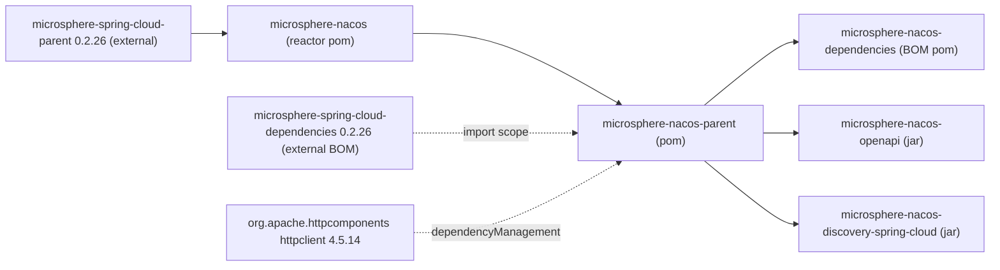

# microsphere-nacos-parent

## 概述

`microsphere-nacos-parent` 是一个**纯 POM 模块** —— `<packaging>pom</packaging>`，没有任何 `src` 目录。它不携带类，
不发布 jar，也不会为应用的运行时 classpath 贡献任何内容。

它的职责在构建期：作为本仓库其他所有模块的共享父 POM，集中两件事 ——

1. 为本项目所依赖的 Apache HttpClient 版本提供一条 `dependencyManagement` 记录；
2. 以 `import` 作用域引入外部的 `microsphere-spring-cloud-dependencies` BOM，Spring Boot / Spring Cloud /
   JDK 编译版本最终都源于此。

在下列情况下你会与本模块交互：

- 你在**构建或扩展本仓库**，需要新模块继承一致的版本（把它作为你的 `<parent>`，而不是重复书写版本字面量）；
- 你希望在自己的多模块构建中复用本项目的依赖版本固定策略，但又不想引入 Nacos BOM；
- 你在排查版本冲突，需要确认到底是哪个 POM 决定了这个数字。

只消费 `microsphere-nacos-openapi` 或
`microsphere-nacos-discovery-spring-cloud` 的应用开发者应改用
[microsphere-nacos-dependencies](microsphere-nacos-dependencies.md)；他们永远不会直接引用本构件。

## Maven 坐标

```xml
<dependency>
    <groupId>io.github.microsphere-projects</groupId>
    <artifactId>microsphere-nacos-parent</artifactId>
    <version>${microsphere-nacos.version}</version>
    <type>pom</type>
</dependency>
```

`${microsphere-nacos.version}` 在这一版本线上为 `0.2.0-SNAPSHOT`。注意：通常你是把它作为**父 POM** 使用，而不是作为
依赖：

```xml
<parent>
    <groupId>io.github.microsphere-projects</groupId>
    <artifactId>microsphere-nacos-parent</artifactId>
    <version>0.2.0-SNAPSHOT</version>
    <relativePath>../microsphere-nacos-parent/pom.xml</relativePath>
</parent>
```

上面的 `<relativePath>` 正是本仓库三个子模块所声明的内容，它让 reactor 构建可以直接从磁盘解析父 POM，而不必经由
仓库。

## 它管理了什么

### 声明的属性

| 属性 | 值 | 作用 |
| --- | --- | --- |
| `httpclient.version` | `4.5.14` | 下方 Apache HttpClient 记录的版本 |
| `microsphere-spring-cloud.version` | `0.2.26` | 下方被 import 的 BOM 版本；POM 中将其归在 `BOM versions` 注释下 |

### dependencyManagement

| Group ID | Artifact ID | 版本 | type / scope |
| --- | --- | --- | --- |
| `org.apache.httpcomponents` | `httpclient` | `${httpclient.version}` → `4.5.14` | — |
| `io.github.microsphere-projects` | `microsphere-spring-cloud-dependencies` | `${microsphere-spring-cloud.version}` → `0.2.26` | `pom` / `import` |

### 父级链

`microsphere-nacos-parent` 自身的父级是
`io.github.microsphere-projects:microsphere-nacos:${revision}`（`<relativePath>../pom.xml</relativePath>`），
而该 reactor 根又继承
`io.github.microsphere-projects:microsphere-spring-cloud-parent:0.2.26`。因此你的构建看到的完整链条是：

```
microsphere-spring-cloud-parent : 0.2.26      (external)
  └── microsphere-nacos                       (reactor root, pom)
        └── microsphere-nacos-parent          (this module, pom)
              ├── microsphere-nacos-dependencies
              ├── microsphere-nacos-openapi
              └── microsphere-nacos-discovery-spring-cloud
```

## 构建期如何使用它

- **版本继承。** 它下面的四个模块都没有为 `httpclient`、`gson`、JUnit 或任何 Spring 构件声明版本字面量。它们省略
  `<version>` 并通过本 POM 继承 —— `httpclient` 来自本 POM 自己的 `dependencyManagement`，其余全部来自被 import 的
  `microsphere-spring-cloud-dependencies` BOM。
- **BOM 组合。** 由于外部 BOM 是在*此处*被 import 的，每个子模块（包括
  `microsphere-nacos-dependencies`）都会在其 effective POM 中看到它。
- **reactor 顺序。** 它在根 `<modules>` 中列在首位，因此 Maven 会先构建它，再构建以它为父的模块。
- **仅有坐标。** 它不声明任何属于自己的构件、插件或构建扩展；其 POM 主体只由 `<parent>`、坐标、
  `<packaging>pom</packaging>`、`<name>`（`Microsphere :: Nacos :: Parent`）、`<description>`、`<properties>` 与
  `<dependencyManagement>` 构成。

## 版本信息

| 项目 | 值 | 来源 |
| --- | --- | --- |
| 模块构件 | `io.github.microsphere-projects:microsphere-nacos-parent` | 模块 `pom.xml` |
| 模块版本 | `${revision}` → `0.2.0-SNAPSHOT` | 根 `pom.xml` 的 `<revision>` 属性 |
| 打包方式 | `pom` | 模块 `pom.xml` |
| 父 POM | `microsphere-nacos` `${revision}`，路径 `../pom.xml` | 模块 `pom.xml` |
| 被管理的 `httpclient` | `4.5.14` | 本 POM 的 `httpclient.version` |
| 被 import 的 BOM | `microsphere-spring-cloud-dependencies:0.2.26` | 本 POM 的 `microsphere-spring-cloud.version` |
| 上游外部父 POM | `microsphere-spring-cloud-parent:0.2.26` | 根 `pom.xml`，位于本模块之外 |

**来源说明。** Spring Boot、Spring Cloud 与编译 JDK 级别均为**继承自外部父 POM/BOM，本仓库中并未声明**。
`microsphere-spring-cloud-parent` 与 `microsphere-spring-cloud-dependencies` 都不在 analysed 快照内，因此除了本 POM 按
编号 import 的那个 `0.2.26` 坐标之外，指南中不为它们给出任何可核实的具体版本。根 POM 确实设置了
`<java.version>17</java.version>`，但消费该属性的编译器插件配置同样位于外部父 POM 中。

## 兼容性

本 POM 固定 `httpclient:4.5.14`，并 import `0.2.26` 的 Microsphere Spring Cloud BOM。
`.github/workflows/maven-build.yml` 中的 CI 矩阵证明该组合在 Java `17`、`21`、`25` 上，配合
`spring-cloud-2022`、`spring-cloud-2023`、`spring-cloud-2024`、`spring-cloud-2025` profile 均可通过；这些 profile
名称背后的 Spring 发布版本由外部 POM 决定，无法从本快照核实。

`org.apache.httpcomponents:httpclient` 是经典的 4.x 坐标，与 HttpClient 5 使用的
`org.apache.httpcomponents.client5` 组不同；Open API 客户端是针对 4.x 的 `CloseableHttpClient` API 编写的。

## 模块依赖关系图



## 相关文档

- [索引](README.md)
- [microsphere-nacos-dependencies](microsphere-nacos-dependencies.md)
- [microsphere-nacos-openapi](microsphere-nacos-openapi.md)
- [microsphere-nacos-discovery-spring-cloud](microsphere-nacos-discovery-spring-cloud.md)
- 开发指南对应文档：[../../../developer-guide/zh/current/microsphere-nacos-parent.md](../../current/microsphere-nacos-parent.md)

## English

[English](../../current/microsphere-nacos-parent.md)
